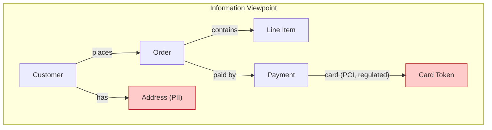

# 🧠 Topic: Information Viewpoint

> [!abstract] Executive Summary (ELI5)
> The Information Viewpoint answers: **what data does the system care about, how is it shaped, and where is it sensitive?** It describes the system's key entities and their relationships — first as a *conceptual* picture anyone can read, then as *logical* structures closer to storage. Crucially, it also flags **sensitive or regulated data** (PII, financial, health), because that data carries obligations that shape the whole architecture.

> [!warning] The #1 confusion — Information Viewpoint is not a database schema
> People equate "information" with "the tables in Postgres." That's the implementation, not the viewpoint. The Information Viewpoint models the **meaningful concepts** (Customer, Order, Payment) and their relationships *before* they become tables, documents, or events. Jumping straight to a physical schema skips the part where you decide what the data *means* — and that's where the costly mistakes hide.

---

## 🎯 The "Why"

- **Problem Solved:** Data is the longest-lived asset in a system — code is rewritten, storage engines swapped, but the *concepts* (what an "Order" means) persist for decades. Modeling them explicitly prevents inconsistent definitions across services, painful migrations, and compliance violations. The Information Viewpoint also surfaces **sensitive/regulated data early**, so security and compliance shape the architecture instead of being bolted on after an audit.
- **Alternatives:** Letting each team/service define its own implicit data model. Result: the same concept means different things in different places ("Order" with vs. without tax), integration becomes a translation nightmare, and nobody knows where PII actually lives.
- **Trade-offs:** A detailed data model takes effort and can become "analysis paralysis." The discipline is to model concepts and relationships at the level the *decisions* require — not to design every column.

## 💡 Mental Model & Analogy

- **Analogy:** The Information Viewpoint is the system's **library catalog system**. A catalog defines the meaningful categories (Fiction, Reference, Rare Books) and their relationships (a book belongs to a category, has authors, has copies) *before* deciding which shelf or building holds them. The catalog is about *meaning*; the shelves are implementation. Sensitive items (rare books) get extra rules — restricted access, logbook — exactly like regulated data.

The red entities carry obligations — they are not just "data," they are *regulated* data, and the architecture must treat them differently.

## 🛠️ Core Principles

1. **Concept before storage.** Model the meaningful concepts (Customer, Order) and their relationships *before* deciding whether they live in SQL tables, JSON documents, or event streams. Meaning is stable; storage is not.
2. **Three levels of data modeling.** Conceptual → Logical → Physical. The Information Viewpoint owns the first two; the physical schema belongs to the deployment/storage world.
3. **Entities are nouns from the domain.** They come from the [[Functional Viewpoint]] (use cases reveal the nouns) and from domain language — this is where DDD's ubiquitous language connects.
4. **Relationships carry semantics.** "Order contains line items" (composition) is a different architectural commitment than "Order references a Customer" (association). Model the relationship type, not just "a line."
5. **Sensitive data is a first-class concern.** PII, PCI, PHI, and regulated data get modeled explicitly because they carry legal/operational obligations (encryption, retention, access control, residency) that propagate into every viewpoint and perspective.

## 🏗️ The Three Levels of Data Modeling

| Level | Question | Audience | Example |
|---|---|---|---|
| **Conceptual** | What concepts exist and how do they relate? | Business, everyone | "Customer places Order; Order contains Line Items" (entities + relationships only, no attributes) |
| **Logical** | What are the attributes, keys, and cardinalities? | Architects, data engineers | "Customer has id, name, email; Order has 1..* Line Items" |
| **Physical** | How is it stored concretely? | DBAs, devs | "`customers` table, `orders` table, FK `orders.customer_id`" |

> The Information Viewpoint stops at **Logical**. Physical modeling is an implementation/storage concern — doing it in this viewpoint couples your data meaning to a specific database technology, which is exactly what the viewpoint exists to prevent.

### Conceptual Data Model (course focus)
*Entities + relationships, no attributes. The picture everyone can validate.*
- Entities: the key nouns — Customer, Order, Product, Payment, Shipment.
- Relationships: how entities connect — "places," "contains," "paid by," "ships via."
- Cardinality: one-to-many, many-to-many — sketched lightly, not enforced.
- Purpose: align business and engineering on *what the data means*.

### Logical Structures
*Entities with attributes, keys, and cardinalities — storage-agnostic.*
- Attributes: the fields each entity holds (Customer.email, Order.total).
- Identifiers: primary keys, natural vs. surrogate.
- Cardinality and optionality: "an Order has exactly one Payment," "a Customer has 0..* Addresses."
- Normalization level: how much redundancy you tolerate (a logical, not physical, choice).

### Key Entities — how to find them
*Not all nouns are entities. The key ones are those the system must track and that appear across use cases.*
- Start from [[Functional Viewpoint]] use cases: the nouns that recur ("Customer places Order, Order contains Items") are your candidate entities.
- Cross-check: an entity that appears in only one use case may be an attribute of another entity, not a thing of its own.
- DDD lens: entities have identity (two Customers with the same name are still different); value objects (Address) do not.

## 🔐 Sensitive & Regulated Data (course emphasis)

This is where the Information Viewpoint stops being "just diagrams" and starts shaping the architecture.

| Category | Examples | Typical obligations |
|---|---|---|
| **PII** (personally identifiable) | Name, email, SSN, IP address | Encryption, access logging, minimization, subject-access requests (GDPR) |
| **PCI** (payment card) | PAN, card data | PCI-DSS: tokenization, strict scope, network segmentation |
| **PHI** (health) | Diagnoses, medical records | HIPAA: encryption at rest/in transit, audit, business-associate agreements |
| **Credentials / secrets** | Passwords, API keys, tokens | Hashing, vault storage, rotation, never log |
| **Regulated / jurisdictional** | Data of EU residents, health, finance | Data residency, cross-border transfer rules, retention limits |

> Why model this *here*, in the Information Viewpoint? Because once you know "the `Customer` entity contains PII," that single fact propagates outward: the [[Perspective]] for Security applies to it, the Deployment viewpoint must place it in the right jurisdiction, and retention policies attach to it. Sensitive data is not a footnote — it is an architectural driver that starts at the data model.

### Practical technique: annotate the conceptual model
Mark sensitive entities/attributes directly on the conceptual diagram. A common convention: red for regulated, amber for confidential, green for unrestricted. This makes the obligation *visible* at a glance instead of buried in a compliance doc.

## ↔️ How the Information Viewpoint Connects

| Connects to | How |
|---|---|
| [[Functional Viewpoint]] | Use cases reveal the nouns → key entities. The Information Viewpoint is fed by Functional. |
| [[Context Viewpoint]] | Entities map to the actors/external systems on the context diagram (Customer is an actor; Payment Provider holds Payment data). |
| [[Key Elements of Architecture View]] | Entities often become components; data relationships become connectors (shared data is the highest-coupling connector — see that note's pitfall). |
| [[Perspective]] | Security, Privacy, and Compliance perspectives are applied *to* this viewpoint — sensitive data is where they bite hardest. |
| DDD (ubiquitous language) | Entity names should match the domain language exactly; a mismatch signals a modeling error. |

## ⚠️ Pitfalls & Anti-patterns

- **Jumping to the physical schema:** designing `customers` and `orders` tables before agreeing what "Customer" and "Order" mean. Couples meaning to storage and makes change expensive.
- **Conceptual = nobody's job:** skipping the conceptual model because "it's obvious." It never is — two teams always have different definitions of the same noun until forced to align.
- **Ignoring sensitive data at modeling time:** treating PII/PCI as "just another attribute." By the time compliance finds it, the architecture is built around the wrong assumptions.
- **Over-modeling:** every attribute and cardinality at conceptual level. Conceptual is for meaning; push detail to logical.
- **Modeling data without use cases:** inventing entities nobody asked for. Every key entity should trace to a [[Functional Viewpoint]] use case.
- **Confusing entity with value object:** modeling "Address" as an entity with identity when it's really a value object (two identical addresses are the same). This affects how data is stored and compared.
- **Treating the Information Viewpoint as a one-time artifact:** data meanings drift as the business evolves. Revisit when domain language changes.

## 🔗 Deep Connections

- **Parent Topic:** [[Viewpoint]] (the Information Viewpoint is one of the standard R&W viewpoints — see the table there), [[System Modeling]]
- **Feeds from:** [[Functional Viewpoint]] (use cases reveal entities)
- **Related Concepts:** [[Context Viewpoint]] (actors ↔ entities), [[Key Elements of Architecture View]] (entities ↔ components, shared data as a connector), [[System]] (its "Structure" property is partly described here), [[Communicating the Model]] (the conceptual model is a communication artifact for business + engineering)
- **Contrast / applied-to:** [[Perspective]] (Security, Privacy, Compliance perspectives apply to this viewpoint — sensitive data is where they bite)
- **Prerequisites:** [[Viewpoint]], [[System]], [[Model]].

## ❓ Active Recall Questions

> [!faq]- What are the three levels of data modeling, and which does the Information Viewpoint own?
> **Conceptual** (entities + relationships, no attributes), **Logical** (attributes, keys, cardinalities, storage-agnostic), **Physical** (concrete schema — tables, columns, FKs). The Information Viewpoint owns **Conceptual and Logical**; Physical is an implementation/storage concern that belongs elsewhere.

> [!faq]- Why is it a mistake to jump straight to a physical database schema?
> The physical schema couples *what the data means* (Customer, Order) to *how it is stored* (a Postgres table). Meaning is stable for decades; storage technology changes. Modeling concepts first lets meaning survive storage changes and prevents the same concept meaning different things in different services.

> [!faq]- Why must sensitive/regulated data be modeled explicitly in the Information Viewpoint?
> Because PII/PCI/PHI carry legal obligations (encryption, residency, retention, access control) that propagate into every other viewpoint and perspective. If sensitive data is just "another attribute," the architecture gets built around wrong assumptions and compliance finds out too late. Annotating it on the conceptual model makes the obligation visible early.

> [!faq]- How does the Information Viewpoint relate to the Functional Viewpoint?
> The Functional Viewpoint feeds it: use cases reveal the recurring nouns ("Customer places Order, Order contains Items") that become key entities. Every key entity should trace back to a use case — an entity with no use case is likely an attribute of another entity or dead weight.

> [!faq]- What's the difference between an entity and a value object, and why does it matter for data modeling?
> An **entity** has identity (two Customers with the same name are still different people); a **value object** does not (two identical Addresses are the same). This affects how data is stored, compared, and duplicated — modeling an Address as an entity forces identity tracking it doesn't need.

> [!faq]- Where does the Information Viewpoint stop, architecturally?
> At the **Logical** level. The Physical schema (specific DBMS, table layout, indexing) is a deployment/storage concern, not part of this viewpoint. Mixing them couples data meaning to a technology choice that may change.

---

## 📝 Related Notes

- [[Viewpoint]]
- [[Functional Viewpoint]]
- [[Context Viewpoint]]
- [[Key Elements of Architecture View]]
- [[System]]
- [[Communicating the Model]]
