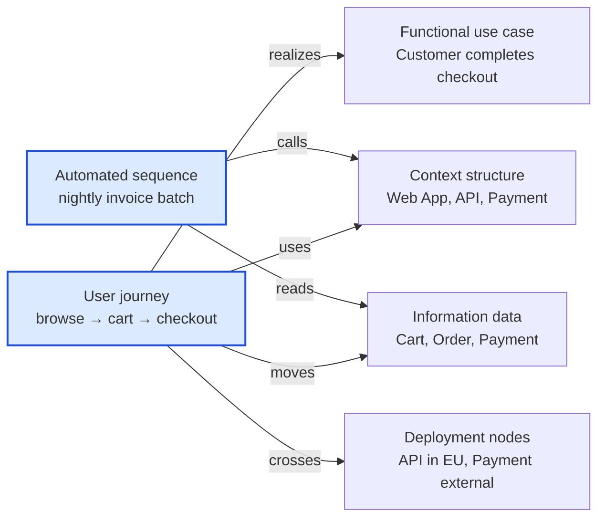

# 🧠 Topic: Operational Viewpoint

> [!abstract] Executive Summary (ELI5)
> The Operational Viewpoint is the **integrator**. It connects the dots between the other viewpoints: it takes the *use cases* from Functional, the *structure* from Context, and the *data* from Information — and shows how they **actually play out as living journeys** through the system. Think user journeys ("a customer goes from browse → cart → checkout → confirmation") and automated sequences ("every night, pending orders are batched and invoiced"). Where other viewpoints are *static maps*, the Operational Viewpoint is the *movie*.

> [!warning] The #1 confusion — Operational Viewpoint ≠ "operations/DevOps"
> The name misleads. This is **not** the "how the system is operated by SREs" view (monitoring, release, recovery — that lives in the Deployment Viewpoint's operational concerns and in the Reliability perspective). The Operational Viewpoint in the course's sense is **runtime behavior**: how the system *operates* — how its pieces cooperate over time to fulfill user journeys and automated workflows. It is the behavioral glue between the structural viewpoints.

---

## 🎯 The "Why"

- **Problem Solved:** Each viewpoint answers one question well but is silent on *how they combine in motion*. A Context diagram shows the boundary; Functional lists use cases; Information models entities — but none of them show "when a customer checks out, these components, this data, and this external API cooperate *in this order*." The Operational Viewpoint closes that gap by tracing journeys and sequences end-to-end.
- **Alternatives:** Hoping that "if each view is right, the behavior will work out." It doesn't — integration and ordering bugs (a step that reads data before it's written, an external call in the wrong position) only appear when you trace the flow. Static views hide them by design.
- **Trade-offs:** Tracing every journey is expensive. The discipline is to model the *important* journeys — the ones that carry the most business value or the most risk — not every path.

## 💡 Mental Model & Analogy

- **Analogy:** If the other viewpoints are the **map of a subway network** (lines, stations, transfers), the Operational Viewpoint is the **animated route of one passenger** traveling from A to Z: which line they take, where they transfer, how long each leg takes, and what happens if a line is down. The map shows what's possible; the route shows what actually happens. User journeys are passenger routes; automated sequences are the driverless trains running on schedule.



A journey (blue) threads through *all* the other viewpoints — it uses the structure, realizes a use case, moves data, and crosses deployment boundaries. That threading is exactly what no single viewpoint can show.

## 🛠️ Core Principles

1. **It is the integration viewpoint.** Its job is to connect the other views by showing them in motion. A journey references structure (Context/Container), function (use cases), data (Information), and nodes (Deployment) simultaneously.
2. **Behavior over time is the subject.** Static views show "what exists." The Operational Viewpoint shows "what happens, in what order, with what timing." Ordering and causality are first-class.
3. **Two kinds of sequences.** **User journeys** are driven by an actor; **automated sequences** are triggered by time or events with no human in the loop. Both must be modeled — automation is where the silent failures live.
4. **External interactions are part of the flow.** A journey that calls a payment provider or sends an email crosses the system boundary. The Operational Viewpoint traces those crossings because they add latency, failure modes, and partial-failure risk.
5. **It validates the other views.** If a journey can't be traced cleanly through the structure and data, one of the other views is wrong. The Operational Viewpoint is the quickest way to find integration mistakes.

## 🏗️ What the Operational Viewpoint Contains

### User Journeys
*An end-to-end path an actor takes through the system to achieve a goal.*

A journey weaves together:
- **Steps** — ordered activities (browse, add to cart, checkout, pay, confirm).
- **Structure touched** — which containers/components participate at each step.
- **Data moved** — which entities from the Information Viewpoint are created, read, or updated.
- **External crossings** — when the journey leaves the system boundary (calls the payment provider, sends email).
- **Timing / ordering** — what must happen before what; where parallelism is possible.

```text
Journey: Customer completes checkout
  1. Browse catalog          [Web App]           reads Product
  2. Add to cart             [Web App → API]     updates Cart
  3. Checkout                [API]               reads Cart, creates Order
  4. Pay                     [API → Payment*]    creates Payment    (* external crossing)
  5. Confirm                 [API → Email*]      Order → CONFIRMED (* external crossing)
```

This single trace ties Functional (use case), Information (Cart/Order/Payment), Context (Payment/Email external), and Deployment (where API runs) together — that is the integrator role.

### Automated Sequences
*Flows that run without a human actor — triggered by time or events.*

- **Scheduled/batch** — nightly invoice generation, daily report, periodic sync.
- **Event-triggered** — "when Payment succeeds, emit OrderConfirmed; when that's received, trigger Shipment."
- **Background workers** — queue consumers, retries, dead-letter handling.
- Why they matter: they have no user watching them, so failures are *silent*. Modeling them makes the triggers, dependencies, and failure paths visible — see pitfall below.

### Failure and alternate paths
*What the journey does when things go wrong.*

- A payment declines mid-journey → is the order left in a half-paid state?
- An external email service is down → is the confirmation retried or lost?
- The Operational Viewpoint must trace the *unhappy* paths, because that's where integration and data-consistency bugs hide.

## ↔️ How the Operational Viewpoint Connects (the integrator role)

| Connects to | How the Operational Viewpoint ties it in |
|---|---|
| [[Functional Viewpoint]] | A user journey *realizes* a use case. Operational is the runtime trace of Functional. |
| [[Context Viewpoint]] | A journey crosses the context boundary when it calls external systems. |
| [[Information Viewpoint]] | Each step moves data — creates/reads/updates the entities from the Information View. |
| [[Deployment Viewpoint]] | A journey's steps execute on specific nodes; external calls cross network boundaries with latency. |
| [[Concurrency Viewpoint]] | Some journeys have parallel steps; automated sequences often involve concurrent consumers. |

> The Operational Viewpoint is where you discover whether the other views *compose*. If a journey can't be traced cleanly, one of the static views has a gap — usually a missing entity, a missing external dependency, or an impossible ordering.

## ⚠️ Pitfalls & Anti-patterns

- **Confusing "operational" with "operations/SRE":** this is runtime behavior (journeys, sequences), not the monitoring/release/recovery concerns of SRE. Those live in Deployment + Reliability perspective.
- **Only modeling the happy path:** every journey has failure and alternate paths, and that's where the real integration bugs live. Trace the unhappy paths too.
- **Ignoring automated sequences:** because they run unattended, their failures are silent until someone notices. Model batch jobs, event handlers, and retries explicitly.
- **Modeling every possible journey:** infeasible and noisy. Prioritize journeys that carry the most business value, the most risk, or cross the most boundaries.
- **Forgetting external crossings:** a journey that calls a payment provider or email service introduces latency, partial failure, and retry semantics. Tracing the boundary crossing makes these visible.
- **Disconnecting the journey from the other views:** drawing a flowchart that names generic steps without tying them to real containers, entities, and external systems. The value is in the integration — if it doesn't reference the other views, it's just a process diagram.

## 🔗 Deep Connections

- **Parent Topic:** [[Viewpoint]] (the Operational Viewpoint is the behavioral integrator among the standard viewpoints), [[System Modeling]]
- **Integrates:** [[Functional Viewpoint]] (use cases), [[Context Viewpoint]] (boundary crossings), [[Information Viewpoint]] (data moved), [[Deployment Viewpoint]] (nodes), [[Concurrency Viewpoint]] (parallel steps)
- **Related Concepts:** [[System]] (its "Behaviour" property is exactly what this viewpoint elaborates), [[Key Elements of Architecture View]] (journeys show connectors in action over time), [[Communicating the Model]] (journeys are the storytelling/scenario technique listed there)
- **Applied-to:** [[Perspective]] (Reliability, Performance perspectives are evaluated against these flows — what happens under failure or load?)
- **Prerequisites:** [[Viewpoint]], [[System]], and at least a passing familiarity with the other viewpoints it integrates.

## ❓ Active Recall Questions

> [!faq]- What does the Operational Viewpoint model, and why is it called "the integrator"?
> It models **runtime behavior**: user journeys and automated sequences — how the system operates end-to-end over time. It's "the integrator" because a journey threads through *all* the other viewpoints simultaneously (it realizes a Functional use case, crosses the Context boundary, moves Information data, runs on Deployment nodes). No single static view shows that composition.

> [!faq]- Why is "operational" a misleading name here, and what is the Operational Viewpoint actually about?
> It sounds like "operations/SRE" (monitoring, release, recovery), but those concerns live in the Deployment Viewpoint and the Reliability perspective. The Operational Viewpoint is actually about **runtime behavior** — user journeys and automated sequences, i.e., how the system *operates* in motion, not how SREs operate it.

> [!faq]- What are the two kinds of sequences this viewpoint models, and why do automated ones need special attention?
> **User journeys** (driven by an actor) and **automated sequences** (triggered by time or events, no human in the loop — batch jobs, event handlers, retries). Automated ones need special attention because they run unattended, so their failures are **silent** until someone notices. Modeling them makes triggers, dependencies, and failure paths visible.

> [!faq]- Why must the Operational Viewpoint trace failure and alternate paths, not just the happy path?
> Because integration and data-consistency bugs hide in the unhappy paths — a payment declining mid-journey can leave an order half-paid; an external service down can lose a confirmation. Static views can't reveal these; only tracing the alternate flows exposes the ordering and partial-failure risks.

> [!faq]- How does tracing a journey validate the other viewpoints?
> If a journey can't be traced cleanly through the structure and data, one of the static views has a gap — a missing entity, a missing external dependency, or an impossible ordering. The Operational Viewpoint is the fastest way to find integration mistakes because it forces the other views to compose.

---

## 📝 Related Notes

- [[Viewpoint]]
- [[Functional Viewpoint]]
- [[Context Viewpoint]]
- [[Information Viewpoint]]
- [[Deployment Viewpoint]]
- [[Concurrency Viewpoint]]
- [[System]]
- [[Communicating the Model]]
