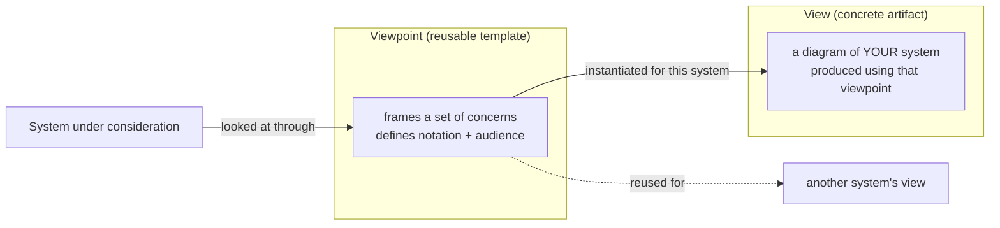

# 🧠 Topic: Architecture Viewpoint

> [!abstract] Executive Summary (ELI5)
> A **viewpoint** is a lens or template that tells you *how to look* at a system to answer a specific concern. A **view** is what you actually produce when you look through that lens. Think of a viewpoint as a camera setting (macro, wide-angle, infrared) and the view as the photo you take with it. Different stakeholders need different lenses, so a good architecture has several viewpoints — never just one.

> [!warning] The #1 confusion — View vs. Viewpoint
> People use the words interchangeably, but they are different things. The **viewpoint** is the reusable pattern (what concerns it addresses, what notation it uses, who the audience is). The **view** is the concrete artifact you draw for *your* system using that pattern. The viewpoint is the recipe; the view is the cake.

---

## 🎯 The "Why"

- **Problem Solved:** No single picture can answer every question about a system. A security engineer, a DBA, and a product owner each care about different things and need different diagrams. A **viewpoint** frames one concern and one audience, so each view stays focused and readable instead of becoming a wall of boxes.
- **Alternatives:** The "one diagram to rule them all" — a single overloaded picture that tries to show structure, data flow, deployment, and security at once. It satisfies nobody and becomes unmaintainable.
- **Trade-offs:** Multiple viewpoints mean more artifacts to keep consistent. The payoff is that each stakeholder gets a picture tuned to their concern, and the architecture can be reasoned about from several angles.

## 💡 Mental Model & Analogy

- **Analogy:** A viewpoint is a camera lens. A **wide-angle** lens captures the whole landscape (the context). A **macro** lens shows one detail up close (a component). An **infrared** lens reveals things the eye cannot see (security, data flow). You pick the lens for what you are trying to photograph. The lens is the viewpoint; the photo is the view.

The viewpoint is general and reusable across systems; the view is specific to one system at one moment.

## 🛠️ Core Principles

1. **A viewpoint frames concerns.** It declares: *what* questions this view will answer and *whose* concerns it addresses. Everything outside that frame is intentionally excluded.
2. **A viewpoint defines the language.** It specifies the notation, element types, and relationships used in any view built from it (e.g., "this viewpoint shows services and synchronous calls only").
3. **A viewpoint targets an audience.** Each one is written for a stakeholder role — developer, operator, security engineer, business sponsor.
4. **A viewpoint is reusable; a view is not.** The *Deployment viewpoint* is a general idea you apply to many systems. The *deployment view of the checkout system* is specific to that system.
5. **Several viewpoints compose into a complete picture.** No single viewpoint is "the architecture." The architecture is the union of its views.

## 🏗️ Common Architecture Viewpoints

These come from established practice (notably Rozanski & Woods, *Software Systems Architecture*, which the C4 course draws on):

| Viewpoint | Question it answers | Primary audience |
|---|---|---|
| **Context** | What is the system, who uses it, what does it interact with? | Everyone (entry point) — see [[Context Viewpoint]] |
| **Functional** | What does the system do? What are its capabilities? | Product, business — see [[Functional Viewpoint]] |
| **Information / Data** | How is data structured, stored, and moved? | Data engineers, DBAs — see [[Information Viewpoint]] |
| **Concurrency / Runtime** | What runs concurrently? Threads, processes, runtime instances? | Developers, performance — see [[Concurrency Viewpoint]] |
| **Development** | How is the code organized? Modules, packages, layers? | Developers — see [[Development Viewpoint]] |
| **Deployment** | Where do things run? Servers, networks, environments? | Operations, DevOps — see [[Deployment Viewpoint]] |
| **Operational** | How is it operated? Monitoring, release, recovery? | SRE, operations — see [[Operational Viewpoint]] (note: in the course's sense, this is runtime behavior — user journeys & automated sequences — not SRE operations) |

#### The C4 zoom levels (structural viewpoints inside one system)

The C4 model provides four zoom levels, each a structural viewpoint. These complement the R&W viewpoints above.

| C4 Level | Viewpoint | Zoom |
|---|---|---|
| L1 | [[Context Viewpoint]] | The system as one box + external actors |
| L2 | [[Container Viewpoint]] | Major deployable/runnable units inside the system |
| L3 | [[Component Viewpoint]] | Building blocks inside one container |
| L4 | Code (rarely drawn) | Classes/packages inside one component |

You rarely use all of them. Pick the viewpoints that match the concerns your stakeholders actually raised — see [[System Modeling]] → "Selecting a Viewpoint."

## 🔼 Viewpoint vs. View — the distinction that matters

| | **Viewpoint** | **View** |
|---|---|---|
| What it is | A pattern / template / lens | A concrete artifact |
| Scope | General, reusable | Specific to one system |
| Answers | "How should we look?" | "What does *this* system look like through that lens?" |
| Example | "The Deployment viewpoint" | "The deployment view of the payments system" |

> If a teammate asks "show me the security view," they are conflating the two. The right response is: "Security is a **perspective**, not a viewpoint — let's agree which viewpoint (deployment? context?) we apply it to." More on this below.

## ↔️ Viewpoint vs. Perspective — the sibling distinction

This pair is in the course title ("C4 viewpoints and perspectives"), so getting it straight matters:

- **Viewpoint** = a *structural* lens. It says **what kind of structure to show** (context, functional, deployment). It produces a view.
- **Perspective** = a *cross-cutting quality concern*. It says **how well** the architecture must behave (security, performance, scalability, availability). It does not produce its own view — it is *applied to* a viewpoint to evaluate/refine the resulting view.

They **combine**: you take the *Security perspective* and apply it to the *Deployment viewpoint* to ask "is this deployment secure?" A perspective without a viewpoint has no structure to evaluate; a viewpoint without perspectives ignores quality.

> See [[Perspective]] for the deep dive on cross-cutting quality concerns.

## 🔗 Relationship to the C4 Model

The C4 levels — **Context, Container, Component, Code** — are viewpoints in the structural sense: each is a lens that shows the same system at a different zoom, addressing a different concern and audience.

| C4 level | As a viewpoint, it frames… |
|---|---|
| **System Context** | The system and its actors/external systems (boundary) |
| **Container** | The major deployable/runnable units and their interactions |
| **Component** | The internal building blocks of one container |
| **Code** | (Rarely drawn) the classes/packages inside one component |

So C4 gives you a *family* of structural viewpoints with a consistent notation. Other frameworks (UML, ArchiMate, Rozanski & Woods) offer additional viewpoints for concerns C4 does not cover (e.g., the Information/Data or Operational viewpoint).

> [!tip] Implementation Note
> When someone asks for a diagram, first ask: *"Which viewpoint? Which concern and audience are we serving?"* That single question prevents the "draw me everything" trap and keeps each view focused. Then, separately, ask which *perspectives* (security, performance) must be checked against that view.

## ⚠️ Pitfalls & Anti-patterns

- **Conflating view and viewpoint:** "The view" and "the viewpoint" are not synonyms. The viewpoint is the template; the view is the artifact. Mixing them muddies conversations about reuse.
- **One view to rule them all:** Trying to make a single diagram serve every concern. It ends up serving none — see [[Model]] pitfalls.
- **Confusing viewpoint with perspective:** A viewpoint produces structure; a perspective evaluates quality. Asking for "the security view" is a category error — security is a perspective applied to a viewpoint.
- **Choosing viewpoints by habit, not by concern:** Drawing a deployment diagram because "we always draw one," even when nobody asked a deployment question. Pick viewpoints from stakeholder concerns — see [[System Modeling]].
- **Inconsistent viewpoints across systems:** If every team invents its own "functional viewpoint," views are not comparable. Agree on a shared set (C4 + a few Rozanski & Woods viewpoints) across the org.
- **Forgetting the audience:** A viewpoint written for developers but shown to executives will overwhelm them — and vice versa. See [[Communicating the Model]].

## 🔗 Deep Connections

- **Parent Topic:** [[System Modeling]] (selecting a viewpoint is a core modeling activity), [[Modeling Software Architecture]]
- **Sibling Concept:** [[Perspective]] (cross-cutting quality concern applied *to* a viewpoint — security, performance, availability)
- **Related Concepts:** [[Model]] (a view is a purposeful model), [[System]] (each viewpoint reveals one facet — structure/function/behaviour), [[System Architecture]], [[Communicating the Model]] (a view is a communication artifact tailored to an audience), [[Levels of Abstraction]] (viewpoints and zoom levels are orthogonal — you can draw any viewpoint at any level)
- **Prerequisites:** [[Model]], [[System]].

## ❓ Active Recall Questions

> [!faq]- What is the difference between a view and a viewpoint?
> A **viewpoint** is the reusable template/lens — it defines which concerns, notation, and audience a view will have. A **view** is the concrete artifact you produce for a specific system by looking through that viewpoint. Viewpoint = recipe; view = cake.

> [!faq]- Why can't one diagram serve as "the architecture"?
> Different stakeholders care about different concerns (structure, data, deployment, security). No single picture can address them all without becoming overloaded and unreadable. Viewpoints let each concern get its own focused view — the architecture is the union of its views.

> [!faq]- How does a viewpoint differ from a perspective?
> A **viewpoint** is a structural lens that produces a view (context, functional, deployment). A **perspective** is a cross-cutting quality concern (security, performance, availability) that does *not* produce its own view — it is applied *to* a viewpoint to evaluate and refine it. "Show me the security view" is a category error; security is a perspective.

> [!faq]- How do the C4 levels relate to viewpoints?
> The C4 levels (Context, Container, Component, Code) are a family of structural viewpoints: each shows the same system at a different zoom, addressing a different concern and audience, with a consistent notation. Other frameworks offer additional viewpoints C4 does not cover (e.g., Information/Data, Operational).

> [!faq]- What question should you ask before drawing an architecture view?
> *"Which viewpoint — which concern and which audience are we serving?"* That prevents the "draw me everything" trap and keeps each view focused. Then separately consider which perspectives must be checked against that view.

---

## 📝 Related Notes

- [[System Modeling]]
- [[Model]]
- [[System]]
- [[System Architecture]]
- [[Communicating the Model]]
- [[Levels of Abstraction]]
- [[Perspective]]
