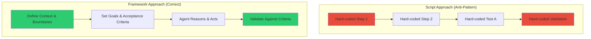

# 🧠 Topic: Skill-as-Framework-Not-Script

> [!abstract] Executive Summary (ELI5)
> A skill is not a script you run. A skill is a sandbox you play in. You define the walls, the rules, and the goal — but you don't choreograph every step. If you turn a skill into a script, it becomes rigid, breaks when context changes, and can never be reused.

---

## 🎯 The "Why"
- **Problem Solved:** "Scriptification of skills" — when developing a skill (especially for AI agents or harnesses), there is a natural temptation to hard-code steps, tests, and scenarios. This makes the skill brittle, context-dependent, and non-reusable across different projects or environments.
- **Alternatives:**
  - *Pure scripting / automation* — write a bash/python script. Fast, but zero flexibility. Works for one repo, breaks on another.
  - *Traditional "skill" as step-by-step guide* — e.g., "Step 1: run this command, Step 2: check this file." Better, but still rigid if the project structure differs.
  - *Framework / Constraint-based skill* — define boundaries, goals, and acceptance criteria. Let the agent figure out the path. This is the approach advocated here.
- **Trade-offs:**
  - Framework approach requires more upfront design thinking.
  - It demands trust in the agent's reasoning capability.
  - But it pays off massively in reusability, maintainability, and robustness.

## 💡 Mental Model & Analogy
- **Analogy:** "This is like the rules of chess versus a chess transcript." A transcript (script) tells you exactly which moves were made in one specific game. The rules (framework) let you play any game. A skill should be the rules, not the transcript.
- **Visual/Diagram:**


## 🛠️ Core Principles

### The Framework Mindset

| Aspect | Script Mindset (Wrong) | Framework Mindset (Right) |
|--------|------------------------|---------------------------|
| **Steps** | "Run `npm test` then check `coverage/lcov.info`" | "Ensure test suite passes and coverage meets threshold" |
| **Tests** | Hard-coded test cases for specific repo | Define what 'correct behavior' means; let agent discover how to verify |
| **Context** | Assumes specific file structure | Adapts to any structure within defined boundaries |
| **Reusability** | Works for one project only | Works across any project matching the context criteria |
| **Maintenance** | Breaks when repo changes | Survives refactoring as long as acceptance criteria hold |

### The Spectrum: Script → Guide → Framework

```
RIGID                                          FLEXIBLE
  |                                               |
  v                                               v
[Script] ---> [Checklist] ---> [Guideline] ---> [Framework]
  |              |                  |                |
  |              |                  |                |
Hard-coded    Step-by-step       Principles       Constraints +
commands      instructions       & heuristics     goals + AC
                                                   |
                                              Agent decides path
```

### Application to Harness Skill

**What went wrong (Script approach):**
```markdown
❌ "Run harness test against project X"
❌ "Check that file Y contains Z"
❌ "If coverage < 80%, fail"
```

**What it should be (Framework approach):**
```markdown
✅ "Given a codebase with a harness skill installed"
✅ "The skill should guide the agent to validate the project's health"
✅ "Acceptance Criteria:
   - Agent can identify the project's test framework
   - Agent can run tests appropriate to the project
   - Agent can report pass/fail against project-specific thresholds"
```

> [!tip] Implementation Note
> When writing a skill, ask: "Could this skill work on a repo I've never seen?" If the answer is no, you're writing a script, not a skill.

## ⚠️ Pitfalls & Anti-Patterns
- **The Scriptification Trap:** "I'll just add one hard-coded check for this specific project..." — the beginning of the end. Each hard-coded piece is technical debt that kills reusability.
- **Over-specification:** Writing too many steps in the skill file. Steps should be high-level goals, not terminal commands.
- **Under-constraint:** Swinging too far the other way — giving the agent no boundaries leads to hallucination and scope creep. The framework must have walls.
- **Context Assumptions:** Implicit assumptions about directory structure, build tools, or conventions. Every assumption must be explicitly stated or discovered by the agent.
- **When NOT to use:**
  - One-off tasks that will never repeat.
  - Highly regulated environments where every command must be auditable and identical.
  - When the agent's reasoning capability is insufficient for the domain (then use a checklist instead).

## 🔗 Deep Connections
- **Parent Topic:** [[Harness-Engineering-Overview]], [[harness_engineering]]
- **Related Concepts:**
  - [[US-AC-Test-Anti-Drown-Workflow]] — the five-step chain reinforces framework thinking (US and AC define the box; the agent fills it in).
  - [[The-Ralph-Loop]] — feedback cycles help discover if your skill is too rigid.
  - [[OpenDev-Harness-Flashcards]] — harness engineering fundamentals.
- **Applied In:**
  - [[2026-06-07 — Daily Plan|Daily Retro 2026-06-07]] — where this insight was born.
  - Harness skill redesign (pending).
  - Future skill development (Teacher, User Stories Creator).

## ❓ Active Recall Questions
> [!faq]- What is the core difference between a skill and a script?
> A script prescribes exact steps for a specific context. A skill defines boundaries and goals, letting the agent determine the path. A script is a transcript; a skill is the rules of the game.

> [!faq]- How do you know if your skill has become a script?
> Ask: "Can this skill work on a project I've never seen?" If it contains hard-coded file paths, specific commands, or project-assumptions, it's a script.

> [!faq]- What is the right level of abstraction for a skill?
> High enough to be reusable across contexts, but constrained enough to prevent agent hallucination. Think "chess rules" not "chess game transcript."

> [!faq]- Why did the Harness skill fail when treated as a script?
> Because hard-coded tests assumed specific repo structures and behaviors. When the context changed, the skill broke. A framework approach would have let the agent discover and adapt.

---
## 📝 How to use this template effectively
1. **Never Copy-Paste:** If you find yourself copying documentation, stop. Read, close the tab, and write it from memory.
2. **Iterate:** Fill the 'ELI5' and 'Analogy' first. If you can't explain it simply, you don't understand it yet.
3. **The "Why" is King:** Seniority is defined by knowing *when* and *why* to use a tool, not just *how*.
4. **Update the Status:** Move from `new` -> `growing` -> `mastered` as you apply this in real projects.
