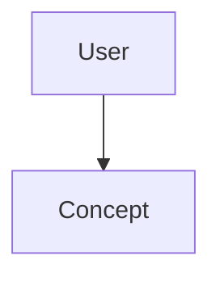

# 🧠 Topic: Структура description в скиллах: категория, триггеры, negative constraints

> [!abstract] Executive Summary (ELI5)
> *Explain this topic in 2-3 sentences as if you were explaining it to a 5-year-old. Focus on the core essence.*

---

## 🎯 The "Why"
- **Problem Solved:** What specific pain point does this technology or pattern address?
- **Alternatives:** What else could we use? (e.g., if this is [[Zustand]], mention [[Redux]] or [[React Context]]).
- **Trade-offs:** Why choose this over the alternatives?

## 💡 Mental Model & Analogy
*Connect this technical concept to a real-world object or process.*
- **Analogy:** "This is like a..."
- **Visual/Diagram:** 

## 🛠️ Core Principles & Code Snippets
*Focus on "The Right Way" (Best Practices).*

## ⚠️ Pitfalls & Anti-patterns
- **Common Mistakes:** What do beginners usually get wrong?
- **When NOT to use:** Situations where this technology is overkill or a poor fit.

## 🔗 Deep Connections
- **Parent Topic:** [[Software Architecture]]
- **Related Concepts:** [[Design Patterns]], [[Clean Code]]

## ❓ Active Recall Questions
> [!faq]- What is the primary constraint of this pattern?
> Your answer here.

---
## 📝 How to use this template effectively
1. **Never Copy-Paste:** If you find yourself copying documentation, stop. Read, close the tab, and write it from memory.
2. **Iterate:** Fill the 'ELI5' and 'Analogy' first. If you can't explain it simply, you don't understand it yet.
3. **The "Why" is King:** Seniority is defined by knowing *when* and *why* to use a tool, not just *how*.
