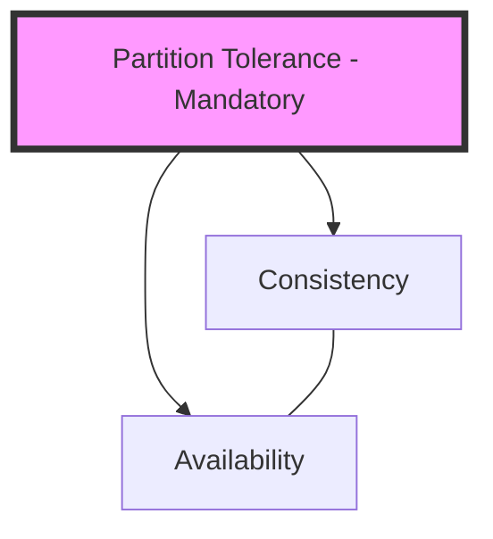

# 🧠 Topic: CAP Theorem

> [!abstract] Executive Summary (ELI5)
> Imagine a group of friends sharing a notebook. CAP says they can only have two out of three things: everyone always sees the same notes (Consistency), everyone can always add notes even if some friends are missing (Availability), and the group still works even if the mailman loses some of their letters to each other (Partition Tolerance). In reality, the mailman *will* lose letters, so you have to pick between everyone seeing the same thing or everyone being able to write.

---

## 🎯 The "Why"
- **Problem Solved:** Provides a framework for understanding the fundamental trade-offs in distributed data stores when network failures occur.
- **Alternatives:** [[PACELC Theorem]] (an extension that covers normal operation), [[BASE Model]] (Basically Available, Soft state, Eventual consistency).
- **Trade-offs:** 
    - **CP (Consistency + Partition Tolerance):** Choosing to stay consistent but becoming unavailable if a network split happens (e.g., MongoDB in some configs, HBase).
    - **AP (Availability + Partition Tolerance):** Choosing to stay available but allowing inconsistent data during a split (e.g., Cassandra, DynamoDB).
    - *Note:* "CA" doesn't really exist in distributed systems because network partitions are inevitable.

## 💡 Mental Model & Analogy
*Connect this technical concept to a real-world object or process.*
- **Analogy:** The "ATM vs. Bank Teller" analogy. If the ATM loses its connection to the bank's central server (a Partition), the bank has a choice:
    - **AP:** Let you withdraw money based on the last known balance (Available, but potentially inconsistent if you spent money elsewhere).
    - **CP:** Refuse the transaction until the connection is restored (Consistent, but you can't get your cash).
- **Visual/Diagram:** 


## 🛠️ Core Principles & Code Snippets
*Focus on "The Right Way" (Best Practices).*

```typescript
// Pseudo-code for a CP system (Consensus-based)
async function writeData(key, value) {
  // Why this way: Ensures a majority (Quorum) agrees before confirming success.
  // If a partition splits the cluster and we can't reach a majority, 
  // we fail the write to preserve Consistency.
  const quorum = Math.floor(nodes.length / 2) + 1;
  const acks = await broadcastToNodes(key, value);
  
  if (acks < quorum) {
    throw new Error("Partition detected: Cannot guarantee consistency. Failing write.");
  }
  return "Success";
}
```

> [!tip] Implementation Note
> Most "CP" systems actually prioritize "Correctness." In a partition, the minority side of the split must shut down or stop accepting writes to prevent "split-brain" scenarios.

## ⚠️ Pitfalls & Anti-patterns
- **Common Mistakes:** Thinking you can pick all three. You can't. In a distributed system, partitions are a "when," not an "if."
- **When NOT to use:** Don't obsess over CAP for a single-node database. CAP only applies when data is distributed.
- **Performance/Security considerations:** CP systems often have higher latency due to the need for round-trips for consensus (e.g., Raft or Paxos).

## 🔗 Deep Connections
- **Parent Topic:** [[Distributed Systems]]
- **Related Concepts:** [[Raft Consensus]], [[Eventual Consistency]], [[Quorum]], [[Split Brain]]
- **Prerequisites:** Basic understanding of networking and database replication.

## ❓ Active Recall Questions
> [!faq]- Why is "CA" (Consistency + Availability) considered a myth in distributed systems?
> Because a network partition (P) is an external reality you cannot opt out of. If a partition occurs, you *must* choose between C and A. Choosing CA means you assume the network will never fail, which is false.

> [!faq]- In a CP system, what happens to the nodes on the minority side of a network split?
> They typically become unavailable for writes (and sometimes reads) because they cannot reach a quorum to guarantee that their data matches the majority.

> [!faq]- Is RDBMS (like Postgres) a CA system?
> Technically, a single-instance Postgres is CA because it doesn't have partitions. However, once you introduce "Streaming Replication," it becomes a distributed system and must follow CAP (usually defaulting to a form of CP or AP depending on synchronous vs. asynchronous replication settings).
