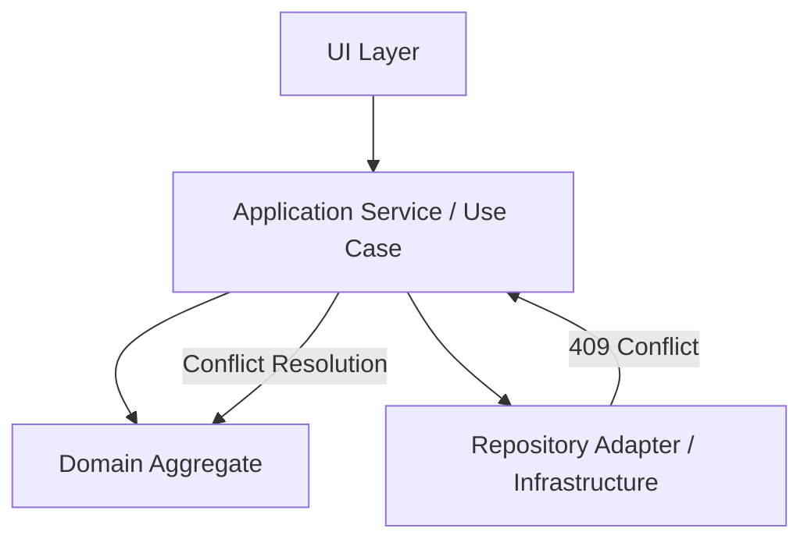
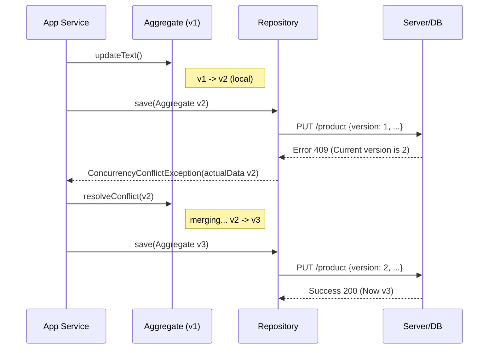

# 🧠 Topic: Optimistic Locking in Hexagonal Frontend Architecture

> [!abstract] Executive Summary (ELI5)
> Это способ сказать: "Я сохраняю изменения, только если никто не трогал этот документ, пока я его читал". Если кто-то успел его изменить, система не просто всё ломает, а дает нам шанс объединить наши правки (Merge) или спросить пользователя, что делать.

---

## 🎯 The "Why"
- **Problem Solved:** Предотвращение "тихого затирания" данных (Lost Update) в распределенных системах без использования блокирующих (Pessimistic) ресурсов.
- **Hexagonal Benefit:** Четкое разделение: *Бизнес-логика* решает, как объединять конфликты, а *Инфраструктура* лишь обрабатывает сетевую ошибку 409 (Conflict).

## 💡 Architecture Layers & Roles



### 🧱 Роли слоев:
1. **Domain Aggregate:** Хранит `version`. Сам инкрементирует её при любом методе `update()`. Содержит метод `resolveConflict(actualData)`.
2. **Repository Adapter:** Переводит доменный объект в JSON (включая версию). Если сервер вернул 409, бросает доменное исключение `ConcurrencyConflictException`.
3. **Application Service:** Оркестратор. Если поймал `ConcurrencyConflictException`, он может попробовать автоматический `merge` через Агрегат или запросить помощь у пользователя.

## 🛠️ Core Principles & Code Snippets

### Domain Aggregate (The Brain)
```typescript
class Product {
  constructor(
    public readonly id: string,
    public name: string,
    public version: number // Инвариант
  ) {}

  updateName(newName: string) {
    this.name = newName;
    this.version++; // Инкремент в домене!
  }

  // Логика слияния в Агрегате
  merge(serverVersion: Product): boolean {
    // Если сервер изменил описание, а мы цену - можем слить автоматически.
    // Если оба изменили одно поле - конфликт.
    if (this.canAutoMerge(serverVersion)) {
       this.version = serverVersion.version + 1;
       return true;
    }
    return false;
  }
}
```

### Application Service (The Orchestrator)
```typescript
async function updateProductUseCase(productId: string, newName: string) {
  const product = await repository.getById(productId);
  product.updateName(newName);

  try {
    await repository.save(product);
  } catch (e) {
    if (e instanceof ConcurrencyConflictException) {
      const actualProduct = e.actualData;
      if (product.merge(actualProduct)) {
        await repository.save(product); // Повторная попытка (Retry)
      } else {
        notifyUIAboutManualConflict(product, actualProduct);
      }
    }
  }
}
```

## 🔄 Lifecycle Diagram


## ⚠️ Pitfalls & Anti-patterns
- **DB-Driven Versioning:** Ошибка — ждать, пока база инкрементирует версию. В DDD Агрегат сам управляет своим состоянием, включая версию.
- **Ignoring UX Race Conditions:** Если пользователь нажимает "Save" 10 раз в секунду, старые ошибки 409 могут "перекрыть" новые изменения. Нужно использовать `snapshots`.

## ❓ Active Recall Questions
> [!faq]- Почему Репозиторий должен быть "тупым" в этой схеме?
> Чтобы бизнес-логика разрешения конфликтов (Merge) не утекала в слой инфраструктуры. Репозиторий лишь сообщает о факте конфликта.

> [!faq]- В чем разница между Optimistic UI и Optimistic Locking?
> UI — это визуальное предвосхищение успеха. Locking — это механизм обеспечения целостности данных при конфликте.
---
