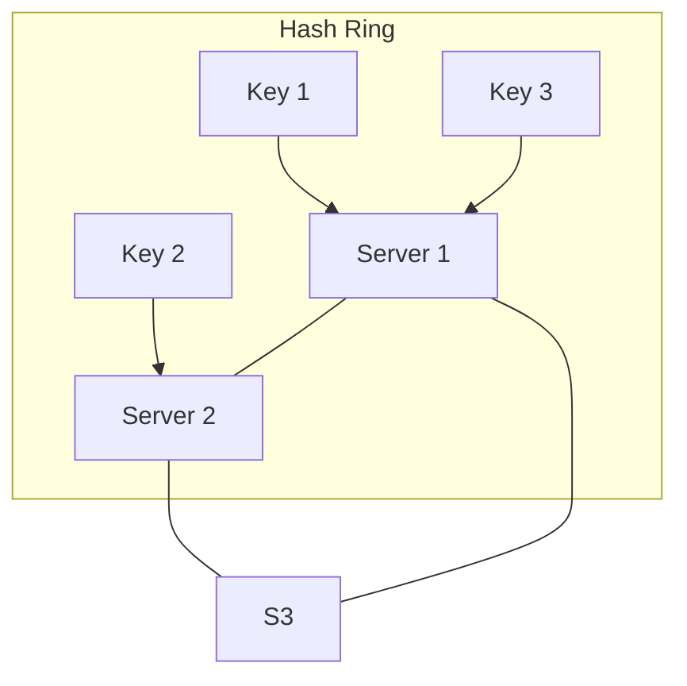

# 🧠 Topic: Data Partitioning & Consistent Hashing

> [!abstract] Executive Summary (ELI5)
> Imagine you have a massive library that's too big for one building. Data partitioning is like splitting the books across multiple buildings. **Consistent Hashing** is a clever way to decide which book goes where using a "circular map." If you add a new building, you only have to move a few books nearby, rather than reorganizing the entire library.

---

## 🎯 The "Why"
- **Problem Solved:** 
    - **Scalability:** A single server has finite CPU, RAM, and Disk. We must spread data to handle "Big Data."
    - **The Rehash Problem:** Simple modulo hashing (`key % N`) is disastrous when scaling. If `N` changes from 9 to 10, nearly all keys map to new locations, causing a "cache stampede" or massive data migration.
- **Alternatives:** 
    - **Range-based Partitioning:** Storing keys `A-M` on Node 1, `N-Z` on Node 2 (Risk: Hot spots/uneven distribution).
    - **Directory-based Partitioning:** A lookup service tells you where data is (Risk: Single point of failure/bottleneck).
- **Trade-offs:** Consistent Hashing adds complexity (virtual nodes, ring management) but provides the best balance for dynamic, high-scale systems.

## 💡 Mental Model & Analogy
*Connect this technical concept to a real-world object or process.*
- **Analogy:** **The Musical Chairs Ring.** 
    - Imagine chairs (servers) placed in a circle. People (data keys) enter the circle and sit in the first chair they find while walking clockwise. 
    - If a chair is removed, only the people who were going to sit in *that specific chair* have to move to the next one. Everyone else stays put.
- **Visual/Diagram:** 


## 🛠️ Core Principles & Code Snippets
*Focus on "The Right Way" (Best Practices).*

```typescript
// Conceptual logic for finding a node in a Consistent Hash Ring
function getServer(key: string, sortedServerHashes: number[]): number {
    const keyHash = hashFunction(key);
    
    // Find the first server hash >= keyHash (Clockwise)
    for (const serverHash of sortedServerHashes) {
        if (serverHash >= keyHash) return serverHash;
    }
    
    // Wrap around to the first server if we reached the end of the ring
    return sortedServerHashes[0];
}
```

> [!tip] Implementation Note: Virtual Nodes (Vnodes)
> To prevent "Skewed Distribution" (one server getting too much data), we map each physical server to hundreds of **Virtual Nodes** on the ring. This averages out the load and handles **Heterogeneity** (powerful servers get more Vnodes).

## ⚠️ Pitfalls & Anti-patterns
- **Common Mistakes:** Using a poor hash function that clusters keys together.
- **Cascading Failures:** If Server A fails, all its load moves to Server B. If B can't handle the extra load, it fails too. Vnodes help mitigate this by spreading the "failed" load across *multiple* surviving servers.
- **The "Celebrity" Problem:** Even with consistent hashing, a single key (e.g., a viral tweet) can overwhelm a single node. This requires application-level caching or further sub-partitioning.

## 🔗 Deep Connections
- **Parent Topic:** [[Database Sharding]]
- **Related Concepts:** [[Load Balancing]], [[Distributed Hash Tables (DHT)]], [[Replication]]
- **Real-world usage:** **Amazon DynamoDB**, **Apache Cassandra**, **Akamai CDN**.

## ❓ Active Recall Questions
> [!faq]- How does Consistent Hashing solve the problem of adding a new node?
> Only `K/N` keys need to be remapped (where K is total keys and N is nodes), whereas simple modulo hashing requires remapping almost all keys.

> [!faq]- What is the primary purpose of "Virtual Nodes"?
> To ensure even data distribution and to allow servers with different hardware capacities to take proportional shares of the load.

---
## 📝 How to use this template effectively
*Refer to GEMINI.md for flashcard generation rules.*
