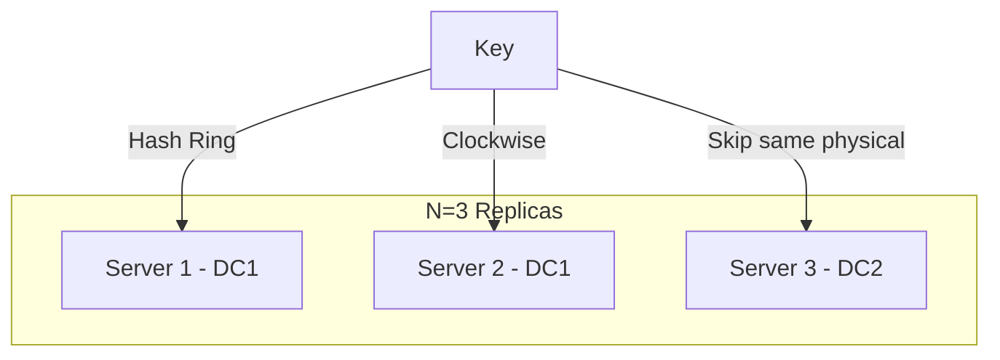

# 🧠 Topic: Data Replication in Distributed Systems

> [!abstract] Executive Summary (ELI5)
> Data replication is like having photocopies of your important documents stored in different safes. If one safe is destroyed or stolen, you can still get your information from the others. In big computer systems, we make these "photocopies" (replicas) and put them on different servers and even in different cities so that if a whole building loses power, your data is still safe.

---

## 🎯 The "Why"
- **Problem Solved:** 
    - **High Availability:** If one node goes down, the system stays up.
    - **Reliability (Durability):** Protects against data loss from hardware failure.
    - **Reduced Latency:** Replicas can be placed closer to users (e.g., in different geographical regions).
- **Alternatives:** 
    - **Single-node storage:** (High risk of total data loss).
    - **RAID/Local redundancy:** Protects against disk failure but not server or rack failure.
- **Trade-offs:** 
    - **Consistency vs. Latency:** Synchronizing multiple copies takes time. 
    - **Complexity:** Keeping $N$ nodes in sync requires complex protocols (like Quorum or Paxos).

## 💡 Mental Model & Analogy
*Connect this technical concept to a real-world object or process.*
- **Analogy:** **The Multi-City Backup Strategy.**
    - If you have an important key, you don't just give a copy to your neighbor (same Rack/DC). You give one to a friend in another city (Cross-DC Replication). Even if your whole city has a blackout, your friend's copy is accessible.
- **Visual/Diagram:** 


## 🛠️ Core Principles & Code Snippets
*Focus on "The Right Way" (Best Practices).*

1. **N-Replication:** Store data on the first $N$ **unique physical nodes** encountered clockwise on the hash ring.
2. **Anti-affinity:** Ensure replicas do not share the same "failure domain" (same power supply, same rack, or same data center).

```typescript
// Conceptual replica selection logic
function getReplicaNodes(key: string, n: number, hashRing: Ring): Node[] {
    const replicas: Node[] = [];
    let currentNode = hashRing.findFirstNode(key);

    while (replicas.length < n) {
        // Crucial: Ensure we don't pick virtual nodes belonging to the same server
        if (!replicas.find(r => r.physicalId === currentNode.physicalId)) {
            replicas.push(currentNode);
        }
        currentNode = hashRing.nextClockwise(currentNode);
    }
    return replicas;
}
```

> [!tip] Implementation Note
> To maintain consistency across these $N$ nodes during reads and writes, systems typically use **Quorum Consensus** ($W + R > N$).

## ⚠️ Pitfalls & Anti-patterns
- **The "Virtual Node Trap":** Picking the next $N$ nodes on a hash ring without checking their physical IDs. You might accidentally put all $N$ copies on the same physical machine.
- **Correlated Failures:** Putting all replicas in the same Data Center. A single backhoe cutting a fiber line or a fire in the cooling system will take out all replicas simultaneously.
- **Replication Lag:** In asynchronous replication, a "Read after Write" might return old data because the replica hasn't received the update yet.

## 🔗 Deep Connections
- **Parent Topic:** [[Distributed Databases]]
- **Related Concepts:** [[Quorum]], [[PACELC Theorem]], [[Consistent Hashing]], [[Availability Zones]]
- **Real-world usage:** **Cassandra**, **DynamoDB**, **MongoDB Replica Sets**.

## ❓ Active Recall Questions
> [!faq]- Why is it insufficient to simply pick the next N virtual nodes on a hash ring for replication?
> Multiple virtual nodes can map to the same physical server. If that server fails, all those "replicas" are lost simultaneously, defeating the purpose of replication.

> [!faq]- What is the primary benefit of cross-data-center replication?
> Disaster recovery. It ensures data survives catastrophic events that take down an entire facility, such as power grid failures or natural disasters.

---
## 📝 How to use this template effectively
*See GEMINI.md for flashcard generation rules.*
