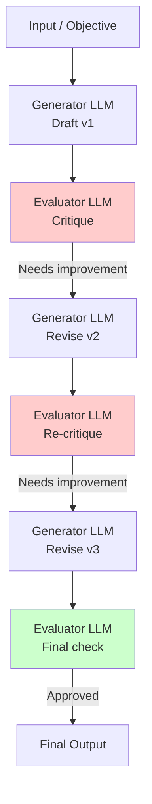

# Evaluator-Optimizer

> [!abstract] Executive Summary (ELI5)
> Evaluator-Optimizer is like a **writer and editor working in a loop** — the writer drafts something, the editor marks it up with feedback ("this section is unclear," "add an example here," "check this fact"), and the writer revises. They keep going back and forth until the editor says "looks good." The key is that the critic has specific criteria to judge against.

---

## 🎯 The "Why"

- **Problem Solved:** LLM outputs often have subtle errors, hallucinations, missing edge cases, or quality issues that are hard to catch in a single pass. An independent evaluator can spot problems the generator missed, and the feedback loop drives iterative improvement.
- **Alternatives:**
  - Single-shot with "be careful" (doesn't actually improve quality)
  - Human-in-the-loop review (expensive, slow, doesn't scale)
  - Bigger model (diminishing returns; GPT-4 still makes mistakes)
- **Trade-offs:** Adds 2-3x latency and cost per iteration. The evaluator must have clear criteria to judge against, otherwise it gives vague feedback. Best when the output is verifiable and quality is worth the cost.

---

## 💡 Mental Model & Analogy

- **Analogy:** "This is like **a design review in architecture** — the architect draws plans, a structural engineer checks them, the engineer says 'this beam can't support this load,' the architect redesigns, and they repeat until the engineer stamps it approved. The feedback is specific, actionable, and based on objective criteria."



---

## 🛠️ Core Principles & Code Snippets

### The Pattern
```python
from dataclasses import dataclass
from typing import Optional

@dataclass
class EvaluationResult:
    score: float  # 0.0 to 1.0
    passed: bool
    feedback: str
    specific_issues: list[str]

def evaluator_optimizer(
    objective: str,
    generator: callable,
    evaluator: callable,
    max_iterations: int = 3,
    quality_threshold: float = 0.85
) -> str:
    """Iterative generate-evaluate-revise loop."""
    
    current_output = generator(objective)
    
    for iteration in range(1, max_iterations + 1):
        # Evaluate current output
        evaluation = evaluator(current_output, objective)
        
        print(f"Iteration {iteration}: Score = {evaluation.score:.2f}")
        
        if evaluation.passed or evaluation.score >= quality_threshold:
            return current_output
        
        # Generator revises based on feedback
        revision_prompt = f"""Your previous output was evaluated with a score of {evaluation.score:.2f}.
        
Specific feedback:
{evaluation.feedback}

Issues to address:
{chr(10).join(f"- {issue}" for issue in evaluation.specific_issues)}

Please revise your output to address these issues. Maintain what was already good."""

        current_output = generator(revision_prompt, previous_output=current_output)
    
    # Max iterations reached, return best effort
    return current_output
```

### The Evaluator's Job
```python
def create_evaluator(criteria: list[str]) -> callable:
    """Factory for evaluators with specific criteria."""
    
    def evaluator(output: str, objective: str) -> EvaluationResult:
        criteria_text = "\n".join(f"{i+1}. {c}" for i, c in enumerate(criteria))
        
        result = llm_call(
            system=f"""You are a strict evaluator. Assess the output against these criteria:
{criteria_text}

Respond with JSON:
{{
  "score": 0.0-1.0,
  "passed": true/false,
  "feedback": "Overall assessment...",
  "specific_issues": ["issue 1", "issue 2"]
}}""",
            user=f"Objective: {objective}\n\nOutput to evaluate:\n{output}"
        )
        
        return EvaluationResult(**result)
    
    return evaluator

# Usage
quality_evaluator = create_evaluator([
    "Accuracy: All facts must be correct and verifiable",
    "Completeness: All requirements from the objective must be addressed",
    "Clarity: The explanation must be understandable to a non-expert",
    "Conciseness: No unnecessary words or redundant explanations",
    "Safety: No harmful, biased, or inappropriate content"
])
```

> [!tip] Implementation Note
> The **evaluator must be specific**. Vague feedback like "make it better" is useless. Good evaluators have rubrics with specific criteria and point to concrete problems. Consider using a *different model* for evaluator (e.g., Claude for generation, GPT-4 for evaluation) to get diverse perspectives.

### Best Practices
- **Define clear criteria:** The evaluator needs a rubric. Without it, feedback is vague and unactionable.
- **Use structured evaluation:** Force the evaluator to return a score, pass/fail, and specific issues. This makes the loop deterministic.
- **Cap iterations:** Always set a max iteration count. Without it, the loop can oscillate or run forever.
- **Preserve progress:** Pass the full previous output to the generator, not just the feedback. The generator should know what to keep and what to fix.
- **Make evaluator strict but fair:** A too-lenient evaluator lets bad outputs through. A too-strict evaluator causes infinite loops. Tune the threshold based on your quality needs.
- **Consider two evaluators:** Use a "fast evaluator" for quick checks (cost: low) and a "deep evaluator" for final sign-off (cost: high).

---

## 🏢 Business Examples

### Sales Proposal Quality Assurance
```
Objective: Generate a $500K enterprise software proposal
Generator: Drafts proposal with pricing, implementation plan, and case studies
Evaluator checks:
  - [ ] Pricing aligns with approved rate card
  - [ ] Implementation timeline is realistic given team capacity
  - [ ] All customer requirements from RFP are addressed
  - [ ] Legal disclaimers and terms are included
  - [ ] Tone is appropriate for enterprise (not too casual)

Feedback: "Timeline promises 3-month delivery but staffing plan shows 2 FTEs. 
          Standard velocity is 4 months for this scope. Revise."
Generator revises timeline.
Evaluator: Pass. Final output sent.
```

### Medical Documentation Review
```
Objective: Summarize patient visit into clinical notes
Generator: Drafts structured notes (HPI, assessment, plan)
Evaluator checks:
  - [ ] All symptoms mentioned by patient are documented
  - [ ] Medication list is complete and dosages verified
  - [ ] No diagnostic conclusions without supporting evidence
  - [ ] Follow-up instructions are clear and actionable
  - [ ] No ambiguous pronouns or unclear references

Feedback: "Patient mentioned chest pain but no characterization (sharp/dull/pressure). 
          Ask for clarification or note as uncharacterized."
Generator adds clarification.
```

### Marketing Copy Review
```
Objective: Write a product launch email for 10M subscribers
Generator: Drafts catchy, persuasive email
Evaluator checks:
  - [ ] No claims that could be considered false advertising
  - [ ] Pricing is clear and matches current offering
  - [ ] Tone matches brand voice (playful but professional)
  - [ ] CTA is prominent and unambiguous
  - [ ] Accessibility: No color-only cues, alt text suggested

Feedback: "CTA button text 'Click here!' is vague. Use 'Start free trial' instead."
Generator revises.
```

---

## 💻 Software Development Examples

### Test Case Generation with Coverage Check
```python
def generate_test_cases_with_coverage(requirements: str) -> list[str]:
    """Generate test cases and verify they cover all requirements."""
    
    generator = TestCaseGenerator()
    evaluator = CoverageEvaluator(requirements)
    
    test_cases = generator.generate(requirements)
    
    for iteration in range(3):
        evaluation = evaluator.evaluate(test_cases)
        
        if evaluation.coverage >= 0.95:
            break
        
        # Generator adds tests for uncovered requirements
        missing = evaluation.uncovered_requirements
        test_cases.extend(generator.generate_for_requirements(missing))
    
    return test_cases
```

### Code Review Feedback Loop
```python
class SelfImprovingCodeAgent:
    def generate_and_fix(self, spec: str) -> str:
        """Generate code, review it, and fix issues."""
        
        code = self.generator.generate(spec)
        
        for _ in range(2):
            review = self.evaluator.review(code, spec)
            
            if review.has_issues:
                fix_plan = self.planner.plan_fixes(code, review.issues)
                code = self.fixer.apply_fixes(code, fix_plan)
            else:
                break
        
        return code

# Evaluator criteria
code_review_criteria = [
    "Correctness: Code implements the spec without bugs",
    "Edge cases: Null inputs, empty arrays, extreme values handled",
    "Performance: No obvious O(n^2) where O(n) suffices",
    "Security: No SQL injection, XSS, or unsafe eval",
    "Style: Follows project conventions (PEP8, etc.)",
    "Tests: Testable design, no hidden dependencies"
]
```

### Documentation Accuracy Verification
```python
def generate_accurate_docs(api_schema: str, code_samples: str) -> str:
    """Generate API docs and verify against actual schema."""
    
    # Generator writes docs
    docs = llm_generate_docs(api_schema, code_samples)
    
    # Evaluator checks docs against schema
    for _ in range(2):
        issues = llm_evaluate_docs(docs, api_schema, criteria=[
            "Every endpoint in schema is documented",
            "All parameter types match schema types",
            "All response codes are documented",
            "Code examples compile and run correctly"
        ])
        
        if not issues:
            break
        
        # Fix specific issues
        docs = llm_revise_docs(docs, issues)
    
    return docs
```

### Structured Data Extraction with Validation
```python
def extract_structured_data(text: str, schema: dict) -> dict:
    """Extract data and validate against schema iteratively."""
    
    extraction = llm_extract(text, schema)
    
    for _ in range(3):
        validation_errors = jsonschema.validate(extraction, schema)
        
        if not validation_errors:
            break
        
        # Generator fixes specific validation errors
        extraction = llm_fix_extraction(text, extraction, validation_errors)
    
    return extraction
```

---

## ⚠️ Pitfalls & Anti-patterns

- **Common Mistakes:**
  - Vague evaluator criteria ("make it better" — not actionable)
  - Oscillation: evaluator says "add more detail," generator adds detail, evaluator says "too verbose" (fix by requiring specific, consistent criteria)
  - Not capping iterations (infinite loops or runaway costs)
  - Evaluator that's too easy or too hard (tune the threshold with real examples)
  - Using the same prompt for generator and evaluator (they should have different system prompts)
- **When NOT to use:**
  - When speed is critical (this is inherently slower)
  - When the output isn't verifiable (evaluator needs objective criteria)
  - For creative tasks where "quality" is subjective (art, poetry, humor)
  - When the problem is simple enough that a single-shot is sufficient
- **Performance considerations:**
  - Each iteration = 2 LLM calls (generate + evaluate). 3 iterations = 6 calls.
  - Consider using a fast model for early iterations and a strong model for final evaluation.
  - If the generator consistently fails evaluation after 2 iterations, escalate to human review rather than burning more tokens.

---

## 🔗 Deep Connections

- **Parent Topic:** [[Agentic_Workflow_Patterns_Overview]]
- **Related Concepts:** [[LLM-as-a-Judge]], [[Constitutional AI]], [[RLHF]], [[Self-Consistency]], [[Iterative Refinement]]
- **Prerequisites:** Understanding of evaluation metrics, rubric design, feedback loops

## Related Notes

- [[Agentic_Workflow_Patterns_Overview]]
- [[Prompt Chaining]] — evaluator-optimizer can be a loop within a chain step
- [[Orchestrator-Worker]] — orchestrator can use evaluator-optimizer to validate worker outputs
- [[Parallelization]] — evaluator can be one of several parallel checks on a generated output
- [[Pattern Compositions]] — evaluator-optimizer is the quality gate in most production pipelines

---

*Last updated: 2026-06-21*
