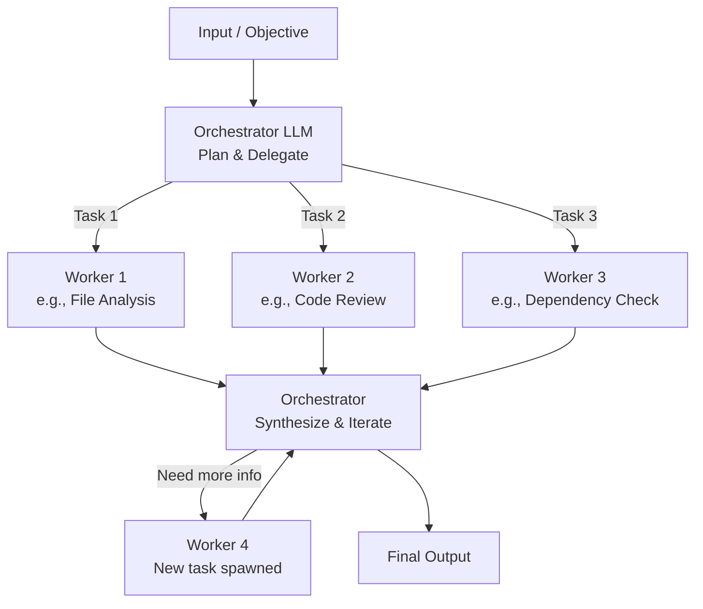

# Orchestrator-Worker

> [!abstract] Executive Summary (ELI5)
> Orchestrator-Worker is like a **general contractor renovating a house** — the contractor doesn't swing the hammer. They look at the job, break it into tasks ("we need plumbing, electrical, and flooring"), hire specialists for each, coordinate them, and make sure the final result comes together. The key is that the contractor decides what needs doing *as they go*, not from a fixed plan.

---

## 🎯 The "Why"

- **Problem Solved:** Some problems are too open-ended or complex to decompose into a fixed pipeline. You don't know what steps are needed until you see the problem. The orchestrator dynamically discovers the task structure, delegates to workers, and synthesizes results.
- **Alternatives:**
  - [[Prompt Chaining]] (requires knowing the sequence in advance)
  - [[Parallelization]] (requires knowing the independent dimensions in advance)
  - Hardcoded workflows (can't adapt to novel problem structures)
- **Trade-offs:** This is the most flexible but also the most expensive and highest-latency pattern. The orchestrator itself is an LLM call that plans, and workers are additional LLM calls. Use it when the problem genuinely requires exploration and adaptation.

---

## 💡 Mental Model & Analogy

- **Analogy:** "This is like **Mission: Impossible** — the team gets a vague objective ('stop the villain'). The leader (orchestrator) doesn't know the plan upfront. They recon the situation, then dynamically assign roles: 'You hack the security system, you create a diversion, you extract the data.' The leader synthesizes the results in real-time and adapts if things go wrong."



---

## 🛠️ Core Principles & Code Snippets

### The Pattern
```python
from dataclasses import dataclass
from typing import List, Optional

@dataclass
class Task:
    task_id: str
    description: str
    context: str
    worker_type: str
    result: Optional[str] = None

class Orchestrator:
    def __init__(self, objective: str):
        self.objective = objective
        self.tasks: List[Task] = []
        self.completed_results: List[str] = []
    
    def plan(self, context: str) -> List[Task]:
        """Orchestrator analyzes the problem and breaks it into tasks."""
        plan = llm_call(
            system="""You are a planning orchestrator. Given an objective and context,
            break it into specific, actionable tasks. Each task should be independent
            and assignable to a worker. Return JSON array of tasks.""",
            user=f"Objective: {self.objective}\nContext: {context}"
        )
        self.tasks = [Task(**t) for t in plan]
        return self.tasks
    
    def delegate(self, task: Task) -> str:
        """Execute a single worker task."""
        worker_prompt = f"""Task: {task.description}
        Context: {task.context}
        Objective: {task.objective}
        
        Complete this task and return your findings."""
        
        return llm_call(
            system=f"You are a {task.worker_type} specialist.",
            user=worker_prompt
        )
    
    def synthesize(self) -> str:
        """Combine all worker results into a coherent final output."""
        context = f"Objective: {self.objective}\n\n"
        context += "\n\n".join([
            f"Task {t.task_id}: {t.result}" 
            for t in self.tasks
        ])
        
        return llm_call(
            system="""You are a synthesis expert. Combine these task results into a
            coherent, comprehensive final answer. Resolve any contradictions and
            fill any gaps.""",
            user=context
        )
    
    def run(self, initial_context: str) -> str:
        # Phase 1: Plan
        self.plan(initial_context)
        
        # Phase 2: Delegate (can be sequential or parallel)
        for task in self.tasks:
            task.result = self.delegate(task)
        
        # Phase 3: Synthesize
        return self.synthesize()
```

> [!tip] Implementation Note
> The orchestrator can **iterate** — after synthesizing, it can identify gaps and spawn additional worker tasks. This creates a loop: plan → delegate → synthesize → replan. Always cap the number of iterations to prevent runaway costs.

### Best Practices
- **Give the orchestrator rich context:** It can only plan well if it understands the full problem. Include relevant documents, schemas, or constraints.
- **Use a strong model for the orchestrator:** The orchestrator does the hardest work (planning). Use GPT-4, Claude Opus, or equivalent. Workers can often use cheaper models.
- **Make workers context-aware:** Each worker should know the overall objective, not just their isolated task. This prevents local optima that conflict with the global goal.
- **Implement iteration carefully:** Allow the orchestrator to say "I need more information about X" and spawn a new task. But set a max iteration limit (e.g., 3 rounds).
- **Log the plan:** The orchestrator's plan is valuable debugging information. Log it to understand why the system made certain decisions.

---

## 🏢 Business Examples

### Competitive Intelligence Report
```
Objective: "Analyze our top 3 competitors' Q3 strategy"
Orchestrator: Plans tasks:
  - Worker 1: Analyze competitor A's recent product launches, pricing changes, hiring
  - Worker 2: Analyze competitor B's marketing campaigns, partnerships, patents
  - Worker 3: Analyze competitor C's financial filings, leadership changes, market expansion
  - Worker 4: Cross-reference findings and identify industry-wide shifts

After initial synthesis, orchestrator notices:
  "All three competitors are investing in AI — spawn additional task:"
  - Worker 5: Deep-dive into each competitor's AI strategy and capabilities

Final synthesis: Comprehensive report with strategic implications
```

### Legal Document Analysis
```
Objective: "Review this 100-page merger agreement for risks"
Orchestrator: Plans tasks:
  - Worker 1: Extract all representations and warranties
  - Worker 2: Identify indemnification clauses and caps
  - Worker 3: Map termination rights and breakup fees
  - Worker 4: Check regulatory approval requirements

Synthesis reveals: "Worker 3 found a unusual termination clause. Worker 1's reps seem inconsistent with this."
Orchestrator spawns:
  - Worker 5: Cross-reference termination clause with representations

Final: Risk-ranked list of issues with cross-references
```

### Crisis Response Planning
```
Objective: "Develop a response plan for a data breach affecting 1M users"
Orchestrator: Plans:
  - Worker 1: Legal/regulatory notification requirements (GDPR, CCPA, etc.)
  - Worker 2: Technical containment and forensic investigation steps
  - Worker 3: Customer communication strategy and timeline
  - Worker 4: PR and media response plan

After synthesis: "Legal requires 72-hour notification, but PR needs 24 hours. Conflict detected."
Orchestrator spawns:
  - Worker 5: Reconcile notification timeline across jurisdictions

Final: Integrated response plan with timeline and owners
```

---

## 💻 Software Development Examples

### Dynamic Code Refactoring
```python
class RefactoringOrchestrator:
    def analyze_codebase(self, repo_path: str):
        """Orchestrator discovers what needs refactoring, then delegates."""
        
        # Step 1: Orchestrator scans and identifies problem areas
        scan_result = llm_call(
            system="You are a code architect. Analyze this codebase for:
            - Tech debt hotspots
            - Outdated dependencies
            - Architecture violations
            - Performance bottlenecks",
            user=read_repo_summary(repo_path)
        )
        
        # Step 2: Plan specific refactoring tasks
        tasks = self.plan_remediation(scan_result)
        
        # Step 3: Delegate to workers
        results = []
        for task in tasks:
            worker = self.get_worker(task["type"])
            result = worker.execute(task, repo_path)
            results.append(result)
        
        # Step 4: Synthesize and check for conflicts
        plan = self.synthesize_refactoring_plan(results)
        
        # Step 5: Validate no conflicts
        if self.detect_conflicts(plan):
            # Re-orchestrate
            tasks = self.plan_reconciliation(plan)
            # ... additional workers
        
        return plan
```

### Bug Investigation Agent
```python
class BugInvestigator:
    def investigate(self, bug_report: str) -> dict:
        """Dynamically investigate a bug by exploring the codebase."""
        
        # Orchestrator reads the bug report and decides first steps
        plan = self.orchestrator.plan_investigation(bug_report)
        
        findings = []
        while plan.has_more_tasks() and plan.iteration < 3:
            for task in plan.next_tasks():
                result = self.worker.execute(task)
                findings.append(result)
            
            # Synthesize and decide if we need more investigation
            plan = self.orchestrator.replan(findings, bug_report)
        
        return self.orchestrator.synthesize_root_cause(findings)
```

### Multi-File Code Review
```python
class DeepCodeReview:
    def review_pr(self, pr_files: List[str]) -> str:
        """Orchestrator reviews PR by delegating analysis per file/module."""
        
        # Orchestrator first understands the change
        overview = self.orchestrator.summarize_changes(pr_files)
        
        # Plans which files need deep analysis vs. quick check
        tasks = self.orchestrator.plan_review(overview, pr_files)
        
        # Workers analyze each file
        file_reviews = {}
        for task in tasks:
            review = self.worker.analyze_file(task.file, task.focus)
            file_reviews[task.file] = review
        
        # Orchestrator identifies cross-file issues
        cross_file_issues = self.orchestrator.check_cross_file_impacts(
            file_reviews, overview
        )
        
        # Final synthesis
        return self.orchestrator.generate_final_review(
            file_reviews, cross_file_issues
        )
```

---

## ⚠️ Pitfalls & Anti-patterns

- **Common Mistakes:**
  - Using orchestrator-worker for simple, linear tasks (massive overkill)
  - Not limiting iteration depth (orchestrator can spiral into infinite replanning)
  - Orchestrator plans too many tasks (20+ tasks = 20+ LLM calls = $$$)
  - Workers with too much scope (they should be focused, not mini-orchestrators)
  - Not giving workers enough context about the overall goal
- **When NOT to use:**
  - When the task sequence is known and fixed (use [[Prompt Chaining]])
  - When the dimensions are known and independent (use [[Parallelization]])
  - When latency is critical (this is the slowest pattern)
  - When the problem is simple enough for a single-shot prompt
- **Performance considerations:**
  - Orchestrator + N workers + synthesizer = N+2 LLM calls minimum
  - With iteration, this can become 2N+ or 3N+ calls
  - Use the strongest model only for the orchestrator and synthesizer
  - Consider streaming partial results to the user while workers process

---

## 🔗 Deep Connections

- **Parent Topic:** [[Agentic_Workflow_Patterns_Overview]]
- **Related Concepts:** [[ReAct Pattern]], [[Multi-Agent Collaboration]], [[Hierarchical Task Networks]], [[Autonomous Agents]]
- **Prerequisites:** Understanding of planning in AI, decomposition strategies, cost management

## Related Notes

- [[Agentic_Workflow_Patterns_Overview]]
- [[Prompt Chaining]] — for fixed, known sequences
- [[Parallelization]] — when workers are independent and predetermined
- [[Evaluator-Optimizer]] — often used to validate orchestrator plans and worker outputs
- [[Pattern Compositions]] — orchestrator-worker is the backbone of most complex compositions

---

*Last updated: 2026-06-21*
