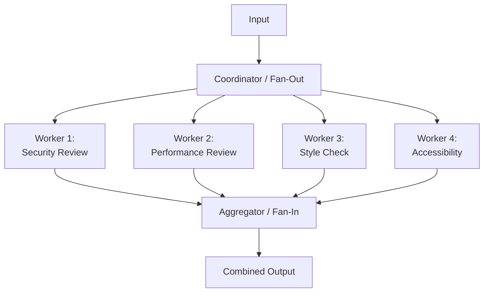

# Parallelization

> [!abstract] Executive Summary (ELI5)
> Parallelization is like **hiring a panel of experts** — instead of asking one person to analyze a problem from every angle, you ask 5 specialists simultaneously: one checks security, one checks performance, one checks legal compliance, one checks user experience, and one checks cost. Then you combine their findings into a single answer.

---

## 🎯 The "Why"

- **Problem Solved:** Single LLM calls have limited "attention budget" and tend to focus on one aspect of a problem. Parallelization gets diverse, independent perspectives simultaneously, improving coverage and reducing blind spots.
- **Alternatives:**
  - Sequential chaining (slower, and later steps may be biased by earlier ones)
  - Single-shot with "think about X, Y, and Z" (LLM often fixates on one aspect)
  - Orchestrator-Worker (adds unnecessary planning overhead for known, independent tasks)
- **Trade-offs:** Parallelization trades cost for speed and coverage. You pay for N calls instead of 1, but you get N perspectives and the wall-clock time is roughly the same as 1 call. It's only effective when tasks are truly independent.

---

## 💡 Mental Model & Analogy

- **Analogy:** "This is like **a home inspection before buying a house** — you don't send one inspector to check everything. You send a plumber, an electrician, a structural engineer, and a pest inspector all at the same time. They each write a report, and your coordinator (you) combines them into a final buy/no-buy decision."



---

## 🛠️ Core Principles & Code Snippets

### The Pattern
```python
import asyncio
from dataclasses import dataclass
from typing import List, Callable

@dataclass
class WorkerResult:
    dimension: str
    output: str
    confidence: float

async def parallelize(input_data: str, workers: List[Callable]) -> List[WorkerResult]:
    """Fan-out: Run all workers concurrently."""
    tasks = [worker(input_data) for worker in workers]
    results = await asyncio.gather(*tasks)
    return results

def aggregate(results: List[WorkerResult]) -> str:
    """Fan-in: Combine worker outputs into a single coherent response."""
    # Aggregation can be simple concatenation, voting, or another LLM call
    combined = "\n\n".join([
        f"### {r.dimension}\n{r.output}" 
        for r in results
    ])
    
    # Optional: LLM-based synthesis for complex aggregation
    return llm_call(
        system="Synthesize these independent reviews into a single coherent assessment.",
        user=combined
    )

# Usage
async def review_code(code: str) -> str:
    workers = [
        lambda c: analyze_security(c),
        lambda c: analyze_performance(c),
        lambda c: analyze_style(c),
        lambda c: check_accessibility(c)
    ]
    
    results = await parallelize(code, workers)
    return aggregate(results)
```

> [!tip] Implementation Note
> The **coordinator** and **aggregator** are typically hardcoded logic, not LLM calls. They decide what dimensions to parallelize and how to combine results. Keep them simple. The heavy lifting happens in the workers.

### Two Flavors of Parallelization

**1. Sectioning (Different subtasks on same input):**
```python
# Each worker processes the same input but focuses on a different dimension
workers = [
    lambda doc: extract_financial_data(doc),
    lambda doc: extract_legal_risks(doc),
    lambda doc: extract_market_opportunity(doc)
]
```

**2. Voting (Same task, multiple attempts):**
```python
# Run the same task N times with different temperatures or prompts, then vote
attempts = [
    llm_call(prompt, temperature=0.7, seed=i) 
    for i in range(5)
]
# Take majority vote or most common answer
```

### Best Practices
- **Use cheaper models for workers:** Workers can often use mid-tier models (GPT-4o, Claude Sonnet). Reserve the strongest model for the aggregator if needed.
- **Limit concurrency:** Most LLM APIs have rate limits. Don't fire 100 workers at once. Use a semaphore (e.g., `asyncio.Semaphore(10)`).
- **Make workers truly independent:** If workers depend on each other, you're not parallelizing — you're doing something closer to an orchestrator pattern.
- **Fail gracefully:** If 3 of 4 workers succeed, aggregate what you have. Don't let one failure kill the whole pipeline.

---

## 🏢 Business Examples

### Investment Due Diligence
```
Input: Startup pitch deck
Workers (parallel):
  - Market Analyst: TAM/SAM/SOM, competitive landscape
  - Financial Analyst: Unit economics, burn rate, runway
  - Legal Analyst: IP ownership, cap table, regulatory risks
  - Technical Analyst: Product feasibility, tech stack assessment
Aggregator: Investment memo with go/no-go recommendation and risk matrix
```

### Content Moderation
```
Input: User-generated post
Workers (parallel):
  - Safety: Hate speech, harassment, violence
  - Spam: Promotional content, bot-like behavior
  - Misinformation: Fact-check claims against known sources
  - Policy: Terms of service violations
Aggregator: Combined decision — allow, flag, or remove with reason
```

### Product Launch Review
```
Input: New feature description
Workers (parallel):
  - Marketing: Messaging, positioning, competitive differentiation
  - Legal: Compliance, privacy implications, terms updates
  - Engineering: Technical feasibility, infrastructure impact
  - UX: User journey, accessibility, edge cases
Aggregator: Launch readiness score and blockers list
```

---

## 💻 Software Development Examples

### Multi-Dimensional Code Review
```python
async def comprehensive_code_review(pr_diff: str) -> dict:
    """Run multiple code review agents in parallel."""
    
    async def security_review(diff):
        return llm_call(system="You are a security engineer. Find vulnerabilities.", user=diff)
    
    async def performance_review(diff):
        return llm_call(system="You are a performance engineer. Find bottlenecks.", user=diff)
    
    async def style_review(diff):
        return llm_call(system="You are a style guide enforcer. Find style violations.", user=diff)
    
    async def test_coverage_review(diff):
        return llm_call(system="You are a QA engineer. Check if tests are adequate.", user=diff)
    
    results = await asyncio.gather(
        security_review(pr_diff),
        performance_review(pr_diff),
        style_review(pr_diff),
        test_coverage_review(pr_diff)
    )
    
    return {
        "security": results[0],
        "performance": results[1],
        "style": results[2],
        "testing": results[3]
    }
```

### Test Case Generation (Voting Style)
```python
def generate_test_cases_with_voting(requirements: str) -> str:
    """Generate test cases via multiple parallel attempts, then synthesize best."""
    
    attempts = [
        llm_call(
            system="Generate comprehensive test cases for these requirements.",
            user=requirements,
            temperature=0.8
        )
        for _ in range(5)
    ]
    
    # Aggregate: LLM picks the best test cases from all attempts
    return llm_call(
        system="""Review these 5 attempts at test case generation. 
        Combine them into a single, comprehensive set without duplicates.""",
        user="\n\n---\n\n".join(attempts)
    )
```

### Multi-Source Data Extraction
```python
async def extract_entity_info(entity_name: str) -> dict:
    """Gather information about a company from multiple sources in parallel."""
    
    sources = {
        "website": scrape_website(entity_name),
        "news": search_news(entity_name),
        "linkedin": search_linkedin(entity_name),
        "crunchbase": search_crunchbase(entity_name)
    }
    
    # Gather all sources concurrently
    raw_data = await asyncio.gather(*sources.values())
    
    # Workers extract structured info from each source type
    extraction_workers = [
        extract_company_info(source) for source in raw_data
    ]
    
    extracted = await asyncio.gather(*extraction_workers)
    
    # Merge and deduplicate
    return merge_extracted_data(extracted)
```

---

## ⚠️ Pitfalls & Anti-patterns

- **Common Mistakes:**
  - Running workers that aren't actually independent (wastes money, adds complexity)
  - Not capping concurrency (hitting rate limits or blowing up costs)
  - Over-aggregating (if the aggregator is too aggressive, it loses important minority viewpoints)
  - Using the same prompt for all workers (each worker should have a distinct system prompt)
- **When NOT to use:**
  - When tasks are sequential (use [[Prompt Chaining]])
  - When the number of dimensions is unknown (use [[Orchestrator-Worker]])
  - When cost is more important than coverage (use a single, stronger model instead)
- **Performance considerations:**
  - Wall-clock time = max(worker latency) + aggregation time, not sum
  - But cost = sum of all worker costs. With 10 workers on GPT-4, that's 10x the cost.
  - Aggregation can be a bottleneck if it requires another LLM call. Consider simple aggregation (concatenation, voting) first.

---

## 🔗 Deep Connections

- **Parent Topic:** [[Agentic_Workflow_Patterns_Overview]]
- **Related Concepts:** [[Map-Reduce]], [[Fan-Out/Fan-In]], [[Ensemble Methods]], [[Voting-Based Systems]]
- **Prerequisites:** Understanding of concurrency, async/await, rate limiting, cost optimization

## Related Notes

- [[Agentic_Workflow_Patterns_Overview]]
- [[Prompt Chaining]] — when tasks must be sequential
- [[Orchestrator-Worker]] — when the decomposition needs to be dynamic
- [[Evaluator-Optimizer]] — often follows parallelization to validate aggregated results
- [[Pattern Compositions]] — parallelization + routing = domain-specific parallel review

---

*Last updated: 2026-06-21*
