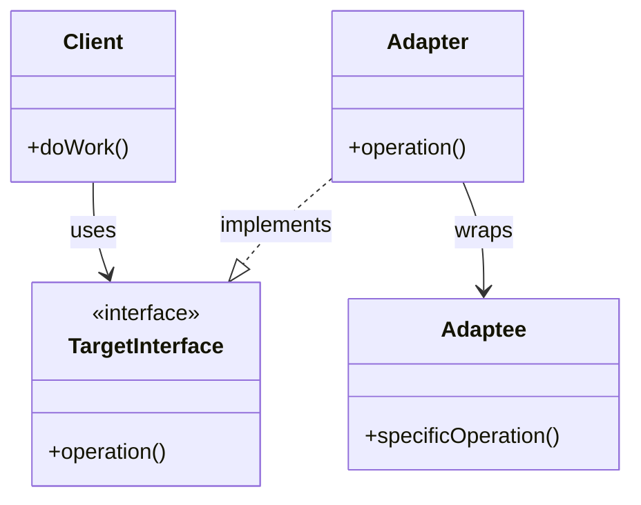

# 🧠 Topic: Adapter Pattern in Production

> [!abstract] Executive Summary (ELI5)
> The Adapter Pattern wraps incompatible external APIs so your code speaks one unified language. Think of it as a travel power adapter: your laptop expects a US plug, but the wall socket in Europe is different. The adapter doesn't change your laptop or the wall — it just makes them work together cleanly.

---

## 🎯 The "Why"

- **Problem Solved:** Modern systems integrate with dozens of external services (payment gateways, cloud storage, LLMs, OAuth providers, message queues). Each has its own data formats, naming conventions, error types, and quirks. Without adapters, your business logic becomes tightly coupled to vendor-specific APIs.
- **Alternatives:** 
  - Direct integration (spaghetti code, vendor lock-in)
  - Anti-corruption layer (DDD pattern — broader in scope, often includes domain translation)
  - Facade (simplifies a complex subsystem but doesn't always change interfaces)
- **Trade-offs:** Adapters add a layer of indirection (slight overhead, more code). The payoff is testability, swap-ability, and keeping business logic clean. The risk is a *leaky abstraction* — when the adapter fails to fully hide the external system.

## 💡 Mental Model & Analogy

- **Analogy:** "This is like a UN translator. The French delegate speaks French, the Japanese delegate speaks Japanese. They don't learn each other's languages — the translator converts both ways. If the Japanese delegate is replaced by a German, only the translator changes; the French delegate never knows the difference."
- **Visual/Diagram:**

## 🛠️ Core Principles & Production Examples

Adapters shine where you need **one interface, many implementations**. Here are 10 real-world battle-tested examples:

### 1. Database Repository Adapter
`UserRepository` interface with `PostgresUserRepository` and `RedisUserCache` implementations. The adapter handles row-to-object mapping (camelCase conversion, Date objects, enum mapping).

### 2. Payment Gateway Adapter
`PaymentGateway` interface unified `StripeAdapter` and `PayPalAdapter`. Converts `Money` to cents, maps status strings (`'succeeded'` → `'success'`), transforms Unix timestamps to `Date`.

### 3. Cloud Storage Adapter
`BlobStorage` abstracts S3, GCS, and local filesystem. Hides SDK-specific metadata formats, signed URL generation, and provider quirks behind a single `upload/download/getSignedUrl` contract.

### 4. LLM Provider Adapter
`LLMClient` unifies OpenAI, Anthropic, and local models. Each provider has different message structures, field names, and token counting — the adapter normalizes them into a common `Completion` type.

### 5. Message Queue Adapter
`MessageQueue` abstracts RabbitMQ (exchanges + routing keys), SQS (polling-based), and Kafka (partitions). Consumers never need to know which broker is underneath.

### 6. OAuth Identity Adapter
`IdentityProvider` normalizes Google, GitHub, and other OAuth providers. Maps `picture` → `avatar`, `login` → `name`, handles optional fields consistently.

### 7. Data Format Serializer Adapter
`DataSerializer` converts XML ↔ JSON ↔ CSV ↔ Protobuf. Legacy ERP sends XML? The adapter parses it and returns a typed domain object your pipeline expects.

### 8. Metrics Collector Adapter
`MetricsCollector` unifies Prometheus, Datadog, and CloudWatch. Handles name sanitization (`-` → `_`), label vs. tag formatting, and different client libraries.

### 9. CI/CD Pipeline Adapter
`CIPipeline` abstracts GitHub Actions, GitLab CI, and Jenkins. Maps your build parameters to provider-specific inputs, normalizes status enums and artifact retrieval.

### 10. Cache Adapter
`Cache` interface with `RedisCacheAdapter`, `InMemoryCacheAdapter`. Serializes typed objects to strings (and back) for Redis, handles TTL uniformly. In-memory version enables fast local testing without infrastructure.

> [!tip] Implementation Note
> Always keep adapters **stateless** and **single-purpose**. An adapter should only fetch/adapt data, not cache, not notify, not run business logic. If you need caching, wrap the adapter in a decorator, don't bake it in.

## ⚠️ Pitfalls & Anti-patterns

### 1. Leaky Abstraction
Throwing raw vendor errors (`S3Error`, `StripeError`) breaks the abstraction. Always translate to **domain errors** (`StorageError`, `PaymentError`) with structured codes (`BUCKET_NOT_FOUND`, `PERMISSION_DENIED`).

### 2. Implicit Data Mutation
Don't surprise consumers. If you `trim()` strings, fine — but `toLowerCase()` or silently dropping fields (`assignee` lost) is a hidden contract violation. Adapters should be **pure functions**: same input → same output, no side effects.

### 3. N+1 Through the Adapter
An adapter that fetches a list of keys and then makes one HTTP call per item is a performance trap. Use **bulk/batch APIs** or expose paginated endpoints properly.

### 4. `any` Everywhere
Input `any`, output `any` defeats the purpose. Use strict types (Zod, io-ts, or at least well-defined interfaces) and validate at the boundary. Runtime validation catches schema drift from external APIs.

### 5. Stateful Adapters
Storing `lastError`, `requestCount`, or caching inside the adapter makes it hard to test and unsafe in concurrent environments. Inject a `MetricsCollector` or `Cache` dependency instead.

### 6. God Adapter
When an adapter fetches, processes, saves, and notifies — it's no longer an adapter. It's a service. Keep adapters focused: fetch + adapt only. Orchestration belongs in the pipeline layer.

### 7. Caching Without Invalidation
Built-in `Map` caches in adapters grow forever and serve stale data. If you need caching, use a **Cache Decorator** pattern: a separate wrapper implementing the same interface, with explicit TTL and invalidation.

### 8. Unhandled Edge Cases
External APIs return `null` for optional fields, omit keys, or change schemas. Use defensive programming: `?.` / `??` everywhere. Never assume a field exists because the docs say so.

### 9. Silent Pagination
Returning only the first page of results without the consumer knowing is a data loss bug. Either auto-paginate and collect all results, or expose pagination explicitly in your interface (`PaginatedResult<T>`).

### 10. Versioning Debt
When the external API changes, don't break the existing adapter. Use **interface versioning** (`JiraAdapterV1`, `JiraAdapterV2`) and bridge adapters (`V2ToV1Adapter`) to migrate consumers gradually.

## 🔗 Deep Connections

- **Parent Topic:** [[Software Architecture]]
- **Related Concepts:** [[Facade Pattern]], [[Decorator Pattern]], [[Repository Pattern]], [[Anti-Corruption Layer]], [[Dependency Inversion Principle]]
- **Prerequisites:** [[TypeScript]], [[Interface Segregation]], [[Error Handling Patterns]]

## ❓ Active Recall Questions

> [!faq]- What is the primary danger of a "leaky abstraction" in an adapter?
> The consumer must know about the external system's quirks (error types, rate limits, field names), defeating the purpose of the adapter. Always translate errors and normalize data.

> [!faq]- Why should caching be a decorator rather than built into the adapter?
> Separation of concerns: the adapter adapts, the cache caches. Decorators let you compose behaviors (cache, retry, metrics) without changing the core adapter. It also makes testing trivial: inject a mock cache.

> [!faq]- How does the Adapter Pattern relate to the Dependency Inversion Principle?
> Both depend on abstractions. The adapter defines the abstraction (`TargetInterface`), and both the high-level business logic and the low-level external service depend on it — not on each other.

> [!faq]- When should you version an adapter interface?
> When the external API introduces breaking changes (new required fields, changed pagination, different auth) or when internal consumers need different capabilities. Never break existing consumers — bridge old to new.

## 📋 Review Checklist

| Check | Question |
|---|---|
| **Purity** | Does the adapter only transform data? No business logic? |
| **Types** | Are inputs validated (Zod/Joi), not `any`? |
| **Errors** | Are external errors mapped to domain errors? |
| **State** | Is the adapter stateless? |
| **Cache** | Is caching a separate decorator with TTL/invalidation? |
| **Pagination** | Is pagination handled explicitly, no silent data loss? |
| **Null-safety** | Are all optional fields handled with `?.` / `??`? |
| **Testability** | Can the adapter be swapped for a mock without changing consumers? |
| **Logging** | Are requests/responses logged at the boundary? |

---

## 📝 Related Notes

- [[Repository Pattern]] — closely related for DB adapters
- [[Decorator Pattern]] — for layering caching, retry, metrics on top of adapters
- [[Anti-Corruption Layer]] — broader DDD pattern that often uses adapters internally
- [[Strategy Pattern]] — when the "adaptation" is about algorithmic choice, not interface translation
