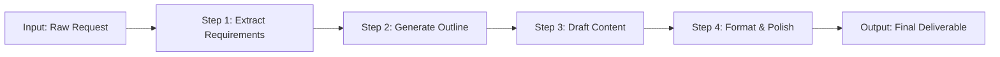

# Prompt Chaining

> [!abstract] Executive Summary (ELI5)
> Prompt chaining is like an **assembly line** — each worker (LLM call) gets the output of the previous worker, adds one specific thing, and passes it forward. You break a big job into a fixed sequence of small, well-defined steps.

---

## 🎯 The "Why"

- **Problem Solved:** Complex tasks overwhelm single-shot LLM calls, leading to hallucinated details, missed requirements, or inconsistent formatting. Chaining enforces a structured, step-by-step approach.
- **Alternatives:**
  - Single-shot prompting (faster, but less reliable for complex outputs)
  - Orchestrator-Worker (overkill for predictable linear tasks)
  - Hardcoded templates (brittle, can't adapt to intermediate outputs)
- **Trade-offs:** Chaining adds latency (sum of all calls) and serializes what could sometimes be parallel. It wins when the task has clear sequential dependencies and intermediate outputs are useful.

---

## 💡 Mental Model & Analogy

- **Analogy:** "This is like **making a sandwich in a deli** — one person slices the bread, the next adds meat, the next adds cheese, the next wraps it. Each person only does one thing, and they only start after the previous person is done."



---

## 🛠️ Core Principles & Code Snippets

### The Pattern
```python
# Each step receives the output of the previous step
def prompt_chain(raw_input: str) -> str:
    step1 = llm_call(
        system="Extract structured requirements from the user's request.",
        user=raw_input
    )
    
    step2 = llm_call(
        system="Generate an outline based on the requirements.",
        user=step1
    )
    
    step3 = llm_call(
        system="Write the full content following the outline.",
        user=step2
    )
    
    step4 = llm_call(
        system="Format, proofread, and polish the final output.",
        user=step3
    )
    
    return step4
```

> [!tip] Implementation Note
> Always validate intermediate outputs before passing them forward. A garbled step 2 output will poison step 3, 4, and 5. Add lightweight validation (schema check, length check) between steps.

### Best Practices
- **Make each step atomic:** One step should do one thing well. "Generate outline" is good. "Generate outline AND write content" defeats the purpose.
- **Use cheaper models for early steps:** Use GPT-3.5/Claude Haiku for extraction and formatting. Save GPT-4/Claude Opus for content generation.
- **Pass context, not just output:** Include the original request alongside intermediate results so later steps don't lose context.
- **Make steps resumable:** If step 4 fails, don't re-run steps 1-3. Cache intermediate results.

---

## 🏢 Business Examples

### Sales Proposal Generation
```
Input: Client discovery call notes (raw text)
Step 1: Extract client needs, budget, timeline, decision-makers
Step 2: Match needs to product capabilities, identify gaps
Step 3: Generate proposal outline with pricing tiers
Step 4: Draft full proposal text with case studies
Step 5: Format as PDF-ready markdown, add legal disclaimers
```
*Why chaining:* Each step depends on the previous. You can't draft a proposal without knowing the client's needs, and you can't format without content.

### Customer Support Response
```
Input: Angry customer email
Step 1: Classify sentiment and identify core issue
Step 2: Look up policy and resolution options
Step 3: Draft empathetic response with resolution steps
Step 4: Add escalation trigger if sentiment remains negative
```

---

## 💻 Software Development Examples

### API Documentation Generation
```python
def generate_api_docs(source_code: str) -> str:
    # Step 1: Extract all public functions, classes, endpoints
    api_surface = llm_extract_api(source_code)
    
    # Step 2: Generate descriptions and parameter docs for each
    descriptions = llm_generate_descriptions(api_surface)
    
    # Step 3: Create usage examples for each function
    examples = llm_generate_examples(descriptions)
    
    # Step 4: Assemble into markdown documentation
    docs = llm_assemble_docs(examples)
    
    return docs
```

### Code Migration Pipeline
```
Input: Legacy Python 2 codebase
Step 1: Identify Python 2-specific syntax and imports
Step 2: Generate Python 3 equivalent for each pattern
Step 3: Add type hints and modern idioms
Step 4: Generate test cases to verify behavior preservation
Step 5: Format with black, add compatibility notes
```

### SQL Query Generation
```python
def natural_language_to_sql(question: str, schema: str) -> str:
    # Step 1: Identify relevant tables and columns
    tables = llm_identify_tables(question, schema)
    
    # Step 2: Generate JOIN conditions and WHERE clauses
    clauses = llm_generate_clauses(question, tables)
    
    # Step 3: Assemble full SQL query
    sql = llm_assemble_sql(clauses)
    
    # Step 4: Validate syntax and suggest optimizations
    validated = llm_validate_sql(sql)
    
    return validated
```

---

## ⚠️ Pitfalls & Anti-patterns

- **Common Mistakes:**
  - Making steps too broad (defeating the purpose of decomposition)
  - Not handling failure in intermediate steps
  - Losing the original input context as the chain grows
  - Using the same model for all steps (wastes money on simple tasks)
- **When NOT to use:**
  - When steps can be parallelized (use [[Parallelization]] instead)
  - When the number of steps is unknown or dynamic (use [[Orchestrator-Worker]] instead)
  - When latency is critical (every step adds sequential delay)
- **Performance considerations:**
  - Total latency = sum of all call latencies + network overhead
  - For 5 steps with 2s each = 10s minimum. Consider streaming intermediate results to the user.

---

## 🔗 Deep Connections

- **Parent Topic:** [[Agentic_Workflow_Patterns_Overview]]
- **Related Concepts:** [[Pipeline Pattern]], [[Chain-of-Thought Prompting]], [[Map-Reduce]]
- **Prerequisites:** Understanding of LLM API calls, structured output parsing (JSON mode)

## Related Notes

- [[Agentic_Workflow_Patterns_Overview]]
- [[Orchestrator-Worker]] — when the sequence isn't fixed
- [[Parallelization]] — when steps can run concurrently
- [[Pattern Compositions]] — chaining often composes with other patterns

---

*Last updated: 2026-06-21*
