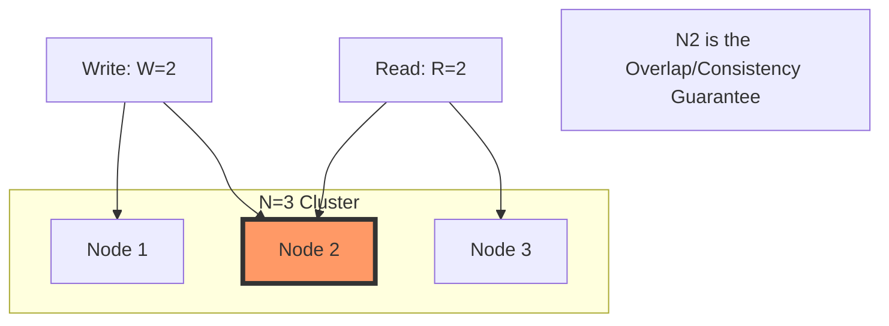

# 🧠 Topic: Quorum Consensus & Consistency Models

> [!abstract] Executive Summary (ELI5)
> Imagine a group of 5 friends (replicas) holding a secret. To update the secret, you tell 3 of them (W=3). To read the secret, you ask 3 of them (R=3). Because 3+3 is more than 5, you are guaranteed that at least one person you ask will have the latest update. This "overlap" ensures the group stays in sync without needing everyone to agree every single time.

---

## 🎯 The "Why"
- **Problem Solved:** 
    - **Tunable Trade-offs:** Allows developers to balance latency (speed) against consistency (accuracy).
    - **High Availability:** Systems don't have to wait for *all* nodes to respond, which would make them fragile.
- **Alternatives:** 
    - **Master-Slave (Strict):** One node handles everything (Bottleneck).
    - **2PC (Two-Phase Commit):** Very slow and blocks during failures.
- **Trade-offs:** 
    - **High W:** Better durability, slower writes.
    - **High R:** Stronger consistency, slower reads.
    - **Low W/R:** Extreme speed, but risk of "Stale Reads."

## 💡 Mental Model & Analogy
*Connect this technical concept to a real-world object or process.*
- **Analogy:** **The Overlapping Committee.**
    - You have a committee of 7 people. If a rule change requires 4 votes (W=4) and checking a rule requires asking 4 people (R=4), any group of 4 you ask is mathematically guaranteed to contain at least one person who voted on the change.
- **Visual/Diagram:** 

## 🛠️ Core Principles & Code Snippets
*Focus on "The Right Way" (Best Practices).*

### The Quorum Formula
To achieve **Strong Consistency**, the following must be true:
> [!important]
> **$W + R > N$**
> - **N:** Total Replicas
> - **W:** Write Quorum (Success after W ACKs)
> - **R:** Read Quorum (Wait for R responses)

### Common Configurations:
- **$W = N, R = 1$:** Optimized for fast reads, but one slow/down node kills write availability.
- **$W = 1, R = N$:** Optimized for fast writes, but one down node kills read availability.
- **$W = Q, R = Q$ (where $Q = N/2 + 1$):** Balanced (The most common "Strong Consistency" setup).
- **$W + R \leq N$:** Eventual Consistency (Fastest, but risk of stale data).

## ⚠️ Pitfalls & Anti-patterns
- **Strong Consistency Performance:** In a global system, requiring $W=N$ across continents will result in massive latency and frequent timeouts.
- **Conflict Resolution Burden:** If you choose **Eventual Consistency** ($W+R \leq N$), the client or the system must handle conflicts using techniques like **Vector Clocks** or **Last-Write-Wins (LWW)**.
- **Read-Your-Own-Writes:** A common pitfall in eventually consistent systems is a user saving a profile change and then refreshing to see the *old* data because they hit a replica that hasn't synced yet.

## 🔗 Deep Connections
- **Parent Topic:** [[Data Replication in Distributed Systems]]
- **Related Concepts:** [[CAP Theorem]], [[PACELC Theorem]], [[Vector Clocks]], [[DynamoDB]], [[Cassandra]]
- **Prerequisites:** Understanding of Replication and Latency.

## ❓ Active Recall Questions
> [!faq]- What happens to a system's availability if you set W = N and one node goes offline?
> The system becomes unavailable for any write operations, as it can no longer satisfy the quorum requirement.

> [!faq]- Why do systems like Cassandra and DynamoDB favor "Eventual Consistency"?
> To maximize availability and minimize latency. They allow the system to remain functional and fast even during network partitions or node slowness, accepting that data will be "eventually" synchronized.

---
## 📝 How to use this template effectively
*See GEMINI.md for flashcard rules.*
