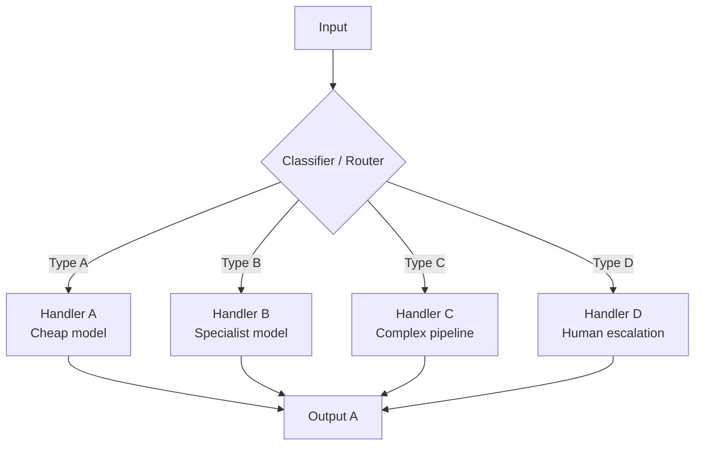

# Routing

> [!abstract] Executive Summary (ELI5)
> Routing is like a **receptionist or traffic cop** — it looks at the incoming request, quickly figures out what kind of thing it is, and sends it to the right specialist or department. It's the cheapest pattern because it usually only takes one fast LLM call.

---

## 🎯 The "Why"

- **Problem Solved:** Different inputs require different expertise, models, or processing pipelines. A one-size-fits-all approach wastes expensive model calls on simple inputs or sends complex inputs to cheap models that can't handle them.
- **Alternatives:**
  - Single model for everything (wastes money, poor quality for edge cases)
  - Hardcoded rule-based routing (brittle, can't handle novel inputs)
  - Client-side routing (requires client to know internal structure)
- **Trade-offs:** Routing adds one classification step but saves much more by directing to the right path. The risk is misclassification — a miscrouted input gets processed by the wrong pipeline.

---

## 💡 Mental Model & Analogy

- **Analogy:** "This is like **emergency room triage** — a nurse takes 30 seconds to assess a patient and decides: 'Go to cardiology,' 'Go to orthopedics,' or 'Go to the fast track for minor injuries.' The specialist doesn't waste time on triage; they get exactly what they're trained for."



---

## 🛠️ Core Principles & Code Snippets

### The Pattern
```python
from enum import Enum, auto
from dataclasses import dataclass

class RequestType(Enum):
    SIMPLE = auto()
    TECHNICAL = auto()
    BILLING = auto()
    ESCALATE = auto()

@dataclass
class RouteResult:
    request_type: RequestType
    confidence: float
    handler: callable

def route(input_text: str) -> RouteResult:
    # Fast, cheap classification call
    classification = llm_call(
        model="gpt-3.5-turbo",  # Use cheap model for routing
        system="""Classify the user request into one of:
        - SIMPLE: General questions, FAQs, greetings
        - TECHNICAL: Bugs, integration issues, API questions
        - BILLING: Payments, invoices, refunds, subscriptions
        - ESCALATE: Angry customers, legal issues, data requests
        
        Respond with JSON: {"type": "...", "confidence": 0.0-1.0}""",
        user=input_text
    )
    
    return RouteResult(
        request_type=classification["type"],
        confidence=classification["confidence"],
        handler=HANDLERS[classification["type"]]
    )
```

> [!tip] Implementation Note
> Use a **cheaper, faster model** for routing (e.g., GPT-3.5, Claude Haiku, or even a fine-tuned classifier). The router doesn't need deep reasoning — it needs speed and accuracy. Consider using embeddings + kNN for routing if you have many historical examples.

### Best Practices
- **Use structured output:** Force the router to return JSON with type and confidence. Reject low-confidence classifications for human review.
- **Keep router prompts simple:** The router should be a fast decision, not deep analysis. If it needs more than 2-3 sentences to classify, your categories are too fuzzy.
- **Log and monitor misclassifications:** Track where human reviewers override the router. Retrain or refine categories based on real data.
- **Consider multi-stage routing:** First route by domain, then by complexity within the domain.

---

## 🏢 Business Examples

### Customer Support Triage
```
Incoming: "I was charged twice for my subscription and the API keeps returning 500 errors"
Router → dual classification: BILLING + TECHNICAL
Action: Route to billing handler with a note about technical issues, or route to a combined handler
```

### Document Processing
```
Incoming: Unstructured document (PDF, email, form)
Router → classify as: Invoice / Contract / Support Ticket / Resume / Legal Notice
Each type goes to a specialized extraction pipeline tuned for its structure
```

### Lead Scoring & Routing
```
Incoming: Website form submission
Router → classify as: Hot Lead / Nurture / Spam / Partner Inquiry
Hot leads → instant sales notification
Nurture → marketing drip campaign
Spam → discard
Partner → partner team
```

---

## 💻 Software Development Examples

### Model Selection Router
```python
def smart_llm_call(prompt: str, complexity: str = None) -> str:
    if complexity is None:
        # Auto-route based on estimated complexity
        complexity = llm_classify_complexity(prompt)
    
    match complexity:
        case "simple":
            return cheap_model.complete(prompt)  # GPT-3.5, fast
        case "standard":
            return mid_model.complete(prompt)      # GPT-4o
        case "complex":
            return strong_model.complete(prompt) # GPT-4, Claude Opus
        case "code":
            return coding_model.complete(prompt)  # Code-specific model
```

### Error Log Routing
```python
def route_error(log: str) -> str:
    category = llm_classify(log, categories=[
        "infra": "Database, network, disk, memory issues",
        "code": "Null pointer, type error, logic bug",
        "security": "Auth failure, injection attempt, unauthorized access",
        "performance": "Timeout, slow query, memory leak"
    ])
    
    handlers = {
        "infra": notify_oncall,
        "code": create_jira_ticket,
        "security": alert_security_team,
        "performance": run_profiler
    }
    
    return handlers[category](log)
```

### API Gateway Routing
```python
# In an LLM-powered API gateway
def route_request(user_query: str):
    intent = classify_intent(user_query)
    
    routes = {
        "search": semantic_search_pipeline,
        "generate": creative_generation_pipeline,
        "analyze": data_analysis_pipeline,
        "summarize": summarization_pipeline,
        "compare": comparison_pipeline
    }
    
    return routes.get(intent, default_pipeline)(user_query)
```

---

## ⚠️ Pitfalls & Anti-patterns

- **Common Mistakes:**
  - Too many categories (5-7 is usually the sweet spot; more leads to confusion)
  - Using an expensive model for routing (wastes 80% of your budget)
  - Not handling "uncertain" — forcing a classification when confidence is low
  - Ignoring category drift over time (new types of requests emerge)
- **When NOT to use:**
  - When all inputs require the same processing (overhead with no benefit)
  - When the cost of misclassification is extremely high (use human-in-the-loop or [[Evaluator-Optimizer]] instead)
  - When categories are hopelessly overlapping (combine categories or use a different pattern)
- **Performance considerations:**
  - Routing should be sub-second. If it's slow, use a simpler model or switch to embeddings-based classification.
  - Cache routing decisions for repeated input patterns.

---

## 🔗 Deep Connections

- **Parent Topic:** [[Agentic_Workflow_Patterns_Overview]]
- **Related Concepts:** [[Load Balancing]], [[Content-Based Router]], [[Intent Classification]], [[ embeddings-based Classification]]
- **Prerequisites:** Understanding of classification problems, familiarity with structured LLM outputs

## Related Notes

- [[Agentic_Workflow_Patterns_Overview]]
- [[Prompt Chaining]] — often follows routing (specialized chain for each route)
- [[Orchestrator-Worker]] — when routing isn't enough and the path needs to be discovered dynamically
- [[Pattern Compositions]] — routing is the entry point for most compositions

---

*Last updated: 2026-06-21*
