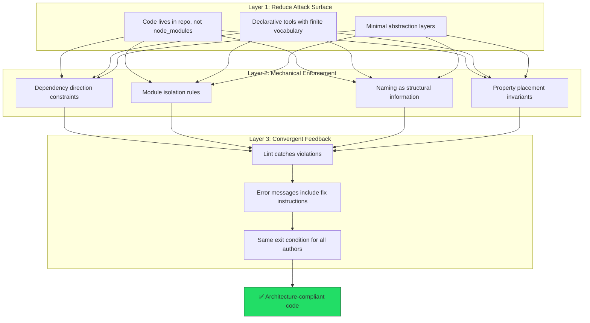

# 🧠 Topic: The Self-Enforcing Repository — Why AI-Era Codebases Must Police Themselves

> [!abstract] Executive Summary (ELI5)
> An AI agent is like a brilliant but amnesiac contractor. Every time it walks into your codebase, it has zero memory of your conventions, your past mistakes, or your taste. If the house itself doesn't have guardrails on the stairs, the contractor will build a staircase without them — fast, clean, and dangerous. **The repository must be a self-enforcing system, not a collection of suggestions.**

---

## 🎯 The "Why"

Three independent analyses — one about architecture (Bitloops), one about tooling choices (shadcn/ui analysis), one about CSS design (Zetsubo) — arrive at the same conclusion from different angles:

| Source | Domain | Says the same thing differently |
|---|---|---|
| Bitloops | Backend architecture | "AI agents optimize for the prompt, not the system. Without explicit constraints, they violate boundaries at scale." |
| shadcn/ui analysis | Frontend tooling | "Each abstraction layer is a hallucination surface. Agents need visible, declarative, low-abstraction code." |
| Zetsubo | CSS architecture | "Conventions drift. Only machine-verifiable invariants with feedback loops converge to consistent output." |

**The unified problem:** AI agents have no institutional memory. They can't internalize conventions the way a developer with 3 years on the codebase can. Every agent session starts from zero context. If your architecture exists only as guidelines, tribal knowledge, or "the way we do things" — it doesn't exist for the agent.

**The unified solution:** Transform the repository from a passive container of code into an **active enforcement system** — one that mechanically prevents violations, makes the right path obvious, and converges all authors (human or AI) to the same standard.

---

## 💡 Mental Model & Analogy

**Analogy: Napoleon's Three Lines of Defense**

Napoleon didn't rely on a single strategy to hold territory. He used defense in depth:

1. **Terrain selection** (choose ground that makes the enemy's job harder) → **Tooling choices** that reduce the agent's hallucination surface
2. **Standing orders** (clear, binary rules that don't require interpretation) → **Architectural invariants** enforced mechanically
3. **Scouts and reserves** (feedback on what's happening + force to correct it) → **Feedback loops** with fix instructions that converge the code

Any one layer can be overwhelmed. All three together create a self-enforcing system.



---

## 🛠️ The Three Pillars

### Pillar 1: Minimize the Hallucination Surface (from shadcn/ui analysis)

Before the agent writes a single line, the *choice of tools and structure* determines how many ways it can go wrong.

**Principle: Visibility > Abstraction**
- Code the agent works with must be **in the repo**, not hidden behind package APIs. A dependency in `node_modules` is a black box — the agent infers behavior from training data and guesses wrong. Source code in `src/components/` is a white box — the agent reads and modifies directly.
- **Declarative, finite vocabulary** beats complex imperative APIs. A bounded set of explicit primitives (utility classes, typed configs) gives the agent fewer degrees of freedom → fewer hallucinations. An unbounded API surface (theme providers, CSS-in-JS context, complex prop systems) is an invitation to invent.
- **Each abstraction layer is a hallucination surface.** The more layers between intent and implementation, the more places the agent can misinterpret. Strip layers to the minimum.

> The goal is not "simple code" — it's **code where the wrong thing is hard to write**.

### Pillar 2: Define Invariants, Not Conventions (from Bitloops + Zetsubo)

Conventions are rules that require interpretation. Invariants are rules that can be mechanically evaluated as true or false.

**Why conventions fail (for humans AND AI):**

| Failure mode         | Human version                  | AI version                                                    |
| -------------------- | ------------------------------ | ------------------------------------------------------------- |
| Memorization burden  | "I forgot that rule"           | Context window overflow — accuracy drops as rules grow        |
| Subjective decisions | "I interpreted it differently" | "I chose the statistically likely pattern from training data" |
| Verification gap     | "The reviewer missed it"       | "No validator checked it"                                     |

**What makes a rule an invariant:**
1. **Binary** — pass/fail, no gray zone
2. **Syntax-verifiable** — source code analysis only, no runtime
3. **Locally verifiable** — single file, no project-wide scanning

**Examples across domains:**

| Domain | Convention (drifts) | Invariant (holds) |
|---|---|---|
| Architecture | "Keep layers separate" | "Code in `/controllers` cannot import from `/db`" |
| CSS | "Parents manage layout" | "margin-top only in parent's `> .child` selector" |
| Naming | "Be consistent" | "Blocks = two-word kebab-case, Elements = single-word" |
| Dependencies | "Avoid circular deps" | "If A imports B, B cannot import A" |
| Security | "Authenticate endpoints" | "All `/api/*` routes must pass through AuthMiddleware" |

> "Isn't this just freezing preferences?" — Yes. And that's more valuable than having the "best" preference that nobody follows. When your author pool includes AI agents that start from zero context every session, an unwavering standard beats an optimal-but-unenforced guideline.

### Pillar 3: Build Convergent Feedback Loops (from Zetsubo)

Invariants without enforcement are still just documentation. The feedback loop is what makes the system self-enforcing.

**The loop:**
```
Write → Validate → [violation?] → Error with fix instructions → Fix → Validate → ... → Zero violations
```

**Critical design requirement: error messages must include fix instructions.**

| Lint style | Message | Agent behavior |
|---|---|---|
| Traditional | `"Architecture violation"` | Guesses a fix, probably wrong |
| Feedback-style | `"controllers.UserController cannot import db.UserRepo. Use UserService in the application layer."` | Applies the exact fix |

**Three enforcement stages (defense in depth):**
1. **Pre-generation** — constraints embedded in context/system prompt ("never generate X that imports Y")
2. **Post-generation / pre-commit** — validators run on agent output before it enters the repo. Fastest feedback.
3. **CI gate** — comprehensive checks before merge. The last line of defense.

**The convergence property:** if the exit condition is "zero lint errors" and the rules are the same, then output converges to the same structural standard regardless of author — junior dev, senior dev, or AI agent. **Same lint, same result.**

---

## ⚠️ Pitfalls & Anti-patterns

- **The `AGENTS.md` Trap:** Writing ever-longer instruction files instead of building validators. The agent's accuracy drops as context grows — this is the same memorization burden problem that kills human conventions, repackaged as a prompt.
- **"Lint everything" without prioritization:** Start with 3–5 high-value invariants (dependency direction, module boundaries, naming). Constraint fatigue is real — for humans reviewing the rules AND for agents processing them.
- **Tooling without error message design:** A validator that says "wrong" without saying "how to fix" forces the agent to guess. You've built a gate but not a guide.
- **Feature-only agents without janitors:** Building new code without automated cleanup is like cooking without washing dishes. Deploy janitor agents (Entropy Management) to enforce invariants on existing code, not just new code.
- **Confusing "flexible" with "resilient":** "We have guidelines but we're flexible about enforcement" = no architecture. Resilience comes from rigidity of rules + flexibility of implementation within those rules.

---

## 🔗 Deep Connections
- **Parent Topic:** [[Harness Engineering]]
- **Implements:** [[Architectural Constraints for AI Agents]] (Bitloops), [[Feedback-Systems-Over-Conventions]] (Zetsubo synthesis)
- **Enables:** [[Entropy Management]] (janitor agents need invariants to check against)
- **Relates to:** [[The Ralph Loop]] (the feedback loop here is a specialized instance of the broader agent correction loop)

---

## ❓ Active Recall Questions

> [!faq]- What are the three pillars of a self-enforcing repository?
> (1) **Minimize hallucination surface** — visible code, declarative tools, minimal abstraction. (2) **Define invariants, not conventions** — binary, syntax-verifiable, locally verifiable rules. (3) **Build convergent feedback loops** — validators with fix instructions, same exit condition for all authors.

> [!faq]- Why do conventions fail identically for humans and AI, despite failing for different reasons?
> Both fail because conventions require (1) memorization (humans forget, AI context overflows), (2) subjective judgment (humans interpret differently, AI picks statistically likely patterns), (3) manual verification (reviewers miss things, no validator checks). The failure modes are different, the structural result is identical: drift.

> [!faq]- What does "each abstraction layer is a hallucination surface" mean in practice?
> Every layer between the agent's intent and the actual implementation is a place where the agent can misinterpret. A theme provider API hides styling logic → agent guesses wrong props. A package in node_modules hides component internals → agent hallucinates behavior. Visible source code with declarative primitives gives the agent direct manipulation — fewer layers, fewer errors.
