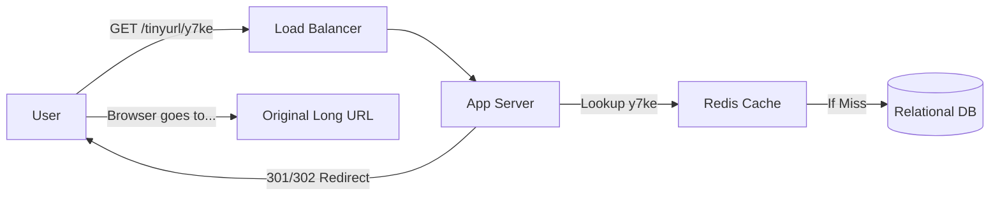

# 🧠 Topic: URL Shortener System Design

> [!abstract] Executive Summary (ELI5)
> A URL shortener takes a long, messy web link and turns it into a tiny, easy-to-share version. When someone clicks the short link, the system quickly finds the original long link in its database and "redirects" the person to the right place.

---

## 🎯 The "Why"
- **Problem Solved:** Long URLs are difficult to share in restricted spaces (like Twitter or SMS), look unprofessional, and can easily break if lines wrap. Shorteners also provide a layer of abstraction for analytics and click tracking.
- **Alternatives:** 
    - **QR Codes:** Good for offline-to-online, but not for text-based sharing.
    - **Subdomains/Path alias (Manual):** Only works for domains you own; doesn't scale for user-provided links.
- **Trade-offs:** 
    - **Pros:** Improved UX, analytics, link management.
    - **Cons:** Added latency (one extra hop), single point of failure (if shortener is down, link is dead), security risks (obfuscated targets used for phishing).

## 💡 Mental Model & Analogy
- **Analogy:** This is like a **Coat Check** at a theater. You give the attendant a big, heavy coat (Long URL), and they give you a tiny plastic token (Short URL). When you want your coat back, you give the token to the attendant, and they look up the mapping to find your specific coat.
- **Visual/Diagram:** 


## 🛠️ Core Principles & Code Snippets

### 1. Key Generation Strategies
There are two primary ways to generate the "slug":
- **Hash + Conflict Resolution:** Hash the original URL (MD5/SHA) and take the first $n$ characters. If it exists in the DB (collision), append a salt and try again.
- **Base-62 Conversion:** Take a unique counter (ID) and convert it to Base-62. This ensures uniqueness without collisions.

### 2. Base-62 Encoding Example
```typescript
/**
 * Converts a unique numeric ID into a Base-62 string.
 * This is superior for URL shorteners as it avoids collisions.
 */
function toBase62(n: number): string {
    const chars = "0123456789abcdefghijklmnopqrstuvwxyzABCDEFGHIJKLMNOPQRSTUVWXYZ";
    let res = "";
    while (n > 0) {
        res = chars[n % 62] + res;
        n = Math.floor(n / 62);
    }
    return res;
}
// Example: ID 2009215674938 => "zn9edcu"
```

> [!tip] Implementation Note
> Use **301 Redirects** if you want to offload traffic to the browser (caching), but use **302 Redirects** if you need accurate analytics on every single click.

## ⚠️ Pitfalls & Anti-patterns
- **Common Mistakes:** Using incremental IDs without obfuscation (allows competitors to crawl all links easily).
- **When NOT to use:** Internal systems where link length doesn't matter (direct database IDs are fine).
- **Performance/Security considerations:** 
    - **Security:** Use a "Snowflake" ID generator or a shuffle on the Base-62 alphabet to prevent sequential link guessing.
    - **Performance:** Reads (redirects) will far outnumber writes (creations). Implement a robust caching layer for the `shortURL -> longURL` mapping.

## ⚙️ Implementation Quirks & Advanced Details
- **Alphabet Shuffling:** By shuffling the standard `[a-z, A-Z, 0-9]` order before Base-62 transformation, you prevent external observers from guessing the sequence or total count of generated URLs.
- **Protocol Independence:** A common mistake is shortening `http` vs `https` as separate links. They should typically be normalized and mapped to the same record.
- **Vanity URL Reserved Keywords:** When allowing users to pick slugs, you must maintain a "blacklist" of reserved words (e.g., `admin`, `api`, `auth`, `stats`) to prevent system spoofing.
- **The Bloom Filter Guard:** Use a Bloom Filter for the write path. It can tell you with 100% certainty if a link has NOT been shortened before, allowing you to skip a DB check for the vast majority of brand-new links.
- **LRU Cache Strategy:** Since URL traffic follows a "power law" (viral links get 99% of traffic), a small LRU cache on the application nodes can handle the vast majority of redirects with zero database impact.

## 🔗 Deep Connections
- **Parent Topic:** [[Software Architecture]]
- **Related Concepts:** [[Caching Strategies]], [[Snowflake ID Generator]], [[Bloom Filters]]
- **Prerequisites:** Basic understanding of HTTP redirect codes (301/302) and Relational Databases.

## ❓ Active Recall Questions
> [!faq]- Why is 301 redirect preferred for performance over 302?
> 301 is a "Permanent Redirect," meaning the browser caches the target URL. Future visits to the short link go directly to the target without hitting your server again.

> [!faq]- How many characters are needed for 365 billion URLs using Base-62?
> 7 characters ($62^7 \approx 3.5$ trillion) is more than enough to handle 365 billion links for 10 years.

---
