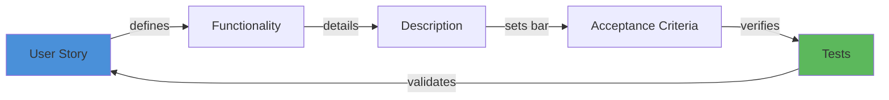

# 🧠 Topic: US-AC-Test-Anti-Drown-Workflow

> [!abstract] Executive Summary (ELI5)
> When building tools or skills, it's easy to get lost in technical setup (scaffolding, stack choice) and forget why you started. This workflow is a life jacket: before touching any code, you chain User Story → Functionality → Description → Acceptance Criteria → Tests. If you can't write the next step, you stop and refocus.

---

## 🎯 The "Why"
- **Problem Solved:** "Drowning in technical context" — when development energy gets consumed by scaffolding, configuration, stack selection, or infrastructure instead of validating the original user need. Observed during Herness testing when scaffolding new learning projects ate the time budget.
- **Alternatives:**
  - *YAGNI / pure TDD* — jumps straight to tests, often misses the "why" and business context.
  - *README-driven development* — good for context, but lacks structured acceptance criteria and test linkage.
  - *Shape Up* (Basecamp) — similar appetite/scoping idea, but less granular for individual features/skills.
- **Trade-offs:** Adds upfront overhead (writing before coding). Pays off by preventing rabbit holes and scope creep. Not needed for throwaway scripts or well-understood boilerplate.

## 💡 Mental Model & Analogy
- **Analogy:** "This is like a pilot's pre-flight checklist." You don't start the engine until every item is checked. If you can't complete the checklist, you don't fly — you don't "just quickly taxi around the airfield" instead.
- **Visual/Diagram:**


## 🛠️ Core Principles

### The Five-Step Chain

| Step | Question to Answer | Output Artifact | Anti-Pattern |
|------|-------------------|-----------------|--------------|
| **User Story** | Who needs what and why? | "As a [role], I want [feature], so that [benefit]" | Skipping to "let's build X" without the "so that" |
| **Functionality** | What does the system do? | Bulleted list of capabilities | Mixing "how" with "what" |
| **Description** | How exactly does it work? | Interaction flow, data flow, edge cases | Writing code instead of describing behavior |
| **Acceptance Criteria** | When is it done? | Given/When/Then or checklist | Vague criteria like "it works" |
| **Tests** | How do we prove it? | Unit, integration, or manual test cases | Writing tests after implementation without criteria |

### Application to Harness / Skill Development
```markdown
1. User Story: "As a developer, I want a harness skill that generates user stories,
   so that I don't lose context when switching between projects."

2. Functionality:
   - Accept project context as input
   - Generate structured user stories
   - Output in markdown format compatible with Obsidian

3. Description:
   - Context is provided via CLI arguments or stdin
   - LLM analyzes context and extracts actors/goals
   - Output is written to vault's research_in_progress/

4. Acceptance Criteria:
   - Given a 3-sentence project description, when I run the skill,
     then I get at least 3 user stories in valid markdown.
   - Given missing context, when I run the skill,
     then it prompts for clarification instead of hallucinating.

5. Tests:
   - Unit: Input parser handles empty/malformed input
   - Integration: End-to-end run produces valid Obsidian frontmatter
   - Manual: Run against 3 real projects and verify usefulness
```

> [!tip] Implementation Note
> If you get stuck at any step, do NOT proceed to the next. Stuck on User Story? Talk to the "customer" (even if it's yourself). Stuck on Description? You don't understand the domain yet — research, don't code.

## ⚠️ Pitfalls & Anti-Patterns
- **The Scaffolding Trap:** "I'll just quickly set up the repo and CI first..." — 4 hours later, no user value tested. **Fix:** Set a hard timebox (15 min) for scaffolding; if it's not enough, the project is too green.
- **Premature Test Writing:** Writing tests before AC leads to testing implementation details, not behavior. **Fix:** AC must exist before tests.
- **Writing for the Drawer:** Creating US/AC and never looking at them again. **Fix:** AC is the checklist for PR review and demo.
- **When NOT to use:**
  - One-off scripts (< 30 min lifetime)
  - Spikes / pure research (use [[Research-to-Project Template]] instead)
  - Fully understood boilerplate (e.g., "create another CRUD endpoint in existing framework")

## 🔗 Deep Connections
- **Parent Topic:** [[User-Story-Mapping-Chapter-1]], [[User-Story-Mapping-Chapter-2]], [[User-Story-Mapping-Chapter-3]]
- **Related Concepts:** [[The-Ralph-Loop]] (feedback cycles), [[Code-Quality-AI-Infrastructure]] (testing as guardrail)
- **Applied In:** [[2026-06-05 — Daily Plan|Daily Retro 2026-06-05]], [[User Stories Creator]] scaffolding, Herness testing workflow

## ❓ Active Recall Questions
> [!faq]- What is the primary constraint of this pattern?
> You cannot skip a step. If User Story is unclear, you don't write Functionality. If AC is missing, you don't write Tests. The chain enforces rigor.

> [!faq]- How does this behave under "I just need to test it quickly" pressure?
> The pressure is exactly when this pattern saves you. "Quick testing" is the gateway to yak shaving. The pattern forces you to define "quick" via AC and stop when AC is met.

> [!faq]- What's the difference between Functionality and Description?
> Functionality is *what* the system does (capabilities). Description is *how* it does it (flow, interactions, edge cases). "What" is for stakeholders; "how" is for developers.

---
## 📝 How to use this template effectively
1. **Never Copy-Paste:** If you find yourself copying documentation, stop. Read, close the tab, and write it from memory.
2. **Iterate:** Fill the 'ELI5' and 'Analogy' first. If you can't explain it simply, you don't understand it yet.
3. **The "Why" is King:** Seniority is defined by knowing *when* and *why* to use a tool, not just *how*.
4. **Update the Status:** Move from `new` -> `growing` -> `mastered` as you apply this in real projects.