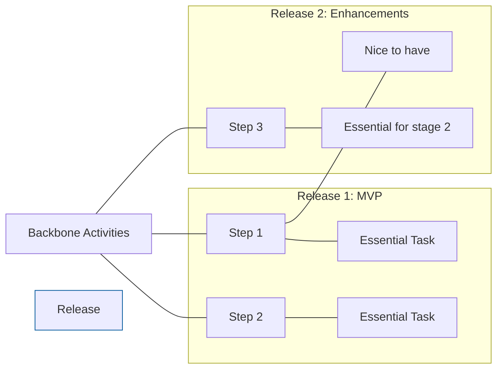

# 🧠 Topic: User Story Mapping (Chapter 2 - Plan to Build Less)

> [!abstract] Executive Summary (ELI5)
> You can't build everything you want because you'll run out of time and money. Story mapping helps you find the smallest possible "slice" of a product that actually helps someone, so you can release it early and see if it works before building the rest.

---

## 🎯 The "Why"
- **Problem Solved:** The "Everything is Important" fallacy. Teams often feel paralyzed by a massive scope, assuming they must build every feature before launch. This leads to late releases, hemorrhaging cash, and building things users don't actually want.
- **Alternatives:** 
    - **Feature Factories:** Building every requested feature without questioning the outcome.
    - **HiPPO (Highest Paid Person's Opinion):** Prioritizing based on status rather than user value or risk.
- **Trade-offs:** Requires the courage to "say no" or "not now" to features. It shifts the pressure from "when will it be done?" to "what is the most important outcome we can achieve first?".

## 💡 Mental Model & Analogy
- **Analogy:** "Building a house vs. camping." If you need shelter today, you don't wait for the granite countertops to be installed; you pitch a tent. The tent is the MVP that achieves the outcome of 'shelter' immediately.
- **Visual/Diagram:** 

## 🛠️ Core Principles
- **Outcome over Output:** Business success isn't measured by how many features you ship (output), but by how much you change user behavior (outcomes).
- **Minimum Viable Product (MVP) - 3 Definitions:**
    1. **Bad:** The "crappiest" version of a product.
    2. **Good (Patton):** The smallest product release that successfully achieves its desired outcomes for a specific set of users.
    3. **Experimental (Ries):** The smallest thing you can create to prove or disprove a risky assumption.
- **The "Slicing" Pattern:** Use a "line" (like blue painter's tape) to divide the map horizontally. Everything above the line is "In" for the next release; everything below is "Later".
- **Focus on the "Thrilling" User:** If you have many user types, choose *one* to thrill first rather than trying to satisfy everyone poorly.

> [!tip] Implementation Note
> Use "Target Outcomes" to anchor your slices. Instead of naming a slice "Version 1.0", name it after the behavior change, e.g., "Allow Musicians to Self-Promote for the First Time".

## ⚠️ Pitfalls & Anti-patterns
- **Scope Creep vs. Growth of Understanding:** Don't view new insights as "scope creep" to be avoided. View them as "growth of understanding" that must be managed through reprioritization.
- **The "Flat Backlog" dependencies:** Relying on individual team backlogs often hides the fact that Team A can't finish their "high priority" item because Team B hasn't started the "low priority" dependency.
- **HiPPO Prioritization:** Letting the loudest or highest-paid person decide the slice without mapping the end-to-end journey.

## 🔗 Deep Connections
- **Parent Topic:** [[Software Architecture]]
- **Related Concepts:** [[Lean Startup]], [[MVP (Minimum Viable Product)]], [[Prioritization Matrix]]
- **Prerequisites:** [[User-Story-Mapping-Chapter-1.md]]

## ❓ Active Recall Questions
> [!faq]- What is the difference between Output and Outcome in product development?
> Output is the software you build (features, lines of code). Outcome is the benefit the user gets or the behavior change that occurs *after* the software is released.

> [!faq]- Why is "The smallest thing to prove an assumption" a better definition of MVP for risky projects?
> Because it emphasizes *learning* over *shipping*. It prevents building a "viable product" that nobody wants because the underlying assumptions were wrong.

> [!faq]- How does a Story Map surface hidden cross-team dependencies?
> By visualizing the end-to-end journey, it becomes obvious if Team A’s task in Step 2 is a prerequisite for Team B's task in Step 3, regardless of their individual backlog priorities.
