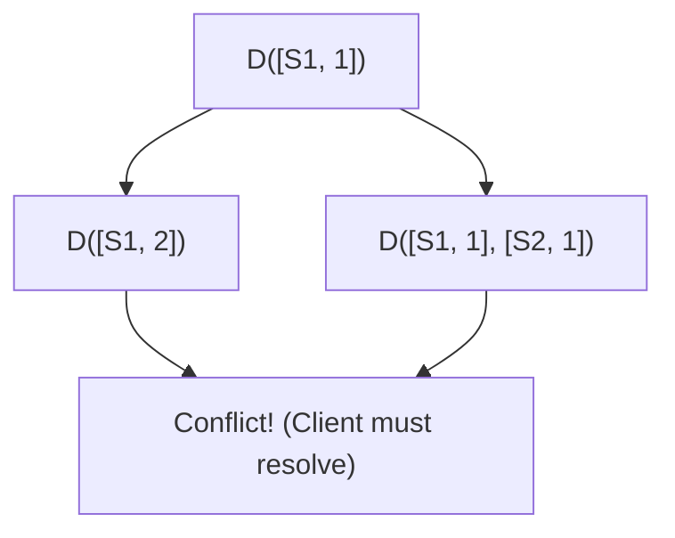

# 🧠 Topic: Vector Clocks & Versioning

> [!abstract] Executive Summary (ELI5)
> Imagine a shared document that several people are editing offline. Vector clocks are like a "change log" attached to the document that tracks who made how many edits. By looking at these logs, the system can tell if one person's version is just a newer version of another's, or if two people edited the same thing at the same time, creating a "clash" that needs fixing.

---

## 🎯 The "Why"
- **Problem Solved:** 
    - **Conflict Detection:** In multi-master distributed systems, different nodes might receive updates for the same key simultaneously. We need a way to know if Version B "happened after" Version A or if they are "concurrent" (conflicting).
    - **Data Integrity:** Prevents the "Last-Write-Wins" (LWW) problem where a later update accidentally overwrites a more important (but slightly earlier) update.
- **Alternatives:** 
    - **Last-Write-Wins (LWW):** Uses timestamps. Simple but risky due to clock skew between servers.
    - **Causality Tracking:** (Vector Clocks are the primary implementation of this).
- **Trade-offs:** 
    - **Complexity:** Moving conflict resolution to the client.
    - **Storage overhead:** Metadata (the vector) grows with the number of participating nodes.

## 💡 Mental Model & Analogy
*Connect this technical concept to a real-world object or process.*
- **Analogy:** **The Passport Stamps.**
    - Imagine a document that travels between cities (servers). Every time a city modifies the document, it stamps it: `[Paris: 1]`. If it goes back to Paris, it becomes `[Paris: 2]`. 
    - If you see two documents, one with `[Paris: 2, London: 1]` and another with `[Paris: 1, London: 1]`, you know the first one is just a newer version of the second. 
    - But if you see `[Paris: 2, London: 1]` and `[Paris: 1, London: 2]`, they have "diverged"—they are in conflict.
- **Visual/Diagram:** 


## 🛠️ Core Principles & Code Snippets
*Focus on "The Right Way" (Best Practices).*

### Vector Clock Definition
A vector clock is a list of pairs: `[Server_i, version_i]`.

### The Comparison Algorithm:
1. **Ancestor/Descendant:** Version X is an ancestor of Y if every counter in X is $\leq$ the corresponding counter in Y.
2. **Conflict:** If some counters in X are greater than in Y, and some in Y are greater than in X, the versions are **concurrent** (conflicting).

```typescript
// Conceptual logic for detecting a conflict
function isConflict(clockA: Map<string, number>, clockB: Map<string, number>): boolean {
    let aGreater = false;
    let bGreater = false;

    const allKeys = new Set([...clockA.keys(), ...clockB.keys()]);
    
    for (const server of allKeys) {
        const valA = clockA.get(server) || 0;
        const valB = clockB.get(server) || 0;
        
        if (valA > valB) aGreater = true;
        if (valB > valA) bGreater = true;
    }

    // If both are true, it's a conflict (Divergence)
    return aGreater && bGreater;
}
```

> [!tip] Implementation Note: Pruning
> To prevent the vector from growing indefinitely, systems use **Clock Pruning**. When the vector exceeds a certain size (e.g., 10 nodes), the oldest entries are removed.

## ⚠️ Pitfalls & Anti-patterns
- **Client Complexity:** The client must be able to handle "sibling" values (multiple values for one key) and merge them (e.g., merging two shopping carts).
- **Physical Clock Reliance:** Don't confuse Vector Clocks (logical clocks) with Wall-clock time. Physical clocks drift; logical clocks only track "causality."
- **Overhead:** If you have thousands of nodes writing to the same key, the metadata overhead can become larger than the actual data.

## 🔗 Deep Connections
- **Parent Topic:** [[Quorum Consensus & Consistency Models]]
- **Related Concepts:** [[Logical Clocks]], [[Lamport Timestamps]], [[DynamoDB]], [[Conflict-free Replicated Data Types (CRDTs)]]
- **Prerequisites:** Understanding of Replication and eventual consistency.

## ❓ Active Recall Questions
> [!faq]- What is the difference between a direct descendant and a conflict in vector clocks?
> A direct descendant means all version numbers in one clock are greater than or equal to the other. A conflict means some numbers are greater in one and some are greater in the other, indicating independent updates.

> [!faq]- How does "Clock Pruning" affect the system?
> It keeps the metadata size manageable but theoretically makes it harder to determine exact causality if very old versions are still floating around (though rare in practice).

---
## 📝 How to use this template effectively
*See GEMINI.md for flashcard rules.*
