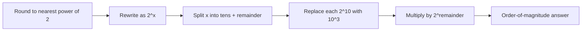

# 🧠 Topic: Back-of-the-Envelope Size Calculations

> [!abstract] Executive Summary (ELI5)
> In system design interviews, you rarely need exact numbers. You need the *order of magnitude*: will this service need gigabytes or petabytes? Hundreds or millions of requests per second? The "golden rule" `2^10 ≈ 10^3` lets you convert powers of two into powers of ten fast enough to do it aloud in front of an interviewer.

---

## 🎯 The "Why"
- **Problem Solved:** Hiring committees are not testing your calculator skills. They want to see that you can sanity-check a design, reason about storage/throughput/latency budgets, and catch mistakes before you propose a 10 PB cache.
- **Alternatives:** You can memorize common numbers (e.g., "1 million RPS ≈ 1K per second"), but that breaks down for non-standard inputs. Approximation keeps you flexible.
- **Trade-offs:** Approximation sacrifices precision for speed. It is appropriate for interviews, early architecture, and capacity planning; it is not appropriate for billing, safety-critical systems, or final capacity orders.

## 💡 Mental Model & Analogy
- **Analogy:** Converting between currencies at the airport. You do not need the exact rate to the fourth decimal; you need to know whether 1,000 yen is closer to $7 or $70. The golden rule is your exchange rate between the binary world (powers of 2) and the decimal world (K/M/G/T).
- **Visual/Diagram:**


## 🛠️ Core Principles & Code Snippets

### The Golden Rule
```
2^10 = 1024 ≈ 1000 = 10^3
```
Every 10 powers of two multiply the result by roughly 1,000:
- `2^20 ≈ 10^6` (million)
- `2^30 ≈ 10^9` (billion)
- `2^40 ≈ 10^12` (trillion)

### The Napkin Algorithm
1. **Round** the base to the nearest power of two.
2. **Rewrite** it as `2^x`.
3. **Split** the exponent: `x = 10 × k + remainder`.
4. **Replace** `(2^10)^k` with `(10^3)^k`.
5. **Multiply** by `2^remainder`.
6. **Round** the final number to one significant digit and attach the unit.

### Worked Examples

| Expression | Steps | Approximation | Actual |
|---|---|---|---|
| `26^8` | round 26 → 32 = 2^5 → `(2^5)^8 = 2^40 = (2^10)^4 ≈ (10^3)^4 = 10^12` | `1 TB` (keys) | 2.08 × 10^11 |
| `43^6` | round 43 → 32 = 2^5 → `(2^5)^6 = 2^30 = (2^10)^3 ≈ 10^9` | `1 billion` | 6.3 × 10^9 |
| `33^6` | round 33 → 32 = 2^5 → `2^30 ≈ 10^9` | `1 billion` | 1.29 × 10^9 |
| `17^10` | round 17 → 16 = 2^4 → `(2^4)^10 = 2^40 ≈ 10^12` | `1 trillion` | 2.02 × 10^12 |
| `55^7` | round 55 → 64 = 2^6 → `(2^6)^7 = 2^42 = 2^40 × 2^2 ≈ 4 × 10^12` | `4 trillion` | 1.73 × 10^12 |
| `129^4` | round 129 → 128 = 2^7 → `(2^7)^4 = 2^28 = 2^20 × 2^8 ≈ 256 × 10^6` | `256 million` | 2.77 × 10^8 |

### Throughput Estimation
Given **10 M users** each making **6 requests/day**:
```
10 × 10^6 users × 6 req/user = 60 × 10^6 req/day
60 × 10^6 ÷ 10^5 seconds ≈ 600 RPS
```
Interview rule of thumb: a day has ~10^5 seconds (actually 86,400; round up for napkin math).

### Storage Estimation
A URL-shortener key space of `26^8`:
```
26^8 ≈ 32^8 = (2^5)^8 = 2^40 ≈ 10^12 unique keys
```
If each key maps to ~1 KB of record metadata, that is `~1 PB` of index data at full saturation.

> [!tip] Implementation Note
> Always state your assumptions out loud: user count, request rate, payload size, retention period, replication factor. The interviewer cares more about *what you assume* than the exact number you produce.

## 📋 Quick Reference Cheat Sheet

### Storage Units
The article uses **decimal prefixes** (`KB = 10^3`), not binary (`KiB = 2^10`). For interviews this is fine — the interviewer wants the order of magnitude, not byte-level precision.

| Unit | Abbreviation | Bytes | Common Name |
|---|---|---|---|
| Kilobyte | KB | 10^3 | Thousand |
| Megabyte | MB | 10^6 | Million |
| Gigabyte | GB | 10^9 | Billion |
| Terabyte | TB | 10^12 | Trillion |
| Petabyte | PB | 10^15 | Quadrillion |

### Powers of 2 to Memorize
Your mental toolkit for rounding: `2, 4, 8, 16, 32, 64, 128`. When you see a number, ask "which power of two is it closest to?"

| Number in problem | Round to | Because |
|---|---|---|
| 17 | 16 | 16 = 2^4 |
| 26 | 32 | 32 = 2^5 |
| 55 | 64 | 64 = 2^6 |
| 129 | 128 | 128 = 2^7 |

### Time Conversions

| Period | Seconds | Interview shortcut |
|---|---|---|
| Day | 86,400 | ≈ 10^5 |
| Month | ~2,592,000 | ≈ 2.6 × 10^6 |
| Year | ~31,536,000 | ≈ 3.2 × 10^7 |

For monthly numbers, divide by ~2.6 × 10^6; on an interview napkin, dividing by 10^6 is usually close enough.

## 🧾 Five Rules of Thumb from the Article
1. **Always estimate to the nearest power of 2.** Round to `2, 4, 8, 16, 32, 64, 128`.
2. **Break down exponents into multiples of 10.** Split so you can apply `2^10 ≈ 10^3`.
3. **Use the `2^10 ≈ 10^3` conversion.** It is your main bridge between binary and decimal magnitudes.
4. **Round for easier mental math.** `8 → 10`, `86,400 → 100,000`.
5. **Focus on order of magnitude, not exact numbers.** The interviewer wants the scale, not a spreadsheet.

## 🌍 Real-Scenario Sizing Examples

### Example 1: WhatsApp-scale Messaging
**Assumptions:**
- 1 billion active users
- 50 messages per user per day
- Average message size: 100 bytes
- Message history retention: 5 years

**Step 1 — Messages per day:**
```
1,000,000,000 × 50 = 50 × 10^9 messages/day
```

**Step 2 — Data per day:**
```
50 × 10^9 messages × 100 bytes = 5 × 10^12 bytes/day = 5 TB/day
```

**Step 3 — Data for 5 years:**
```
5 TB/day × 365 days × 5 years
≈ 5 × 400 × 5  (round 365 to 400)
= 25 × 400
= 10,000 TB
= 10 PB
```

**Step 4 — Throughput:**
```
50 × 10^9 messages ÷ 10^5 seconds ≈ 500,000 messages/second
```

**Takeaway:** A WhatsApp-scale system needs petabytes of storage and ~500K messages/second. That immediately tells you: sharding, replication, message queues, and no single-node PostgreSQL.

### Example 2: URL Shortener Key Space + Metadata
**Assumptions:**
- 8-character key using 26 lowercase letters
- Each stored mapping is 1 KB
- Full saturation of the key space

**Key space size:**
```
26^8 ≈ 32^8 = (2^5)^8 = 2^40 ≈ 10^12 unique keys
```

**Total storage at saturation:**
```
10^12 keys × 1 KB = 10^12 × 10^3 bytes = 10^15 bytes = 1 PB
```

**Takeaway:** Even a tiny-looking 8-character string can address a petabyte-scale index. This drives the choice of a distributed key-value store over a single relational database.

### Example 3: Social Feed Read Load
**Assumptions:**
- 100 million DAU
- Each user refreshes the feed 10 times per day
- Each refresh = 1 request

**Daily reads:**
```
100 × 10^6 × 10 = 10^9 reads/day
```

**RPS:**
```
10^9 ÷ 10^5 seconds ≈ 10,000 RPS
```

**Takeaway:** A moderately popular feed is already 10K RPS at read time. Caching, CDNs, and feed pre-computation become non-negotiable.

## ⚠️ Pitfalls & Anti-patterns
- **Mistake 1 — Adding exponents instead of multiplying:** `(2^a)^b = 2^(a×b)`, not `2^(a+b)`. Forgetting this turns `32^8` into `2^13` instead of `2^40`.
- **Mistake 2 — Confusing `2^30` with `2^10 × 3`:** `2^30` is `(2^10)^3`, i.e., roughly one billion, not three thousand.
- **Mistake 3 — Treating the power of ten as a multiplier:** `10^9` is one billion (1 followed by 9 zeros), not nine billion.
- **Mistake 4 — Rounding to a "nice" number that is not a power of two:** `30^8` is *not* safely approximated as `32^8` unless you are explicitly bounding from above. Round to the nearest power of two, not the nearest round decimal.
- **Mistake 5 — Forgetting the remainder:** When splitting `2^42`, the leftover `2^2 = 4` must be multiplied back in. The remainder is itself a power of two, not just a digit.
- **When NOT to use:** Financial ledgers, medical dosing, safety margins, and capacity purchase orders need exact arithmetic, not back-of-the-envelope math.

## 🔗 Deep Connections
- **Parent Topic:** [[Capacity Planning]]
- **Related Concepts:** [[Latency Budget - System Design]], [[URL-Shortener-Design]], [[Distributed-KV-Store-Architecture]]
- **Prerequisites:** Basic exponent rules, familiarity with K/M/G/T prefixes.
- **Practice Source:** System Design Sandbox sizing scenarios and [[System Design Interview Preparation Plan]]

## ❓ Active Recall Questions
> [!faq]- Why is `2^10 ≈ 10^3` called the "golden rule" in system design interviews?
> It is the bridge between binary exponents (easy to compute mentally) and decimal magnitudes (easy to interpret as KB/MB/GB/TB). Every extra 10 in the exponent roughly multiplies the result by 1,000.

> [!faq]- What is the correct way to approximate `55^7` on a napkin?
> Round 55 up to 64 = 2^6. Then `(2^6)^7 = 2^42 = 2^40 × 2^2 ≈ 4 × 10^12`.

> [!faq]- How many RPS does 10 million daily active users generate if each user makes 6 requests per day?
> `10^7 × 6 = 6 × 10^7` requests per day. Divide by ~10^5 seconds per day → ~600 RPS.

> [!faq]- A WhatsApp-scale system has 1B users sending 50 messages/day at 100 bytes each. How much storage is needed for 5 years?
> ~5 TB/day × 365 × 5 ≈ 10 PB of raw message data. This ignores compression, replication, and metadata.

> [!faq]- When should you *not* use back-of-the-envelope approximation?
> When exactness matters: billing, safety-critical systems, compliance, final hardware procurement, or anything where an order-of-magnitude error is expensive or dangerous.
