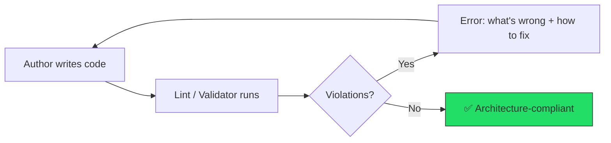

# 🧠 Topic: Feedback Systems Over Conventions — Designing Drift-Resistant Architecture for AI Agents

> [!abstract] Executive Summary (ELI5)
> Instead of writing long rule books that humans forget and AI ignores, build systems that **automatically tell you what's wrong and how to fix it**. Like a spell-checker: you don't memorize spelling rules — you just write, see the red underline, and fix it.

---

## 🎯 The "Why"
- **Problem Solved:** Convention-based architectures (naming guides, style docs, README rules) degrade over time — "drift." Human teams drift slowly; AI agents drift at scale and speed. Conventions require memorization, subjective judgment, and consistent reviews — all of which fail as teams (or agent counts) grow.
- **The Shift:** Replace "rules to memorize" with "feedback systems" — machine-verifiable invariants + error messages that include fix instructions. The author (human or AI) doesn't need to know the rules beforehand. Write → get feedback → fix → converge.
- **Trade-offs:** Requires upfront investment in tooling (custom lint rules, validators). Rules must be strict enough to be binary — some nuanced decisions can't be captured as invariants.

## 💡 Mental Model & Analogy
- **Analogy: TypeScript as the Gold Standard.** TypeScript doesn't teach you type rules — you write code, the compiler says "Type 'string' is not assignable to type 'number'", and you fix it. The code converges to type safety without upfront education. Apply the same pattern to any architectural concern: instead of a guidelines doc, build a tool that catches violations and tells you how to fix them.
- **Analogy: Napoleon's Standing Orders.** Napoleon didn't send letters explaining *why* each regiment should hold its position — he issued standing orders with clear, binary instructions. "Hold the bridge" is an invariant. "Use good judgment about the bridge" is a convention. One survives the fog of war; the other doesn't.



## 🛠️ Core Principles

### 1. Drift — The Silent Killer
Design doesn't collapse all at once. Small decision inconsistencies accumulate:
- **Boundary ambiguity:** Where one module/component ends and another begins differs by author
- **Responsibility confusion:** Who owns what (e.g., layout vs. content) varies file by file
- **Structural inconsistency:** Naming, file organization, import patterns drift across the project

AI agents amplify drift because they optimize for the prompt, not the system. They don't have a mental model of your architecture — they process tokens.

### 2. Conventions Fail for Three Reasons
1. **Memorization burden:** The longer the guidelines, the lower the compliance
2. **Subjective decisions:** Gray zones where "correct" depends on interpretation
3. **Verification difficulty:** Can't mechanically determine if a convention was followed

When all three are present, drift is inevitable — for humans and AI alike.

### 3. Invariants — The Alternative to Conventions
An invariant is a rule that can be mechanically evaluated as true or false. No gray zones, no interpretation.

**Design criteria for invariants:**
- **Binary evaluation:** Pass or fail, no "it depends"
- **Syntax-verifiable:** Determined from source code alone, no runtime needed
- **Locally verifiable:** Determined from the target file alone, no project-wide scanning

> "Isn't this just freezing preferences?" — Yes, and that's the point. When the author pool includes AI agents, having an unwavering standard is more valuable than having the "best" standard.

### 4. Error Messages as Documentation
For the feedback loop to work, error messages must be:
- **Specific:** Not "invalid" but "X must be Y (e.g., `hero-container`)"
- **Include fix instructions:** Not just what's wrong, but how to fix it
- **Self-contained:** No need to reference external docs
- **Machine-readable:** AI can parse and convert to executable fixes

### 5. Same Exit Condition for All Authors
```
Write → Lint → Fix → Lint → ... → Zero errors = compliant
```
The convergence target is identical whether the author is a junior dev, senior dev, or AI agent. **Same lint, same result.**

> [!tip] Implementation Note
> This pattern applies beyond CSS. Any architectural concern (dependency direction, module boundaries, API contracts) can be reframed as: define invariants → build a validator → design error messages with fix instructions → run in CI.

## ⚠️ Pitfalls & Anti-patterns
- **"Upfront Teaching" Trap:** Writing ever-longer `AGENTS.md` / `llms.txt` files instead of building validators. AI accuracy drops as context grows — same problem as human memory.
- **Convention Drift Disguised as Flexibility:** "We have guidelines but we're flexible about enforcement" = you don't have architecture, you have suggestions.
- **Lint Without Fix Instructions:** Traditional lint says "wrong" but not "how to fix." This works for formatting (the fix is obvious) but fails for architectural rules. Without fix instructions, AI agents guess — and guess wrong.
- **Ignoring the "Locally Verifiable" Criterion:** Rules requiring project-wide scanning are expensive to run and hard to integrate into fast feedback loops. Prefer rules verifiable from a single file.

## 🔗 Deep Connections
- **Parent Topic:** [[Harness Engineering]]
- **Related Concepts:** [[Architectural Constraints for AI Agents]] (Bitloops), [[Entropy Management]], [[The Ralph Loop]]
- **Key Insight:** This is the CSS-domain manifestation of the broader harness engineering principle: **the repo must mechanically enforce its own rules**, because AI agents can't internalize conventions the way experienced developers do.

## ❓ Active Recall Questions
> [!faq]- What are the three structural reasons that convention-based designs inevitably drift?
> (1) Memorization burden — guidelines get too long to apply accurately. (2) Subjective decisions — gray zones where "correct" depends on interpretation. (3) Verification difficulty — you can't mechanically check compliance, only review manually.

> [!faq]- What three criteria must a rule meet to qualify as an "invariant" (vs. a convention)?
> (1) Binary evaluation — unambiguous pass/fail. (2) Syntax-verifiable — determined from source code, no runtime. (3) Locally verifiable — determined from the target file alone, no project-wide scanning.

> [!faq]- Why is "same lint, same result" more powerful than "same guidelines, same result"?
> Guidelines require memorization and interpretation — both drift over time and vary by author. Lint provides post-hoc feedback with a fixed exit condition (zero errors). The code converges to the same standard regardless of who wrote it — human or AI.
