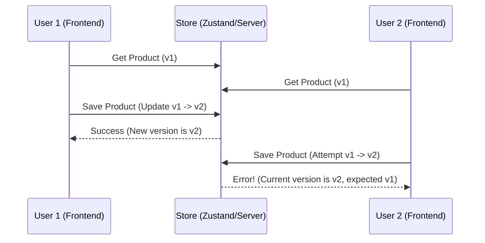

# 🧠 Topic: Optimistic Locking in Frontend (Zustand/In-memory)

> [!abstract] Executive Summary (ELI5)
> Представь, что ты и твой друг одновременно хотите взять последнюю печеньку из коробки. Перед тем как схватить её, ты проверяешь: "В коробке всё ещё лежит та самая печенька, которую я видел секунду назад?". Если кто-то уже успел её подменить или забрать, ты просто не совершаешь действие и понимаешь, что опоздал.

---

## 🎯 The "Why"
- **Problem Solved:** Решает проблему "Lost Update" (потерянное обновление) и "Overselling" (продажа товара, которого нет). Без этого два пользователя могут одновременно "успешно" купить последний товар, так как оба видели в стейте `count: 1`.
- **Alternatives:** 
	- **Pessimistic Locking:** Блокировка ресурса на сервере (БД) до завершения транзакции. (Тяжело для веба и масштабируемости).
	- **Last Write Wins:** Кто последний сохранил, тот и прав. (Опасно, затирает данные других).
- **Trade-offs:** Мы не нагружаем базу блокировками, но пользователь может получить ошибку "Данные устарели" в самый последний момент.

## 💡 Mental Model & Analogy
*Connect this technical concept to a real-world object or process.*
- **Analogy:** Редактирование статьи в Википедии. Если пока ты писал текст, кто-то другой уже сохранил новую версию, система скажет: "Версия страницы изменилась, разрешите конфликт".
- **Visual/Diagram:** 


## 🛠️ Core Principles & Code Snippets
Логика версионирования живет в **Агрегате**, а **Репозиторий** проверяет версию перед сохранением.

```typescript
// 1. Агрегат с версией
interface Product {
  id: string;
  count: number;
  version: number; // Наш ключ к успеху
}

// 2. Логика в Репозитории (или Store)
const useProductStore = create((set, get) => ({
  products: { 'p1': { id: 'p1', count: 1, version: 1 } },
  
  updateStock: (productId: string, newCount: number, expectedVersion: number) => {
    const state = get();
    const currentProduct = state.products[productId];

    // КРИТИЧЕСКАЯ ПРОВЕРКА
    if (currentProduct.version !== expectedVersion) {
      throw new Error("Optimistic Locking: Version mismatch! Someone updated the stock faster.");
    }

    // Сохраняем и инкрементируем версию
    set((state) => ({
      products: {
        ...state.products,
        [productId]: { 
          ...currentProduct, 
          count: newCount, 
          version: currentProduct.version + 1 
        }
      }
    }));
  }
}));
```

### Реальные примеры:
1.  **Корзина интернет-магазина:** Два пользователя одновременно добавляют последний iPhone в корзину. Первый проходит, второй получает: "Извините, товар закончился".
2.  **Бронирование мест в кино:** Если вы с кем-то выбрали одно и то же кресло одновременно, покупка пройдет у того, чей запрос долетел первым (проверка версии места).
3.  **Коллаборативный TODO-лист:** Если два человека меняют статус одной задачи, проверка версии защитит от перезатирания описания старой версией.

> [!tip] Implementation Note
> Всегда инкрементируйте `version` на клиенте (если это in-memory) или убедитесь, что сервер возвращает новую версию после успешного PATCH/PUT, чтобы локальный стейт оставался синхронизированным.

## ⚠️ Pitfalls & Anti-patterns
- **Common Mistakes:** Забывать обновлять версию после успешного сохранения (приведет к постоянным ошибкам конфликта).
- **When NOT to use:** Когда конфликты случаются ОЧЕНЬ часто (high contention). В таких случаях лучше использовать очереди или пессимистичные блокировки.
- **Performance/Security considerations:** Проверка должна дублироваться на сервере. Клиентская проверка — это UX и защита локального стейта, но сервер — это истина.

## 🔗 Deep Connections
- **Parent Topic:** [[Software Architecture]]
- **Related Concepts:** [[Hexagonal Architecture]], [[Domain Driven Design]], [[Race Conditions]]

## ❓ Active Recall Questions
> [!faq]- Что произойдет, если мы НЕ будем использовать Optimistic Locking в высоконагруженном фронтенде?
> Мы получим проблему Lost Update: действия одного пользователя будут бесследно затерты действиями другого.

---
