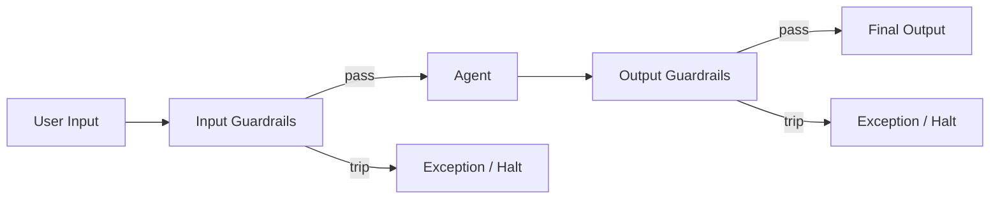

# Guardrails (OpenAI Agents SDK)

> [!abstract] Executive Summary (ELI5)
> **Guardrails** are safety checks that run on what the user says (input) or what the agent produces (output). If a check fails, the SDK can stop the run or flag it for review before the conversation continues.

---

## 🎯 The "Why"

- **Problem Solved:** Agents can receive harmful, off-topic, or PII-laden inputs, and they can produce incorrect, unsafe, or off-brand outputs. Guardrails intercept these at the edges — before the agent processes bad input or after it generates bad output.
- **Alternatives:**
  - **Pre/post-processing in app code** — you write validation logic around the agent. Works, but scatters safety logic and misses framework-level hooks.
  - **Model-level moderation (e.g., OpenAI Moderation API)** — good for toxicity, but not for domain-specific rules (e.g., "don't solve math homework").
  - **Fine-tuning for safety** — bakes guardrails into weights, but is slow to adapt and doesn't cover all cases.
- **Trade-offs:** Guardrails add latency (especially if they use another agent to check). They run in parallel where possible, but they still cost tokens. Use them for high-stakes checks, not trivial ones.

## 💡 Mental Model & Analogy

- **Analogy:** "This is like airport security. Before you board (input guardrail), your bags are scanned for dangerous items. After you land (output guardrail), customs checks what you're bringing into the country. If either check fails, you're stopped before you cause harm."
- **Visual/Diagram:**



## 🛠️ Core Principles & Code Snippets

### 1. Two categories: Input and Output

From the official docs:

- **Input guardrails** run on the initial user input, in parallel to the agent's execution. They only run if the agent is the **first** in the chain.
- **Output guardrails** run on the final output of the agent, after it generates a response. They only run if the agent produces a final output.

### 2. Input guardrail example

```python
from pydantic import BaseModel
from agents import (
    Agent, GuardrailFunctionOutput, InputGuardrailTripwireTriggered,
    RunContextWrapper, Runner, input_guardrail,
)

class HomeworkCheck(BaseModel):
    is_math_homework: bool
    reasoning: str

guardrail_agent = Agent(
    name="Guardrail check",
    instructions="Check if the user is asking you to do their math homework.",
    output_type=HomeworkCheck,
)

@input_guardrail
async def math_guardrail(ctx, agent, input):
    result = await Runner.run(guardrail_agent, input, context=ctx.context)
    return GuardrailFunctionOutput(
        output_info=result.final_output,
        tripwire_triggered=result.final_output.is_math_homework,
    )

agent = Agent(
    name="Tutor",
    instructions="You help with math concepts, not homework.",
    input_guardrails=[math_guardrail],
)
```

### 3. Output guardrail example

```python
from agents import (
    Agent, GuardrailFunctionOutput, OutputGuardrailTripwireTriggered,
    RunContextWrapper, Runner, output_guardrail,
)

class ToneCheck(BaseModel):
    is_too_casual: bool

 tone_agent = Agent(
    name="Tone check",
    instructions="Check if the response is too casual for a professional setting.",
    output_type=ToneCheck,
)

@output_guardrail
async def tone_guardrail(ctx, agent, output):
    result = await Runner.run(tone_agent, output.response, context=ctx.context)
    return GuardrailFunctionOutput(
        output_info=result.final_output,
        tripwire_triggered=result.final_output.is_too_casual,
    )
```

### 4. How guardrails work under the hood

1. The guardrail is decorated with `@input_guardrail` or `@output_guardrail`.
2. It receives the run context, the agent, and the input or output.
3. It returns a `GuardrailFunctionOutput` with:
   - `output_info`: arbitrary data (often the result of a guardrail agent check).
   - `tripwire_triggered`: a boolean indicating whether the guardrail failed.
4. If `tripwire_triggered` is `True`, the SDK raises `InputGuardrailTripwireTriggered` or `OutputGuardrailTripwireTriggered`.

### 5. Using another agent as the checker

The canonical pattern is to use a lightweight, fast agent (e.g., `gpt-4o-mini`) to evaluate the input/output. This keeps the guardrail logic declarative and testable.

## 🏗️ Complexity Spectrum

| Level | Approach | Example |
|-------|----------|---------|
| **Level 1: Simple regex / keyword guardrail** | Fast check without an LLM | Blocklist of banned words |
| **Level 2: LLM-as-a-judge guardrail** | Another agent evaluates input/output | Homework detection, tone check |
| **Level 3: Multi-guardrail pipeline** | Several input + output guards run in parallel | PII scan + toxicity scan + relevance check |
| **Level 4: Custom exception handling** | Catch tripwire and take business action (fallback, human review) | Escalate to human when guardrail trips |

## 🏢 Production Examples

- **Education app:** Input guardrail blocks direct homework answers; output guardrail ensures the response teaches rather than solves.
- **Customer support:** Input guardrail detects PII leakage; output guardrail checks for brand-violating language.
- **Medical assistant:** Input guardrail screens for emergency language; output guardrail adds a "not medical advice" disclaimer.
- **Code generation:** Output guardrail checks for hardcoded secrets or insecure patterns.

## ⚠️ Pitfalls & Anti-patterns

- **Guardrail agents that are too powerful:** Using `gpt-5.4` for a simple guardrail is overkill and expensive. Use a fast, cheap model.
- **Guardrail fatigue:** Running 10 guardrails on every message adds latency and cost. Keep the set small and high-signal.
- **False positives:** A guardrail that trips too aggressively ruins the user experience. Tune the prompt and test edge cases.
- **Not handling exceptions:** If you don't catch `InputGuardrailTripwireTriggered`, the run crashes. Always define what happens when a guardrail trips.
- **Leaking context in guardrail agents:** The guardrail agent may see sensitive data. Ensure it doesn't log or expose it.

## 🔗 Deep Connections

- **Parent Topic:** [[Agentic Workflow Patterns Overview]], [[OpenAI Agents SDK]]
- **Related Concepts:** [[The Agent]], [[Handoffs]], [[Evaluator-Optimizer]], [[LLM-as-a-Judge]]
- **Prerequisites:** Error handling, Pydantic models, decorator patterns

## ❓ Active Recall Questions

> [!faq]- What is the difference between input and output guardrails?
> Input guardrails run on the user's input before the agent generates a response. Output guardrails run on the agent's final output after generation.

> [!faq]- When do input guardrails *not* run?
> They only run if the agent is the first in the chain. If the conversation has already been handed off, input guardrails on subsequent agents are skipped.

> [!faq]- What does `tripwire_triggered` do?
> If set to `True` in the `GuardrailFunctionOutput`, the SDK raises an exception (`InputGuardrailTripwireTriggered` or `OutputGuardrailTripwireTriggered`), halting the run.

> [!faq]- Why use a separate agent as the guardrail checker?
> It keeps the guardrail logic declarative, testable, and isolated from the main agent's behavior. You can also use a cheaper, faster model.

## Related Notes

- [[The Agent]]
- [[Handoffs]]
- [[Agentic Workflow Patterns Overview]]
- [[Evaluator-Optimizer]]
