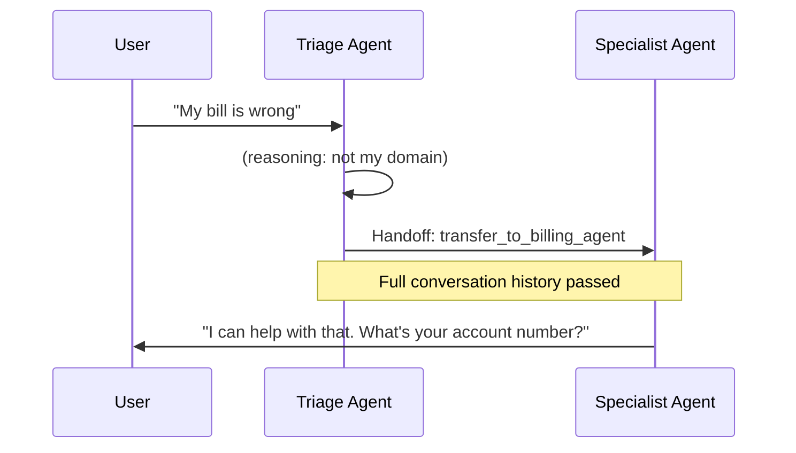

# Handoffs (OpenAI Agents SDK)

> [!abstract] Executive Summary (ELI5)
> A **handoff** is when one agent decides it is not the right person for the job and passes the conversation to a more specialized agent. The new agent receives the full conversation history and takes over from there.

---

## 🎯 The "Why"

- **Problem Solved:** A single general-purpose agent cannot excel at everything. Handoffs let you build modular, specialist agents (billing, support, sales) and let a triage agent route work to the right expert.
- **Alternatives:**
  - **One giant agent with all tools** — simpler setup, but the model gets confused and quality drops as the tool count grows.
  - **Prompt chaining** — hardcode the routing in your app logic. Fast but brittle when the routing logic changes.
  - **Orchestrator-Worker pattern** — an external orchestrator decides who does what. More flexible, but adds complexity.
- **Trade-offs:** Handoffs add an LLM decision step (latency + cost) but improve correctness and modularity. They work best when tasks are clearly separable.

## 💡 Mental Model & Analogy

- **Analogy:** "This is like a hospital receptionist. A patient walks in, the receptionist quickly assesses the issue, and then transfers them to the right specialist (cardiology, orthopedics, etc.). The specialist picks up the patient's chart and continues the conversation where the receptionist left off."
- **Visual/Diagram:**



## 🛠️ Core Principles & Code Snippets

### 1. A handoff is a special tool

Under the hood, a handoff is registered as a tool on the source agent. The model decides to call it just like any other tool. The SDK abstracts this away via the `handoff()` helper.

### 2. Creating a handoff

```python
from agents import Agent, handoff

billing_agent = Agent(
    name="Billing agent",
    handoff_description="Handles billing and payment issues",
    instructions="You are a billing specialist. Resolve invoice and payment questions.",
)

triage_agent = Agent(
    name="Triage agent",
    instructions="Route the user to the right specialist.",
    handoffs=[handoff(billing_agent)],
)
```

### 3. Configuring handoff behavior (from the official docs)

| Parameter | What it does |
|-----------|--------------|
| `agent` | The target agent to hand off to. Required. |
| `tool_name_override` | Custom name for the handoff tool exposed to the LLM. |
| `tool_description_override` | Custom description for the handoff tool. |
| `on_handoff` | Callback that runs when the handoff is invoked. Use for side effects or bookkeeping. |
| `input_type` | Pydantic type for structured handoff arguments. Validates model-generated JSON. |
| `input_filter` | Function that filters the conversation history passed to the next agent. |
| `nest_handoff_history` | Whether to nest the handoff history (affects how context is passed). |
| `is_enabled` | Bool or callable that dynamically enables/disables the handoff at runtime. |

### 4. Input filtering

By default, the new agent sees the entire conversation history. You can filter it to remove sensitive items or trim old messages.

```python
def my_filter(data):
    # data contains the full history and new items
    # modify and return data to control what the next agent sees
    return data

handoff(billing_agent, input_filter=my_filter)
```

### 5. Dynamic enabling

You can conditionally hide a handoff from the model based on runtime state.

```python
def is_billing_open(ctx, agent):
    return ctx.context.business_hours

handoff(billing_agent, is_enabled=is_billing_open)
```

## 🏗️ Complexity Spectrum

| Level | Setup | When to Use |
|-------|-------|-------------|
| **Level 1: Single handoff** | One triage → one specialist | Simple routing (sales vs support) |
| **Level 2: Multiple handoffs** | Triage with several specialists | Domain-specific support (billing, technical, account) |
| **Level 3: Bidirectional handoffs** | Agents can hand back or sideways | Complex workflows where ownership shifts |
| **Level 4: Conditional handoffs** | Dynamic `is_enabled` + `input_filter` | Enterprise systems with access control and data privacy |

## 🏢 Production Examples

- **Customer support:** Triage → Billing, Technical, Account Management.
- **Medical triage:** Intake nurse → General Practitioner → Specialist.
- **DevOps assistant:** General bot → Security bot, Deployment bot, Incident bot.
- **Sales assistant:** Qualifier → Demo scheduler → Pricing specialist.

## ⚠️ Pitfalls & Anti-patterns

- **Missing `handoff_description`:** Other agents rely on this description to decide whether to hand off. Without it, the model has no context for routing.
- **Circular handoffs:** Agent A hands to B, B hands back to A. Add guardrails or limit handoff depth.
- **Leaking PII via history:** If the first agent collected sensitive data, the next agent sees it by default. Use `input_filter` to redact.
- **Over-handoff:** An agent that hands off too eagerly creates a ping-pong experience. Triage agents should be trained to handle simple queries themselves.
- **Ignoring `on_handoff` side effects:** This is the right place for audit logs, notifications, or analytics — not in the target agent.

## 🔗 Deep Connections

- **Parent Topic:** [[Agentic Workflow Patterns Overview]], [[OpenAI Agents SDK]]
- **Related Concepts:** [[The Agent]], [[Guardrails]], [[Routing]], [[Orchestrator-Worker]], [[LLM Tool Use / Function Calling]]
- **Prerequisites:** Understanding of the Agent primitive, tool use, and multi-agent routing logic

## ❓ Active Recall Questions

> [!faq]- What is a handoff in the OpenAI Agents SDK?
> A special tool that lets an agent delegate control to another agent. The target agent receives the conversation history and takes over.

> [!faq]- Why is `handoff_description` important?
> It is the text the source agent sees when deciding whether to hand off. Without a good description, routing is random.

> [!faq]- What does `input_filter` do?
> It lets you control which conversation history items are passed to the next agent. Useful for privacy, trimming, or removing irrelevant context.

> [!faq]- What is the difference between `on_handoff` and the target agent's instructions?
> `on_handoff` runs when the handoff is triggered (good for side effects like logging). The target agent's instructions define how the new agent behaves once it takes over.

## Related Notes

- [[The Agent]]
- [[Guardrails]]
- [[Agentic Workflow Patterns Overview]]
- [[Routing]]
