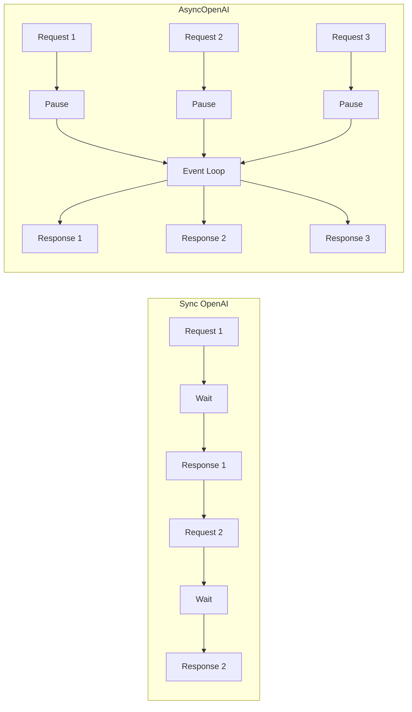

# 🧠 Topic: OpenAI Client vs AsyncOpenAI Client

> [!abstract] Executive Summary (ELI5)
> OpenAI provides two official Python clients: `OpenAI` is synchronous — it blocks and waits for the API to respond before doing anything else. `AsyncOpenAI` is asynchronous — it can ask the API a question, pause that specific task, and work on other things while waiting for the answer. Choose `AsyncOpenAI` when you need to handle many requests concurrently without spawning hundreds of threads.

---

## 🎯 The "Why"
- **Problem Solved:** LLM API calls are high-latency network operations. A synchronous client holds a thread for the entire duration of the request, which wastes resources under concurrency. The async client lets a single thread juggle many in-flight requests using Python's `asyncio` event loop.
- **Alternatives:**
    - **Sync `OpenAI` + thread pool:** Works for moderate concurrency, but each thread still consumes memory and OS scheduling overhead.
    - **`httpx.AsyncClient` manually:** Maximum control, but you rebuild retries, streaming, authentication, and SSE parsing yourself.
    - **LangChain / LlamaIndex wrappers:** Hide the client choice behind framework abstractions; useful until you need fine-grained control.
- **Trade-offs:**
    - **Sync `OpenAI`:** Simpler code, easier to use in scripts and notebooks, no `async/await` ceremony. Poor scalability for I/O-bound workloads.
    - **Async `AsyncOpenAI`:** Better throughput and lower memory usage for many concurrent calls. Requires an async runtime and propagating `async`/`await` through the call stack.

## 💡 Mental Model & Analogy
- **Analogy:** A synchronous client is like a **single cashier who stops everything until each customer's credit-card transaction finishes**. An async client is like a **barista who takes your order, starts brewing, takes the next order, and comes back when your coffee is ready** — one worker serving many customers without idle waiting.
- **Visual/Diagram:**


## 🛠️ Core Principles & Code Snippets

### 1. Synchronous Client
Use this in scripts, one-off jobs, or when you are not running inside an async framework.

```python
from openai import OpenAI

client = OpenAI(api_key="...")

response = client.chat.completions.create(
    model="gpt-4o",
    messages=[{"role": "user", "content": "Explain asyncio in one sentence."}]
)
print(response.choices[0].message.content)
```

### 2. Asynchronous Client
Use this in web servers, agent orchestrators, or any workload that issues many LLM calls at once.

```python
import asyncio
from openai import AsyncOpenAI

client = AsyncOpenAI(api_key="...")

async def ask(question: str) -> str:
    response = await client.chat.completions.create(
        model="gpt-4o",
        messages=[{"role": "user", "content": question}]
    )
    return response.choices[0].message.content

async def main():
    questions = ["What is asyncio?", "What is a coroutine?", "What is an event loop?"]
    answers = await asyncio.gather(*[ask(q) for q in questions])
    for a in answers:
        print(a)

asyncio.run(main())
```

> [!tip] Implementation Note
> Always create one client instance and reuse it. Both `OpenAI` and `AsyncOpenAI` manage connection pools internally. Creating a new client per request defeats the purpose and leaks connections.

### 3. Streaming with Both Clients
Streaming works the same conceptual way, but the async iterator yields chunks without blocking other coroutines.

```python
# Sync
for chunk in client.chat.completions.create(
    model="gpt-4o",
    messages=[{"role": "user", "content": "Count to 10"}],
    stream=True
):
    print(chunk.choices[0].delta.content or "", end="")

# Async
async for chunk in await client.chat.completions.create(
    model="gpt-4o",
    messages=[{"role": "user", "content": "Count to 10"}],
    stream=True
):
    print(chunk.choices[0].delta.content or "", end="")
```

> [!warning] Async Streaming Syntax
> In the async client, `await client.chat.completions.create(..., stream=True)` returns an async iterator. You then iterate with `async for`, not `for`.

## ⚠️ Pitfalls & Anti-patterns
- **Mixing sync and async in the same loop:** Do not call `client.chat.completions.create()` (sync) from inside an async function. It blocks the event loop and kills concurrency. If you are in async code, use `AsyncOpenAI` everywhere.
- **Creating a client per request:** This destroys connection reuse and adds TLS handshake overhead to every call.
- **Forgetting to `await`:** The async client returns coroutines. Missing `await` gives you a coroutine object instead of a response, often surfacing as a subtle bug or `RuntimeWarning`.
- **Using async in a non-async context without `asyncio.run`:** You cannot `await` at the top level of a regular script. Wrap the entry point with `asyncio.run(main())` or use an async framework like FastAPI.
- **Forgetting to import `AsyncOpenAI`:** A common first failure is `NameError: name 'AsyncOpenAI' is not defined`. The fix is simply `from openai import AsyncOpenAI` before constructing the client.
- **When NOT to use async:** A single sequential script that makes one API call at a time gains nothing from `AsyncOpenAI`. The extra `async`/`await` syntax is noise unless you exploit concurrency.

## 🔗 Deep Connections
- **Parent Topic:** [[OpenAI-Agent-SDK-Overview]], [[LLM Tool Use - Function Calling]]
- **Related Concepts:**
    - [[The Agent]] — Agent loop that often issues many tool + LLM calls concurrently
    - [[Decorator-Based Tool Registry]] — Tool registration patterns that may run inside async agents
    - [[Guardrails]] — Guardrails may invoke the model; decide sync vs async based on caller context
    - [[Troubleshooting Custom LLM Provider with OpenAI Agents SDK]] — Using `AsyncOpenAI` with custom `base_url` and provider prefixes
- **Prerequisites:** Python `asyncio`, understanding of blocking vs non-blocking I/O

## ❓ Active Recall Questions
> [!faq]- When should you prefer `AsyncOpenAI` over `OpenAI`?
> Prefer `AsyncOpenAI` whenever you need to run multiple LLM requests concurrently or when your code already runs inside an async event loop, such as a FastAPI server or an async agent orchestrator.

> [!faq]- Can you use the sync `OpenAI` client inside an async function?
> Technically yes, but it blocks the event loop and defeats the purpose of async concurrency. It is almost always a bug.

> [!faq]- Does `AsyncOpenAI` make a single request faster?
> No. The latency of one individual request is roughly the same. The gain is throughput: many requests overlap instead of executing one after another.

> [!faq]- How do you correctly stream with the async client?
> `await client.chat.completions.create(..., stream=True)` returns an async iterator; iterate with `async for chunk in ...`.

---
## 📝 How to use this template effectively
1. **Never Copy-Paste:** If you find yourself copying documentation, stop. Read, close the tab, and write it from memory.
2. **Iterate:** Fill the 'ELI5' and 'Analogy' first. If you can't explain it simply, you don't understand it yet.
3. **The "Why" is King:** Seniority is defined by knowing *when* and *why* to use a tool, not just *how*.
