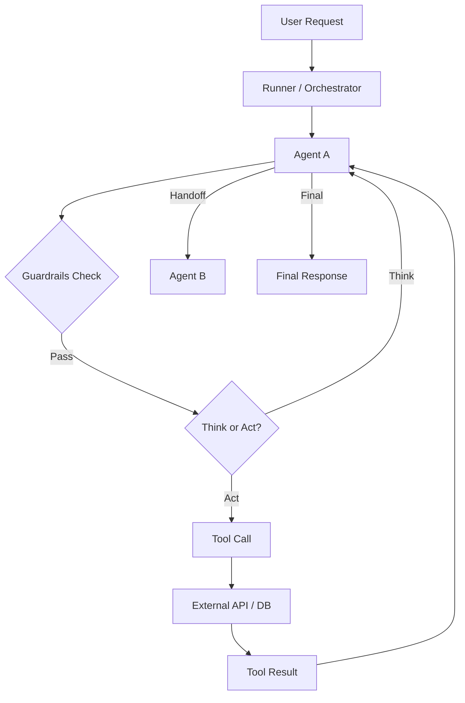

# 🧠 Topic: OpenAI Agent SDK — Overview

> [!abstract] Executive Summary (ELI5)
> OpenAI Agent SDK is a set of building blocks that turn a raw LLM into a structured, autonomous agent. Instead of writing prompts from scratch, you define an agent with a name, instructions, tools, and guardrails. The SDK then orchestrates the loop: the agent thinks, decides, calls tools, receives results, and thinks again.

---

## 🎯 The "Why"
- **Problem Solved:** Building agentic systems with raw API calls requires manual orchestration of the reasoning loop, tool calling, error handling, and state management. The SDK provides primitives to handle this boilerplate so you focus on business logic.
- **Alternatives:**
    - **LangChain / LangGraph:** More mature ecosystem, but heavier abstractions and steeper learning curve.
    - **CrewAI:** High-level multi-agent framework, opinionated but less flexible for custom tool integration.
    - **Raw OpenAI API + custom loop:** Maximum control, but requires building the entire tool-calling, retry, and state machinery from scratch.
- **Trade-offs:**
    - **Pros:** Minimal boilerplate, built-in tool calling, native OpenAI integration, clean API design, built-in guardrails and handoffs.
    - **Cons:** Tightly coupled to OpenAI ecosystem, newer (less community support), multi-agent orchestration still requires careful design.

## 💡 Mental Model & Analogy
- **Analogy:** The SDK is like a **flight control tower**.
    - The **tower** is the orchestration layer (the `run` loop).
    - Each **pilot** is an agent with a specific mission (instructions + tools).
    - **Runways** are guardrails — safety checks before takeoff or landing.
    - **Handoffs** are when a pilot transfers control to another tower (agent-to-agent delegation).
    - **Radar** is the tool system — it feeds real-world data into the cockpit.
- **Visual/Diagram:**


## 🛠️ Core Components & Code Snippets

### 1. Agent
The fundamental unit. It has an identity (name + instructions) and a set of capabilities (tools + model).

```python
from agents import Agent, Runner

agent = Agent(
    name="Research Assistant",
    instructions="You are a helpful assistant. Use web_search to find facts. Use calculator for math.",
    model="gpt-4o",
    tools=[web_search, calculator]
)

result = await Runner.run(agent, input="What is the population of Tokyo divided by 100?")
print(result.final_output)
```

### 2. Tools
Any Python function decorated with `@function_tool` becomes available to the agent.

```python
from agents import function_tool

@function_tool
def get_stock_price(symbol: str) -> str:
    """Fetch the current stock price for a given ticker."""
    return f"${fetch_price(symbol)}"
```

> [!tip] Implementation Note
> Always write descriptive docstrings. The agent reads the tool name, description, and parameter types to decide when to call it. A vague docstring is like a broken button.

### 3. Guardrails
Input/output safety checks. They run before the agent starts or after it finishes to prevent harmful content or malformed inputs.

```python
from agents import guardrail

@guardrail
def no_sensitive_data(input: str) -> str:
    if "password" in input.lower():
        return "Cannot process requests containing passwords."
    return None
```

### 4. Handoffs
Agent-to-agent delegation. One agent can recognize it lacks the right tools and pass control to a specialist.

```python
from agents import handoff

# Agent A handles general queries
# Agent B handles billing specifically
billing_agent = Agent(name="Billing Specialist", tools=[refund_tool])

general_agent = Agent(
    name="Support Agent",
    instructions="Help users. Hand off to Billing Specialist for billing issues.",
    handoffs=[billing_agent]
)
```

> [!warning] Handoff loops
> If two agents can hand off to each other, you may create an infinite loop. Always design one-directional handoff paths or add a max-turns limit.

## 🔗 Deep Connections
- **Parent Topic:** [[Agentic Workflows]], [[LLM Agents]]
- **Related Concepts:**
    - [[Guardrails]] — Input/output safety mechanisms
    - [[Handoffs]] — Agent-to-agent delegation
    - [[The Agent]] — The core agent primitive in detail
    - [[Tool Use and MCP]] — External tool integration patterns
    - [[OpenAI Client vs AsyncOpenAI Client]] — Sync vs async OpenAI client choice
    - [[Troubleshooting Custom LLM Provider with OpenAI Agents SDK]] — Custom `base_url` and provider prefixes
    - [[Jupyter Kernel and uv Virtual Environment]] — Notebook kernel and package-manager basics
    - [[Runner Context Object]] — Request-scoped state for tools, guardrails, and hooks
- **Prerequisites:** Basic Python async, OpenAI API concepts

## ❓ Active Recall Questions
> [!faq]- What is the difference between a tool and a handoff?
> A tool is an external capability the agent calls (like a calculator). A handoff transfers the entire conversation to another agent with different instructions and tools.

> [!faq]- Why are guardrails important even if the model has safety training?
> Model-level safety is a baseline, not a guarantee. Guardrails add deterministic, auditable rules specific to your domain and compliance requirements.

> [!faq]- Can an agent have both tools and handoffs?
> Yes. The agent decides dynamically whether to call a tool or hand off to another specialist based on the user input and its instructions.

> [!faq]- What happens if a tool throws an exception?
> The SDK catches the error and feeds it back into the agent's context as a tool result. The agent can then decide to retry, try a different tool, or ask the user for clarification.

---
## 📝 How to use this note effectively
1. **Never Copy-Paste:** Read, close the tab, and write from memory.
2. **Iterate:** Update the ELI5 and analogy as your understanding deepens.
3. **The "Why" is King:** Seniority is defined by knowing *when* and *why* to use the SDK over raw API or heavier frameworks.
4. **Update the Status:** Move from `new` -> `growing` -> `mastered` as you build real agents with this SDK.
