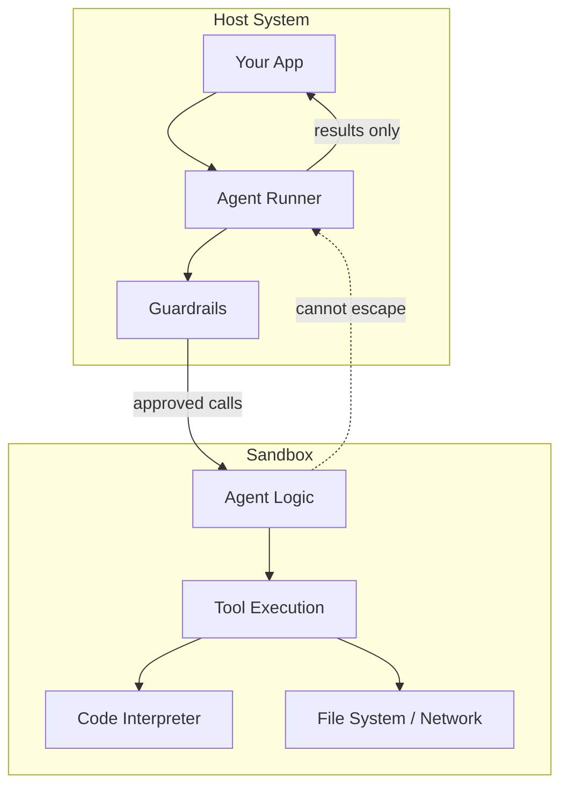

# 🧠 Topic: Sandbox Agent

> [!abstract] Executive Summary (ELI5)
> A Sandbox Agent is an agent whose actions run inside a restricted environment — like a padded cell. It can do useful work (run code, call tools, process files) but it cannot damage the rest of your system. If it misbehaves, the blast radius stays small.

---

## 🎯 The "Why"
- **Problem Solved:** Agents that can execute code, run shell commands, or invoke arbitrary tools are powerful but dangerous. A prompt injection or hallucinated tool call could delete files, exfiltrate data, or consume resources. Sandboxing isolates the agent from the host system and sensitive data.
- **Alternatives:**
  - **Static tool allow-lists** — limit what the agent can call, but the tool implementation still runs in the main process.
  - **Read-only permissions** — reduce damage, but one misconfigured path can still leak data.
  - **Human-in-the-loop** — ask a human before risky actions; safer but slower and does not scale.
  - **No isolation at all** — fastest to build, but unacceptable for production agents with code execution.
- **Trade-offs:**
  - Sandboxing adds latency (process/container startup) and operational complexity.
  - File I/O, network access, and state management become harder because the agent lives in a restricted box.
  - Debugging tool failures inside a sandbox requires better observability than a regular agent.
  - It is not a replacement for input validation, guardrails, or least-privilege design.

## 💡 Mental Model & Analogy
- **Analogy:** A Sandbox Agent is like a food taster in a royal court. The taster can interact with the meal, but they eat it in a separate room with a locked door. If the food is poisoned, the king is safe.
- **Visual/Diagram:**


## 🛠️ Core Principles & Code Snippets
*Focus on "The Right Way" (Best Practices).*

### 1. Define what must be sandboxed

Not every agent needs a sandbox. Ask: *Can this agent execute arbitrary code, run commands, or write files?* If yes, sandbox it.

```python
from dataclasses import dataclass
from pathlib import Path

@dataclass
class SandboxConfig:
    allowed_dirs: list[Path]
    network_mode: Literal["none", "restricted", "full"]
    max_cpu_seconds: int
    max_memory_mb: int
    allow_shell: bool = False
```

### 2. Run code execution in an isolated process

For a self-hosted Python agent, a minimal sandbox can use `subprocess` with restricted privileges. For production, use containers (Docker, gVisor, Firecracker) or managed services.

```python
import subprocess
import tempfile
from pathlib import Path

async def run_code_in_sandbox(code: str, config: SandboxConfig) -> str:
    with tempfile.TemporaryDirectory() as tmpdir:
        script_path = Path(tmpdir) / "task.py"
        script_path.write_text(code)

        result = subprocess.run(
            ["python", str(script_path)],
            cwd=tmpdir,
            capture_output=True,
            text=True,
            timeout=config.max_cpu_seconds,
        )
        return result.stdout + result.stderr
```

> [!warning] This is a minimal illustration. Real production sandboxes need containers, seccomp, cgroup limits, and network isolation.

### 3. Treat the sandbox as a tool, not a free agent

The safest design is an agent that decides *what* to do, then delegates execution to a sandboxed tool. The agent itself stays outside the sandbox; only the tool runs inside.

```python
from agents import Agent, function_tool
from agents.run_context import RunContextWrapper

@function_tool
async def execute_python(
    ctx: RunContextWrapper[AppContext],
    code: str,
    description: str,
) -> str:
    """Execute Python code in a sandboxed environment."""
    return await ctx.context.sandbox.run(code)

agent = Agent(
    name="Data Analyst",
    instructions="Analyze data using Python. Use execute_python for code.",
    tools=[execute_python],
)
```

### 4. Guardrails at the boundary

Sandboxing is the last line of defense, not the first. Combine it with guardrails that review the code before execution.

```python
from agents import input_guardrail

@input_guardrail
async def code_safety_guardrail(ctx, agent, input):
    dangerous = {"os.system", "subprocess", "open("}
    if any(d in input for d in dangerous):
        return GuardrailOutput(
            output_message="This request contains potentially unsafe code patterns.",
            tripwire_triggered=True,
        )
    return GuardrailOutput(tripwire_triggered=False)
```

Key principles:
1. **Defense in depth.** Sandbox + guardrails + least privilege + human approval for destructive actions.
2. **Sandbox is a boundary, not an implementation detail.** Design the interface between the agent and the sandbox explicitly: inputs, outputs, timeout, and resource limits.
3. **Never trust sandbox output blindly.** The agent can still be tricked into interpreting malicious output as truth. Validate returned data before acting on it.
4. **One sandbox per request.** Reusing a sandbox across requests can leak state between users. Start fresh or sanitize between runs.
5. **Log everything.** Sandboxed execution is high-risk; record code, inputs, outputs, and resource usage for audit and forensics.

## ⚠️ Pitfalls & Anti-patterns
- **Common Mistakes:**
  - Believing that sandboxing removes the need for guardrails. A sandbox prevents system damage, not prompt injection or data exfiltration through allowed network calls.
  - Using `exec()` or `eval()` in the main process and calling it a sandbox. That is not a sandbox; it is a vulnerability.
  - Giving the sandbox broad network access. If the agent can call external APIs, it can leak data even from inside the sandbox.
  - Passing sensitive environment variables or secrets into the sandbox. Mount only what is necessary.
- **When NOT to use:**
  - Simple agents that only call internal, read-only APIs with no code execution.
  - Prototypes where the productivity cost of containers outweighs the risk (but never ship these to production with code execution).
- **Performance/Security considerations:**
  - Container startup time is the biggest latency cost. Use warm pools or keep a pool of pre-warmed sandboxes for high-throughput workloads.
  - File uploads into the sandbox are a common attack vector. Scan and validate files before mounting them.
  - Network egress from the sandbox must be controlled. Use allow-lists, not block-lists, for outbound domains.
  - Resource limits (CPU, memory, disk) prevent denial-of-service from runaway code.

## 🔗 Deep Connections
- **Parent Topic:** [[OpenAI-Agent-SDK-Overview]]
- **Related Concepts:** [[The Agent]], [[Guardrails]], [[LLM Tool Use - Function Calling]], [[Decorator-Based Tool Registry]], [[Human-in-the-Loop for Agent Observability]]
- **Prerequisites:** Security basics, containerization, OpenAI Assistants Code Interpreter, async Python

## ❓ Active Recall Questions
> [!faq]- What is the main purpose of a Sandbox Agent?
> To isolate risky execution (code, tools, file processing) from the host system so that failures or attacks cannot escape the sandbox.

> [!faq]- Why is sandboxing not enough on its own?
> It protects the host from malicious code execution, but it does not stop prompt injection, data exfiltration over allowed networks, or the agent from making bad decisions based on untrusted sandbox output.

> [!faq]- What is the safest way to give an agent code execution?
> The agent decides what code to run, but a separate sandboxed tool executes it. The agent never executes code directly in its own process.
