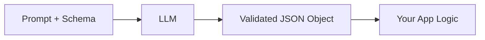

# 🧠 Topic: Structured Output

> [!abstract] Executive Summary (ELI5)
> Instead of asking a model to return free-form text and then parsing it yourself, you give it a strict schema (like a form) and the model fills it in. You get back typed, validated data you can rely on in your code.

---

## 🎯 The "Why"
- **Problem Solved:** LLMs naturally generate prose, which is brittle to parse. If you need a date, a list of entities, or a JSON object, regex-parsing text is error-prone and breaks on creative formatting. Structured Output guarantees the response conforms to a schema.
- **Alternatives:**
  - [[LLM Tool Use - Function Calling]] — can also produce structured args, but the model can decide whether to call the tool.
  - Prompt engineering with few-shot JSON examples — cheap, but no guarantee and no validation.
  - Post-processing with custom parsers or regex — fragile and hard to maintain.
- **Trade-offs:**
  - Structured outputs slightly increase latency and token usage because the model is constrained.
  - Not all schemas are supported; some complex JSON Schema features (like `additionalProperties` or certain recursive patterns) may be rejected by the OpenAI API.
  - Best for production systems where downstream code expects a precise shape.

## 💡 Mental Model & Analogy
- **Analogy:** Asking a chef to "make dinner" is like a free-text prompt — anything could come back. Asking them to fill in a recipe card with `main_ingredient`, `cooking_time`, and `steps` is Structured Output.
- **Visual/Diagram:**


## 🛠️ Core Principles & Code Snippets
*Focus on "The Right Way" (Best Practices).*

With the OpenAI SDK you can request a structured response by setting `response_format` to a Pydantic model or JSON Schema.

```python
from pydantic import BaseModel, Field
from openai import OpenAI

class Step(BaseModel):
    explanation: str
    output: str

class MathSolution(BaseModel):
    steps: list[Step]
    final_answer: str = Field(description="The final numeric answer")

client = OpenAI()
completion = client.beta.chat.completions.parse(
    model="gpt-4o-2024-08-06",
    messages=[
        {"role": "system", "content": "Solve the math problem step by step."},
        {"role": "user", "content": "What is 47 + 135?"},
    ],
    response_format=MathSolution,
)
result = completion.choices[0].message.parsed
```

> [!tip] Implementation Note
> Always use `client.beta.chat.completions.parse(...)` (or `AsyncOpenAI` equivalent) when you want a Pydantic model back. It returns `message.parsed` as a strongly typed object, not just a raw JSON string.

Key principles:
1. **Schema is the contract.** Define fields with `Field(description=...)` so the model understands semantics, not just types.
2. **Prefer small, composable models.** Break complex outputs into nested models; it improves both schema compliance and maintainability.
3. **Handle refusal.** When the request cannot be satisfied safely, the model may return a `refusal` message instead of structured data.
4. **Validate at the boundary.** Use [[Pydantic]] to enforce types, constraints, and custom validators before the data reaches your business logic.

## ⚠️ Pitfalls & Anti-patterns
- **Common Mistakes:**
  - Passing a huge, deeply nested schema without testing it first — the API may reject it or the model may perform poorly.
  - Forgetting that structured output is not a replacement for safety checks; the model can still hallucinate factually wrong values.
  - Ignoring `refusal` signals and assuming `.parsed` is always populated.
- **When NOT to use:**
  - Creative writing, brainstorming, or any task where the exact shape of the answer is unknown.
  - When latency is critical and prose with light parsing is sufficient.
- **Performance/Security considerations:**
  - Large schemas consume more tokens and may hit output limits.
  - Never expose the raw model output directly to end users without validating it against your business rules.

## 🔗 Deep Connections
- **Parent Topic:** [[OpenAI-Agent-SDK-Overview]]
- **Related Concepts:** [[Pydantic]], [[LLM Tool Use - Function Calling]], [[Decorator-Based Tool Registry]]
- **Prerequisites:** Basic Python, Pydantic models, OpenAI SDK client setup

## ❓ Active Recall Questions
> [!faq]- What is the main difference between structured output and function calling?
> Structured output constrains the final response to a schema. Function calling lets the model choose to invoke a tool and returns arguments for that tool.

> [!faq]- How should you handle cases where the model refuses to produce structured output?
> Check `message.refusal` and fall back to a safe error path or prompt refinement rather than crashing on `message.parsed`.

> [!faq]- Why is Pydantic a natural companion for structured output?
> It provides a declarative schema, runtime validation, and strong typing, which matches the API's `response_format` contract.
