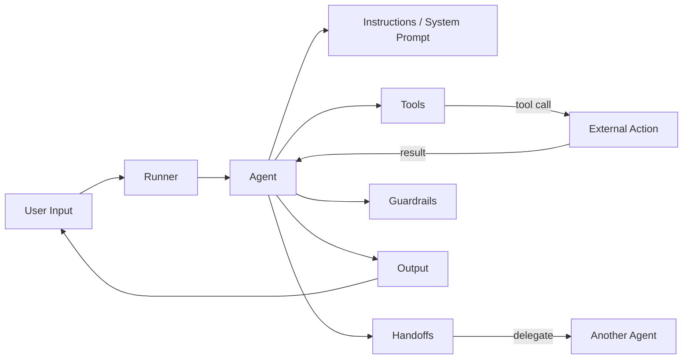

# The Agent (OpenAI Agents SDK)

> [!abstract] Executive Summary (ELI5)
> In the OpenAI Agents SDK, an **Agent** is an LLM wrapped with a name, instructions, and a set of tools it can call. It is the core primitive — everything else (handoffs, guardrails, tracing) is built around it.

---

## 🎯 The "Why"

- **Problem Solved:** The SDK abstracts away the boilerplate of calling the OpenAI Responses API, managing conversation state, and dispatching tools. You declaratively configure an agent and let the `Runner` orchestrate execution.
- **Alternatives:**
  - **Raw OpenAI API calls** — maximum control, but you handle message history, tool dispatch, and looping yourself.
  - **LangChain / LlamaIndex agents** — more abstractions, but heavier and often more coupled to the framework.
  - **Swarm** (the precursor) — the SDK is the production-ready evolution of Swarm, with fewer abstractions and more direct control.
- **Trade-offs:** The SDK is lightweight but opinionated. It uses the Responses API, not the Chat Completions API. If you need deep custom orchestration logic, you may outgrow it.

## 💡 Mental Model & Analogy

- **Analogy:** "An Agent is like a skilled customer service rep at a desk. They have a name badge, a training manual (instructions), and a set of tools they can use (phone, computer, forms). They don't run the whole company — they just handle their assigned conversation, using their tools when needed."
- **Visual/Diagram:**



## 🛠️ Core Principles & Code Snippets

### 1. The Agent is a dataclass of configuration

```python
from agents import Agent

agent = Agent(
    name="Math tutor",
    instructions="You are a helpful math tutor. Explain concepts step by step.",
    model="gpt-4o",
    tools=[calculator],
    output_type=StepByStepAnswer,
)
```

### 2. Key attributes (from the official docs)

| Attribute | What it does |
|-----------|--------------|
| `name` | Human-readable name. Required. |
| `instructions` | System prompt or a function that generates it dynamically. |
| `prompt` | OpenAI Responses API prompt configuration (static or function). |
| `handoff_description` | Short description exposed when this agent is offered as a handoff target. |
| `handoffs` | List of sub-agents this agent can delegate to. See [[Handoffs]]. |
| `model` | Which LLM to use. Defaults to `gpt-5.4-mini` if not set. |
| `model_settings` | Tuning parameters: `temperature`, `top_p`, `tool_choice`, etc. |
| `tools` | Function tools the agent can call. |
| `mcp_servers` | MCP-backed tools for the agent. |
| `mcp_config` | Fine-tuning how MCP tools are prepared. |
| `input_guardrails` | Checks that run on the first user input. See [[Guardrails]]. |
| `output_guardrails` | Checks that run on the final output. See [[Guardrails]]. |
| `output_type` | Structured output type (Pydantic model, dataclass, TypedDict) instead of plain text. |
| `hooks` | Lifecycle callbacks (`on_start`, `on_end`, `on_tool_start`, etc.). |
| `tool_use_behavior` | `"run_llm_again"` (default), `"stop_on_first_tool"`, or custom logic. |
| `reset_tool_choice` | Reset `tool_choice` after a tool call to avoid infinite loops. Default: `True`. |

### 3. Dynamic instructions

Instead of a static string, `instructions` can be a callable that receives the run context and the agent instance. This lets you personalize the system prompt per request.

```python
def generate_instructions(ctx, agent):
    return f"You are helping user {ctx.context.user_id}. Be extra friendly."

agent = Agent(name="Support", instructions=generate_instructions)
```

### 4. Running the agent

You never "run" the agent directly. You pass it to a `Runner`:

```python
from agents import Runner

result = await Runner.run(agent, "What is 15% of 230?")
print(result.final_output)
```

## ⚠️ Pitfalls & Anti-patterns

- **Missing `instructions`:** The SDK strongly recommends providing instructions. Without them, the agent has no system prompt and behaves unpredictably.
- **Confusing `name` and `handoff_description`:** `name` is for debugging and tracing. `handoff_description` is what other agents see when deciding whether to hand off to this one.
- **Overloading one agent:** An agent with 20 tools and 10 handoffs becomes hard for the model to navigate. Split into specialized sub-agents and use handoffs.
- **Tool loops:** If `reset_tool_choice` is disabled and the model keeps choosing the same tool, you can get infinite loops. Leave it `True` unless you have a specific reason.

## 🔗 Deep Connections

- **Parent Topic:** [[Agentic Workflow Patterns Overview]], [[OpenAI Agents SDK]]
- **Related Concepts:** [[Handoffs]], [[Guardrails]], [[LLM Tool Use / Function Calling]], [[ReAct Loop]]
- **Prerequisites:** Python dataclasses, OpenAI Responses API basics, prompt engineering

## ❓ Active Recall Questions

> [!faq]- What is the Agent in the OpenAI Agents SDK?
> An Agent is an LLM equipped with a name, instructions, and a set of tools. It is the core primitive of the SDK.

> [!faq]- What is the difference between `name` and `handoff_description`?
> `name` is for debugging and tracing. `handoff_description` is the text other agents see when deciding whether to hand off to this agent.

> [!faq]- What does `tool_use_behavior` control?
> It determines what happens after a tool call: whether the tool result is sent back to the LLM for further reasoning (`run_llm_again`), or the tool output is treated as the final result (`stop_on_first_tool`).

## Related Notes

- [[Handoffs]]
- [[Guardrails]]
- [[Agentic Workflow Patterns Overview]]
