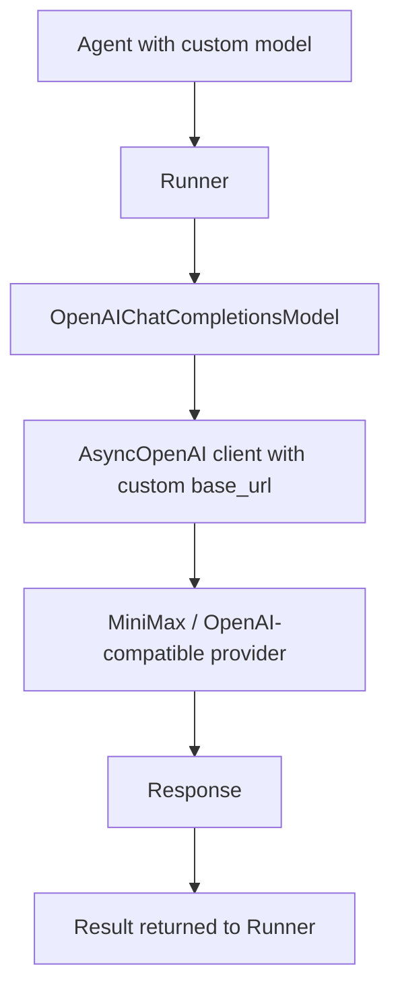

# 🧠 Topic: Troubleshooting Custom LLM Provider with OpenAI Agents SDK

> [!abstract] Executive Summary (ELI5)
> The OpenAI Agents SDK is built around OpenAI's API shape, so using it with a custom provider requires a few explicit bridge steps: you must build your own `AsyncOpenAI` client, register it as the default, and wrap the model name in `OpenAIChatCompletionsModel`. Otherwise the SDK either rejects the model string or tries to send the request to the wrong endpoint.

---

## 🎯 The "Why"
- **Problem Solved:** The SDK does not accept `base_url` or `api_key` directly on the `Agent(...)` constructor, and it inspects model-name prefixes to pick a provider adapter. When you point it at a third-party endpoint such as MiniMax, these assumptions break.
- **Alternatives:**
    - **Use the provider's own SDK directly** — bypasses `openai-agents` orchestration entirely. You lose handoffs, guardrails, and tracing.
    - **Subclass or monkey-patch the SDK internals** — possible, but fragile across versions.
    - **Use `OpenAIChatCompletionsModel`** — the supported escape hatch that forces the standard chat-completions path with a custom client.
- **Trade-offs:** The explicit-client approach adds setup code but keeps all SDK features (tools, handoffs, guardrails). The main cost is that you now manage the HTTP client lifecycle and any provider quirks yourself.

## 💡 Mental Model & Analogy
- **Analogy:** The SDK is like a car built for a specific fuel nozzle shape. `set_default_openai_client` swaps in a compatible pump, and `OpenAIChatCompletionsModel` is the adapter that lets the nozzle fit a different brand of fuel tank.
- **Visual/Diagram:**


## 🛠️ Core Principles & Code Snippets

### 1. The agent does not take `base_url` or `api_key`
This fails:
```python
from agents import Agent

# ❌ No such parameters
agent = Agent(
    name="My agent",
    model="minimax/...",
    base_url="https://api.minimaxi.chat/v1",
    api_key="..."
)
```

The SDK separates **agent configuration** from **HTTP client configuration**. The agent only knows which model object to use.

### 2. Create and register the custom client globally
```python
from openai import AsyncOpenAI
from agents import set_default_openai_client

client = AsyncOpenAI(
    base_url="https://api.minimaxi.chat/v1",
    api_key="..."
)
set_default_openai_client(client)
```

> [!tip] Implementation Note
> `set_default_openai_client` makes the SDK use your client for every model that does not receive an explicit client. Do this once at startup, before creating or running agents.

### 3. Wrap the model name to bypass prefix detection
A bare string like `"minimax-..."` or `"minimax/..."` triggers the SDK's prefix router, which raises `UserError: Unknown prefix: minimax`.

```python
from agents import Agent, OpenAIChatCompletionsModel

agent = Agent(
    name="MiniMax agent",
    instructions="You are a helpful assistant.",
    model=OpenAIChatCompletionsModel(
        model="minimax-...",   # or whatever the provider expects
        openai_client=client,  # required in current SDK versions
    ),
)
```

> [!warning] Pass the client explicitly
> `OpenAIChatCompletionsModel.__init__()` requires `openai_client`. If you omit it you get:
> `TypeError: OpenAIChatCompletionsModel.__init__() missing 1 required positional argument: 'openai_client'`.

### 4. Complete working pattern
```python
import asyncio
from openai import AsyncOpenAI
from agents import Agent, Runner, OpenAIChatCompletionsModel, set_default_openai_client

client = AsyncOpenAI(
    base_url="https://api.minimaxi.chat/v1",
    api_key="..."
)
set_default_openai_client(client)

agent = Agent(
    name="MiniMax agent",
    instructions="You are a helpful coding assistant.",
    model=OpenAIChatCompletionsModel(model="minimax-...", openai_client=client),
)

async def main():
    result = await Runner.run(agent, "Write a Python function that sums a list.")
    print(result.final_output)

asyncio.run(main())
```

## ⚠️ Pitfalls & Anti-patterns
- **Passing a bare provider-prefixed model string:** Strings like `claude-...` may work because the SDK recognizes the prefix, but anything unrecognized such as `minimax-...` will crash. Always wrap custom-provider models in `OpenAIChatCompletionsModel`.
- **Forgetting to import `AsyncOpenAI`:** A missing `from openai import AsyncOpenAI` produces `NameError: name 'AsyncOpenAI' is not defined`. Import it before constructing the client.
- **Creating the client but not registering it:** If you build `AsyncOpenAI(base_url=...)` but do not call `set_default_openai_client(client)`, the SDK falls back to the default OpenAI client and hits `api.openai.com`.
- **Using the sync `OpenAI` client in an async agent loop:** The SDK's `Runner` is async. Passing a sync client will either fail outright or block the event loop and kill concurrency.
- **Hard-coding credentials in notebooks:** Use environment variables or secrets managers. Notebooks are especially bad places for plaintext API keys.

## 🔗 Deep Connections
- **Parent Topic:** [[OpenAI-Agent-SDK-Overview]], [[The Agent]]
- **Related Concepts:**
    - [[OpenAI Client vs AsyncOpenAI Client]] — Why the SDK needs `AsyncOpenAI`
    - [[Jupyter Kernel and uv Virtual Environment]] — Notebook kernel mismatch and `uv pip` basics
    - [[LLM Tool Use - Function Calling]] — Tools still work with custom-provider agents
    - [[Guardrails]] — Input/output checks apply regardless of the provider
- **Prerequisites:** Python `asyncio`, OpenAI-compatible API basics, environment variable handling

## ❓ Active Recall Questions
> [!faq]- Why can't you pass `base_url` directly to `Agent(...)`?
> The SDK separates agent configuration from HTTP client configuration. The agent receives a model object; the model object (or the global default) carries the client.

> [!faq]- What error do you get when the SDK does not recognize a model prefix?
> `UserError: Unknown prefix: <provider>`, e.g. `Unknown prefix: minimax`.

> [!faq]- How do you force the SDK to use a standard OpenAI-compatible chat-completions path for any model?
> Wrap the model name in `OpenAIChatCompletionsModel(model="...", openai_client=client)`.

> [!faq]- What is the purpose of `set_default_openai_client(client)`?
> It registers a custom `AsyncOpenAI` client so the SDK uses it for any model that does not receive an explicit client.
