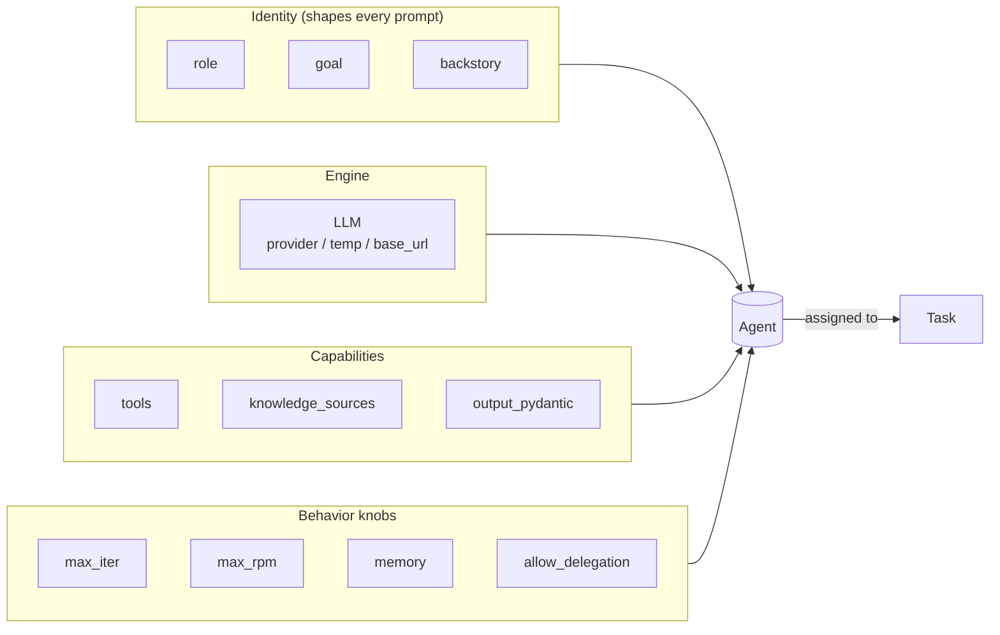

# 🧠 Topic: CrewAI Agents — Deep Dive

> [!abstract] Executive Summary (ELI5)
> An **Agent** in CrewAI is one team member: a role with a goal, a backstory, a set of tools, and a tuned LLM. Where the [[CrewAI Overview|overview]] covered the *team*, this note zooms into the *individual* — every knob that turns a generic LLM into a focused specialist. The three levers that matter most: **identity** (`role`/`goal`/`backstory`), **engine** (the `LLM` object — provider, temperature, base URL), and **capabilities** (`tools`, `knowledge_sources`, structured output).

> [!info] Version note
> This note targets **CrewAI ≥ 1.15.x**. Recent changes to be aware of:
> - `verbose` is now a **bool**, not an int level.
> - `max_iter` defaults have shifted across versions — **set it explicitly** in production.
> - The framework is moving from **LiteLLM model strings** toward **native providers** (`openai/...`, `anthropic/...`). Install a provider extra, e.g. `uv add "crewai[anthropic]"`.
> - Custom tools live in `crewai.tools` (`BaseTool`, `@tool`); prebuilt tools are the separate `crewai_tools` package.

---

## 🎯 The "Why"
- **Problem Solved:** A raw LLM has no persistent role, no opinion on *how* to approach a task, no tools, and no memory of this run's earlier steps. To get reliable, repeatable specialist behavior you must pin down **who** it is, **what** it can do, and **how** it reasons. The `Agent` object is the single place that contract lives.
- **Why this over a raw prompt:** The same identity (`role` + `backstory`) is injected consistently across every task an agent owns within a crew. If you inline the same persona into prompts by hand, it drifts the moment the crew grows.
- **Alternatives / comparison:**
    - **[[OpenAI-Agent-SDK-Overview|OpenAI Agents SDK]] `Agent`:** `instructions` string + tools + handoffs — flatter, one persona blob. CrewAI splits identity into `role`/`goal`/`backstory`, which is more structure (good for teams) but more to keep coherent (bad for trivial agents).
    - **LangGraph node:** you encode the persona in the node's system prompt yourself; the graph gives you control over *flow*, CrewAI's agent gives you control over *character*.

## 💡 Mental Model & Analogy
- **Analogy:** An Agent is a **job spec you hand to a contractor**.
    - `role` = the **title** on the contract ("Senior Threat Intel Analyst").
    - `goal` = the **success criteria** ("produce an actionable brief, not a wall of links").
    - `backstory` = the **resume** that primes their judgment and tone.
    - `llm` = the **brain** you're renting (and its `temperature` is how creative that brain gets).
    - `tools` = the **access badges** (search, a DB query, an internal API).
    - `knowledge_sources` = the **onboarding docs** they've already read.
    - `max_iter` = how many **thinking rounds** before they must answer.
- **Visual/Diagram:**


## 🛠️ Anatomy of an Agent — parameter reference

The three required attributes are `role`, `goal`, `backstory`. Everything else is optional tuning. The table covers the parameters you'll actually touch.

| Parameter | Type | What it controls | Senior note |
|---|---|---|---|
| `role` | `str` | The agent's title/function | Be specific. `"Support Agent"` < `"Tier-2 Billing Escalation Specialist"`. |
| `goal` | `str` | Success criteria for *this* agent | Phrase as an outcome, not an activity. Avoid "help the user" — that's not measurable. |
| `backstory` | `str` | Persona, tone, judgment biases | The real behavioral lever. Length matters but specificity matters more. |
| `llm` | `str \| LLM` | The model + its params | A string (`"openai/gpt-4o-mini"`) for defaults; an `LLM(...)` object the moment you need `temperature`, `base_url`, or a non-default provider. |
| `tools` | `list[Tool]` | External capabilities | The agent only "sees" tool name + description. Bad description = never called. |
| `knowledge_sources` | `list[BaseKnowledgeSource]` | Pre-loaded context for *this* agent | Per-agent knowledge is independent of crew-level knowledge. |
| `output_pydantic` | `type[BaseModel]` | Forces structured, validated output | The single biggest reliability upgrade for downstream consumers. |
| `memory` | `bool` | Short-term memory across steps in this run | Useful for long multi-step tasks; adds tokens/cost. |
| `max_iter` | `int` | Max reasoning rounds before forcing an answer | **Set explicitly.** A runaway loop here burns budget. |
| `max_rpm` | `int \| None` | Requests-per-minute cap | `None` = uncapped. Set it to respect provider rate limits. |
| `allow_delegation` | `bool` | Can this agent ask a crewmate to take a sub-task? | Disable on leaf specialists to avoid delegation cycles. |
| `verbose` | `bool` | Step logging | Now a bool, not an int level. |
| `step_callback` | `callable` | Runs after each reasoning step | Hook for logging/tracing — see [[Human-in-the-Loop for Agent Observability]]. |

> [!tip] Identity is prompt engineering, not metadata
> `role`, `goal`, and `backstory` are concatenated into the system prompt on every call. Treat writing them like writing a system prompt — concrete, outcome-driven, unambiguous. "Helper agent" is a failure mode.

---

## 1️⃣ The Engine: the `LLM` object

Pass a string when defaults are fine; pass an `LLM` object the moment you need *any* customization. The `LLM` class is the single entry point for provider, decoding params, and custom endpoints.

### A. Minimal — model string only
```python
from crewai import Agent

agent = Agent(
    role="Summarizer",
    goal="Produce a 3-bullet executive summary.",
    backstory="You compress dense text into decisions.",
    llm="openai/gpt-4o-mini",   # provider/model string
)
```

### B. Tuned decoding — `temperature`, `max_tokens`
```python
from crewai import Agent, LLM

analyst = Agent(
    role="Threat Intelligence Analyst",
    goal="Produce an actionable brief with concrete recommendations.",
    backstory="Former SOC lead; allergic to speculation, insists on sources.",
    llm=LLM(
        model="anthropic/claude-sonnet-4-5",
        temperature=0.1,     # low = deterministic, factual
        max_tokens=4096,     # REQUIRED for Anthropic models
    ),
)
```

### C. OpenAI-compatible gateway / self-hosted — custom `base_url`
This is the pattern that connects to **vLLM, LM Studio, Ollama's OpenAI endpoint, Azure OpenAI, or a corporate LLM gateway**. Same idea as [[Troubleshooting Custom LLM Provider with OpenAI Agents SDK]] — a non-default `base_url` pointed at anything that speaks the OpenAI chat-completions protocol.

```python
from crewai import Agent, LLM

# Point at a local Ollama server exposing an OpenAI-compatible API
local_llm = LLM(
    model="openai/llama3.1",                       # "openai/" prefix = use the OpenAI client
    base_url="http://localhost:11434/v1",
    api_key="ollama",                              # required by the client, ignored by the server
)

private_cloud = Agent(
    role="Internal Docs Q&A",
    goal="Answer from the company knowledge base only.",
    backstory="You never speculate beyond provided context.",
    llm=local_llm,
)
```

> [!warning] `max_tokens` is mandatory for Anthropic
> Anthropic models reject requests without an explicit `max_tokens`. If you switch a working OpenAI agent to Claude and forget it, you'll get an opaque provider error, not a friendly CrewAI message.

> [!tip] Native providers vs LiteLLM (migration underway)
> Recent CrewAI versions are moving away from LiteLLM wrappers toward **native providers**. The pattern: `model="anthropic/claude-sonnet-4-5"` + `uv add "crewai[anthropic]"` + `ANTHROPIC_API_KEY`. Older `litellm/`-prefixed strings still work on current stable but are on the way out — prefer the `provider/model` form for new code.

---

## 2️⃣ Capabilities: sophisticated tools

Two ways to define a tool. Use the **`@tool` decorator** for quick one-offs; subclass **`BaseTool`** when you need input validation, complex logic, or **structured return types**.

### A. Quick tool — `@tool` decorator
The function's **docstring becomes the tool description** the agent reads to decide when to call it. Type hints are required.

```python
from crewai.tools import tool

@tool("Format As Markdown")
def format_markdown(text: str, heading: str) -> str:
    """Wrap text under a markdown H1 heading. Use when preparing final report sections."""
    return f"# {heading}\n\n{text}"
```

### B. Validated tool — `BaseTool` subclass with Pydantic schema
For anything with real input rules, subclass `BaseTool` and attach an `args_schema`. This gives you validation *before* `_run` executes and lets the agent receive a precise argument contract.

```python
from typing import Type
from crewai.tools import BaseTool
from pydantic import BaseModel, Field

class StockLookupInput(BaseModel):
    """Input schema for StockLookupTool."""
    ticker: str = Field(..., description="Stock ticker symbol, e.g. 'AAPL'.")
    as_of: str = Field(None, description="ISO date; defaults to latest available.")

class StockLookupTool(BaseTool):
    name: str = "Stock Lookup"
    description: str = (
        "Fetch the closing price and 52-week range for a ticker. "
        "Use for any question about current or historical equity prices."
    )
    args_schema: Type[BaseModel] = StockLookupInput

    def _run(self, ticker: str, as_of: str = None) -> str:
        price = pricing_client.get(ticker, as_of)   # your real integration
        return f"{ticker} closed at ${price.close} (52w: ${price.low}-${price.high})"
```

### C. Structured tool output — Pydantic return type
A tool can return a **Pydantic model**. Direct Python callers get the typed object; the agent receives a JSON serialization. This is how you feed structured data into an agent without losing shape.

```python
from crewai.tools import BaseTool
from pydantic import BaseModel

class InventoryResult(BaseModel):
    sku: str
    quantity: int
    needs_reorder: bool

class InventoryTool(BaseTool):
    name: str = "Inventory Check"
    description: str = "Checks current stock for a product SKU."

    def _run(self, sku: str) -> InventoryResult:
        qty = {"SKU-123": 14, "SKU-456": 0}.get(sku, 0)
        return InventoryResult(sku=sku, quantity=qty, needs_reorder=qty < 5)

# Direct call → typed object
result = InventoryTool().run(sku="SKU-123")
print(result.needs_reorder)   # bool, not a string to parse
```

> [!tip] The description is the API
> The agent's decision to call a tool rests on its `name` + `description` + arg descriptions. Write the description as a **trigger condition**, not a feature list: *"Use for any question about equity prices"* beats *"Fetches stock data."*

---

## 3️⃣ Structured agent output — `output_pydantic`

When downstream code (another agent, a DB write, an API response) needs a **guaranteed shape**, set `output_pydantic` on the agent. The agent's final answer is validated against the model.

```python
from crewai import Agent
from pydantic import BaseModel, Field

class CompetitorBrief(BaseModel):
    name: str
    positioning: str = Field(..., description="One-line market positioning.")
    strengths: list[str]
    weaknesses: list[str]
    threat_level: int = Field(..., ge=1, le=5)

briefing_agent = Agent(
    role="Competitive Intelligence Analyst",
    goal="Return a structured competitor brief, never prose.",
    backstory="You think in fields, not paragraphs.",
    output_pydantic=CompetitorBrief,   # final output is validated → CompetitorBrief
)
```

Connect to the broader pattern in [[Structured-Outputs-in-Agentic-Systems]] — this is CrewAI's idiomatic enforcement of the same idea.

---

## 4️⃣ Agent-level knowledge — `knowledge_sources`

Give an agent **its own** reference material that is injected into context, independent of any crew-level knowledge. Use `StringKnowledgeSource` for inline text or extend `BaseKnowledgeSource` for files/DBs.

```python
from crewai import Agent
from crewai.knowledge.source.string_knowledge_source import StringKnowledgeSource

playbook = StringKnowledgeSource(
    content=(
        "Escalation rules: refund > $500 requires manager approval. "
        "Always cite the policy section number in the response."
    )
)

billing_specialist = Agent(
    role="Tier-2 Billing Specialist",
    goal="Resolve billing disputes correctly per policy.",
    backstory="You've handled 10,000 disputes and never improvised a policy.",
    knowledge_sources=[playbook],   # this agent always "knows" the playbook
)
```

> [!note] Agent vs crew knowledge
> `knowledge_sources` on the **agent** scopes material to that one specialist. Crew-level knowledge (set on the `Crew`) is shared. Prefer agent-level scoping when the material is role-specific — it keeps other agents' context lean.

---

## 5️⃣ Behavioral tuning & observability

| Knob | When to change it |
|---|---|
| `max_iter=15` | Hard ceiling on reasoning rounds. Lower for cost/latency; raise only if the task genuinely needs deep iteration. |
| `max_rpm=50` | Respect provider rate limits in production; set per crew. |
| `temperature=0.1` | Factual/extraction work → low. Brainstorming/drafting → higher. Set on the `LLM`, not the agent. |
| `memory=True` | Long multi-step tasks where the agent should recall its own earlier steps in this run. Costs tokens. |
| `allow_delegation=False` | Leaf specialists — prevents them from offloading to a crewmate and creating cycles. |
| `step_callback=trace_fn` | Observability hook after every reasoning step — wire to Langfuse/tracing. |

```python
def trace_step(step_state) -> None:
    # step_state carries the intermediate reasoning — log to your observability backend
    langfuse.trace(step_state)

agent = Agent(
    role="...",
    goal="...",
    backstory="...",
    step_callback=trace_step,
    max_iter=15,
    max_rpm=50,
    memory=True,
    allow_delegation=False,
)
```

---

## 🔬 Worked example — a complete, non-trivial agent

Putting it together: a **Competitor Briefing agent** that uses a custom OpenAI-compatible LLM (so it works against a private gateway or local model), a validated `BaseTool` returning structured data, agent-level knowledge, and a Pydantic-validated output. This is the unit you'd drop into a crew.

```python
from typing import Type
from pydantic import BaseModel, Field

from crewai import Agent, LLM
from crewai.tools import BaseTool
from crewai.knowledge.source.string_knowledge_source import StringKnowledgeSource


# --- 1. Structured tool output (feeds the agent typed data) ---
class Firmographic(BaseModel):
    name: str
    headcount: int
    funding_total_musd: float


# --- 2. Validated tool (BaseTool + Pydantic args schema) ---
class FirmographicInput(BaseModel):
    company: str = Field(..., description="Legal or brand name of the company.")

class FirmographicTool(BaseTool):
    name: str = "Firmographic Lookup"
    description: str = (
        "Returns headcount and total funding for a company. "
        "Use whenever you need size or funding context about a competitor."
    )
    args_schema: Type[BaseModel] = FirmographicInput

    def _run(self, company: str) -> Firmographic:
        row = crunchbase_client.lookup(company)   # your integration
        return Firmographic(
            name=row["name"],
            headcount=row["headcount"],
            funding_total_musd=row["funding_usd"] / 1_000_000,
        )


# --- 3. Structured agent output (what this agent produces) ---
class CompetitorBrief(BaseModel):
    name: str
    positioning: str
    strengths: list[str]
    weaknesses: list[str]
    threat_level: int = Field(..., ge=1, le=5)


# --- 4. Agent-level knowledge (always-on reference) ---
disclosure_policy = StringKnowledgeSource(
    content="Threat level is relative to OUR position, not absolute market size."
)


# --- 5. The agent — custom LLM (private gateway), all capabilities wired ---
briefing_agent = Agent(
    role="Competitive Intelligence Analyst",
    goal="Return a structured CompetitorBrief grounded in firmographics, never prose.",
    backstory=(
        "Former VC analyst. You never speculate — if a field isn't supported by "
        "the firmographic tool or the disclosure policy, you say so explicitly."
    ),
    llm=LLM(
        model="openai/gpt-4o",                       # works against the default OR a gateway
        base_url="https://llm-gateway.internal/v1",  # private OpenAI-compatible endpoint
        api_key="${GATEWAY_TOKEN}",
        temperature=0.1,
    ),
    tools=[FirmographicTool()],
    knowledge_sources=[disclosure_policy],
    output_pydantic=CompetitorBrief,
    max_iter=15,
    max_rpm=30,
    allow_delegation=False,        # leaf specialist — no delegation cycles
    memory=True,
    verbose=True,
)
```

This agent then plugs into a crew unchanged — assign it a `Task`, add it to the crew's `agents` list. The crew handles sequencing; everything above is *per-agent* configuration.

---

## ⚠️ Pitfalls & Anti-patterns (agent-specific)
- **`temperature` on the agent? No — on the `LLM`.** Setting `temperature` directly on `Agent` is ignored; it lives on the `LLM` object. A common "why is my agent still creative?" bug.
- **Forgetting `max_tokens` for Anthropic.** Silent provider errors that look like CrewAI bugs.
- **Bloated backstories.** A 400-word backstory pollutes every call's context window. Be specific, not long.
- **Tools the agent never calls.** Almost always a weak `description`. Rewrite it as a *trigger condition*, not a feature list.
- **`allow_delegation=True` on everyone.** Creates delegation cycles — two agents bouncing a task forever. Make leaf specialists non-delegating.
- **No `max_iter` cap.** A confused agent can loop until budget is gone. Always set it in production.
- **`output_pydantic` without `Field(...)` constraints.** Validation only catches what you constrain. Add `ge`/`le`/`min_length` where meaningful.
- **When NOT to build an agent:** if the task is a single deterministic transformation, an `Agent` is overhead — use a plain function. Agents earn their cost when there's **judgment + tool selection + iteration**.

## 🔗 Deep Connections
- **Parent Topic:** [[CrewAI Overview]], [[Agentic Workflows]]
- **Siblings (this folder):**
    - [[CrewAI Tasks]] — what this agent gets *assigned*. An agent without a task never runs.
    - [[CrewAI Crews]] — how this agent *coordinates* with teammates (process, memory, manager).
    - [[CrewAI Flows]] — when a whole crew (incl. this agent) is one step in a larger branching pipeline.
- **Related Concepts:**
    - [[LLM Tool Use - Function Calling]] — the underlying mechanism `tools` rely on.
    - [[Structured-Outputs-in-Agentic-Systems]] — the pattern `output_pydantic` enforces.
    - [[Troubleshooting Custom LLM Provider with OpenAI Agents SDK]] — same `base_url` idea in the OpenAI SDK.
    - [[Decorator-Based Tool Registry]] — compare CrewAI's `@tool` decorator approach.
    - [[Forcing-a-Reasoning-Budget]] — why `max_iter` matters for cost control.
    - [[Human-in-the-Loop for Agent Observability]] — what to do inside `step_callback`.
- **Prerequisites:** [[CrewAI Overview]], basic Pydantic, OpenAI-compatible API concepts.

## ❓ Active Recall Questions
> [!faq]- What are the three required attributes of a CrewAI Agent, and why is splitting identity this way useful?
> `role`, `goal`, `backstory`. Splitting them lets you express **title**, **success criteria**, and **persona** separately — they're concatenated into the system prompt, so each can be tuned independently. A flat `instructions` blob (OpenAI SDK style) is simpler but harder to keep coherent as a crew grows.

> [!faq]- When do you pass a string vs an `LLM` object to the `llm` parameter?
> A **string** (`"openai/gpt-4o-mini"`) for provider/model defaults. An **`LLM` object** the moment you need `temperature`, `max_tokens`, a custom `base_url`, or a non-default API key — i.e. any decoding or endpoint customization.

> [!faq]- Why would a tool's structured Pydantic return type matter, and what does the agent actually receive?
> Direct callers get the typed object (safe attribute access, IDE help); the **agent receives a JSON serialization**. It guarantees the agent consumes well-shaped data rather than parsing free text — critical when one tool's output drives downstream reasoning.

> [!faq]- What goes wrong if you set `temperature` directly on the `Agent`?
> It's **ignored** — `temperature` lives on the `LLM` object. This is a classic "my agent is still too creative despite low temperature" bug: the value was set in the wrong place.

> [!faq]- Why set `allow_delegation=False` on a specialist agent?
> To prevent **delegation cycles** — two agents bouncing a task back and forth indefinitely. Leaf specialists that shouldn't offload work should be non-delegating; reserve delegation for coordinator/manager roles.

> [!faq]- Agent-level vs crew-level `knowledge_sources` — how do you choose?
> **Agent-level** when the material is role-specific (a billing policy for the billing specialist) — it keeps other agents' context lean. **Crew-level** when every agent needs the same shared context (company glossary, project brief).

---
## 📝 How to use this note effectively
1. **Never Copy-Paste:** Read, then build an agent from memory — model strings and provider extras change; the *structure* of the config is stable.
2. **Iterate:** The first agent you write will have a weak `backstory` or tool description. Tighten them after one real run.
2. **The "Why" is King:** Knowing *which knob* (`max_iter` vs `temperature` vs `allow_delegation`) solves *which symptom* (cost vs creativity vs loops) is what separates working code from senior judgment.
3. **Re-verify the API:** CrewAI is evolving fast (LiteLLM → native providers). Before shipping, confirm imports (`crewai.tools`, `crewai import LLM`) and model strings against the version you pinned.

---

## 📚 Sources
- [CrewAI Agents — official docs (v1.15.x)](https://docs.crewai.com/concepts/agents)
- [Customize Agents](https://docs.crewai.com/learn/customizing-agents)
- [LLMs — provider config, base_url, structured output](https://docs.crewai.com/concepts/llms)
- [Create Custom Tools — BaseTool & @tool](https://docs.crewai.com/learn/create-custom-tools)
- [Agent Knowledge Sources](https://docs.crewai.com/concepts/knowledge)
- [LiteLLM removal / native providers migration](https://docs.crewai.com/learn/litellm-removal-guide)
