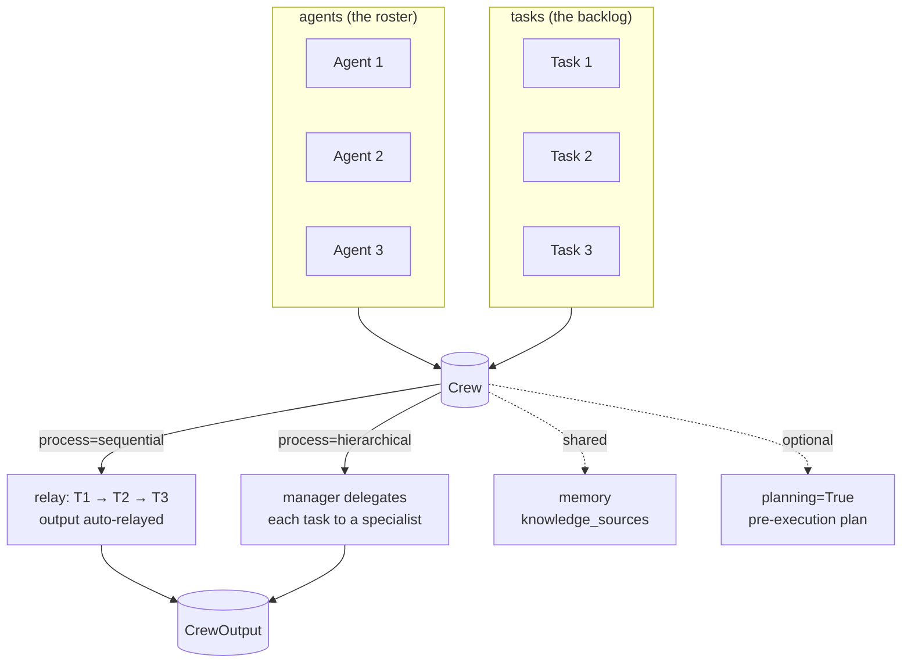

# 🧠 Topic: CrewAI Crews — Deep Dive

> [!abstract] Executive Summary (ELI5)
> If a [[CrewAI Agents|Agent]] is a team member and a [[CrewAI Tasks|Task]] is an assignment, a **Crew** is the team *plus* the process — the manager that binds agents and tasks together and decides **how work flows between them**. The `Crew` object is where you pick the orchestration style (sequential vs. hierarchical), wire in shared memory and crew-level knowledge, configure human-in-the-loop gates, and actually call `kickoff()` to run the whole thing. Where the agent defines *who* and the task defines *what*, the crew defines **how they coordinate**.

> [!info] Version note
> Targets **CrewAI ≥ 1.15.x**. Points to keep in mind on current versions:
> - **Two processes only**: `Process.sequential` and `Process.hierarchical`. (The older "consensual" process was removed long ago — if you see it in old blog posts, ignore it.)
> - `verbose` is a **bool**, not an int level (same change as on `Agent`).
> - The manager LLM in a hierarchical crew must be set explicitly via `manager_llm` — there is no sensible default in production.
> - `@CrewBase` + YAML config (`agents_config` / `tasks_config`) is the recommended pattern for anything beyond a prototype; `crewai run` CLI scaffolds this layout.

---

## 🎯 The "Why"
- **Problem Solved:** You have *N* agents and *M* tasks. Left to themselves, they'd call the LLM in arbitrary order, drop each other's outputs, and burn budget on duplicated work. The `Crew` object answers three coordination questions in one place: **In what order do tasks run?** (`process`), **what does the team remember?** (`memory` + crew-level `knowledge_sources`), and **who can veto a step?** (`human_input`, manager delegation).
- **Why a first-class object and not a free function:** The crew's *configuration* (process, memory, manager LLM, planning, callbacks) is independent of which agents and tasks it holds. Two different crews can share the same agents but run them under different processes — you couldn't express that if the process lived on the task.
- **Alternatives / comparison:**
    - **[[OpenAI-Agent-SDK-Overview|OpenAI Agents SDK]]:** orchestration is *implicit* — an `Runner` executes one agent, and that agent hands off to another via a `handoff`. There's no "team + process" object; the trace is a tree of agent calls. Lighter, but you re-derive sequencing rules each time.
    - **LangGraph:** the graph itself *is* the crew — nodes are agents/tasks, edges are the process. Maximum control, maximum verbosity. CrewAI trades graph-level flexibility for a much shorter happy path on the two process types most pipelines actually need.
    - **A bare loop over agents:** you rebuild ordering, context-relay, memory, and retry. Fine for two tasks; a maintenance trap past five.

## 💡 Mental Model & Analogy
- **Analogy:** A Crew is a **project team with a defined working style**.
    - `agents` = the **roster** (who's on the team).
    - `tasks` = the **backlog** (what needs doing).
    - `process` = the **working agreement**: sequential = "everyone takes the baton in order"; hierarchical = "a manager triages and delegates".
    - `manager_llm` = the **manager's brain** (hierarchical only).
    - `memory` = the team's **shared short-term scratchpad**.
    - `knowledge_sources` (crew-level) = the **team wiki** everyone reads.
    - `planning` = a **planning meeting before execution**: the crew drafts an execution plan (one extra LLM call) before touching task 1.
    - `human_input` / `manager` = **approval gates**.
- **Visual/Diagram:**


## 🛠️ Anatomy of a Crew — parameter reference

Only `agents` and `tasks` are required. Everything else is orchestration tuning. This table covers the parameters you'll actually touch in production.

| Parameter | Type | What it controls | Senior note |
|---|---|---|---|
| `agents` | `list[Agent]` | The roster | Must include every agent a task references. Under hierarchical, add a `manager_agent` (or let one be auto-created) — don't forget the manager. |
| `tasks` | `list[Task]` | The backlog, in execution order (for sequential) | Order matters under sequential; under hierarchical the manager reorders. |
| `process` | `Process` | How tasks flow | `Process.sequential` (default) or `Process.hierarchical`. See [[#1️⃣ Process — sequential vs hierarchical]]. |
| `manager_llm` | `str \| LLM` | The manager's model (hierarchical only) | **Set explicitly.** Auto-pick defaults to whatever LiteLLM resolves, which is not what you want in production. |
| `manager_agent` | `Agent` | Provide your own manager (hierarchical only) | Use when you want a custom manager persona/constraints instead of the auto-generated one. Mutually exclusive-ish with `manager_llm` (one defines *brain*, the other *persona*). |
| `memory` | `bool` | Short-term memory across steps in this run | Shares earlier task outputs and tool results across agents. Costs tokens — see [[#4️⃣ Memory]]. |
| `memory_config` | `dict` | Memory backend/embedder config | Plug in a custom embedder or vector store; defaults to local. |
| `knowledge_sources` | `list[BaseKnowledgeSource]` | Crew-level shared context | Distinct from per-agent `knowledge_sources` — see [[CrewAI Agents#4️⃣ Agent-level knowledge — knowledge_sources]]. |
| `planning` | `bool` | Pre-execution planning step | Adds one LLM call that drafts an execution plan before task 1. Useful for complex crews; pure overhead for linear ones. |
| `verbose` | `bool` | Step logging | Now a bool, not an int level. |
| `max_rpm` | `int \| None` | Requests-per-minute cap across the whole crew | `None` = uncapped. Set to respect provider rate limits. |
| `cache` | `bool` | Cache tool/LLM results within the run | Default `True`. Saves tokens on repeated tool calls; turn off if results are time-sensitive. |
| `function_calling_llm` | `str \| LLM` | Model used to format tool calls | Override only if the default mishandles your tools' schemas. |
| `step_callback` | `callable` | Runs after each step | Observability hook — wire to Langfuse/tracing. |
| `task_execution_method` | `str` | How tasks run | `"sequential"` (default) or `"async"`. |
| `share_crew` | `bool` | Emit crew traces for CrewAI Enterprise telemetry | Only relevant if you're on the hosted platform. |
| `usage_metrics` | `bool` | Expose token/call counts on the result | Useful for cost dashboards. |

> [!tip] Configuration is independent of membership
> The same `[agents, tasks]` can be wrapped in two crews with different `process` / `memory` / `manager_llm`. When you find yourself copying agent/task definitions to "try a different flow", you're actually just varying crew configuration — keep the agents/tasks identical and vary the crew.

---

## 1️⃣ Process — sequential vs hierarchical

The single most consequential crew-level decision. Pick the process *before* you write tasks, because it changes what the `agent` field on a task means.

### A. Sequential — the relay
Tasks run in **list order**. Each task **automatically receives the previous task's output** as context (you do *not* add it to `context` — that would duplicate it in the prompt; see [[CrewAI Tasks# Pitfalls]]). The `agent` on each task is who executes it.

```python
from crewai import Agent, Task, Crew, Process

researcher = Agent(role="Researcher", goal="...", backstory="...", llm="openai/gpt-4o-mini")
writer     = Agent(role="Writer",     goal="...", backstory="...", llm="openai/gpt-4o-mini")

research = Task(description="Research {topic}.",
                expected_output="10 bullets with sources.",
                agent=researcher)
report   = Task(description="Write the report from the research.",
                expected_output="A 4-section markdown report.",
                agent=writer)

crew = Crew(agents=[researcher, writer],
            tasks=[research, report],
            process=Process.sequential)   # default

result = crew.kickoff(inputs={"topic": "multi-agent orchestration"})
```

**When to use:** the workflow is a **fixed, linear pipeline** (research → analyze → write). You know the order at authoring time; there's no runtime decision about who handles what.

### B. Hierarchical — the manager delegates
The crew spawns (or uses your) **manager agent**. Tasks are handed to the manager, which **decides which specialist agent** executes each one and synthesizes results. The `agent` field on a task becomes optional — the manager assigns dynamically.

```python
from crewai import Agent, Task, Crew, Process, LLM

researcher = Agent(role="Researcher", goal="...", backstory="...")
writer     = Agent(role="Writer",     goal="...", backstory="...")
reviewer   = Agent(role="Reviewer",   goal="...", backstory="...")

tasks = [
    Task(description="Produce a 4-section report on {topic}.",
         expected_output="A markdown report with a sources list."),
    # no `agent` set — manager decides
]

crew = Crew(
    agents=[researcher, writer, reviewer],
    tasks=tasks,
    process=Process.hierarchical,
    manager_llm="openai/gpt-4o",          # REQUIRED: the manager's brain
    planning=True,                          # let the manager draft a plan first
    verbose=True,
)
```

**When to use:** delegation decisions are **dynamic** — which specialist should handle this task depends on the *content* produced by earlier steps (triage, routing, multi-pass refinement). The cost: the manager adds reasoning turns for every delegation. Fine for quality, expensive at scale.

> [!warning] Hierarchical needs an explicit `manager_llm`
> Without `manager_llm` (or a custom `manager_agent`), the auto-created manager uses an arbitrary default model. This is the #1 "why is my hierarchical crew behaving weirdly" bug. Always pin the manager's model.

### C. Choosing between them

| Signal | Pick |
|---|---|
| Order known at authoring time, linear | **Sequential** |
| Order depends on runtime content / needs triage | **Hierarchical** |
| Cost/latency sensitive, simple pipeline | **Sequential** (fewer reasoning turns) |
| Quality-sensitive, needs a reviewer/editor loop | **Hierarchical** (manager orchestrates refinement) |
| Want a single "final answer" synthesized from specialists | **Hierarchical** |

If you're unsure, start sequential — it's ~one manager-LLM-call cheaper per delegation and debuggable end-to-end. Promote to hierarchical only when the routing decision genuinely needs LLM judgment.

---

## 2️⃣ `@CrewBase` — the maintainable layout (YAML config)

Direct construction (above) is great for prototypes. Once a crew has more than ~3 agents/tasks, decouple specs from code with the **decorator + YAML** pattern. This is what `crewai run` scaffolds for you.

```
my_crew/
├── config/
│   ├── agents.yaml      # role / goal / backstory per agent
│   └── tasks.yaml       # description / expected_output / agent per task
└── crew.py              # @CrewBase class wiring it together
```

```yaml
# config/agents.yaml
researcher:
  role: "Senior Research Analyst"
  goal: "Uncover cutting-edge developments in {topic}"
  backstory: "You are a meticulous analyst at a top think tank."

writer:
  role: "Technical Writer"
  goal: "Turn research into a clear, structured report"
  backstory: "You compress dense findings into readable prose."
```

```yaml
# config/tasks.yaml
research_task:
  description: "Investigate the latest developments in {topic}."
  expected_output: "10 bullets, each with a source URL."
  agent: researcher

writing_task:
  description: "Write a 4-section report from the research."
  expected_output: "A markdown report with a '## Sources' section."
  agent: writer
```

```python
# crew.py
from crewai import Agent, Crew, Process, Task
from crewai.project import CrewBase, agent, crew, task

@CrewBase
class ReportCrew:
    agents_config = "config/agents.yaml"
    tasks_config  = "config/tasks.yaml"

    @agent
    def researcher(self) -> Agent:
        return Agent(config=self.agents_config["researcher"],
                     llm="openai/gpt-4o-mini")

    @agent
    def writer(self) -> Agent:
        return Agent(config=self.agents_config["writer"],
                     llm="openai/gpt-4o-mini")

    @task
    def research_task(self) -> Task:
        return Task(config=self.tasks_config["research_task"])

    @task
    def writing_task(self) -> Task:
        return Task(config=self.tasks_config["writing_task"])

    @crew
    def crew(self) -> Crew:
        return Crew(
            agents=[self.researcher(), self.writer()],
            tasks=[self.research_task(), self.writing_task()],
            process=Process.sequential,
            verbose=True,
        )
```

> [!tip] Why YAML wins past 3 tasks
> Non-engineers can edit agent personas and acceptance criteria without touching Python. The decorator methods stay thin (just `return Agent(config=...)`), so behavior changes live in YAML and review stays in code. This is the same separation that makes [[System Design interview/Concept Notes/iac|iac]] pipelines maintainable.

---

## 3️⃣ Running a crew — `kickoff`, `kickoff_for_each`, replays

### A. `kickoff` — the normal run
```python
result = crew.kickoff(inputs={"topic": "multi-agent orchestration"})
print(result.raw)          # final answer as string
print(result.token_usage)  # cumulative tokens across all agents
```

### B. `kickoff_for_each` — fan-out over a list of inputs
Run the **whole crew once per input** and collect results. The unit of parallelism is the *crew*, not the task.
```python
results = crew.kickoff_for_each(
    inputs=[{"topic": "RAG"}, {"topic": "agents"}, {"topic": "evals"}],
)
```

### C. Replay & inspect
CrewAI records every step (when `share_crew` or local tracing is on). You can **replay from a specific task** to debug without re-running the whole crew:
```python
crew.replay(task_id="<task-id-from-the-last-run>")
```
Use this to iterate on a single misbehaving task instead of burning the full pipeline each time.

> [!tip] `inputs` are templated into descriptions
> The `{topic}` placeholders in `description`/`expected_output` are filled from `kickoff(inputs={...})`. Forgetting the input or mismatching the placeholder name silently leaves the literal `{topic}` in the prompt — a classic "the agent is researching the string 'topic'" bug.

---

## 4️⃣ Memory

Crew memory is **shared short-term scratchpad across agents in a run**. Turned on with `memory=True`. The crew then keeps recent task outputs, tool results, and (optionally) entity-level facts available to later agents.

```python
crew = Crew(
    agents=[...],
    tasks=[...],
    memory=True,                          # short-term scratchpad
    memory_config={
        "provider": "local",              # or a custom vector store
        "embedder": {
            "provider": "openai",         # embedder for semantic recall
            "config": {"model": "text-embedding-3-small"},
        },
    },
    verbose=True,
)
```

| Memory layer | What it stores | When it helps |
|---|---|---|
| **Short-term** | Recent task outputs in this run | Multi-step tasks where step *N* should recall step *N-3* beyond the auto-relay. |
| **Long-term** | Cross-run facts (persisted) | The crew should "remember" prior executions (e.g. user preferences). Needs a persistent backend. |
| **Entity** | Facts about specific entities ("Acme Corp is a customer") | Tasks that reason about named entities across steps. |

> [!warning] Memory is not free
> Every recalled item is injected into context — that's tokens on every downstream call. Use `memory=True` only when the agent genuinely needs recall beyond the auto-relayed previous output. For purely linear pipelines, the sequential auto-relay already covers most needs and memory adds pure cost.

### Crew-level vs agent-level knowledge — don't conflate
- **Crew-level `knowledge_sources`** (set on `Crew`): shared wiki every agent reads. Use for project-wide context (company glossary, the brief).
- **Agent-level `knowledge_sources`** (set on `Agent`): scoped to one specialist. Use for role-specific material (the billing policy for the billing agent). Keeps other agents' context lean. See [[CrewAI Agents#4️⃣ Agent-level knowledge — knowledge_sources]].

---

## 5️⃣ Planning — the optional pre-execution step

`planning=True` makes the crew spend **one extra LLM call** *before* task 1 to draft an execution plan: which tasks matter, in what order, what each should produce. The plan is then visible to the manager (hierarchical) or used to contextualize agents (sequential).

```python
crew = Crew(
    agents=[...],
    tasks=[...],
    process=Process.hierarchical,
    planning=True,            # draft plan before execution
    manager_llm="openai/gpt-4o",
)
```

**When it pays off:** complex crews with non-obvious dependencies, or hierarchical crews where the manager benefits from a structured plan. **When it's overhead:** short linear pipelines where the order is already obvious — you pay one extra call for no benefit.

---

## 6️⃣ Human-in-the-loop & callbacks

A crew inherits HITL from its [[CrewAI Tasks|tasks]]: any task with `human_input=True` pauses for a human to approve/edit before its output flows downstream. There's no separate "crew-level HITL" flag — the gates live on tasks.

The crew-level hook is `step_callback`, fired after **every** step (not just task completion):
```python
def trace(step_state) -> None:
    langfuse.trace(step_state)    # log every intermediate step

crew = Crew(agents=[...], tasks=[...], step_callback=trace)
```
Use this for observability/tracing; use task-level `callback` for side effects scoped to one task's completion. See [[Human-in-the-Loop for Agent Observability]].

---

## 🔬 Worked example — a hierarchical content pipeline with planning + memory

Putting it together: a research + writing + review crew that runs **hierarchically** (a manager delegates), uses **planning** (the manager drafts a plan first), keeps **short-term memory** so the reviewer sees the research, and enforces a structured final output.

```python
from pydantic import BaseModel, Field
from crewai import Agent, Task, Crew, Process, LLM
from crewai.project import CrewBase, agent, crew, task
from crewai.knowledge.source.string_knowledge_source import StringKnowledgeSource


# --- Shared contract: the final output shape ---
class ContentPackage(BaseModel):
    title: str = Field(..., max_length=100)
    body: str = Field(..., min_length=200)
    sources: list[str] = Field(default_factory=list)
    quality_score: int = Field(..., ge=1, le=5)


# --- Crew-level shared knowledge (the brief) ---
brief = StringKnowledgeSource(
    content="Audience: senior engineers. Tone: direct, no marketing fluff."
)


@CrewBase
class ContentPipeline:
    agents_config = "config/agents.yaml"
    tasks_config = "config/tasks.yaml"

    @agent
    def researcher(self) -> Agent:
        return Agent(config=self.agents_config["researcher"],
                     llm="openai/gpt-4o-mini",
                     allow_delegation=False)        # leaf specialist

    @agent
    def writer(self) -> Agent:
        return Agent(config=self.agents_config["writer"],
                     llm="openai/gpt-4o",
                     allow_delegation=False)

    @agent
    def reviewer(self) -> Agent:
        return Agent(config=self.agents_config["reviewer"],
                     llm="openai/gpt-4o",
                     output_pydantic=ContentPackage)

    @task
    def research_task(self) -> Task:
        return Task(config=self.tasks_config["research_task"])

    @task
    def writing_task(self) -> Task:
        return Task(config=self.tasks_config["writing_task"])

    @task
    def review_task(self) -> Task:
        return Task(config=self.tasks_config["review_task"],
                    human_input=True)               # HITL gate before sign-off

    @crew
    def crew(self) -> Crew:
        return Crew(
            agents=[self.researcher(), self.writer(), self.reviewer()],
            tasks=[self.research_task(), self.writing_task(), self.review_task()],
            process=Process.hierarchical,
            manager_llm=LLM(model="openai/gpt-4o", temperature=0.1),
            planning=True,                  # manager drafts plan first
            memory=True,                    # reviewer sees research output
            knowledge_sources=[brief],      # crew-level shared context
            verbose=True,
        )


# Run it
result = ContentPipeline().crew().kickoff(inputs={"topic": "multi-agent eval"})
print(result.pydantic.title)          # typed access to ContentPackage
```

Key things this example demonstrates:
- **Hierarchical + manager_llm**: manager delegates dynamically, brain pinned explicitly.
- **Planning**: one extra call before execution to improve manager decisions.
- **Memory**: reviewer recalls research beyond the immediate predecessor.
- **Crew-level knowledge**: the brief is shared; per-agent knowledge stays scoped.
- **HITL on the final task**: a human signs off before the package is "done".
- **Structured final output**: the reviewer's `output_pydantic` becomes the crew's typed result.

---

## ⚠️ Pitfalls & Anti-patterns (crew-specific)
- **Forgetting `manager_llm` on hierarchical.** The auto-created manager uses an arbitrary default. Pin it explicitly — this is the #1 hierarchical-crew bug.
- **Mixing processes implicitly.** Setting `agent` on every task *and* `process=Process.hierarchical` fights the manager (it wants to assign; you pre-assigned). Under hierarchical, leave `agent` off tasks the manager should route.
- **Roster missing an agent.** Every agent referenced by a task must be in `agents=[...]`. Otherwise the crew fails at runtime, not at construction.
- **`memory=True` on linear pipelines.** Sequential already auto-relays the previous output. Adding memory duplicates context and burns tokens with no benefit.
- **`planning=True` on trivial crews.** One extra LLM call for a 2-task linear pipeline is pure overhead. Reserve planning for genuinely complex or hierarchical crews.
- **No `max_rpm` in production.** Without a cap, a misbehaving crew can hammer the provider and trip rate limits across *all* your other traffic. Set it per crew.
- **Duplicating context into `context`.** Under sequential, task *N+1* already sees task *N*. Adding the predecessor to `context` doubles it in the prompt (see [[CrewAI Tasks# Pitfalls]]).
- **Sharing one crew instance across threads.** Crews hold run state (memory, traces). Construct a fresh crew per run, or use `kickoff_for_each` for batch.
- **When NOT to model something as a crew:** if there's only one agent and one task with no inter-step coordination, you don't need a crew — call the agent directly. The crew abstraction earns its keep at *2+ coordinating steps*.

## 🔗 Deep Connections
- **Parent Topic:** [[CrewAI Overview]], [[Agentic Workflows]]
- **Siblings (must read):**
    - [[CrewAI Agents]] — defines *who* is on the crew.
    - [[CrewAI Tasks]] — defines *what* the crew does and how outputs flow.
- **Related Concepts:**
    - [[Structured-Outputs-in-Agentic-Systems]] — the pattern the final task's `output_pydantic` enforces at the crew boundary.
    - [[Forcing-a-Reasoning-Budget]] — why `max_rpm`, `planning`, and `memory` must be deliberate cost decisions.
    - [[Human-in-the-Loop for Agent Observability]] — what `human_input` and `step_callback` are for.
    - [[OpenAI-Agent-SDK-Overview]] — comparison: implicit `Runner` + handoffs vs. explicit `Crew` + process.
    - [[Handoffs]] — the OpenAI SDK's analogue to hierarchical delegation.
- **Prerequisites:** [[CrewAI Overview]], [[CrewAI Agents]], [[CrewAI Tasks]].

## ❓ Active Recall Questions
> [!faq]- Sequential vs. hierarchical process — when do you pick which?
> **Sequential** when the order is known at authoring time and the pipeline is linear (research → write). **Hierarchical** when delegation/routing depends on runtime content (triage, refinement loops), or when you want a manager to synthesize a single final answer. Hierarchical costs extra reasoning turns per delegation.

> [!faq]- Why must you set `manager_llm` explicitly on a hierarchical crew?
> Without it, the auto-created manager uses an arbitrary default model. That default may be the wrong size/price/behavior for orchestration, and you get opaque "why did the manager do that?" failures. Always pin the manager's brain.

> [!faq]- Under sequential process, where does task *N+1* get task *N*'s output, and what goes wrong if you also add it to `context`?
> The crew **automatically relays** the previous task's output into the next task's prompt. If you *also* list the predecessor in `context`, the output appears **twice** in the prompt — wasted tokens and possible confusion. Reserve `context` for **non-adjacent** dependencies or fan-in.

> [!faq]- When does crew `memory=True` actually help, and when is it pure cost?
> It helps when a step needs recall **beyond the auto-relayed previous output** — e.g. step *N* should remember step *N-3*, or an agent reasons about entities surfaced earlier. It's pure cost on linear pipelines where the auto-relay already covers what later agents need: every recalled item is injected into context as tokens.

> [!faq]- What does `planning=True` add, and when is it overhead?
> It adds **one extra LLM call before task 1** to draft an execution plan (which tasks matter, in what order, expected outputs). It pays off for **complex or hierarchical** crews where a structured plan improves manager decisions. It's overhead for short linear pipelines where the order is already obvious.

> [!faq]- Crew-level vs agent-level `knowledge_sources` — how do you choose?
> **Crew-level** (set on `Crew`) when every agent needs the same shared context (a brief, a glossary). **Agent-level** (set on `Agent`) when the material is role-specific (the billing policy for the billing specialist) — it keeps other agents' context lean.

> [!faq]- When is a `Crew` overkill?
> When there's **one agent and one task** with no inter-step coordination — call the agent directly. The crew abstraction earns its keep at *2+ coordinating steps* that need a defined process, shared memory, or a manager.

---
## 📝 How to use this note effectively
1. **Never Copy-Paste:** Read, then assemble a 2-agent crew from memory — process names and `kickoff` semantics are stable; YAML keys and `manager_llm` defaults shift.
2. **Iterate on the process first.** Most "the crew gave me garbage" bugs are actually "I picked hierarchical when sequential would do" (or vice versa). Re-pick the process before tuning agents.
3. **The "Why" is King:** Knowing *which knob* (`process` vs `manager_llm` vs `planning` vs `memory` vs `max_rpm`) solves *which symptom* (coordination vs manager brain vs plan quality vs recall vs rate limits) is the senior judgment this note is really about.
4. **Re-verify the API:** CrewAI is evolving fast. Before shipping, confirm `Process` values, `@CrewBase` decorator paths, and `memory_config` schema against the version you pinned.

---
## 📚 Sources
- [Crews — official docs (v1.15.x)](https://docs.crewai.com/concepts/crews)
- [Sequential vs. hierarchical process](https://docs.crewai.com/concepts/crews#process)
- [Memory — short-term, long-term, entity](https://docs.crewai.com/concepts/memory)
- [Crew Planning](https://docs.crewai.com/concepts/planning)
- [@CrewBase / YAML configuration](https://docs.crewai.com/concepts/crews#crew-class)
- [CLI — `crewai run`, scaffolding](https://docs.crewai.com/quickstart)
