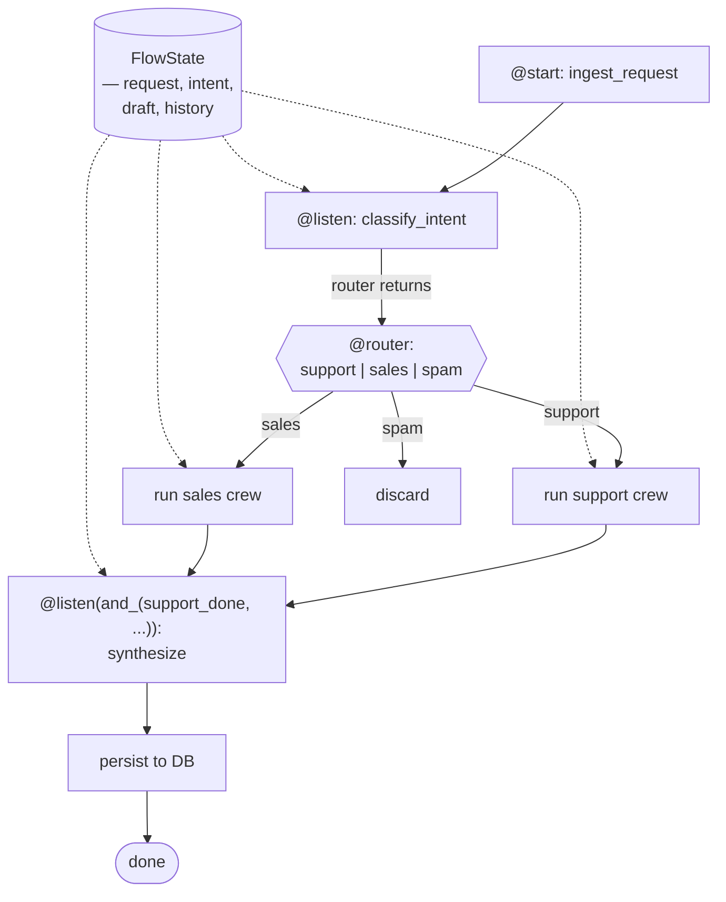

# 🧠 Topic: CrewAI Flows — Deep Dive

> [!abstract] Executive Summary (ELI5)
> A [[CrewAI Crews|Crew]] runs a fixed list of tasks under one of two processes (sequential / hierarchical). A **Flow** is the next layer up: an **event-driven state machine** that orchestrates *multiple* crews (or plain functions) with **branching, fan-out/fan-in, conditional routing, retries, and persistent state**. Where a crew answers "how do these agents share work?", a flow answers "which crew runs next, and what does it do with the previous crew's output?". Decorators — `@start`, `@listen`, `@router` — declare the graph; `FlowState` (or your subclass) carries data between steps.

> [!info] Version note
> Targets **CrewAI ≥ 1.15.x**. Flows is the youngest major API in CrewAI and is still evolving:
> - The **state machine** model (`@start` / `@listen` / `@router`) is stable.
> - `@listen` accepts **start methods, other listeners, router outputs, or `or_` / `and_` combinators** for fan-in.
> - State is passed via a `FlowState`-derived class; **persistence** (DB-backed state so a flow survives restarts) is a recent addition — verify the persistence API against your pinned version before relying on it.
> - For ML-style hyperparameter search across flows, CrewAI ships an **`om zeroes`** integration; treat it as optional and separate from core Flows.

---

## 🎯 The "Why"
- **Problem Solved:** Once your pipeline has a **real control-flow shape** — *if the classifier routes to support, run the support crew, else run the sales crew*; *run research and pricing concurrently, then synthesize*; *retry on validation failure* — a single crew is no longer expressive enough. You could chain crews by hand, but then you're rebuilding routing, state passing, and error handling. Flows gives you those primitives as decorators so you describe the *graph*, not the plumbing.
- **Why a state machine and not a bigger crew:** A crew's process is **fixed at kickoff** (sequential or hierarchical). A flow can **decide the next step based on the previous step's output** at runtime — that's the definition of a state machine. Trying to express conditional branching inside a single crew leads to "agent-as-router" hacks that are opaque, expensive, and untestable.
- **Alternatives / comparison:**
    - **[[LangGraph]]:** Flows is CrewAI's answer to LangGraph's graph model. LangGraph is lower-level and more flexible (explicit nodes, edges, reducers); Flows is more opinionated and integrates natively with CrewAI crews. Pick Flows if you're already in CrewAI; pick LangGraph if you want maximum graph-level control or non-CrewAI nodes.
    - **[[OpenAI-Agent-SDK-Overview|OpenAI Agents SDK]]:** orchestration is a tree of handoffs, not a state machine. There's no first-class "branching workflow" object — you encode it in agent logic. Lighter for linear pipelines; weaker for explicit fan-out/fan-in with persistence.
    - **Temporal / Prefect / Airflow:** general-purpose workflow engines. Overkill if your steps are LLM calls and you don't need their durability/queueing model — but reach for them when you need human-scale SLAs, retries across days, or cross-process orchestration that Flows' persistence doesn't cover.
    - **A hand-rolled `if/else` chain over crews:** works for two branches; becomes spaghetti fast. You lose the visual graph, structured routers, and built-in fan-in.

## 💡 Mental Model & Analogy
- **Analogy:** A Flow is a **stateful production line with quality-control gates and conveyors**.
    - `@start` methods = the **loading dock** — where raw input enters the line.
    - `@listen(X)` methods = a **workstation that activates when part X arrives**.
    - `@router` methods = a **sorter/turntable** — inspects the part, decides which workstation is next.
    - `FlowState` = the **tote/bin** traveling with each unit, carrying its accumulated state.
    - A **crew** embedded in a step = a **multi-person workstation** (a team inside one station).
    - `and_` / `or_` = "**wait for both** conveyors" / "**wait for either** conveyor" before the next station.
    - **Persistence** = the line can be **paused and resumed** across shifts (restarts).
- **Visual/Diagram:**


## 🛠️ Core primitives

### 1. State — the travel tote
State is a Pydantic model subclassing `FlowState` (or `SQLiteState` / `DBState` for persistence). Every step receives it via `self.state`. Mutations in one step are visible to the next.

```python
from pydantic import BaseModel, Field
from crewai.flow.flow import Flow, FlowState, start, listen, router, or_, and_

class SupportState(FlowState):
    request: str = ""
    intent: str = ""                 # "support" | "sales" | "spam"
    draft_response: str = ""
    conversation_history: list[str] = Field(default_factory=list)
```

> [!tip] State is shared, not returned
> Steps don't return their output to be passed as an argument — they **mutate `self.state`**, and downstream steps read it. This is the key mental shift from a function pipeline. Returns from a step are used **only for routing** (what to trigger next), not for carrying data.

### 2. `@start` — the entry point(s)
A flow can have **one or more** `@start` methods. They fire when `flow.kickoff(...)` is called.

```python
@start()
def ingest_request(self):
    # self.state.request was set via kickoff(inputs=...)
    self.state.conversation_history.append(f"USER: {self.state.request}")
```

### 3. `@listen(X)` — react to a step
`X` can be: a start method, another listener, a router's output, or a combinator (`or_`, `and_`). The listener runs **after X completes**.

```python
@listen(ingest_request)
def classify_intent(self):
    self.state.intent = classify(self.state.request)   # populate state
```

### 4. `@router(X)` — conditional branching
A router returns one of several **literal values**. CrewAI routes to whichever listener is registered for that value. The router method is decorated **twice**: once with `@router(X)` (when to run) and once with `@listen(router_method, <value>)` on each downstream branch.

```python
@router(classify_intent)
def route_by_intent(self):
    # The return value selects the next step.
    if self.state.intent == "support":
        return "support"
    elif self.state.intent == "sales":
        return "sales"
    else:
        return "spam"

@listen(route_by_intent, "support")
def run_support_crew(self):
    # ...build and kickoff a Crew, write result into self.state.draft_response

@listen(route_by_intent, "sales")
def run_sales_crew(self):
    ...

@listen(route_by_intent, "spam")
def discard(self):
    ...
```

### 5. `and_` / `or_` — fan-in combinators
For steps that should wait on **multiple** upstream steps:
- `and_(A, B)` — run only after **both A and B** complete.
- `or_(A, B)` — run after **either A or B** completes.

```python
@listen(and_(run_support_crew, fetch_billing_history))
def synthesize_response(self):
    # both upstream steps have written to self.state; merge here
    self.state.draft_response = synthesize(self.state)
```

> [!warning] Fan-in needs deterministic state writes
> When two steps run concurrently and both write to `self.state`, ensure they write **different fields**. Concurrent writes to the same field race; the last writer wins and the result is non-deterministic. Design state so each parallel branch owns distinct keys.

---

## 1️⃣ A complete, non-trivial flow

Putting the primitives together: a support-routing flow that **classifies intent**, **branches** to one of two crews, **fans in** the crew's output with fetched context, and **persists** the result.

```python
from pydantic import BaseModel, Field
from crewai.flow.flow import Flow, FlowState, start, listen, router, and_, or_

from my_crews.support_crew import build_support_crew
from my_crews.sales_crew  import build_sales_crew


class SupportState(FlowState):
    request: str = ""
    intent: str = ""
    billing_history: list[str] = Field(default_factory=list)
    draft_response: str = ""
    final_response: str = ""


class SupportFlow(Flow[SupportState]):
    @start()
    def ingest(self):
        self.state.request  # populated via kickoff(inputs={"request": ...})

    @listen(ingest)
    def classify(self):
        self.state.intent = classify_intent(self.state.request)  # "support"|"sales"|"spam"

    @router(classify)
    def route(self):
        return self.state.intent   # routes to matching @listen(route, <value>)

    # --- branches ---
    @listen(route, "support")
    def run_support(self):
        crew = build_support_crew()
        result = crew.kickoff(inputs={"request": self.state.request})
        self.state.draft_response = result.raw

    @listen(route, "sales")
    def run_sales(self):
        crew = build_sales_crew()
        result = crew.kickoff(inputs={"request": self.state.request})
        self.state.draft_response = result.raw

    @listen(route, "spam")
    def discard(self):
        self.state.final_response = "(discarded)"

    # --- fan-in: fetch context + whichever branch ran, then synthesize ---
    @listen(run_support)
    def fetch_billing(self):
        # only meaningful for support; runs after support crew finishes
        self.state.billing_history = billing_repo.lookup(self.state.request)

    @listen(and_(fetch_billing, run_support))
    def synthesize(self):
        self.state.final_response = merge(
            self.state.draft_response, self.state.billing_history
        )

    @listen(synthesize)
    def persist(self):
        db.save(self.state.final_response)


flow = SupportFlow()
result = flow.kickoff(inputs={"request": "My invoice is wrong, please help"})
print(result)
```

Key things this demonstrates:
- **Entry** via `@start`, **classification** via `@listen`, **branching** via `@router` + `@listen(route, value)`.
- **Crews embedded inside flow steps** — each branch kicks off a different crew.
- **Fan-in** via `and_(...)` to wait on both context fetch and crew output.
- **State as the single channel** between steps — nothing is returned and passed as an argument.
- A **terminal persistence step** at the end.

---

## 2️⃣ Structured routers — type-safe branching

Instead of returning bare strings (typo-prone), use an `Enum`. CrewAI matches the router's return value against the registered listeners.

```python
from enum import Enum

class Intent(Enum):
    SUPPORT = "support"
    SALES   = "sales"
    SPAM    = "spam"

@router(classify)
def route(self) -> Intent:
    return Intent(self.state.intent)

@listen(route, Intent.SUPPORT)
def run_support(self): ...

@listen(route, Intent.SALES)
def run_sales(self): ...

@listen(route, Intent.SPAM)
def discard(self): ...
```

> [!tip] Always use an Enum for non-trivial routers
> A typo in a string return (`"suport"`) silently never matches any listener — the flow dead-ends with no error. An Enum makes the set of legal routes explicit and IDE-checkable.

---

## 3️⃣ Persistence — surviving restarts

By default, a flow's state lives **in memory** for the duration of `kickoff`. For long-running flows (hours/days) or flows that must survive process restarts, subclass a persistent state class:

```python
from crewai.flow.flow import Flow, SQLiteState   # or DBState for other backends

class SupportState(SQLiteState):
    request: str = ""
    intent: str = ""
    # ...same fields

class SupportFlow(Flow[SupportState]):
    ...
```

With persistent state, CrewAI checkpoints `self.state` after every step. If the process crashes mid-flow, you can **resume** from the last completed step instead of re-running from `@start`.

> [!warning] Verify the persistence API for your version
> Persistence is the most actively changing part of Flows. The state base class names (`SQLiteState`, `DBState`), the resume mechanics, and the exact checkpoint semantics differ across versions. **Pin your version and confirm against the official docs before relying on persistence in production.** For mission-critical durability (multi-day flows, regulated workloads), evaluate whether a dedicated workflow engine (Temporal, Prefect) is the safer choice.

---

## 4️⃣ Flow vs Crew — when to graduate

| Need | Reach for |
|---|---|
| 2–5 tasks, fixed order, one team | **Crew** (sequential or hierarchical) |
| Linear pipeline with no branching | **Crew** |
| Conditional routing based on output content | **Flow** (router) |
| Fan-out / fan-in across independent sub-pipelines | **Flow** (`and_` / `or_`) |
| Multi-crew orchestration (different teams per branch) | **Flow** |
| Persistent state across restarts | **Flow** (persistence) |
| External triggers / webhooks / queue-driven | **Flow** (with persistence + idempotent starts) |
| One agent, one task, no coordination | Neither — call the agent directly |

> [!tip] Don't graduate too early
> A surprising share of "I need a Flow" pipelines are actually a single hierarchical crew with a manager that routes. Try expressing your control flow as a hierarchical crew *first*; reach for a Flow only when the manager-as-router pattern becomes contortion (multiple distinct crews, real persistence, fan-out across crews).

---

## ⚠️ Pitfalls & Anti-patterns (flow-specific)
- **Returning data from steps instead of writing state.** Step returns are for **routing**, not data transfer. Write to `self.state`; the return value should be a routing signal (or `None`). Conflating the two is the #1 source of "where did my data go?" bugs.
- **String-typed routers with typos.** `"suport"` never matches any listener — the flow silently dead-ends. Use an `Enum`.
- **Concurrent writes to the same state field.** When two `@listen` branches run in parallel and both write `self.state.draft`, the result is a race. Give each branch its own field; merge in a fan-in step.
- **Embedding heavy logic in router methods.** A `@router` should **decide**, not **do**. If your router also fetches data and writes state, it's doing two jobs — split it into a listener (does) + a router (decides).
- **Forgetting `@start` is the only entry.** Methods without `@start`, `@listen`, or `@router` are **never executed** by the flow. They're dead code, and CrewAI won't warn you.
- **Modeling trivially linear work as a flow.** If you have `A → B → C` with no branching, a flow is overhead — use a sequential crew.
- **Treating persisted state as transactional.** Flow persistence is **checkpointing**, not a transaction system. There's no automatic rollback of side effects (DB writes, API calls) if a later step fails. Design steps to be idempotent or add explicit compensation logic.
- **No idempotency on `@start`.** If a flow can be triggered by an external queue/webhook, a duplicate trigger should not produce duplicate side effects. Use a deduplication key in state.
- **When NOT to use a Flow:** if the control flow fits in a single crew (≤ a handful of tasks, one process), Flows is overkill. Don't reach for the state machine until the crew model genuinely can't express your branching.

## 🔗 Deep Connections
- **Parent Topic:** [[CrewAI Overview]], [[Agentic Workflows]]
- **Sibling (must read):**
    - [[CrewAI Crews]] — the unit a flow orchestrates. Most flow steps either run a crew or do routing around crews.
    - [[CrewAI Tasks]] — `context`, `async_execution`, and fan-in on tasks solve *intra-crew* coordination; Flows solves *inter-crew* coordination. Don't reach for a Flow when task-level `context` would do.
- **Related Concepts:**
    - [[LangGraph]] — the lower-level graph model Flows is CrewAI's answer to. Compare when choosing between frameworks.
    - [[Structured-Outputs-in-Agentic-Systems]] — use Pydantic state + Enum routers so branching is type-safe.
    - [[Forcing-a-Reasoning-Budget]] — every step that calls a crew is multiple LLM calls. Branching multiplicatively increases cost; design routes deliberately.
    - [[OpenAI-Agent-SDK-Overview]] — comparison: tree-of-handoffs vs. explicit state machine.
    - [[Handoffs]] — single-agent-style routing vs. flow-style routing.
- **Prerequisites:** [[CrewAI Overview]], [[CrewAI Crews]], [[CrewAI Tasks]].

## ❓ Active Recall Questions
> [!faq]- What problem does a Flow solve that a Crew cannot?
> A crew's process (sequential / hierarchical) is **fixed at kickoff**. A flow can **decide the next step based on runtime output** (branching), **fan-out and fan-in** across independent sub-pipelines, orchestrate **multiple distinct crews**, and **persist state across restarts**. Any control flow with real conditional routing or multi-crew coordination needs a flow.

> [!faq]- How does data move between steps in a Flow — via return values or via state?
> Via **shared state** (`self.state`). Steps **mutate state**; downstream steps read it. Return values are used **only for routing** (what to trigger next), not for carrying data. Treating returns as data transfer is the #1 Flow bug.

> [!faq]- What's the difference between `@listen(A)` and `@router(A)`, and how do branches register?
> `@listen(A)` runs unconditionally after `A`. `@router(A)` returns a value that **selects** the next step. Branches register as `@listen(router_method, <value>)` — only the branch whose value matches the router's return runs. Use an `Enum` for the value set to avoid typo dead-ends.

> [!faq]- When do you use `and_` vs `or_`?
> `and_(A, B)` — the listener fires only after **both A and B complete** (classic fan-in: synthesize after two parallel research crews). `or_(A, B)` — the listener fires after **either** completes. The race/determinism caveat: ensure parallel branches write **distinct** state fields to avoid races.

> [!faq]- Why should a `@router` method "decide, not do"?
> A router that also fetches data and writes state is doing two jobs and becomes hard to reason about. Split: a listener does the work and writes state; a router reads state and returns the next branch. Each method has one responsibility, and the graph reads cleanly.

> [!faq]- When should you NOT use a Flow?
> When the control flow is **linear and fits one crew** (≤ a handful of tasks, one process), or when a **hierarchical crew with a manager-as-router** can express the branching without contortion. Flows adds a state machine; reach for it only when the crew model genuinely can't express your branching or you need persistence.

> [!faq]- Is flow persistence a substitute for a transactional workflow engine?
> **No.** Flow persistence is **checkpointing** (resume after crash) — it does **not** roll back side effects (DB writes, API calls) if a later step fails. For multi-day durability, regulated workloads, or transactional semantics, evaluate Temporal/Prefect instead.

---
## 📝 How to use this note effectively
1. **Never Copy-Paste:** Read, then express one real branching pipeline as a flow from memory — decorator names are stable; state/persistence APIs shift.
2. **Iterate on the graph before the code.** Draw the router/branch/fan-in shape on paper first. Most "my flow is a mess" bugs are actually "I modeled a crew-shaped problem as a flow."
3. **The "Why" is King:** Knowing *which primitive* (`@router` vs `and_` vs persistence vs "use a crew instead") solves *which symptom* (branching vs fan-in vs durability vs overkill) is the senior judgment this note is really about.
4. **Re-verify the API:** Flows is the youngest major CrewAI API. Before shipping, confirm decorator imports (`crewai.flow.flow`), state base classes (`FlowState` / `SQLiteState` / `DBState`), and persistence mechanics against the version you pinned.

---
## 📚 Sources
- [Flows — official docs (v1.15.x)](https://docs.crewai.com/concepts/flows)
- [State management in Flows](https://docs.crewai.com/concepts/flows#state-management)
- [Routing — `@router`, `and_`, `or_`](https://docs.crewai.com/concepts/flows#routing)
- [Persistence / `SQLiteState`](https://docs.crewai.com/concepts/flows#persistence)
- [Flows + Crews integration patterns](https://docs.crewai.com/how-to/flows-with-crews)
