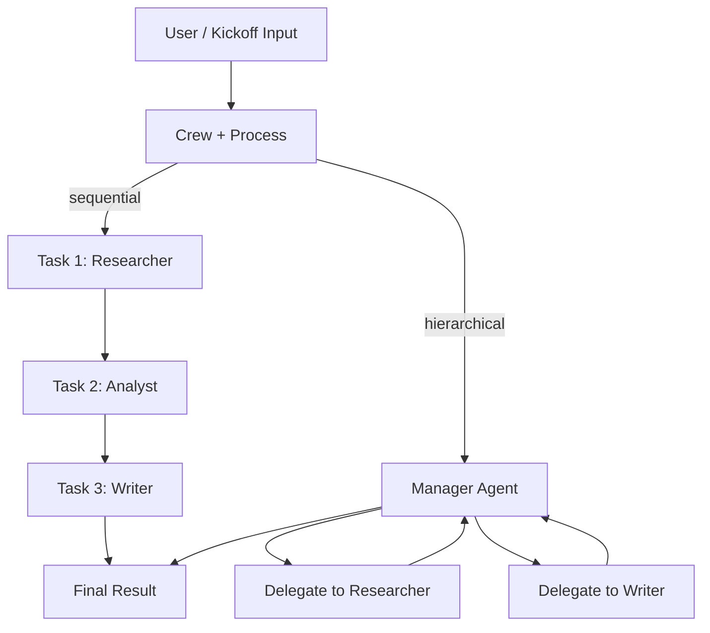

# 🧠 Topic: CrewAI — Overview

> [!abstract] Executive Summary (ELI5)
> CrewAI is a Python framework for building **collaborative multi-agent systems**. Instead of one agent doing everything, you assemble a *crew* of role-based agents (a researcher, a writer, a reviewer) who hand tasks to each other and produce a combined result. It abstracts away the orchestration loop, role assignment, and inter-agent communication so you describe *who* is on the team and *what* the workflow is — not the plumbing.

---

## 🎯 The "Why"
- **Problem Solved:** Real-world tasks (research a topic and write a report, triage and resolve a support ticket, plan a trip) are too big for a single prompt. You need multiple specialized steps, each with its own instructions and tools. Wiring that orchestration by hand — who runs first, who passes output to whom, how errors propagate — is repetitive and brittle. CrewAI provides the role + workflow + delegation primitives as first-class objects.
- **Alternatives:**
    - **[[OpenAI-Agent-SDK-Overview|OpenAI Agents SDK]]:** Production-grade, lighter-weight, single-agent-first with explicit handoffs. More control, less opinionated collaboration model.
    - **LangGraph:** Graph-based orchestration (nodes + edges as explicit state machine). Maximum flexibility for custom flows, but verbose and low-level.
    - **AutoGen (Microsoft):** Conversational multi-agent paradigm where agents message each other in a group chat. More research-flavored; less structured than CrewAI's role/task model.
    - **Raw LLM calls + custom loop:** Total control, but you rebuild task routing, memory, and tool dispatch.
- **Trade-offs:**
    - **Pros:** Role-based design maps cleanly to how you think about teams; fast to prototype collaborative pipelines; supports sequential and hierarchical workflows out of the box; model-agnostic (OpenAI, Anthropic, local via LiteLLM/Ollama).
    - **Cons:** Opinionated structure can fight you on unconventional flows; extra abstraction layer adds debugging surface; performance/cost grows linearly with agent count and turns; the high-level API can hide *why* a crew misbehaved.

## 💡 Mental Model & Analogy
- **Analogy:** CrewAI is like **assembling a project team and writing their job descriptions**.
    - An **Agent** is an employee with a *role* ("Senior Researcher"), a *goal*, and a *backstory* that shapes tone and behavior.
    - A **Task** is an assignment with expected output and an assigned owner.
    - A **Tool** is a skill an employee has (web search, a database query, a calculator).
    - A **Crew** is the whole team plus the *process* — sequential (relay) or hierarchical (a manager delegates).
    - **Delegation** is one employee asking a colleague to take over a sub-task.
- **Visual/Diagram:**


## 🛠️ Core Components & Code Snippets

> [!info] This section is the **map**. Each pillar has its own deep-dive note — follow the links for the full API reference, worked examples, and pitfalls.
> - **Agent** → [[CrewAI Agents]] — *who* (identity, LLM, tools, knowledge, structured output)
> - **Task** → [[CrewAI Tasks]] — *what* and *what-good-looks-like* (description, expected_output, guardrails, structured output)
> - **Crew** → [[CrewAI Crews]] — *how they coordinate* (sequential vs hierarchical, memory, planning, `@CrewBase`)
> - **Flows** → [[CrewAI Flows]] — *which crew runs next* (state machine: `@start` / `@listen` / `@router`, fan-out, persistence)

### 1. Agent — the role
An agent has an identity (role, goal, backstory) and capabilities (tools, model, LLM params). The *backstory* is not cosmetic — it biases the model's persona and decision-making. See [[CrewAI Agents]] for the full parameter reference, the `LLM` object, `BaseTool` vs `@tool`, and `output_pydantic`.

```python
from crewai import Agent

researcher = Agent(
    role="Senior Research Analyst",
    goal="Uncover cutting-edge developments in AI agents",
    backstory="You are a meticulous analyst at a top think tank, "
              "known for distinguishing hype from real breakthroughs.",
    tools=[search_tool],
    llm="gpt-4o-mini",
    verbose=True,
)
```

### 2. Task — the assignment
A task describes the work, the expected output, and *which agent* owns it. Tasks are the unit the crew executes. See [[CrewAI Tasks]] for `context`/`async_execution` (fan-in), guardrails, and structured output.

```python
from crewai import Task

research_task = Task(
    description="Investigate the latest multi-agent orchestration frameworks "
                "and summarize the top 3 with concrete trade-offs.",
    expected_output="A 3-bullet comparison with citations.",
    agent=researcher,
)
```

### 3. Crew — the team + process
The crew binds agents, tasks, and a process together. `process="sequential"` runs tasks in order; `process="hierarchical"` spawns a manager that delegates. See [[CrewAI Crews]] for the full crew configuration (memory, planning, `manager_llm`, `@CrewBase` YAML layout, `kickoff_for_each`).

```python
from crewai import Crew, Process

crew = Crew(
    agents=[researcher, writer],
    tasks=[research_task, writing_task],
    process=Process.sequential,  # or Process.hierarchical
    verbose=True,
)

result = crew.kickoff(inputs={"topic": "multi-agent orchestration"})
print(result.raw)
```

### 4. Tools — agent skills
Any function can become a tool. CrewAI supports `@tool` decorators and integrates with LangChain's tool ecosystem, so you rarely write a capability from scratch. See [[CrewAI Agents#2️⃣ Capabilities: sophisticated tools]] for `BaseTool` + Pydantic `args_schema` and structured return types.

```python
from crewai.tools import tool

@tool("Web Search")
def web_search(query: str) -> str:
    """Search the web and return the top results for the query."""
    return run_search(query)
```

> [!tip] Implementation Note
> The `role`, `goal`, and tool **descriptions** are what the LLM actually reads to decide behavior and when to call a tool. Write them like a good job posting — specific, outcome-oriented, and unambiguous. A vague role ("helper agent") produces vague output.

### 5. Flows — multi-crew orchestration (newer API)
For stateful, branching pipelines across multiple crews, CrewAI offers `Flow` — an event-driven state machine with `@start` / `@listen` / `@router` decorators, `and_`/`or_` fan-in, and optional persistence. See [[CrewAI Flows]] for the full primitive reference, structured `Enum` routers, and the crew-vs-flow decision table. Use Flows when sequential/hierarchical isn't expressive enough (fan-out across crews, conditional branches, persistent state across restarts).

## ⚠️ Pitfalls & Anti-patterns
- **Agent sprawl:** Adding an agent per sub-step "because it sounds organized" multiplies cost and latency and rarely improves quality. Start with the fewest agents that cover distinct roles.
- **Role/goal bloat:** Pages of instructions per agent dilute focus. Keep each role to one clear job.
- **Ignoring `expected_output`:** Without a concrete expected output, tasks drift and downstream agents receive unstructured blobs. Always specify it.
- **Hidden cost in hierarchical process:** The manager agent adds reasoning turns for every delegation — fine for quality, expensive at scale.
- **Blind trust on tool errors:** A failed tool call becomes the agent's input. Log and constrain retries to avoid hallucinated "results."
- **When NOT to use:** For a single-step task or a deterministic pipeline with no LLM judgment, CrewAI is overkill — use a plain function chain or the lighter [[OpenAI-Agent-SDK-Overview|OpenAI Agents SDK]].

## 🔗 Deep Connections
- **Parent Topic:** [[Agentic Workflows]], [[LLM Agents]]
- **Deep dives (this folder):**
    - [[CrewAI Agents]] — *who*: identity, `LLM` object, tools, knowledge, structured output.
    - [[CrewAI Tasks]] — *what*: `expected_output`, `context`/`async_execution`, guardrails.
    - [[CrewAI Crews]] — *how they coordinate*: sequential vs hierarchical, memory, planning, `@CrewBase`.
    - [[CrewAI Flows]] — *which crew runs next*: state-machine orchestration, routing, persistence.
- **Related Concepts:**
    - [[OpenAI-Agent-SDK-Overview]] — comparison point: single-agent-first vs. crew-first.
    - [[LLM Tool Use - Function Calling]] — the underlying mechanism CrewAI tools rely on.
    - [[Handoffs]] — OpenAI SDK's analogue to CrewAI delegation.
    - [[Structured-Outputs-in-Agentic-Systems]] — enforcing `expected_output` shape reliably.
    - [[Forcing-a-Reasoning-Budget]] — controlling cost when crews chain many reasoning turns.
- **Prerequisites:** Python, basic understanding of LLM tool calling, multi-agent concepts.

## ❓ Active Recall Questions
> [!faq]- What is the core unit of collaboration in CrewAI, and how does it differ from a plain agent loop?
> The **crew** — a team of role-based **agents** executing **tasks** under a shared **process** (sequential or hierarchical). A plain agent loop runs one agent against tools; a crew coordinates multiple specialized agents that hand work to each other.

> [!faq]- Sequential vs. hierarchical process — when do you pick which?
> Use **sequential** for a fixed, linear pipeline (research → analyze → write). Use **hierarchical** when delegation decisions are dynamic — a manager agent decides which specialist handles each sub-task based on runtime content.

> [!faq]- What is the role of `backstory`, and why isn't it just flavor text?
> The backstory shapes the model's persona, tone, and judgment biases. "A skeptical analyst" produces different output than "an enthusiastic blogger" given the same goal — it's a behavioral lever, not decoration.

> [!faq]- Why is "agent sprawl" an anti-pattern even though CrewAI makes adding agents easy?
> More agents mean more LLM calls, higher latency and cost, and more places for errors to propagate. Each agent should own a genuinely distinct role; otherwise the abstraction adds overhead without quality gains.

---
## 📝 How to use this note effectively
1. **Never Copy-Paste:** Read, close the tab, and write a crew from memory.
2. **Iterate:** Refine the ELI5 and analogy as you build real crews.
3. **The "Why" is King:** Seniority is knowing *when* CrewAI's role-based model beats a lighter SDK or a hand-rolled loop.
4. **Update the Status:** Move `mastery` from `beginner` → `growing` → `mastered` as you ship crews to production.
