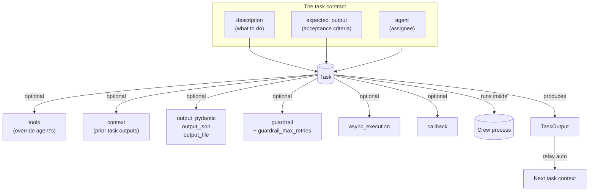

# 🧠 Topic: CrewAI Tasks — Deep Dive

> [!abstract] Executive Summary (ELI5)
> If a [[CrewAI Agents|Agent]] is a team member, a **Task** is the assignment handed to them: a description, a definition of "done", the tools they're allowed, and what other tasks' output they should read first. Tasks are the unit the crew actually *executes* — the crew sequences them, passes their outputs along, and validates them. Where the agent defines *who*, the task defines *what* and *what-good-looks-like*.

> [!info] Version note
> Targets **CrewAI ≥ 1.15.x**. Points that trip people up on current versions:
> - **Only one output type per task.** Pick exactly one of `output_pydantic` / `output_json` / `output_file` (you can combine `output_file` with a Pydantic/JSON schema, but not set `output_pydantic` *and* `output_json` together).
> - `output_pydantic` / `output_json` take **the Pydantic class itself**, not an instance: `output_pydantic=Blog`, never `output_pydantic=Blog()`.
> - Guardrails return a **`(bool, Any)` tuple** — `(True, result)` to accept, `(False, "error")` to send the agent back to retry. `guardrail_max_retries` defaults to **3**.
> - The `markdown=True` flag injects formatting instructions into the prompt; it does *not* parse output.

---

## 🎯 The "Why"
- **Problem Solved:** An LLM with no notion of "done" will produce *something* on every call, but rarely the *same shape* twice. To chain steps reliably (research → analyze → write), each step needs an explicit contract: what to do, what the result must look like, and which prior steps feed in. The `Task` object is that contract.
- **Why this matters for crews:** In a sequential process, each task's output is **automatically relayed** as context to the next. That means a sloppy `expected_output` on task N silently corrupts task N+1. Tasks are where multi-agent pipelines succeed or fail.
- **Alternatives / comparison:**
    - **[[OpenAI-Agent-SDK-Overview|OpenAI Agents SDK]]:** no `Task` object — you encode "what to do" in the prompt and "what good looks like" in a response format. Lighter, but you hand-wire the inter-step plumbing that CrewAI gives you for free.
    - **LangGraph:** a node *is* effectively a task, but dependencies are explicit graph edges; CrewAI's `context=[...]` is a lighter dependency declaration.
    - **Plain function chain:** deterministic, but no LLM judgment, no retry-on-validation-failure, no structured-output enforcement.

## 💡 Mental Model & Analogy
- **Analogy:** A Task is a **ticket in your project tracker**.
    - `description` = the ticket body — what needs doing.
    - `expected_output` = the **acceptance criteria** — what "done" looks like (the most under-used field).
    - `agent` = the **assignee**.
    - `tools` = the **permissions/apps** this ticket grants (can *override* the agent's default tools).
    - `context` = "see tickets #12 and #15 before starting."
    - `output_pydantic` = "fill in **this exact form**."
    - `guardrail` = a **QA reviewer** who can bounce the ticket back with notes.
    - `async_execution` = "work on this in parallel; we'll sync later."
    - `callback` = the **webhook** that fires when the ticket closes.
- **Visual/Diagram:**


## 🛠️ Anatomy of a Task — parameter reference

`description` and `expected_output` are the heart of every task; everything else is optional orchestration. `agent` is optional because in a **hierarchical** process the manager assigns tasks dynamically.

| Attribute | Type | What it controls | Senior note |
|---|---|---|---|
| `description` | `str` | What the task entails | Make it action-oriented. `{topic}`-style placeholders are filled from `kickoff(inputs={...})`. |
| `expected_output` | `str` | What "done" looks like | **The highest-leverage field.** Write it like acceptance criteria: format, length, tone, structure. A vague `expected_output` is the #1 cause of drift. |
| `name` | `Optional[str]` | Identifier | Handy for logging/retrieval; auto-derived from description if omitted. |
| `agent` | `Optional[Agent]` | Assignee | Optional under `Process.hierarchical` (manager delegates); required-ish under sequential. |
| `tools` | `List[BaseTool]` | Task-scoped tool allowlist | **Overrides** the agent's tools for this task — use to *narrow* capabilities (e.g. a write task with no internet). |
| `context` | `Optional[List[Task]]` | Other tasks whose outputs feed in | Beyond the auto-relay from the immediately preceding task. Combine with `async_execution` to fan-in. |
| `async_execution` | `Optional[bool]` | Run without blocking the next task | Default `False`. The crew moves on; a later task consuming this one via `context` waits for it. |
| `human_input` | `Optional[bool]` | Prompt a human to review the final answer | Default `False`. Lightweight HITL gate — see [[Human-in-the-Loop for Agent Observability]]. |
| `markdown` | `Optional[bool]` | Inject markdown-formatting instructions | Default `False`. Alters the prompt; doesn't parse output. |
| `output_file` | `Optional[str]` | Persist output to disk | Pair with `create_directory=True` to auto-mkdir. |
| `output_json` | `Optional[Type[BaseModel]]` | Force validated JSON output | Pass the **class**. Mutually exclusive with `output_pydantic`. |
| `output_pydantic` | `Optional[Type[BaseModel]]` | Force validated Pydantic output | Pass the **class**. Strongest structured-output guarantee. |
| `callback` | `Optional[Callable]` | Post-completion hook | Receives a `TaskOutput`. Use for side effects (notify, persist). |
| `guardrail` | `Callable \| str \| LLMGuardrail` | Single validator/transformer | Returns `(bool, Any)`. String form = no-code natural-language rule. |
| `guardrails` | `list` | **Multiple** validators run in sequence | Prefer this over hand-rolling a `chain()`. Mix functions + LLM strings freely. |
| `guardrail_max_retries` | `int` | Retries before giving up | Default **3**. (Older `max_retries` is deprecated → use this.) Each retry is another LLM call — budget accordingly. |
| `create_directory` | `bool` | Auto-create dirs for `output_file` | Default `False`. |

> [!tip] `expected_output` is acceptance criteria, not a label
> "A report" is a label. "A markdown report, 4 sections, each ≤200 words, with a sources list" is acceptance criteria. The agent reads this field — precision here directly improves output quality and makes the guardrail's job possible.

---

## 1️⃣ Two ways to define tasks

### A. YAML configuration (recommended for real projects)
Decouples task specs from code. The `@CrewBase` + `@task` decorators load YAML via `self.tasks_config`. This is the maintainable pattern once you have more than ~3 tasks.

```yaml
# src/latest_ai_development/config/tasks.yaml
research_task:
  description: >
    Conduct thorough research about {topic}.
    Surface only developments from the last 12 months.
  expected_output: >
    A 10-bullet list. Each bullet: one development + one concrete source URL.
  agent: researcher

reporting_task:
  description: >
    Expand each research bullet into a full report section.
    Never introduce facts not present in the research context.
  expected_output: >
    A markdown report with one ## section per bullet, ≤200 words each,
    plus a '## Sources' list at the end.
  agent: reporting_analyst
  markdown: true
  output_file: report.md
```

```python
# src/latest_ai_development/crew.py
from crewai import Agent, Crew, Process, Task
from crewai.project import CrewBase, agent, crew, task

@CrewBase
class LatestAiDevelopmentCrew:
    agents_config = "config/agents.yaml"
    tasks_config = "config/tasks.yaml"

    @task
    def research_task(self) -> Task:
        return Task(config=self.tasks_config["research_task"])

    @task
    def reporting_task(self) -> Task:
        return Task(config=self.tasks_config["reporting_task"])

    @crew
    def crew(self) -> Crew:
        return Crew(
            agents=[self.researcher(), self.reporting_analyst()],
            tasks=[self.research_task(), self.reporting_task()],
            process=Process.sequential,
        )
```

### B. Direct code definition (for prototypes / notebooks)
Faster to iterate; fine until the task list grows or you need non-engineers to edit specs.

```python
from crewai import Task

research_task = Task(
    description="Research the latest developments in AI agents.",
    expected_output="A 10-bullet list, each with a source URL.",
    agent=researcher,
)
```

---

## 2️⃣ Structured output — the biggest reliability lever

When a downstream consumer (another task, a DB write, an API response) needs a **guaranteed shape**, set `output_pydantic` (preferred) or `output_json`. Both take the Pydantic **class**, not an instance.

```python
from pydantic import BaseModel, Field
from crewai import Task

class Article(BaseModel):
    title: str = Field(..., max_length=80)
    body: str = Field(..., min_length=100)
    tags: list[str] = Field(default_factory=list, max_length=5)

write_task = Task(
    description="Write an article about {topic} under 400 words.",
    expected_output="An Article object: title (≤80 chars), body (≥100 chars), up to 5 tags.",
    agent=writer,
    output_pydantic=Article,        # the CLASS — validated, not an instance
    output_file="output/article.md",  # optional: persist alongside
)
```

### Consuming `TaskOutput`
The crew's result exposes the structured data four ways. `pydantic` and `json_dict` are populated **only if** the task was configured with `output_pydantic` / `output_json`.

```python
result = crew.kickoff(inputs={"topic": "multi-agent orchestration"})

# Option 1 — dict-style indexing on the CrewOutput
print(result["title"])

# Option 2 — typed access via the Pydantic model
print(result.pydantic.title)

# Option 3 — dict()
print(result.to_dict()["tags"])

# Option 4 — per-task output (more granular than the final crew output)
print(write_task.output.raw)
print(write_task.output.pydantic)
```

> [!warning] `output_pydantic` and `output_json` are mutually exclusive
> You'll get a validation error if you set both. Choose `output_pydantic` when you want typed Python objects downstream; choose `output_json` when you're shipping the JSON onward (e.g. to an HTTP client) and don't need the Pydantic instance.

This is CrewAI's idiomatic enforcement of the pattern in [[Structured-Outputs-in-Agentic-Systems]].

---

## 3️⃣ Task dependencies & the `context` pipeline

In a **sequential** process, each task automatically receives the previous task's output. The `context` attribute lets you pull in **non-adjacent** tasks — essential when a task depends on something other than its immediate predecessor.

### A. Basic fan-in (one task waits on several)
```python
research_ai = Task(
    description="Research the latest developments in AI.",
    expected_output="A list of recent AI developments.",
    agent=research_agent,
    async_execution=True,          # run in parallel, don't block
)

research_ops = Task(
    description="Research the latest developments in AI Ops.",
    expected_output="A list of recent AI Ops developments.",
    agent=research_agent,
    async_execution=True,
)

write_blog = Task(
    description="Write a blog post about AI using both research streams.",
    expected_output="A 4-paragraph blog post.",
    agent=writer_agent,
    context=[research_ai, research_ops],   # wait for both async tasks
)
```

### B. Why async + context is a senior move
`async_execution=True` lets independent tasks run **concurrently**; a downstream task that lists them in `context` automatically waits for all of them. This is how you turn a linear chain (3 × latency) into a fan-out/fan-in (≈ max(latencies)).

> [!tip] Tool override narrows, not extends
> Setting `tools=[search_tool]` on a task **replaces** the agent's tool list for that task. Use it to restrict capabilities — e.g. a "write the report" task that shouldn't have internet access — not to add to the agent's existing tools.

---

## 4️⃣ Guardrails — QA between tasks

A guardrail is a function that runs **before the next task starts**. It validates, transforms, or filters the output. Return `(True, result)` to accept (the result flows downstream); return `(False, error_msg)` to send the agent back to retry, up to `guardrail_max_retries` (default 3).

### A. Function guardrail (full control)
```python
from typing import Tuple, Any
from crewai import Task, TaskOutput

def enforce_word_limit(result: TaskOutput) -> Tuple[bool, Any]:
    """Reject blog posts over 200 words; surface a clear reason on failure."""
    words = len(result.raw.split())
    if words > 200:
        return (False, f"Post is {words} words; must be ≤ 200. Trim it.")
    return (True, result.raw.strip())

blog_task = Task(
    description="Write a blog post about AI.",
    expected_output="A blog post under 200 words.",
    agent=blog_agent,
    guardrail=enforce_word_limit,
    guardrail_max_retries=3,   # default; raise only if the task is worth the cost
)
```

### B. No-code / natural-language guardrail
For non-engineers or quick rules, pass a string — CrewAI uses an LLM to evaluate it.
```python
task = Task(
    description="Summarize the research.",
    expected_output="5 bullets, each ≥100 words.",
    guardrail="Ensure each bullet contains a minimum of 100 words.",
)
```

### C. LLM-backed guardrail with a dedicated model
Use a cheaper/faster model for validation to keep costs down.
```python
from crewai import Task
from crewai.llm import LLM
from crewai.guardrail import LLMGuardrail

task = Task(
    description="Generate a structured competitor brief.",
    expected_output="A CompetitorBrief JSON object.",
    guardrail=LLMGuardrail(
        description="Verify every claim is supported by the research context; flag speculation.",
        llm=LLM(model="openai/gpt-4o-mini"),   # cheap validator model
    ),
)
```

### D. Chaining validators — the built-in `guardrails` list
For multiple checks, pass a **list** to `guardrails` (plural). CrewAI runs them **in sequence**, failing fast on the first violation — no need to hand-roll a `chain()` combinator. You can freely mix function-based and LLM-based (string) validators.

```python
from typing import Tuple, Any
from crewai import TaskOutput, Task

def validate_word_count(result: TaskOutput) -> Tuple[bool, Any]:
    n = len(result.raw.split())
    if not (100 <= n <= 500):
        return (False, f"Word count {n} outside 100-500.")
    return (True, result.raw)

def format_output(result: TaskOutput) -> Tuple[bool, Any]:
    return (True, result.raw.strip()[0].upper() + result.raw.strip()[1:])

blog_task = Task(
    description="Write a blog post about AI.",
    expected_output="A 100-500 word blog post.",
    agent=blog_agent,
    guardrails=[                                    # list → run in sequence
        validate_word_count,                        # function: precise check
        "The content must be engaging and jargon-free",  # LLM string: subjective check
        format_output,                              # function: transform on success
    ],
    guardrail_max_retries=3,                        # default; keep conservative
)
```

> [!warning] Each retry is a full LLM call
> A guardrail that fails 3× burns 3 extra completions per run. Make `expected_output` precise so the first attempt usually passes, and keep `guardrail_max_retries` conservative. Connect to the broader cost-control idea in [[Forcing-a-Reasoning-Budget]].

---

## 5️⃣ Callbacks & human input

### Callback — fires after the task completes
```python
from crewai import Task, TaskOutput

def on_complete(output: TaskOutput) -> None:
    # Side effect: notify, persist, instrument. Receives the full TaskOutput.
    log_to_observability(output.description, output.raw)

research_task = Task(
    description="Find the latest AI news.",
    expected_output="Top 5 stories as bullets.",
    agent=research_agent,
    callback=on_complete,
)
```

### Human input — lightweight HITL gate
When `human_input=True`, the agent's final answer is surfaced for a human to approve/edit before it's passed downstream. Expensive in wall-clock but indispensable for high-stakes outputs.
```python
approval_task = Task(
    description="Draft the customer-facing refund email.",
    expected_output="A polite refund email citing policy §4.2.",
    agent=writer,
    human_input=True,   # operator reviews before it's sent
)
```

---

## 🔬 Worked example — a research → analyze → report pipeline

Putting it together: three tasks with a **fan-out/fan-in** structure, structured outputs at each boundary, a guardrail on the synthesis step, and persistence. This is the shape most real crews converge on.

```python
from typing import Tuple, Any
from pydantic import BaseModel, Field

from crewai import Agent, Task, Crew, Process, TaskOutput
from crewai.tools import tool


# --- Shared models (the contracts between tasks) ---
class ResearchFinding(BaseModel):
    topic: str
    bullets: list[str] = Field(..., min_length=3, max_length=10)
    sources: list[str]

class TrendReport(BaseModel):
    title: str = Field(..., max_length=100)
    sections: list[str] = Field(..., min_length=2)
    threat_level: int = Field(..., ge=1, le=5)


# --- Agents (abbreviated; see CrewAI Agents note for full config) ---
researcher = Agent(role="Researcher", goal="...", backstory="...",
                   llm="openai/gpt-4o-mini", tools=[search_tool])
analyst = Agent(role="Trend Analyst", goal="...", backstory="...",
                llm="openai/gpt-4o", allow_delegation=False)


# --- Task 1: parallel research (async, structured output) ---
research_ai = Task(
    description="Research recent developments in {topic_a}. Return ≥3 bullets with sources.",
    expected_output="A ResearchFinding: 3-10 bullets + source URLs.",
    agent=researcher,
    async_execution=True,           # fan-out
    output_pydantic=ResearchFinding,
)

research_ops = Task(
    description="Research recent developments in {topic_b}. Return ≥3 bullets with sources.",
    expected_output="A ResearchFinding: 3-10 bullets + source URLs.",
    agent=researcher,
    async_execution=True,           # fan-out
    output_pydantic=ResearchFinding,
)


# --- Task 2: synthesis with a guardrail (fan-in) ---
def no_unsourced_claims(result: TaskOutput) -> Tuple[bool, Any]:
    """Bounce back if the report references something the research didn't surface."""
    try:
        report = TrendReport.model_validate_json(result.raw)
    except Exception as e:
        return (False, f"Output is not valid TrendReport JSON: {e}")
    if not report.sections or len(report.sections) < 2:
        return (False, "Report needs at least 2 sections.")
    return (True, result.raw)

analysis = Task(
    description=(
        "Synthesize the two research streams into a trend report. "
        "Only reference developments present in the research context."
    ),
    expected_output="A TrendReport: title, ≥2 sections, threat_level 1-5.",
    agent=analyst,
    context=[research_ai, research_ops],   # fan-in: waits for both async tasks
    output_pydantic=TrendReport,
    output_file="outputs/trend_report.json",
    create_directory=True,
    guardrail=no_unsourced_claims,
    guardrail_max_retries=2,
    callback=lambda out: notify_slack(out.raw),   # side effect on success
)


# --- The crew ---
crew = Crew(
    agents=[researcher, analyst],
    tasks=[research_ai, research_ops, analysis],
    process=Process.sequential,      # sequential ordering; async_execution adds parallelism within it
)

result = crew.kickoff(inputs={"topic_a": "AI agents", "topic_b": "AI Ops"})
print(result.pydantic.title)         # typed access to the final structured output
```

Key things this example demonstrates:
- **Fan-out/fan-in** via `async_execution` + `context` — two research tasks run concurrently, synthesis waits for both.
- **Structured output at every boundary** — `ResearchFinding` and `TrendReport` are validated contracts, not free text.
- **Guardrail with parse + business rule** — both "is it valid JSON?" and "does it meet my criteria?".
- **Persistence + notification** — `output_file` + `create_directory` + `callback`.

---

## ⚠️ Pitfalls & Anti-patterns (task-specific)
- **Vague `expected_output`.** The #1 source of drift. Write acceptance criteria, not labels.
- **Setting both `output_pydantic` and `output_json`.** Mutually exclusive — you get a validation error. Pick one.
- **Passing a Pydantic instance instead of the class.** `output_pydantic=Blog()` fails; use `output_pydantic=Blog`.
- **Forgetting that sequential auto-relays.** Task N+1 already sees task N's output. Adding it to `context` duplicates it in the prompt, wasting tokens.
- **`context` on the wrong tasks.** Useful for *non-adjacent* dependencies; redundant for the immediately preceding task.
- **`tools` on a task to "add" a tool.** It *replaces* the agent's tools. Read it as an allowlist, not an append.
- **Runaway guardrail retries.** Each failure is another completion. Cap `guardrail_max_retries` and make `expected_output` precise so the first attempt usually passes.
- **Overusing `human_input`.** Gating every task turns a pipeline into a manual queue. Reserve HITL for genuinely high-stakes steps.
- **When NOT to model something as a task:** deterministic transforms (regex, formatting, math) don't need an LLM — do them in Python and inject the result via `context` or `output_pydantic` on a *prior* task. Don't burn tokens on certainty.

## 🔗 Deep Connections
- **Parent Topic:** [[CrewAI Overview]], [[Agentic Workflows]]
- **Siblings (must read):**
    - [[CrewAI Agents]] — defines *who* executes a task.
    - [[CrewAI Crews]] — defines *how tasks coordinate* (the sequential auto-relay this note relies on is a crew-level behavior; hierarchical changes what `agent` means).
    - [[CrewAI Flows]] — when *inter-crew* coordination (routing, fan-out across crews, persistence) is needed on top of the *intra-crew* wiring this note covers.
- **Related Concepts:**
    - [[Structured-Outputs-in-Agentic-Systems]] — the pattern `output_pydantic`/`output_json` enforce.
    - [[Forcing-a-Reasoning-Budget]] — why `guardrail_max_retries` and `max_iter` must be capped.
    - [[Human-in-the-Loop for Agent Observability]] — when to use `human_input` and `callback`.
    - [[LLM Tool Use - Function Calling]] — the mechanism behind task `tools`.
    - [[Guardrails]] — the OpenAI SDK's analogue of task guardrails.
- **Prerequisites:** [[CrewAI Overview]], [[CrewAI Agents]], basic Pydantic.

## ❓ Active Recall Questions
> [!faq]- What is the single most important field on a Task, and why?
> `expected_output`. It's the **acceptance criteria** the agent reads, and it's what makes the guardrail's job possible. A precise `expected_output` ("4 sections, ≤200 words each, with sources") produces dramatically more consistent results than a label like "a report".

> [!faq]- How does output flow between tasks in a sequential process, and when do you need `context`?
> Each task **automatically receives the previous task's output**. You only need `context` for **non-adjacent** dependencies — e.g. task 5 needs task 2's output — or to fan-in multiple `async_execution=True` tasks. Adding the immediately preceding task to `context` duplicates it in the prompt.

> [!faq]- What's the difference between `output_pydantic` and `output_json`, and can you use both?
> Both enforce a Pydantic-validated shape. `output_pydantic` gives you a typed `.pydantic` object on the result; `output_json` populates `.json_dict`. They are **mutually exclusive** — setting both raises a validation error. Pass the **class**, not an instance.

> [!faq]- What does setting `tools=[...]` on a task actually do?
> It **replaces** the agent's tool list for that task — it's an allowlist, not an append. Use it to *narrow* capabilities (e.g. a writing task with no internet), not to extend the agent's existing tools.

> [!faq]- A guardrail returns `(False, "error")`. What happens next, and what's the cost implication?
> The error is sent back to the agent, which **retries** — up to `guardrail_max_retries` (default 3). Each retry is a **full LLM completion**, so a guardrail that fails repeatedly burns budget. Keep `expected_output` precise and the cap conservative.

> [!faq]- How do you make two independent tasks run concurrently and have a third wait for both?
> Set `async_execution=True` on the two independent tasks (the crew moves on without waiting), then list both in the third task's `context` — it will **wait for all** of them to complete before starting.

---
## 📝 How to use this note effectively
1. **Never Copy-paste:** Read, then define a 2-task crew from memory — field names are stable, model classes change.
2. **Iterate on `expected_output` first.** Most "the agent gave me garbage" bugs are actually "my acceptance criteria were vague."
3. **The "Why" is King:** Knowing *which knob* (`context` vs `async_execution` vs `guardrail` vs `output_pydantic`) solves *which symptom* (ordering vs latency vs quality vs shape) is the senior judgment this note is really about.
4. **Re-verify the API:** Guardrail return signatures, `LLMGuardrail` import paths, and the `@CrewBase` decorators shift between minor versions. Confirm against the version you pinned before shipping.

---

## 📚 Sources
- [CrewAI Tasks — official docs (v1.15.x)](https://docs.crewai.com/concepts/tasks)
- [Task structured output (`output_pydantic` / `output_json`) — migration guide](https://docs.crewai.com/guides/migration/upgrading-crewai)
- [Task guardrails & LLMGuardrail](https://docs.crewai.com/concepts/tasks#task-guardrails)
- [@CrewBase / YAML task configuration](https://docs.crewai.com/concepts/tasks#yaml-configuration-recommended)
