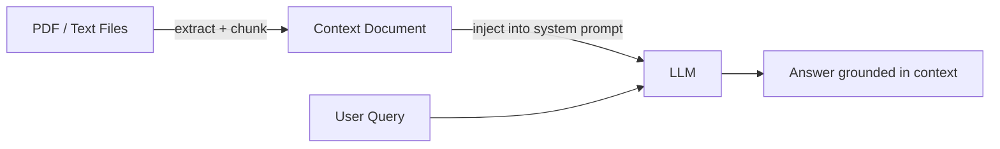

# Lightweight Prompt-Injected RAG

> [!abstract] Executive Summary (ELI5)
> Instead of building a search engine, you put all the knowledge the bot needs directly into the system prompt. It works as long as the documents are small enough to fit in the model's memory window. Fast, simple, no vector database required.

---

## 🎯 The "Why"

- **Problem Solved:** LLMs don’t know private or recent information. Retrieval-Augmented Generation (RAG) fixes this by giving the model relevant context at query time. The lightweight version skips the retrieval layer and injects a fixed corpus directly into the prompt — perfect for small, stable knowledge bases.
- **Alternatives:**
  - **Vector DB RAG** — chunk documents, embed them, retrieve top-k chunks by similarity. Scales to large corpora, but adds infrastructure, latency, and tuning.
  - **Fine-tuning** — bake knowledge into model weights. Expensive, slow, and knowledge becomes stale quickly.
  - **External search tool** — let the agent call a search engine. Good for live data, but adds a tool call and potential hallucination of search queries.
  - **Keyword/hybrid retrieval** — use BM25 or sparse retrievers. Better for exact-match domains than pure semantic search.
- **Trade-offs:** Prompt-injected RAG is trivial to set up and deterministic, but it is limited by context window size and doesn’t scale beyond a few thousand tokens of source material. It also re-sends the full corpus on every call, increasing cost.

## 💡 Mental Model & Analogy

- **Analogy:** "This is like giving an open-book exam where the student is allowed to bring one cheat sheet. If the cheat sheet is short and well-organized, they can answer everything. If the subject is huge, the cheat sheet becomes useless and you need a library instead."
- **Visual/Diagram:**



## 🛠️ Core Principles & Code Snippets

### 1. Concatenate and inject

Read the documents, turn them into text, and place them in the system prompt under clear markers.

```python
with open("linkedin_profile.pdf", "rb") as f:
    linkedin_text = extract_pdf(f)

with open("personal_summary.txt") as f:
    summary_text = f.read()

system_prompt = f"""You are a digital twin of the user. Use the context below to answer questions.

### LinkedIn Profile
{linkedin_text}

### Personal Summary
{summary_text}

If the answer is not in the context, record the question and ask for an email."""
```

### 2. Respect the context window

Measure the injected text in tokens, not characters. Leave headroom for the conversation history and the model’s response. A good rule of thumb: reserve at least 30% of the context window for the actual chat.

```python
def count_tokens(text, model="gpt-4o"):
    return len(tiktoken.encoding_for_model(model).encode(text))
```

### 3. Keep source material stable

This pattern works best when the corpus changes rarely (a profile, a product manual, a small FAQ). If documents change every minute, you’ll spend tokens reloading context.

### 4. Format matters

Use headers, bullet points, and clear separators. A wall of text hurts the model’s ability to locate facts.

## 🏗️ Complexity Spectrum

| Level | Technique | Scale |
|-------|-----------|-------|
| **Level 1: Full prompt injection** | Put the whole document into the system prompt | < few thousand tokens |
| **Level 2: Static chunked injection** | Pre-split into logical sections, inject all relevant sections | < 50k tokens |
| **Level 3: Dynamic section selection** | Use rules or light classification to pick sections before the call | Medium |
| **Level 4: Vector DB RAG** | Embed chunks, semantic search, top-k retrieval | Large, dynamic corpora |

## 🏢 Production Examples

- **Personal assistant / digital twin** — inject user profile, preferences, and calendar rules.
- **Customer support bot for small products** — inject the FAQ and return policy.
- **API documentation helper** — inject a subset of endpoint docs for a single SDK.
- **Sales demo bot** — inject a short product one-pager and competitive battlecard.
- **Lab 4 implementation** — LinkedIn PDF + personal summary injected into the system prompt.

## ⚠️ Pitfalls & Anti-patterns

- **Ignoring token limits:** A 10k-token PDF can quietly blow the context window once history grows.
- **Dumping raw PDFs:** Unstructured PDF extraction creates garbage text. Clean and format before injection.
- **No fallback:** If the answer isn’t in the context, the model may hallucinate. Add an explicit instruction to admit ignorance or use a tool.
- **Stale context:** If the source updates, the prompt must be rebuilt. Don’t cache for too long.
- **Cost blindness:** Re-injecting a large corpus on every message adds up. Monitor token usage.

## 🔗 Deep Connections

- **Parent Topic:** [[Agentic Workflow Patterns Overview]], [[LLM System Design]]
- **Related Concepts:** [[Vector Databases]], [[Embeddings]], [[Chunking Strategies]], [[LLM Tool Use / Function Calling]]
- **Prerequisites:** Tokenization, context windows, prompt engineering

## ❓ Active Recall Questions

> [!faq]- When is prompt-injected RAG preferable over vector DB RAG?
> When the corpus is small, stable, and fits comfortably within the context window. It avoids vector DB infrastructure and retrieval complexity.

> [!faq]- What is the main scaling limitation?
> Context window size and cost. Every message resends the full corpus, and once the corpus exceeds the window, facts get truncated.

> [!faq]- How do you prevent hallucination when the answer is not in the injected context?
> Give the model an explicit out — e.g., "If the answer is not in the context, say so and offer to record the question."

## Related Notes

- [[LLM Tool Use / Function Calling]]
- [[ReAct Loop]]
- [[Agentic Workflow Patterns Overview]]
- [[Vector Databases]]
