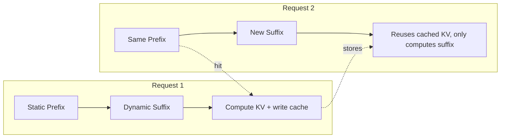
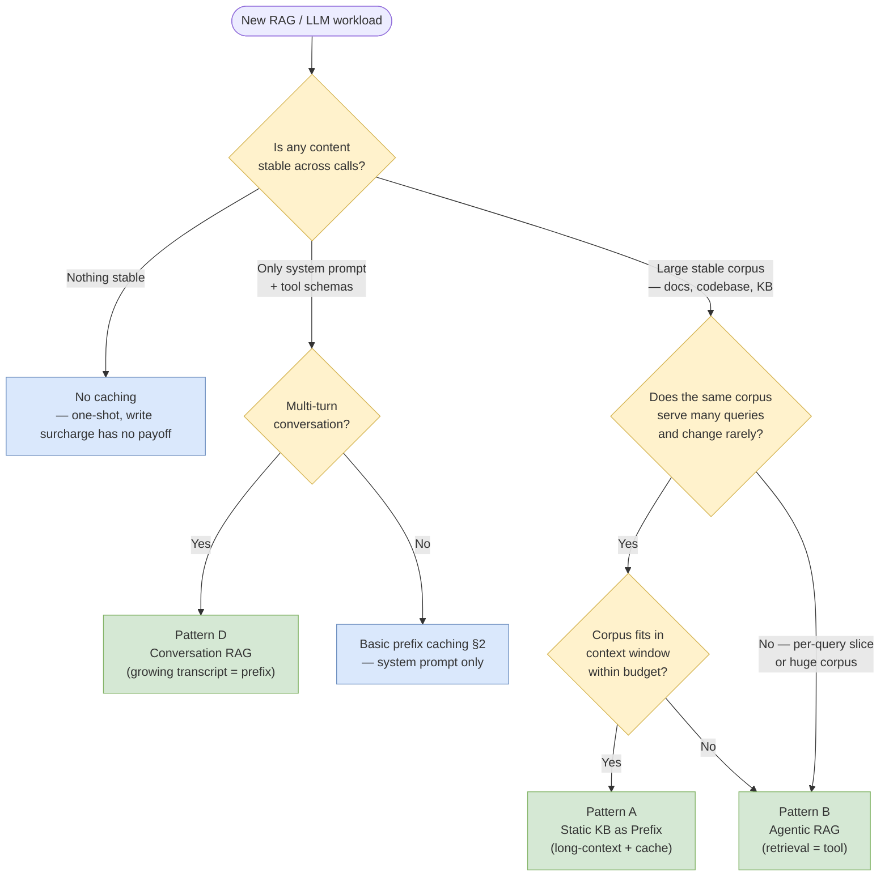

# 🧠 Topic: Prompt Caching

> [!abstract] Executive Summary (ELI5)
> Prompt caching is like **memorizing the first half of a book you keep rereading**. When an LLM processes a prompt, it stores the intermediate math results for the tokens it has already seen. If the *same prefix* shows up again soon, the model skips re-reading and recomputing that part — answering faster and charging you a fraction of the price.

---

## 🎯 The "Why"
- **Problem Solved:** LLM inference is **autoregressive** — every output token attends to *all* preceding tokens. For long system prompts, tool schemas, and retrieved documents that get reused across calls, recomputing their KV state on every request wastes latency and money. Prompt caching persists that computed state and reuses it.
- **Alternatives:**
    - **Just recompute every time:** Simple but expensive. For an 8k-token system prompt called 1M times, that is 8 billion tokens of pure waste.
    - **Local input dedup / response memoization:** Only helps for *identical* prompts returning *identical* answers — useless for agentic and RAG flows where the suffix changes.
    - **Smaller context / aggressive summarization:** Trades quality and grounding for cost. Caching keeps the full context *and* the discount.
- **Trade-offs:**
    - **Pros:** Big cost cuts (typically **50–90% off** the cached input tokens), lower time-to-first-token, unchanged output quality (same model, same math).
    - **Cons:** Cache is **prefix-positioned and content-sensitive** — one changed character early in the prompt invalidates everything after it. Cache hits are **time-limited (TTL)** and provider-specific. Cache *writes* usually cost **more** than a regular call.

## 💡 Mental Model & Analogy
- **Analogy:** Prompt caching is like a **cook who pre-chops all the vegetables**.
    - The "recipe" = your prompt. The "prep" = computing the KV cache (key/value tensors) for each token.
    - If you cook the same dish twice, the cook skips re-chopping and goes straight to assembly → faster, cheaper.
    - But if you change the *first* ingredient, the whole prep is invalid and must be redone. Add new ingredients at the *end* of the recipe, not the start.
- **Visual/Diagram:**


---

## 🛠️ Core Principles & Code Snippets

### 1. Understand the Two Layers of "KV Cache"

The term is overloaded. Distinguish them:

| Layer | Scope | Always on? | What it is |
|-------|-------|-----------|------------|
| **In-session KV cache** | One forward pass / one generation | Yes — fundamental to how transformer decoders work | Per-request tensors holding keys/values for attended tokens. Lets each new token attend to prior ones without recomputation. Dies with the request. |
| **Cross-request prompt cache** (the feature this note is about) | Across requests, minutes–hours | Opt-in (or provider-automatic) | Persisted KV state, keyed by a **token-exact prefix**, reused across independent API calls. |

> [!tip] The first layer is not a feature
> The in-session KV cache is *how* autoregressive generation works at all — it is not optional and not billed as "caching." When people say "prompt caching" as a product feature, they mean the **cross-request** layer.

### 2. Put Stable Content First — Prefix Ordering Is Everything

Caches match on a **prefix**: the longest run of identical tokens from the start. Anything *before* the first changed token is a hit; everything *after* is a miss and gets recomputed.

**Stable-then-dynamic ordering:**

```text
┌──────────────────────────────────────────────┐
│ STATIC (cacheable, put first)                │
│  - System prompt / persona                   │
│  - Tool definitions (JSON schemas)           │
│  - Few-shot examples                         │
│  - Large retrieved documents                 │
├──────────────────────────────────────────────┤
│ DYNAMIC (changes every call, put last)       │
│  - User message, timestamp, request id       │
│  - Conversation history tail                 │
│  - Per-call parameters                       │
└──────────────────────────────────────────────┘
```

**Anti-pattern** — a date in position 1 kills the entire cache:

```typescript
// ❌ EVERY request invalidates the whole cache — the date changes daily
const messages = [
  { role: 'system', content: `Today is ${new Date().toDateString()}. You are...` },
  { role: 'user', content: userQuery }
];
```

```typescript
// ✅ Stable persona first, volatile data last → prefix stays cached
const messages = [
  { role: 'system', content: 'You are a senior backend engineer...' },
  { role: 'user', content: `Today is ${new Date().toDateString()}.\n\n${userQuery}` }
];
```

> [!tip] Whitespace and ordering are content too
> Caching is **token-exact**. Reordering JSON keys, trailing newlines, different indentation, or `"` vs `'` all produce different token streams and break the match. Normalize the static prefix and freeze its serialization.

### 3. Provider Models: Explicit Cache Points vs Automatic

Providers differ in how you opt in. Two dominant philosophies:

**A. Explicit cache breakpoints (Anthropic)** — you mark exactly which blocks are cacheable:

```typescript
const response = await anthropic.messages.create({
  model: 'claude-sonnet-4-5',
  max_tokens: 1024,
  system: [
    {
      type: 'text',
      text: LARGE_SYSTEM_PROMPT,
      cache_control: { type: 'ephemeral' }   // <-- mark as cacheable
    }
  ],
  messages: [{ role: 'user', content: userQuery }]
});
```

- **TTL:** `ephemeral` ≈ 5 min (refreshed on each hit); `1h` type for longer-lived caches.
- **Discount:** cached reads ~**90% off**; cache **writes** cost ~**25% more** than a normal input (amortize with ~1 reuse).
- **Min size:** typically **1024 tokens** to be cacheable.

**B. Automatic prefix caching (OpenAI, DeepSeek)** — no opt-in flag, the provider caches the longest matching prefix for you:

```typescript
// No cache flag — just structure prompts so the prefix is stable
const completion = await openai.chat.completions.create({
  model: 'gpt-4o',
  messages: [
    { role: 'system', content: LARGE_STABLE_SYSTEM_PROMPT },
    { role: 'user', content: userQuery }   // only this changes
  ]
});
// response.usage.prompt_tokens_details.cached_tokens tells you what hit
```

- **TTL:** provider-managed (minutes, internal eviction).
- **Discount:** cached input ~**50% off**. No write surcharge.
- **Min size:** typically **1024 tokens**.

**C. Explicit Context Cache API (Google Gemini)** — you create a named, addressable cache object with a TTL, then reference it by name:

```python
from google import genai
from google.genai import types

client = genai.Client()
cache = client.caches.create(
    model='gemini-2.5-flash',
    config=types.CreateCachedContentConfig(
        contents='...'   # large document / system instruction set
    )
)
# cache has an explicit name + expiration_time; reuse across many calls
response = client.models.generate_content(
    model='gemini-2.5-flash',
    contents=user_query,
    config=types.GenerateContentConfig(cached_content=cache.name)
)
```

- **TTL:** **configurable** (default ~2h, can be set explicitly up to longer windows).
- **Discount:** cached input heavily discounted vs. fresh input.
- **Use case:** best for *very* large static contexts (whole codebases, books) reused many times.

### 4. Keep the Cache Warm in Loops (Agentic + Conversational)

Cache hits reset the TTL on most providers — a request every few minutes keeps long-running sessions hot.

```typescript
// ReAct / agent loop: the growing tool-schema + system prefix stays cached,
// only the appended turns + scratchpad get computed fresh.
async function runAgent(seedMessages: Message[]) {
  const messages = [...seedMessages];           // static prefix (cached)
  for (let step = 0; step < MAX_STEPS; step++) {
    const res = await llm.create({ messages });  // prefix reuses cached KV
    messages.push(res.choice.message);           // append → still prefix-stable
    if (res.choice.message.tool_calls) {
      const observations = await runTools(res.choice.message.tool_calls);
      messages.push(...observations);
    } else break;
  }
}
```

> [!tip] Watch the billing crossover
> Cache *writes* cost extra (Anthropic +25%). You only net-save if the prefix is read **at least ~2×** within the TTL. For one-shot prompts, caching is pure overhead — skip it.

### 5. Cache-Aware RAG Patterns

RAG is the **natural adversary** of prefix caching: the query changes every call, and retrieved chunks change every call. Naive RAG leaves almost nothing cacheable but the system prompt. The fix is to **separate the stable knowledge layer from the dynamic retrieval layer** and match each strategy to its content's reuse profile.

**The core tension** — a RAG prompt mixes three content classes with very different reuse rates:

| Content | Reuse rate | Where it goes |
|---------|-----------|---------------|
| System prompt, tool schemas, few-shot examples | High (never changes) | **Prefix — cache** |
| Reference corpus (policy doc, codebase, product catalog) | Medium (changes rarely) | **Prefix — cache, version-pinned** |
| Retrieved chunks, user query, conversation tail | None (per-call) | **Suffix — recompute** |

#### Pattern A — Static Knowledge Base as Prefix (Long-Context + Cache)

When the corpus is fixed and reused by many queries, put the **whole document in the cached prefix** and append only the query. This is "cached long-context RAG" — Gemini's Context Cache API and Anthropic's `1h` cache are built for exactly this.

```text
┌─ CACHED PREFIX (written once, reused N times) ──────┐
│  System: "Answer only from the doc below."          │
│  Document: <full 200k-token policy manual>          │
├─ DYNAMIC SUFFIX (per call) ─────────────────────────┤
│  User: "What's the refund policy for digital goods?"│
└─────────────────────────────────────────────────────┘
```

```python
# Gemini — cache the corpus once, query against it many times
from google import genai
from google.genai import types

client = genai.Client()
cache = client.caches.create(
    model='gemini-2.5-pro',
    config=types.CreateCachedContentConfig(
        contents=policy_manual_text,            # large, stable
        system_instruction='Answer only from the provided document.',
        ttl='7200s'                             # 2h
    )
)

for query in user_queries:
    response = client.models.generate_content(
        model='gemini-2.5-pro',
        contents=query,                         # only this changes
        config=types.GenerateContentConfig(cached_content=cache.name)
    )
```

> [!tip] Long-context vs retrieval — pick by reuse rate
> Embedding the whole corpus as a cached prefix pays off when the **same corpus serves many queries** and changes **rarely** (so the write surcharge amortizes). When the corpus is huge or the relevant slice differs widely per query, retrieval (Pattern B) wins — you cache the *retrieval interface*, not the data.

#### Pattern B — Agentic RAG: Retrieval as a Tool (Cache the Interface)

Instead of injecting retrieved chunks into the prompt (which trashes the prefix), expose retrieval as a **tool**. The system prompt + tool schema form a stable cached prefix; retrieved content arrives as tool results in the dynamic suffix.

```text
┌─ CACHED PREFIX ─────────────────────────────────────┐
│  System: "Use tools to answer."                     │
│  Tools: { search_docs(query): string }              │  ← schema never changes
├─ DYNAMIC SUFFIX ────────────────────────────────────┤
│  User query → [tool call: search_docs] → tool result│
└─────────────────────────────────────────────────────┘
```

```typescript
const tools = [{
  type: 'function',
  function: {
    name: 'search_docs',
    description: 'Search the internal knowledge base. Call before answering.',
    parameters: {
      type: 'object',
      properties: { query: { type: 'string' } },
      required: ['query']
    }
  }
}];

// System prompt + tool schema are the stable, cacheable prefix.
// Retrieved chunks return as tool_call results — appended, never in the prefix.
const res = await openai.chat.completions.create({
  model: 'gpt-4o',
  messages: [
    { role: 'system', content: STABLE_SYSTEM_PROMPT },
    { role: 'user', content: userQuery }
  ],
  tools   // cached as part of the prefix
});
```

This turns RAG from "prefix-destroying" into "prefix-preserving": the **interface** is cached, the **data** flows through dynamically. Bonus: tool-call structure makes retrieval observable and debuggable.

#### Pattern C — Few-Shot Examples as a Cached Prefix

Few-shot demonstrations are large and stable — ideal cache material. Put them before the dynamic query, never after:

```typescript
const messages = [
  { role: 'system', content: STABLE_INSTRUCTIONS },
  // Few-shot examples — frozen, cacheable
  { role: 'user', content: EXAMPLE_Q1 }, { role: 'assistant', content: EXAMPLE_A1 },
  { role: 'user', content: EXAMPLE_Q2 }, { role: 'assistant', content: EXAMPLE_A2 },
  // Live query — only this changes
  { role: 'user', content: userQuery }
];
```

#### Pattern D — Conversation RAG (Session-Scoped Cache)

In a chat with retrieval, the **growing transcript is itself a cacheable prefix** — each new turn reuses everything said so far. Keep the freshly retrieved context and the new question at the tail:

```text
[Cached: System + tool schemas + turns 1..N-1] → [Dynamic: retrieval for turn N + turn N]
```

Pair this with the [[ReAct Loop]] cache-warming pattern from §4: as long as turns arrive within the TTL, the whole session prefix stays hot.

#### Pattern E — Version-Pin the Corpus to Control Invalidation

When a cached document *does* change, every dependent cache silently misses. Make invalidation explicit by embedding a version token in the (stable) system prompt and bumping it on corpus updates:

```typescript
// Bump CORPUS_VERSION on deploy → old caches expire cleanly, new ones build once
const system = `Knowledge base v${CORPUS_VERSION}. Answer only from retrieved context.`;
```

Without this, a mid-deploy doc edit causes a flapping pattern: half your traffic hits (old cache), half misses (rebuild), oscillating until the TTL settles.

> [!warning] Don't cache retrieved chunks as a prefix
> Retrieved chunks are per-query by definition. Putting them in the prefix means the cache breaks on the very next query. They belong in the **suffix** (Pattern B) or behind a retrieval tool — never in the cached layer.

#### Decision Tree — Which Cache-Aware Pattern to Use

Synthesizes Patterns A–E. Start at the top; follow the answer that matches your workload. Pattern E (version-pinning) and §4 (keep-warm) are **cross-cutting** — apply them on top of whichever leaf you land on, not as alternatives.



**How to read it:**
- **Yellow diamonds** = the decision axes: content stability, conversation shape, corpus reuse, corpus size.
- **Green** = the recommended RAG pattern (A/B/D). **Blue** = leaf outcomes with no RAG-specific caching (skip it, or just cache the system prompt).
- **Cross-cutting:** if your corpus changes on deploy → layer Pattern E on top of A/B. If calls are bursty → apply the keep-warm loop from §4 so the TTL doesn't expire between turns.

> [!tip] The one question that matters most
> *"Is the relevant knowledge the same across calls, or does each query need a different slice?"* Same → Pattern A (cache the data). Different → Pattern B (cache the interface). Most naive RAG failures come from picking A when B is correct — caching retrieved chunks that change every query.

## ⚠️ Pitfalls & Anti-patterns
- **Common Mistakes:**
    - Putting a volatile field (date, user id, random id) **at the top** of the prompt, invalidating the entire cache.
    - Assuming caching is "automatic and free" — on explicit providers you must place `cache_control`, and writes cost extra.
    - Reordering JSON keys in tool definitions or system prompt between deploys → silent cache miss.
    - Letting the TTL expire on infrequent calls and paying write surcharges repeatedly.
    - Ignoring `cached_tokens` / cache-read fields in `usage` — you can't optimize what you don't measure.
- **When NOT to use:**
    - One-shot prompts where the prefix is never reused (write surcharge with no payoff).
    - Highly dynamic content where almost nothing is stable across calls.
    - When the provider's minimum cacheable length isn't met (sub-1024-token prefixes are not cached).
- **Performance/Security considerations:**
    - Caching does **not** change model output — same math, just reused. No quality/security trade-off in the result itself.
    - Cache isolation is provider-managed; treat it as multi-tenant (don't rely on cross-tenant leakage, but also don't put secrets only in a "cached" block expecting it to be hidden).

## 🔗 Deep Connections
- **Parent Topic:** [[LLM Agents]], [[Agentic Workflows]]
- **Related Concepts:** [[Structured-Outputs-in-Agentic-Systems]] (large tool schemas are a prime cache target), [[ReAct Loop]] (growing agent transcript benefits from prefix caching), KV cache, attention, prefix matching, tokenization, cost & latency budgeting
- **Prerequisites:** Basic transformer attention / autoregressive decoding, tokenization, REST API usage of at least one LLM provider.

## ❓ Active Recall Questions
> [!faq]- What is the difference between the in-session KV cache and cross-request prompt caching?
> The in-session KV cache is a fundamental, per-request mechanism that lets an autoregressive decoder reuse key/value tensors *within one generation*. Cross-request prompt caching is an opt-in (or provider-automatic) feature that persists that KV state across independent API calls, keyed by a token-exact prefix.

> [!faq]- Why does the position of a volatile field matter so much?
> Cache matching is strictly **prefix-based**. The first token that differs invalidates the cache for it and *every token after it*. A date on line 1 therefore disables caching for the entire prompt; the same date on the last line leaves the whole static prefix cacheable.

> [!faq]- When is it not worth enabling prompt caching?
> When the prefix is reused fewer than ~2 times within the TTL, or when the prefix is shorter than the provider's minimum cacheable length (commonly 1024 tokens). Cache writes typically cost extra, so without reuse you pay more, not less.

> [!faq]- How do explicit breakpoint (Anthropic) and automatic (OpenAI) caching differ in practice?
> Anthropic requires you to tag cacheable blocks with `cache_control` and offers explicit TTLs (5 min / 1 h) with ~90% read discount and a write surcharge. OpenAI caches the longest matching prefix automatically, charges ~50% less for cached input with no write surcharge, but gives you no TTL control.

> [!faq]- Why does naive RAG break prompt caching, and how do cache-aware patterns fix it?
> Naive RAG injects retrieved chunks into the prompt, and since they differ every query, the prefix changes on every call — only the system prompt stays cached. Cache-aware patterns fix this by separating the **stable interface** (system prompt, tool schemas, few-shot examples, optionally the whole corpus) from the **dynamic retrieval layer**: either cache the corpus as a prefix and append the query (long-context RAG), or expose retrieval as a tool whose schema is cached while chunks flow through the suffix (agentic RAG).

> [!faq]- When should you cache the whole corpus as a prefix vs. retrieve per query?
> Cache the whole corpus when the **same corpus serves many queries** and **changes rarely** — the write surcharge amortizes across many reads (long-context + cache). Retrieve per query when the corpus is large or the relevant slice varies widely — cache the retrieval *interface* (tool schema), not the data.

> [!faq]- What single question most determines the cache-aware RAG pattern to use?
> *"Is the relevant knowledge the same across calls, or does each query need a different slice?"* Same knowledge, many queries → Pattern A (cache the data as a prefix). Different slice per query → Pattern B (cache the retrieval interface as a tool). Pattern D applies on top when the interaction is multi-turn. Picking A when B is correct is the most common cause of silent cache misses.

---

## 📝 How to use this note effectively
1. **Never Copy-Paste:** Read, close the tab, and write the cache-control snippet from memory.
2. **Iterate:** The ELI5 and analogy are the test — if you can't explain *why prefix position matters*, revisit section 2.
3. **The "Why" is King:** Seniority is knowing *when* caching pays off (reuse ≥ 2, stable prefix ≥ 1024 tokens) vs. when it is overhead.
4. **Update the Status:** Move `status` → `experimenting` once you wire `cache_control` into a real project and measure `cached_tokens` in `usage`; bump `mastery` as the savings show up in production.
