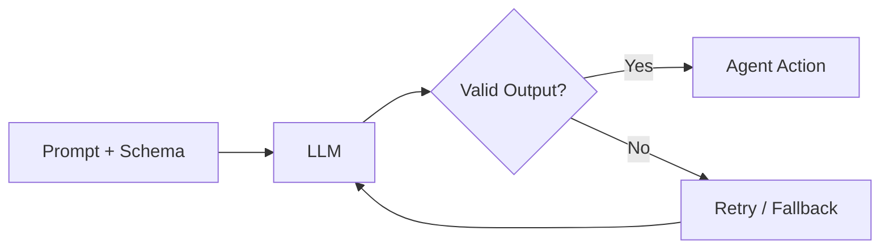

# 🧠 Topic: Structured Outputs in Agentic Systems

> [!abstract] Executive Summary (ELI5)
> Structured outputs are like giving an LLM a fill-in-the-blanks form instead of asking for a free-form essay. You define exactly what fields you need, and the model returns data in that shape — making it easy for your code to understand and act on.

---

## 🎯 The "Why"
- **Problem Solved:** Raw text from LLMs is hard to parse reliably. Agentic systems need to make decisions, call tools, and pass data between steps. Structured outputs turn ambiguous prose into typed, machine-actionable data.
- **Alternatives:**
    - **Free-form text + regex/JSON parsing:** Brittle, error-prone, breaks on formatting changes.
    - **Prompting "respond in JSON":** Unreliable — model may wrap JSON in markdown, omit fields, or invent keys.
    - **Function calling / tool use:** Similar concept but framed as invoking external capabilities; structured output is about the response shape itself.
- **Trade-offs:**
    - **Pros:** Type safety, easier validation, deterministic downstream routing, reduced parsing code.
    - **Cons:** Tighter schema coupling, can limit creative reasoning, schema engineering becomes a design task, some providers have limited support.

## 💡 Mental Model & Analogy
- **Analogy:** A structured output is like a **customs declaration form**.
    - The form specifies exact fields: name, country, items, value.
    - The traveler (LLM) must fill it out correctly.
    - The officer (your code) validates it and decides what to do next.
- **Visual/Diagram:**


## 🛠️ Core Principles & Code Snippets

### 1. Define a Schema First

Use a type system or JSON Schema to declare exactly what you expect.

```typescript
import { z } from 'zod';

const SentimentSchema = z.object({
  sentiment: z.enum(['positive', 'neutral', 'negative']),
  confidence: z.number().min(0).max(1),
  reasoning: z.string().max(200)
});

type Sentiment = z.infer<typeof SentimentSchema>;
```

### 2. Bind Schema to the Model Call

Most modern providers support schema-constrained generation.

```typescript
const result = await openai.chat.completions.create({
  model: 'gpt-4o',
  messages: [{ role: 'user', content: reviewText }],
  response_format: {
    type: 'json_schema',
    json_schema: {
      name: 'sentiment_analysis',
      schema: zodToJsonSchema(SentimentSchema),
      strict: true
    }
  }
});

const parsed = SentimentSchema.parse(JSON.parse(result.choices[0].message.content));
```

> [!tip] Implementation Note
> Always validate the output with your runtime schema library (Zod, Pydantic, JSON Schema validator). Provider-level constraints reduce but do not eliminate validation failures.

### Python Equivalent with Pydantic

```python
from pydantic import BaseModel, Field
from openai import OpenAI

class Sentiment(BaseModel):
    sentiment: str = Field(pattern=r'^(positive|neutral|negative)$')
    confidence: float = Field(ge=0, le=1)
    reasoning: str = Field(max_length=200)

client = OpenAI()
completion = client.beta.chat.completions.parse(
    model='gpt-4o',
    messages=[{'role': 'user', 'content': review_text}],
    response_format=Sentiment
)

result = completion.choices[0].message.parsed
# result is a validated Sentiment instance
```

### 3. Separate "Thinking" from "Output"

For complex tasks, forcing the model to produce structured JSON immediately is like asking someone to solve a math problem by writing only the final number. It is harder because **all reasoning must be compressed into the constrained format** without intermediate working memory.

LLMs are **autoregressive** — they generate one token at a time, and each new token sees all previously generated tokens as context. When you give the model a `chain_of_thought` field, this is what happens internally:

1. The model starts generating the JSON structure.
2. It reaches the `chain_of_thought` field and produces free-form reasoning tokens ("The user said the product was great but shipping was slow...").
3. Those reasoning tokens become part of the context window.
4. The model then uses its own reasoning as context to produce the final structured fields (`final_answer`, `confidence`, etc.).

In other words: **the model reads its own thoughts before committing to the answer**. This is the same mechanism as Chain-of-Thought (CoT) prompting, but the reasoning is captured inside the structured response rather than in a separate chat turn.

```typescript
const AnalysisSchema = z.object({
  chain_of_thought: z.string(), // model's internal reasoning
  final_answer: z.string(),     // user-facing result
  confidence: z.number()
});

// The model generates something like:
// {
//   "chain_of_thought": "The review mentions slow shipping, which is negative, but praises the product quality, which is positive. The overall tone is mixed but leans positive because the user says they would buy again.",
//   "final_answer": "positive",
//   "confidence": 0.72
// }
```

**Why this works better than a single-field schema:**
- **Disambiguation:** The model can reason through edge cases explicitly instead of jumping to a conclusion.
- **Error recovery:** If the reasoning is flawed, the final answer is still more likely to be self-consistent because it was derived from explicit logic.
- **Debugging:** You can inspect the `chain_of_thought` to understand *why* the model returned a particular answer — crucial for agent observability.

> [!tip] Explicit instruction is required
> The `chain_of_thought` field name is a hint for the model, not a guarantee. Always include an explicit instruction in your system prompt: "First, write your step-by-step reasoning in the `chain_of_thought` field. Then, based on that reasoning, provide the final answer." Without this, the model may skip reasoning or write shallow one-liners.

> [!warning] Chain-of-thought leakage
> If the chain-of-thought contains sensitive reasoning, strip it before returning to the user. The field is for the model's benefit and internal debugging, not for external consumption.

### 4. Build Retry and Fallback Loops

LLMs can still fail schema constraints. Wrap generation in a retry policy.

```typescript
async function generateWithRetry<T>(
  schema: z.ZodSchema<T>,
  prompt: string,
  maxAttempts = 3
): Promise<T> {
  for (let i = 0; i < maxAttempts; i++) {
    try {
      const raw = await llm.generate(prompt, schema);
      return schema.parse(raw);
    } catch (err) {
      if (i === maxAttempts - 1) throw err;
      // Include error in next prompt so model can correct itself
      prompt += `\n\nPrevious attempt failed validation: ${err.message}. Please fix the output.`;
    }
  }
  throw new Error('Unreachable');
}
```

### 5. Use Structured Output for Agent Routing

A common pattern: the agent first emits a structured decision, then the executor dispatches to the right tool.

```typescript
const AgentDecisionSchema = z.discriminatedUnion('action', [
  z.object({ action: z.literal('search'), query: z.string() }),
  z.object({ action: z.literal('calculate'), expression: z.string() }),
  z.object({ action: z.literal('respond'), answer: z.string() })
]);
```

## ⚠️ Pitfalls & Anti-patterns
- **Common Mistakes:**
    - Trusting provider guarantees without runtime validation.
    - Over-specifying schemas, leaving no room for the model's reasoning.
    - Returning raw structured output to users without post-processing.
    - Using JSON mode without schema constraints.
- **When NOT to use:**
    - Creative writing or open-ended brainstorming where rigid structure hurts quality.
    - When the cost of schema engineering outweighs the parsing benefits.
- **Performance/Security considerations:**
    - Some providers charge more for constrained decoding.
    - Schema constraints can sometimes increase latency.
    - Never expose internal field names or reasoning that could leak context.

## 🔗 Deep Connections
- **Parent Topic:** [[LLM Agents]], [[Agentic Workflows]]
- **Related Concepts:** [[Function Calling]], [[Tool Use]], [[JSON Schema]], [[Zod]], [[Pydantic]], [[Retry Patterns]], [[Output Validation]]
- **Prerequisites:** Basic LLM API usage, JSON, type systems

## ❓ Active Recall Questions
> [!faq]- Why is "respond in JSON" prompting less reliable than schema-constrained generation?
> The model may add markdown fences, omit required fields, or hallucinate extra keys. Schema constraints enforce the shape at the decoding level.

> [!faq]- Should you skip runtime validation if the provider claims structured output support?
> No. Provider constraints reduce failures but do not eliminate them. Always validate against your own schema.

> [!faq]- Why include a `chain_of_thought` field in a structured output?
> It improves reasoning quality for complex tasks by giving the model space to think before producing the final answer.

> [!faq]- What is the difference between structured outputs and function calling?
> Structured output constrains the model's response shape. Function calling is a special case where the model emits a call to an external tool. Both rely on schemas, but serve different purposes.

---
## 📝 How to use this note effectively
1. **Never Copy-Paste:** Read, close the tab, and write from memory.
2. **Iterate:** Update the ELI5 and analogy as your understanding deepens.
3. **The "Why" is King:** Seniority is defined by knowing *when* and *why* to constrain outputs, not just *how*.
4. **Update the Status:** Move from `new` -> `growing` -> `mastered` as you apply these patterns in real agent systems.
