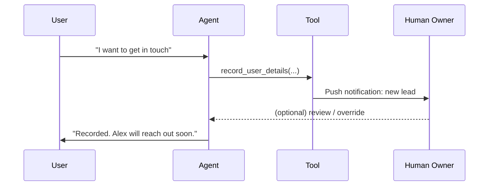

# Human-in-the-Loop for Agent Observability

> [!abstract] Executive Summary (ELI5)
> The agent can do things on its own, but it keeps a human informed — by sending notifications, asking for approval, or logging decisions. That way the owner knows what is happening and can step in when it matters.

---

## 🎯 The "Why"

- **Problem Solved:** Autonomous agents make mistakes, take irreversible actions, and operate in opaque loops. Human-in-the-loop (HITL) patterns give humans visibility, veto power, and the context to intervene without micromanaging every step.
- **Alternatives:**
  - **Full autonomy** — fastest, but risky for high-stakes actions like refunds, bookings, or data deletion.
  - **Pre-approval only** — every tool call waits for human approval. Safe, but slow and annoying.
  - **Post-hoc logging** — record everything, review later. Good for audit, bad for catching mistakes in time.
  - **Synchronous chat handoff** — transfer to a human agent. Necessary for complex cases, but expensive.
- **Trade-offs:** Notification-based observability is lightweight and non-blocking, but it can spam the owner if not throttled. It is best for low-frequency, high-signal events.

## 💡 Mental Model & Analogy

- **Analogy:** "This is like a security camera that sends an alert only when motion is detected. The owner doesn’t watch the feed 24/7, but they get a ping when something important happens so they can check and act."
- **Visual/Diagram:**



## 🛠️ Core Principles & Code Snippets

### 1. Notify on action, not on every message

A notification should signal that something happened in the real world — a lead was captured, a refund issued, an appointment booked. Routine chitchat should be silent.

```python
@register_tool(name="record_user_details")
def record_user_details(email: str, name: str = None):
    save_to_crm(email=email, name=name)
    notify_owner(
        title="New lead from chatbot",
        body=f"{name or 'Someone'} left their email: {email}"
    )
    return {"status": "recorded"}
```

### 2. Make notifications actionable

Include enough context so the human can decide whether to act: user message, extracted data, timestamp, and a link to the conversation.

```python
def notify_owner(title, body, conversation_url=None):
    pushover.send(
        title=title,
        message=body,
        url=conversation_url,
        priority=0  # -2 silent, -1 quiet, 0 normal, 1 high, 2 emergency
    )
```

### 3. Throttle and batch

If a bot goes viral, notifications can overwhelm the owner. Add rate limiting or batch summaries.

```python
from collections import deque

recent_notifications = deque(maxlen=10)

def notify_owner(title, body):
    recent_notifications.append((title, body))
    if len(recent_notifications) >= 5:
        send_batch_summary(recent_notifications)
        recent_notifications.clear()
```

### 4. Provide override paths

For sensitive tools, let the owner reject or undo an action from the notification itself. This moves from observability to true human-in-the-loop control.

## 🏗️ Complexity Spectrum

| Level | Human Involvement | Example |
|-------|-------------------|---------|
| **Level 1: Observability notifications** | Human is informed after the action | Lab 4 Pushover notifications |
| **Level 2: Confirmation for irreversible actions** | Human must approve before execution | Refund, delete account |
| **Level 3: Real-time escalation** | Agent hands off to human when confidence is low | Support bot escalation |
| **Level 4: Shared control** | Human and agent collaborate in the same interface | Copilot-style editing |
| **Level 5: Full human-on-the-loop** | Human monitors many agents and can intervene at any scale | Air-traffic-control style ops |

## 🏢 Production Examples

- **Lead capture chatbot** — notify sales rep when a qualified lead shares contact info.
- **Fraud detection agent** — flag suspicious transactions for analyst review before blocking.
- **Content moderation bot** — auto-hide borderline posts but send them to a moderator queue.
- **DevOps remediation agent** — restart a service automatically, but page the on-call engineer.
- **Medical triage assistant** — suggest next steps, but route high-risk cases to a clinician.

## ⚠️ Pitfalls & Anti-patterns

- **Notification fatigue:** If every minor event pings the owner, they will mute the channel and miss real issues.
- **False confidence:** A notification is not a guarantee that the action was correct. Pair notifications with logs and undo capability.
- **No fallback if human is unreachable:** Define what the agent does when approval is required but no one responds.
- **Leaky PII in notifications:** Don’t send full emails, phone numbers, or health data to insecure channels.
- **Observability without actionability:** A log of every tool call is useful, but a noisy stream without context is just overhead.

## 🔗 Deep Connections

- **Parent Topic:** [[Agentic Workflow Patterns Overview]], [[LLM System Design]]
- **Related Concepts:** [[LLM Tool Use / Function Calling]], [[ReAct Loop]], [[Decorator-Based Tool Registry]], [[Monitoring and Alerting]]
- **Prerequisites:** Push notification services, logging, incident response basics

## ❓ Active Recall Questions

> [!faq]- What is the difference between human-in-the-loop and observability?
> Observability informs the human after the fact. Human-in-the-loop gives the human the ability to approve, reject, or modify the agent’s actions.

> [!faq]- Why throttle notifications in a production agent?
> To prevent notification fatigue and reduce cost. A viral or misbehaving agent can generate thousands of pings.

> [!faq]- What should a good notification include?
> What happened, what data was involved, when it happened, why it matters, and how the human can follow up.

## Related Notes

- [[LLM Tool Use / Function Calling]]
- [[Decorator-Based Tool Registry]]
- [[ReAct Loop]]
- [[Agentic Workflow Patterns Overview]]
