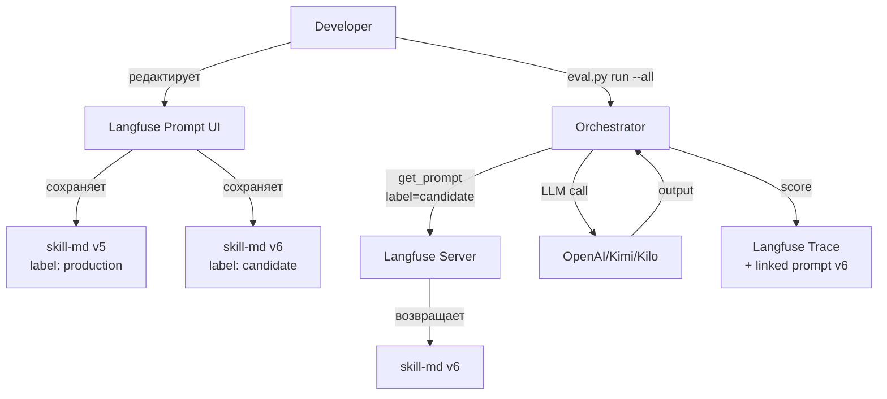

# Langfuse — PromptOps & EvalOps для LLM-приложений

> [!abstract] Executive Summary (ELI5)
> Langfuse — это «GitHub + Datadog + CI/CD» для LLM-приложений. Он позволяет хранить промпты вне кода, отслеживать каждый вызов нейросети, и автоматически тестировать новые версии промптов на фиксированных данных. Представь, что ты можешь поменять инструкцию для AI-ассистента в веб-интерфейсе и моментально увидеть, стало ли лучше — без перезапуска кода.

---

## 🎯 The "Why"

### Проблема 1: Промпты в коде
```python
# Плохая практика (как сейчас у нас в runner.py)
def build_runner_prompt(repo_path, output_path):
    skill = read_skill_md()  # ← читаем локальный файл
    return f"""You execute... {skill}... {repo_path}..."""  # ← f-string
```
**Что плохо:** Чтобы поменять промпт — нужен `git commit`, деплой. Нет истории, нет A/B тестов, нет связи между версией промпта и результатом.

### Проблема 2: Нет трассировки
Когда LLM вернул плохой ответ — не знаешь: какой промпт был отправлен, сколько токенов, какая модель, сколько стоило.

### Проблема 3: Оценка руками
Каждый раз при смене промпта — запускать тесты вручную, сравнивать «глазами», решать, лучше или хуже.

### Альтернативы
| Инструмент | Что делает | Почему не заменяет Langfuse |
|---|---|---|
| **W&B** | ML experiment tracking | Нет prompt management, нет tracing LLM-вызовов |
| **Helicone** | LLM observability | Есть tracing, но слабый prompt management и нет dataset experiments |
| **Custom JSON + S3** | Самописное хранение | Требует разработки, нет UI, нет стандартных паттернов |
| **Git для промптов** | Версионирование в файлах | Нет рантайм-переключения, нет tracing, нет eval |

### Trade-offs
Langfuse **не нужен**, если:
- У вас один промпт, который меняется раз в год
- Вам не нужна история версий и отладка
- Вы не тестируете разные версии промптов на одних и тех же данных

Langfuse **критичен**, если:
- Промпты меняются часто (ежедневно/еженедельно)
- Нужно доказать, что «новая версия лучше старой»
- Нужно понять, какой промпт породил конкретный фейл

---

## 💡 Mental Model & Analogy

**Analogy:** Langfuse — это «GitHub Actions + Git + Datadog», но специализированно для LLM-приложений.

| Классический devops | Langfuse |
|---|---|
| Git — хранит код | Langfuse Prompts — хранит промпты |
| GitHub Actions — запускает тесты | Langfuse Experiments — запускает eval на датасете |
| Datadog — трейсинг запросов | Langfuse Traces — трейсинг LLM-вызовов |
| Feature flags — переключение версий | Labels — переключение prompt версий |

**Visual:**


---

## 🛠️ Core Principles & Code Snippets

### 3 дисциплины Langfuse

```
┌─────────────────────────────────────────────────────────┐
│                    Langfuse                              │
├──────────────────┬──────────────────┬───────────────────┤
│  Observability   │ Prompt Management│    Evaluation     │
│    (Tracing)     │                  │ (Datasets/Exper)  │
├──────────────────┼──────────────────┼───────────────────┤
│ • Записывает     │ • Хранит промпты│ • Фиксированные   │
│   каждый вызов  │   вне кода       │   датасеты        │
│ • Tokens, cost, │ • Версии + labels│ • Автосравнение   │
│   latency       │ • Templating     │   двух версий     │
│ • Timeline UI   │ • Config         │ • Regression gate │
└──────────────────┴──────────────────┴───────────────────┘
```

### 1. Prompt Management — хранение вне кода

**Плохо:**
```python
# Промпт внутри Python-файла
SYSTEM_PROMPT = """You are a helpful assistant..."""

def run():
    response = client.chat.completions.create(
        model="gpt-4o",
        messages=[{"role": "system", "content": SYSTEM_PROMPT}]
    )
```

**Хорошо:**
```python
# Промпт в Langfuse, код только ссылается
langfuse = Langfuse()

prompt = langfuse.get_prompt("skill-md", label="production")
text = prompt.compile()  # или prompt.compile(var1="value")

response = client.chat.completions.create(
    model="gpt-4o",
    messages=[{"role": "user", "content": text}]
)
```

### 2. Templating — переменные в промпте

**Шаблон в Langfuse (prompt "runner-prompt"):**
```markdown
You execute exactly one task: run the {{skill_name}} skill
against the repository at {{repo_path}}.

Write output to {{output_path}}.
```

**Компиляция в коде:**
```python
prompt = langfuse.get_prompt("runner-prompt")
compiled = prompt.compile(
    skill_name="agent-harness-p2",
    repo_path="/path/to/repo",
    output_path="/path/to/output.md"
)
```

### 3. Config — настройки модели рядом с текстом

```python
langfuse.create_prompt(
    name="runner-prompt",
    prompt="You are a runner...",
    config={
        "model": "gpt-4o",
        "temperature": 0,
        "max_tokens": 4000
    }
)
```

```python
# Чтение в коде
prompt = langfuse.get_prompt("runner-prompt")
model = prompt.config.get("model", "gpt-4o")  # "gpt-4o"
temperature = prompt.config.get("temperature", 0)  # 0
```

### 4. Labels — переключение версий без деплоя

| Label | Значение | Когда использовать |
|---|---|---|
| `latest` | Автоматически на последней версии | Для разработки, опасно в проде |
| `production` | Рабочая версия | Все eval-запуски по умолчанию |
| `candidate` | Кандидат на замену | A/B тестирование |
| `experiment-*` | Конкретный эксперимент | Тест одной идеи |

```python
# Тестируем новый промпт
prompt = langfuse.get_prompt("skill-md", label="candidate")

# Рабочий промпт
prompt = langfuse.get_prompt("skill-md", label="production")
```

### 5. Linking prompts to generations (Tracing)

```python
response = client.chat.completions.create(
    model="gpt-4o",
    messages=[{"role": "user", "content": prompt_text}],
    langfuse_prompt=skill_prompt  # ← привязываем версию промпта
)
```

**В Langfuse UI:** Открываешь trace → видишь «Prompt: skill-md v5» → кликаешь → видишь точный текст, который был использован.

---

## 🏢 Корпоративные примеры использования

### Пример 1: HR-ассистент по подбору персонала

**Ситуация:** Компания использует LLM для первичного скрининга резюме. Промпт содержит критерии отбора для разных позиций (Java-разработчик, продуктовый аналитик, sales).

**Проблема:** HR-менеджер не разработчик. Он не может править Python-файл. Но ему нужно тонко настроить промпт под новую позицию.

**Решение через Langfuse:**
```python
# Код (писали разработчики, не трогают)
import langfuse

def screen_resume(resume_text, position):
    prompt = langfuse.get_prompt(f"hr-screen-{position}", label="production")
    compiled = prompt.compile(resume=resume_text)
    # ... LLM call ...
```

```yaml
# Langfuse Prompt: "hr-screen-java-developer"
Вы — HR-скринер. Оцените резюме на позицию Java-разработчик.
Критерии:
- Опыт Spring Boot: {{min_spring_years}}+ лет
- Опыт SQL: {{min_sql_years}}+ лет
- Наличие open-source проектов: {{require_opensource}}

Резюме:
{{resume}}
```

**HR-менеджер в Langfuse UI:**
1. Создаёт новый промпт «hr-screen-java-developer»
2. Меняет `min_spring_years` с 3 на 2 (ослабляет требования)
3. Label = `candidate`
4. Запускает eval на 50 резюме из датасета
5. Сравнивает с `production` — видит, что precision упал, но recall вырос
6. Принимает решение: merge или reject

**Профит:** HR-менеджер не обращается к разработчику. Сам управляет промптом, сам тестирует на датасете, сам видит метрики.

---

### Пример 2: Финансовый аналитик — генерация отчётов

**Ситуация:** Банк использует LLM для генерации ежедневных отчётов о рынке. Промпт должен быть строго форматированным, с регуляторными требованиями.

**Проблема:** Регуляторы требуют аудит: «Какой промпт сгенерировал этот отчёт 3 месяца назад?»

**Решение через Langfuse:**
```python
# Код
prompt = langfuse.get_prompt("financial-report-daily", label="production")
report = generate(prompt.compile(market_data=today_data))
# trace automatically links prompt version to generation
```

**Аудит:**
1. Регулятор просит отчёт от 15 марта
2. Аналитик открывает Langfuse → находит trace за 15 марта
3. Видит: «Prompt: financial-report-daily v12»
4. Кликает — видит точный текст, использованный в тот день
5. Сравнивает с текущей v17 — видит diff: «Добавлено требование о риск-факторах»

**Профит:** Полная аудиторская прослеживаемость. Каждый отчёт привязан к версии промпта. Без самописных логов, без grep по git history.

---

## 💻 Примеры для кодинговых агентов (наш кейс)

### Пример 1: Code Review Agent

**Ситуация:** Агент ревьюит pull request'ы. Промпт содержит критерии: безопасность, производительность, стиль кода, тестовое покрытие.

**Проблема:** Команда хочет A/B тестировать: строгий ревью (больше false positives) vs мягкий ревью (больше пропускает).

**Решение через Langfuse:**
```python
# Код
prompt = langfuse.get_prompt("code-reviewer", label="production")
# или label="strict-experiment" для A/B теста

review = llm_call(prompt.compile(
    diff=pr_diff,
    language="python",
    repo_context="fastapi microservice"
))
```

```markdown
# Langfuse Prompt: "code-reviewer" v5 (label: production)
Вы — code reviewer. Оцените PR по критериям:
- Безопасность: SQL injection, XSS, hardcoded secrets
- Производительность: N+1 queries, unnecessary loops
- Стиль: PEP8, naming conventions

Строгость: {{strictness}}  # ← normal или strict
```

**Эксперимент:**
1. Создаём v6 с `strictness=strict`
2. Label = `strict-experiment`
3. Запускаем на 100 PR из датасета (dataset = «code-reviews-corpus»)
4. Langfuse показывает:
   - v5: precision=0.85, recall=0.70, latency=2.3s
   - v6: precision=0.92, recall=0.65, latency=4.1s
5. Команда решает: strictness добавляет precision, но latency растёт. Компромисс: `strictness=normal` + отдельный промпт для security-PR.

**Профит:** Решение основано на данных, а не на мнениях в Slack. Один запуск eval — и видна полная картина.

---

### Пример 2: Auto-fix Agent (генерация патчей)

**Ситуация:** Агент получает issue с GitHub и генерирует PR с фиксом. Промпт содержит инструкции: «не трогай несвязанные файлы», «добавь тесты», «не ломай обратную совместимость».

**Проблема:** Агент начал ломать CI — добавляет фиксы, но тесты падают. Не понятно, какой промпт породил конкретный сломанный PR.

**Решение через Langfuse:**
```python
# Код
prompt = langfuse.get_prompt("auto-fix-agent", label="production")
patch = llm_call(prompt.compile(
    issue=issue_body,
    codebase_summary=repo_summary
))
# trace ID сохраняется в PR description
```

**PR description:**
```
Auto-fix generated by Langfuse
Trace: https://langfuse.com/trace/abc123
Prompt: auto-fix-agent v8
```

**Когда CI падает:**
1. Разработчик открывает trace по ссылке
2. Видит полный LLM conversation: system prompt, user prompt, ответ
3. Видет linked prompt: auto-fix-agent v8
4. Кликает на v8 — сравнивает с v7 (где CI не падал)
5. Видит diff: «В v8 добавлено требование 'add type hints' — LLM начал добавлять typing в файлы, где не импортированы нужные модули»
6. Откат к v7 или фикс промпта: «Добавляй type hints только если модуль уже импортирован»

**Профит:** Отладка сломанного PR занимает 5 минут вместо 2 часов. Не нужно искать логи, не нужно воспроизводть локально.

---

### Пример 3: Наш Skill Testing Framework (то, что мы делаем)

**Ситуация:** Мы тестируем `agent-harness-p2` — скилл, который анализирует репозитории и выдаёт рекомендации. 6 тестовых репозиториев, ground truth YAML, rubric scoring.

**Проблема сейчас:** SKILL.md в файле. Меняем его → `git commit` → `eval.py run --all` → сравниваем `history.jsonl` руками. Не понятно, какой SKILL.md был в конкретном запуске вчера.

**Целевое решение (Фаза 1):**
```python
# Сейчас
skill_md = SKILL_MD_PATH.read_text()  # ← файл на диске
runner_prompt = f"""...{skill_md}...{repo_path}..."""  # ← f-string

# После Фазы 1
runner_prompt = lf.get_prompt("runner-prompt", label="production")
skill_prompt = lf.get_prompt("skill-md", label=prompt_label)  # ← production или candidate

compiled = runner_prompt.compile(
    skill_md=skill_prompt.prompt,
    repo_path=repo_path,
    output_path=output_path
)
```

**Профит:**
- Меняем SKILL.md в Langfuse UI → `eval.py run --all --prompt-label latest` → тестируем
- Можно сравнить `v5` vs `v6` без изменения кода — просто меняем label
- В trace видно: «Этот run использовал skill-md v5»
- Если Langfuse упал — fallback на локальный файл (graceful degradation)

---

## ⚠️ Pitfalls & Anti-patterns

### Common Mistakes

1. **Сохранять промпты в коде, а Langfuse использовать только для tracing**
   - Тогда tracing — действительно «только картинки». Профит от Langfuse — 20%.

2. **Не использовать `label="production"`, а использовать `latest`**
   - `latest` автоматически меняется при каждом upload. В проде это опасно — внезапно поменяется промпт.

3. **Не делать fallback на локальные файлы**
   - Если Langfuse недоступен — вся система падает. Нужен graceful degradation.

4. **Хранить в Langfuse не шаблоны, а готовые тексты**
   - Langfuse поддерживает `{{variable}}`. Если вместо этого каждый раз upload'ить готовый текст с вставленными значениями — теряется versioning (каждый запрос = новый промпт).

### When NOT to use

- **Один промпт, меняется раз в год** — проще хранить в коде.
- **Нет тестовых данных** — dataset experiments бесполезны без датасета.
- **Прототип на 2 дня** — overhead настройки не окупится.

---

## 🔗 Deep Connections

- **Parent Topic:** [[LLM Application Architecture]]
- **Related Concepts:** [[Prompt Engineering]], [[LLM Observability]], [[CI/CD for AI]], [[A/B Testing]]
- **Used in project:** Skill Testing Framework — agent-harness-p2 evaluation pipeline
- **Phase tracker:** `docs/langfuse-integration-roadmap.md` (project repo)

---

## ❓ Active Recall Questions

> [!faq]- В чём разница между `version` и `label` в Langfuse prompt?
> Version — это число (v1, v2, v3), label — это тег (`production`, `candidate`). Одна версия может иметь несколько labels. Label позволяет переключать версии без изменения кода.

> [!faq]- Почему хранить промпты в Langfuse лучше, чем в файлах + git?
> Потому что label позволяет переключать версию в рантайме без деплоя. Git требует commit + push + deploy. Langfuse требует только `get_prompt(label="candidate")`.

> [!faq]- Что такое `prompt.compile()` и зачем оно нужно?
> `compile()` подставляет переменные в шаблон `{{variable}}`. Это позволяет хранить структуру промпта в Langfuse, а динамические данные (пути, имена) передавать из кода.

> [!faq]- Как Langfuse помогает в отладке сломанного LLM-вызова?
> Trace содержит полный prompt, response, model, tokens, cost. + Linked prompt показывает точную версию промпта, которая была использована. Можно сравнить с предыдущей версией через diff в UI.

> [!faq]- Что такое Dataset Experiment и почему это важно?
> Experiment — это запуск одного и того же датасета (например, 100 резюме) на двух версиях промпта. Langfuse показывает side-by-side comparison: где улучшилось, где ухудшилось. Решение о merge промпта становится data-driven, а не opinion-based.

---

## 🔧 Инженерные находки из проекта (2026-06-14)

### Langfuse — это оркестратор, а не рантайм

В процессе построения agentic sandbox runner уточнилось: `dataset.run_experiment(task=...)` запускает **пользовательскую Python-функцию**, но не предоставляет agent loop. Весь агентский цикл (чтение файлов, bash, edit, reasoning) должен быть внутри `task()`.

- Langfuse не умеет читать `package.json`, не умеет вызывать `edit`, не умеет запускать Docker.
- Он только вызывает `task(item)`, собирает trace и считает скоры.
- Это важно при проектировании: observability/eval — один слой, agent runtime — другой.

### Промпт — это artifact: text + config + label

На практике оказалось, что промпт в Langfuse — не просто строка. Он состоит из трёх частей:

| Часть | Что хранится | Зачем |
|---|---|---|
| `prompt` | Текст с `{{variable}}` | Сама инструкция |
| `config` | `model`, `temperature`, `max_tokens` | Настройки генерации рядом с текстом |
| `label` | `production`, `candidate`, `latest` | Переключение версий без деплоя |

**Наблюдение:** Если в коде остаётся `model="gpt-4o"` или `temperature=0.0`, а в Langfuse другие значения — получается дрейф между «что спрашиваем» и «как спрашиваем». Код должен читать `prompt.config` вместо `config.LLM_MODEL`.

## 📝 История обновлений заметки

- **2026-06-13** — Создана. Вводная лекция по Langfuse: 3 дисциплины, практики, корпоративные примеры, примеры для coding agents, наш проект (Фаза 1).
- **2026-06-14** — Добавлен раздел «Инженерные находки из проекта»: Langfuse как оркестратор (не рантайм) и промпт как text + config + label.
- **Следующее обновление** — После завершения Фазы 1: добавить code snippets реализованных функций `get_prompt()`, `compile()`, `fallback`.
