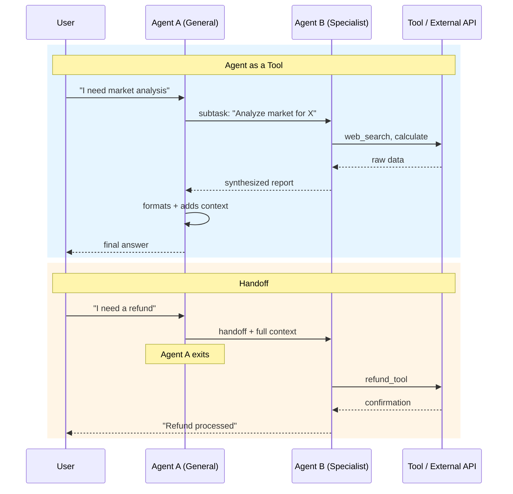

# 🧠 Topic: Agent as a Tool vs Handoffs

> [!abstract] Executive Summary (ELI5)
> Calling an agent as a tool is like asking a specialist for a quick opinion and getting the answer back. A handoff is like transferring your entire case file to a different department — they take full ownership and you step out of the conversation.

---

## 🎯 The "Why"
- **Problem Solved:** As agentic systems grow, you need ways to involve multiple agents. But "involving another agent" can mean two very different things: a temporary subtask delegation, or a full transfer of responsibility. Confusing them leads to broken context, duplicate work, or agents talking past each other.
- **Alternatives:**
    - **Single monolithic agent:** Handles everything, but becomes bloated, slow, and error-prone on edge cases.
    - **Raw function calls:** No agent reasoning in the subtask — just deterministic logic. Fast but inflexible.
    - **Manual routing:** Hardcoded if/else logic picks the next agent. Works for simple cases, but doesn't scale with input variability.
- **Trade-offs:**
    - **Agent as a tool:** Keeps the original agent in control, simpler state management, but adds latency and the caller must synthesize the result.
    - **Handoff:** Clean separation of concerns, the new agent has full autonomy, but you lose the original agent's context and risk circular handoffs.

## 💡 Mental Model & Analogy
- **Agent as a tool:** You are a general practitioner. You call a cardiologist, describe the patient's symptoms, the cardiologist runs a test and sends you a report. You read the report and decide the next step for the patient. The cardiologist never talks to the patient directly.
- **Handoff:** You are a triage nurse. You determine the patient needs surgery. You walk them to the surgery department, hand over the entire chart, and leave. The surgeon now owns the case. The surgeon may later hand the patient to recovery, but you are no longer involved.
- **Visual/Diagram:**


## 🛠️ Core Principles & Code Snippets

### 1. Agent as a Tool

The calling agent invokes another agent as a function. The called agent performs a self-contained task and returns a result. The caller remains the owner of the conversation.

```python
from agents import Agent, Runner, function_tool

research_agent = Agent(
    name="Market Researcher",
    instructions="Analyze market trends. Use web_search. Return a concise 3-bullet summary.",
    tools=[web_search]
)

@function_tool
def get_market_analysis(query: str) -> str:
    """Delegate market research to a specialized agent."""
    result = Runner.run_sync(research_agent, input=query)
    return result.final_output

main_agent = Agent(
    name="Strategy Advisor",
    instructions="Help users with business strategy. Use get_market_analysis for market data.",
    tools=[get_market_analysis]
)
```

**Key characteristics:**
- **Synchronous:** The caller waits for the result.
- **Bounded scope:** The sub-agent has a narrow, well-defined task.
- **Result is data:** The output is a string/object that the caller integrates into its own reasoning.
- **State isolation:** The sub-agent does not see the full conversation history (unless you explicitly pass it).

### 2. Handoff

The original agent transfers the entire conversation state to another agent. The new agent becomes the active handler. The original agent drops out.

```python
from agents import Agent, handoff

billing_agent = Agent(
    name="Billing Specialist",
    instructions="Handle refunds, invoices, and payment issues. Be polite and efficient."
)

support_agent = Agent(
    name="Support Agent",
    instructions="Help users with general issues. If the issue is billing-related, hand off to Billing Specialist.",
    handoffs=[billing_agent]
)

result = Runner.run(support_agent, input="I want a refund for my last order")
# billing_agent takes over and responds to the user directly
```

**Key characteristics:**
- **Asynchronous from original agent's perspective:** The original agent does not wait for a "result" — it exits.
- **Full context transfer:** The new agent receives the entire conversation history.
- **New agent speaks to the user:** The response comes directly from the handoff target.
- **One-way (usually):** The new agent can hand off again, but the original agent is no longer in the loop.

> [!tip] Implementation Note
> Handoffs are cleaner when you have clear domain boundaries. If the user's intent is "I need a specialist to take over this entire request," use a handoff. If the user's intent is "I need a piece of information to complete my current task," use agent-as-a-tool.

## ⚠️ Pitfalls & Anti-patterns
- **Common Mistakes:**
    - Using a handoff when you only need a quick fact. This fragments the conversation and makes debugging harder.
    - Using agent-as-a-tool for long, multi-turn interactions. The caller becomes a bottleneck and must manually manage state.
    - Creating bidirectional handoffs (Agent A → Agent B → Agent A). This can cause infinite loops.
    - Passing too much context to an agent-as-a-tool. Sub-agents should receive only the data they need.
- **When NOT to use agent-as-a-tool:**
    - The subtask requires back-and-forth with the user (e.g., clarifying questions).
    - The sub-agent's output needs to be streamed to the user in real-time.
- **When NOT to use handoffs:**
    - The task is a simple data lookup or calculation.
    - You need to combine results from multiple specialists before responding.
    - The conversation state is large and sensitive — you may leak context to the new agent.

## 🔗 Deep Connections
- **Parent Topic:** [[Agentic Workflows]], [[Multi-Agent Orchestration]]
- **Related Concepts:**
    - [[The Agent]] — Core agent primitive
    - [[Handoffs]] — Handoff mechanism in detail
    - [[Tool Use and MCP]] — External tool integration
    - [[Orchestrator-Worker]] — Related pattern where an orchestrator delegates to workers
- **Prerequisites:** Basic agent architecture, OpenAI SDK or equivalent

## ❓ Active Recall Questions
> [!faq]- When should you use an agent as a tool instead of a handoff?
> Use agent-as-a-tool when the caller needs a specific piece of data or analysis to complete its own reasoning, and the subtask is bounded and self-contained. The caller retains control.

> [!faq]- What happens to the original agent after a handoff?
> The original agent exits the conversation. The new agent receives the full context and responds directly to the user. The original agent is no longer in the loop.

> [!faq]- Can a handoff target later hand off to another agent?
> Yes, handoffs can be chained. But you must guard against cycles — Agent A → Agent B → Agent A can create an infinite loop if not constrained by a max-turns or intent-detection guardrail.

> [!faq]- Does an agent-as-a-tool see the full conversation history?
> No, by default it only sees the input you explicitly pass to it. If you need it to have broader context, you must include that context in the subtask prompt.

---
## 📝 How to use this note effectively
1. **Never Copy-Paste:** Read, close the tab, and write from memory.
2. **Iterate:** Update the analogies as you encounter real-world cases in your own agent systems.
3. **The "Why" is King:** The difference between these two patterns is about *control* and *ownership*, not just syntax.
4. **Update the Status:** Move from `new` -> `growing` -> `mastered` as you build systems using both patterns.
