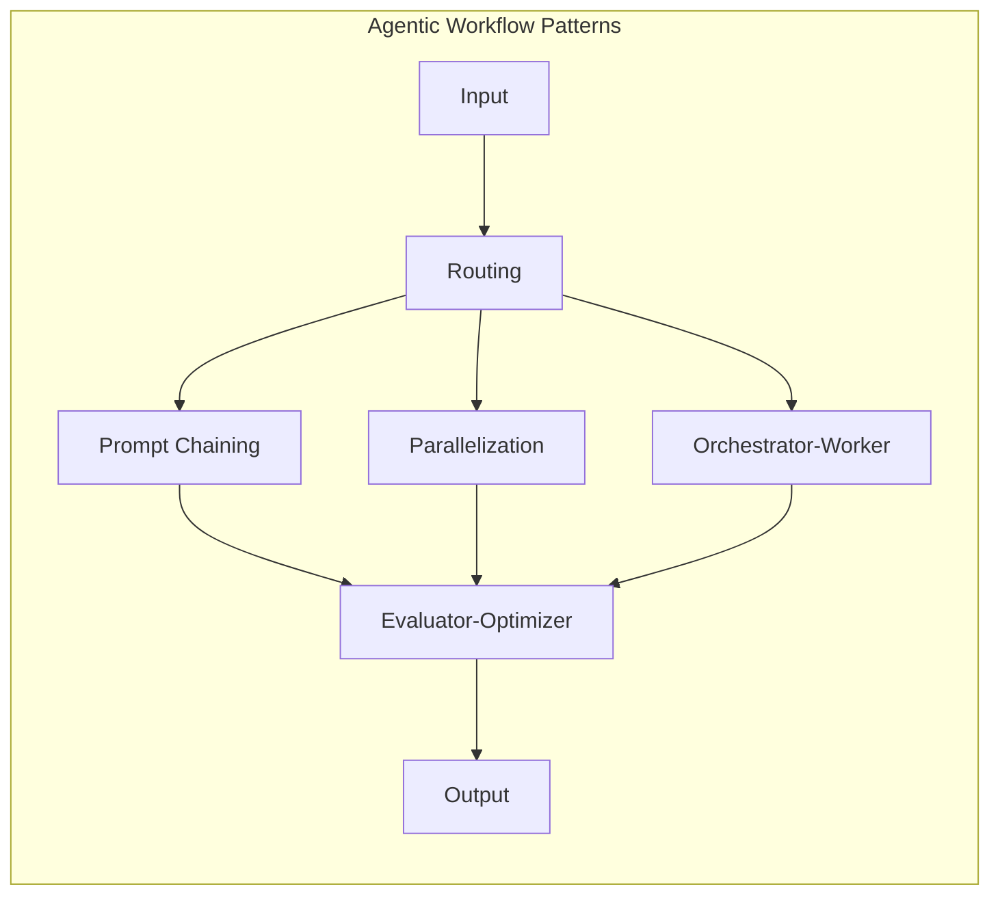

# Agentic Workflow Patterns: Overview

> [!abstract] Executive Summary (ELI5)
> Agentic workflows are like **assembly lines for intelligence** — instead of asking one giant brain to do everything at once, you break the work into specialized stations, each handled by an LLM call. Some stations work in sequence, some in parallel, some route work to specialists, and some check each other's output for quality.

---

## 🎯 The "Why"

- **Problem Solved:** Single-shot LLM calls struggle with complex, multi-step reasoning, quality assurance, and domain specialization. Agentic workflows decompose problems into manageable, verifiable, and optimizable steps.
- **Alternatives:** 
  - Single-shot prompting (fast, but shallow and error-prone on complex tasks)
  - Fine-tuning (expensive, slow to adapt, doesn't solve multi-step reasoning)
  - Hardcoded pipelines (brittle, can't adapt to input variability)
- **Trade-offs:** Agentic workflows add latency, cost, and complexity. They shine when correctness matters more than speed, and when the problem is inherently multi-step or multi-domain.

---

## 💡 Mental Model & Analogy

- **Analogy:** "This is like a **modern hospital** — a patient doesn't see one doctor who does everything. A triage nurse (routing) sends them to the right specialist. Multiple tests run in parallel (parallelization). If surgery is needed, a lead surgeon (orchestrator) coordinates the team, and a second surgeon reviews the work (evaluator-optimizer)."



---

## 🏗️ The 5 Core Patterns at a Glance

| Pattern | Core Idea | When to Use | Latency | Cost |
|---------|-----------|-------------|---------|------|
| **[[Prompt Chaining]]** | Fixed sequence of subtasks | Task decomposes cleanly into known steps | Medium | Medium |
| **[[Routing]]** | Classify input, dispatch to specialist | Input type determines processing path | Low | Low |
| **[[Parallelization]]** | Run multiple independent analyses in parallel | Need diverse perspectives or speed | Low (parallel) | High |
| **[[Orchestrator-Worker]]** | LLM dynamically plans, delegates, synthesizes | Problem is open-ended, requires exploration | High | High |
| **[[Evaluator-Optimizer]]** | One LLM generates, another critiques and iterates | Quality is critical, output is verifiable | High | Medium-High |

---

## 🏢 Business Examples

### Customer Support Automation
```
Ticket arrives
    → [[Routing]]: classify as billing/technical/sales
    → If technical: [[Orchestrator-Worker]] — diagnose across systems, gather context
    → [[Prompt Chaining]] — draft response → translate → add disclaimers
    → [[Evaluator-Optimizer]] — check tone, accuracy, policy compliance
    → Send to customer
```

### Market Research Report
```
Research request arrives
    → [[Orchestrator-Worker]] — break into: competitor analysis, pricing, trends, risks
    → [[Parallelization]] — workers run in parallel for each dimension
    → [[Evaluator-Optimizer]] — synthesizer checks for gaps, contradictions
    → [[Prompt Chaining]] — format → executive summary → final polish
```

---

## 💻 Software Development Examples

### Code Review Pipeline
```
PR opened
    → [[Routing]]: size/complexity check → small (simple review) vs. large (deep review)
    → [[Parallelization]]: security scan + performance check + style review
    → [[Orchestrator-Worker]]: for large PRs, orchestrator identifies changed modules, workers analyze each
    → [[Evaluator-Optimizer]]: reviewer LLM checks if suggestions are actionable and correct
    → Post consolidated review
```

### Bug Investigation
```
Bug report arrives
    → [[Routing]]: classify as frontend/backend/infra
    → [[Orchestrator-Worker]]: orchestrator reads logs, identifies relevant files, delegates analysis
    → [[Parallelization]]: trace execution paths, check recent commits, analyze dependencies
    → [[Evaluator-Optimizer]]: verify root cause hypothesis, check fix doesn't break other areas
    → Generate fix + test case
```

---

## 🧠 Compositional Thinking

Real systems rarely use one pattern in isolation. The power comes from **composition**:

| Composition | Pattern Stack | Use Case |
|-------------|--------------|----------|
| **Routed Pipeline** | [[Routing]] → [[Prompt Chaining]] | Multi-domain document processing |
| **Parallel Review** | [[Parallelization]] → [[Evaluator-Optimizer]] | High-stakes output validation |
| **Deep Research** | [[Orchestrator-Worker]] → [[Evaluator-Optimizer]] | Open-ended analysis with quality gates |
| **Full Agent** | [[Routing]] → [[Orchestrator-Worker]] → [[Parallelization]] → [[Evaluator-Optimizer]] | Autonomous complex task execution |

> See [[Pattern Compositions]] for a deep dive on combining patterns.

---

## ⚠️ Pitfalls & Anti-patterns

- **Over-engineering:** Don't use an orchestrator-worker for a task that chains predictably. Use the simplest pattern that fits.
- **Latency blindness:** Each LLM call adds 500ms-5s. A 10-step chain with slow model = 30s+ latency. Consider faster models for early steps.
- **Cost explosion:** Parallelization with 10 workers on GPT-4 = 10x cost. Use cheaper models for workers, expensive models for orchestrators and evaluators.
- **Error propagation:** In chaining, a mistake in step 3 poisons step 4, 5, 6... Add verification gates.
- **Feedback loops without termination:** Evaluator-optimizer can loop forever. Always set max iterations and clear exit criteria.

---

## 🔗 Deep Connections

- **Parent Topic:** [[LLM System Design]], [[AI Agents Architecture]]
- **Related Concepts:** [[Chain-of-Thought Prompting]], [[ReAct Pattern]], [[Multi-Agent Systems]], [[LLM-as-a-Judge]]
- **Prerequisites:** Understanding of LLM capabilities, prompt engineering basics, system design trade-offs

## Related Notes

- [[Prompt Chaining]]
- [[Routing]]
- [[Parallelization]]
- [[Orchestrator-Worker]]
- [[Evaluator-Optimizer]]
- [[Pattern Compositions]]

---

*Last updated: 2026-06-21*
