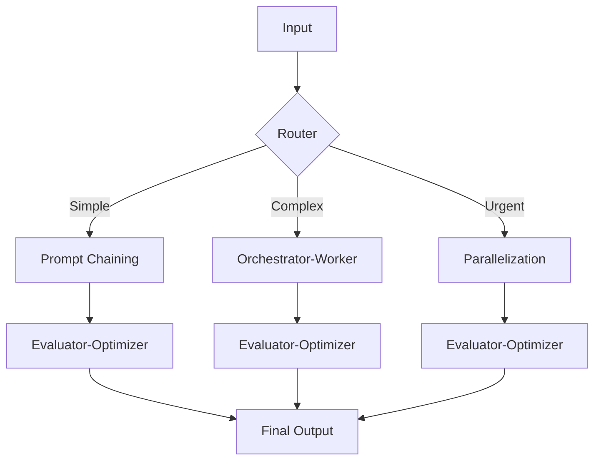
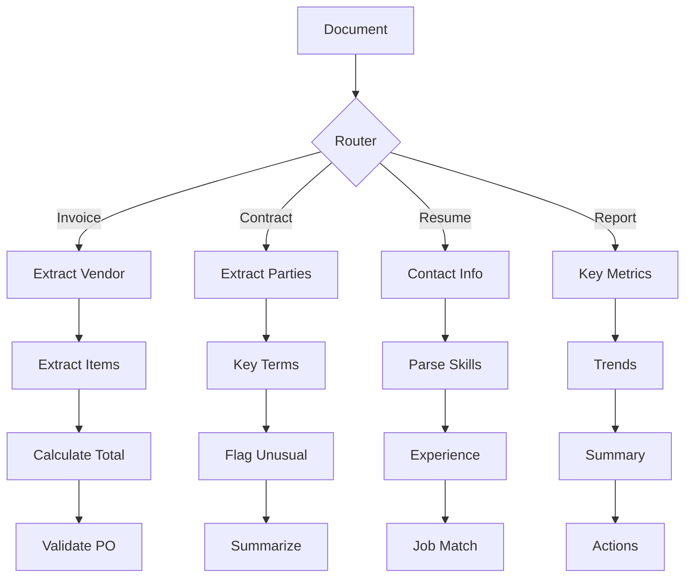
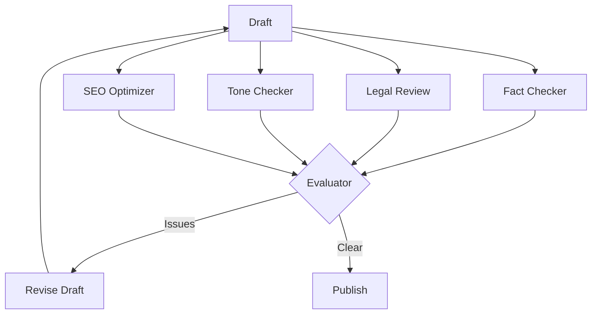
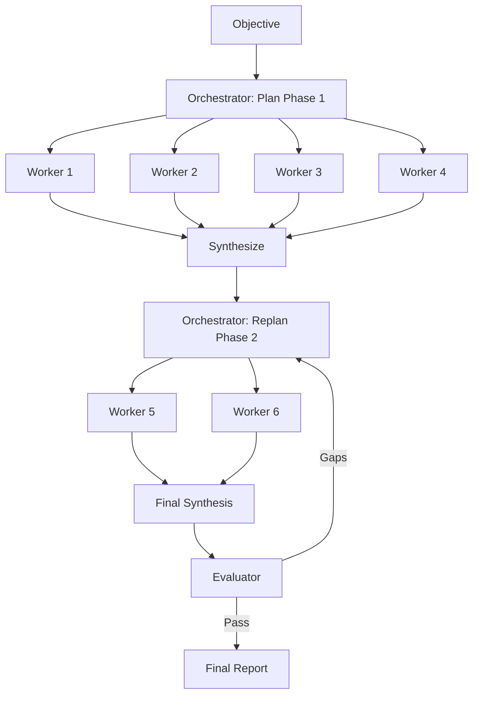
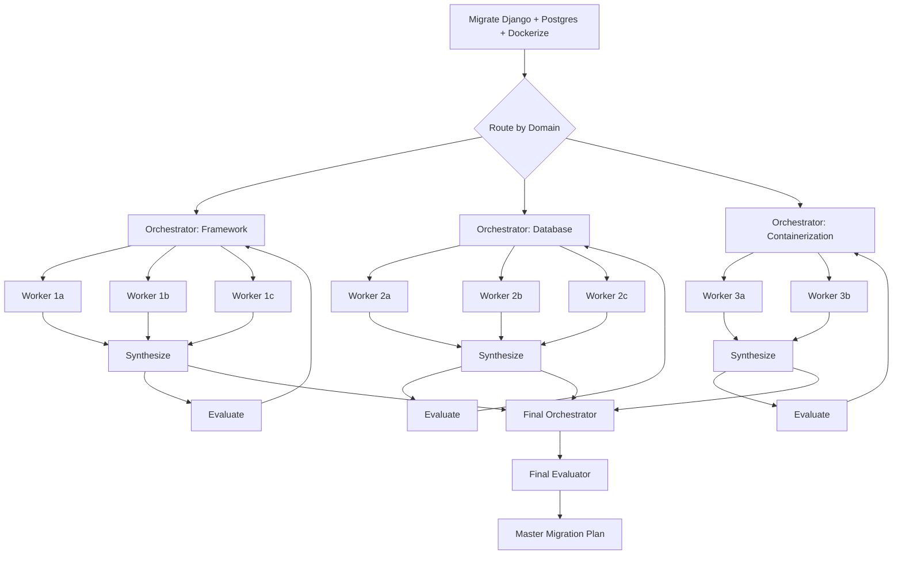

# Pattern Compositions

> [!abstract] Executive Summary (ELI5)
> Real-world problems rarely fit into a single workflow pattern. Pattern composition is like **building with LEGO** — you combine the basic patterns (chaining, routing, parallelization, orchestrator, evaluator) into larger structures that match the complexity and shape of your actual problem. The key insight is that different *parts* of a problem need different patterns.

---

## 🎯 The "Why"

- **Problem Solved:** Production systems face heterogeneous problems — some parts are simple and linear, some need classification, some need exploration, some need quality gates. A single pattern applied everywhere is either over-engineered or under-powered.
- **Alternatives:**
  - Using one pattern for everything (Orchestrator-Worker for simple tasks = waste; Prompt Chaining for open-ended problems = failure)
  - Hardcoding a giant workflow (brittle, hard to debug, hard to evolve)
- **Trade-offs:** Compositions are more complex to design, debug, and monitor. They require understanding which pattern applies to which sub-problem. The payoff is a system that uses the right tool for each job.

---

## 💡 Mental Model & Analogy

- **Analogy:** "This is like **building a modern factory** — you don't use one machine for everything. You have a receiving dock (routing) that sorts incoming materials. Simple parts go through an assembly line (chaining). Complex custom parts go to a workshop where a foreman (orchestrator) coordinates specialists. Every finished product goes through quality control (evaluator-optimizer). The factory is a composition of specialized stations."



---

## 🛠️ Core Compositions

### 1. Routed Pipeline: Routing → Prompt Chaining

**When to use:** You have multiple domains, each with a fixed processing pipeline.

**Example — Multi-Domain Document Processing:**
```
Incoming document
  → Router classifies: Invoice / Contract / Resume / Report
  
  If Invoice:
    → Extract vendor info → Extract line items → Calculate totals → Validate against PO
  
  If Contract:
    → Extract parties → Identify key terms → Flag unusual clauses → Summarize obligations
  
  If Resume:
    → Extract contact info → Parse skills → Calculate experience → Match against job req
  
  If Report:
    → Extract key metrics → Identify trends → Generate summary → Suggest actions
```



---

### 2. Parallel Review: Parallelization → Evaluator-Optimizer

**When to use:** You need multiple independent perspectives, then a quality gate before finalizing.

**Example — High-Stakes Content Publishing:**
```
Draft article
  → Parallel workers:
      - Fact-checker: Verify all claims against sources
      - Legal reviewer: Check for defamation, copyright, compliance
      - Tone checker: Ensure brand voice consistency
      - SEO optimizer: Check keywords, meta, structure
  → Evaluator synthesizes reviews and flags blockers
  → If issues: Generator revises draft with specific feedback
  → Re-evaluate until clear or max iterations reached
  → Publish
```



---

### 3. Deep Research: Orchestrator-Worker → Evaluator-Optimizer

**When to use:** Open-ended research where the plan is dynamic and the output must be high-quality.

**Example — Strategic Competitive Analysis:**
```
Objective: "Analyze how competitor X is threatening our market position"
  → Orchestrator plans initial investigation:
      - Worker 1: Product feature comparison
      - Worker 2: Pricing and packaging analysis
      - Worker 3: Customer sentiment (reviews, social)
      - Worker 4: Recent hiring and talent acquisition
  
  → Synthesis reveals: "They're building an AI feature we don't have. Need deeper analysis."
  → Orchestrator spawns:
      - Worker 5: Technical capabilities of their AI feature
      - Worker 6: Our ability to build equivalent feature (timeline, resources)
  
  → Second synthesis: Combined report
  → Evaluator checks: Completeness, objectivity, actionable recommendations, supporting evidence
  → If gaps: Orchestrator plans additional research
  → Final: Board-ready analysis
```



---

### 4. Smart Routing: Routing → Orchestrator-Worker

**When to use:** Simple inputs get fast paths; complex inputs get full dynamic analysis.

**Example — Intelligent Support System:**
```
Customer message arrives
  → Router: Classify complexity
      
      SIMPLE (80%): "How do I reset my password?"
        → Fast prompt chain: Validate account → Generate reset link → Send confirmation
        → Total time: < 2 seconds
      
      COMPLEX (20%): "My integration stopped working after the API update, 
                      and I'm getting 403 errors on webhook endpoints."
        → Orchestrator-Worker:
            - Worker 1: Check recent API changelog for breaking changes
            - Worker 2: Analyze webhook configuration for auth issues
            - Worker 3: Check customer's API key permissions
        → Synthesize: Root cause + fix steps + code snippet
        → Evaluator: Verify fix matches actual error, check for edge cases
        → Total time: 10-30 seconds, but correct
```

---

### 5. Full Agent: Routing → Orchestrator-Worker → Parallelization → Evaluator-Optimizer

**When to use:** Maximum complexity, highest stakes, fully autonomous tasks.

**Example — Autonomous Code Migration:**
```
Input: "Migrate our Python monolith from Django 3 to Django 5, 
        upgrade PostgreSQL 12 to 16, and containerize with Docker"
  
  → Router: Classify migration type (framework, database, infrastructure)
  → Orchestrator: Plans overall migration strategy
      
      Phase 1: Framework upgrade
        → Workers (parallel):
            - Analyze breaking changes between Django 3 and 5
            - Scan codebase for deprecated APIs
            - Identify third-party package compatibility
        → Synthesize: Prioritized migration checklist
        → Evaluator: Verify no critical path is missed
      
      Phase 2: Database upgrade
        → Workers (parallel):
            - Check PostgreSQL 12→16 migration guide
            - Analyze schema for incompatibilities
            - Plan backup and rollback strategy
        → Synthesize: Migration runbook
        → Evaluator: Verify data safety and rollback feasibility
      
      Phase 3: Containerization
        → Workers: Dockerfile, docker-compose, health checks, CI/CD updates
        → Evaluator: Verify image builds, tests pass, deployment works
  
  → Final Orchestrator: Combine all phases into master migration plan
  → Final Evaluator: End-to-end consistency check, risk assessment
  → Output: Complete migration plan with timeline, risks, and rollbacks
```



---

### 6. Parallel Orchestration: Parallelization with Orchestrator Sub-Tasks

**When to use:** Multiple independent sub-problems, each requiring dynamic planning.

**Example — Multi-Region Incident Response:**
```
Incident: "API latency spiking in US-East and EU-West, 
            database connections maxed out"
  
  → Parallel orchestrators (one per region):
      
      US-East Orchestrator:
        - Worker 1: Check CloudWatch metrics for last 4 hours
        - Worker 2: Check recent deployments in US-East
        - Worker 3: Analyze connection pool configuration
        → Synthesize: US-East specific root cause
      
      EU-West Orchestrator:
        - Worker 1: Check equivalent metrics in EU-West
        - Worker 2: Check for cross-region replication lag
        - Worker 3: Check failover configuration
        → Synthesize: EU-West specific root cause
  
  → Global Evaluator: Are root causes correlated? Is there a shared dependency?
  → Final synthesis: Incident report with coordinated fix plan
```

---

## ⚠️ Pitfalls & Anti-patterns

- **Common Mistakes:**
  - Using the most complex pattern everywhere ("when you have a hammer...")
  - Not monitoring which patterns are invoked for which inputs (you lose optimization opportunities)
  - Composing without clear boundaries (orchestrator calling orchestrator calling orchestrator = unbounded recursion)
  - Ignoring latency stacking (routing + orchestrator + parallelization + evaluator = 30+ seconds)
  - Not designing for failure at composition boundaries (what if the router fails?)
- **When NOT to compose:**
  - For simple, predictable tasks (a single prompt or chain is enough)
  - When you don't understand the problem shape well enough to choose patterns
  - When debugging and observability aren't in place (compositions are hard to debug)
- **Performance considerations:**
  - Profile each component's latency and cost. Often 80% of cost comes from 20% of invocations.
  - Consider caching router decisions and orchestrator plans for repeated input patterns.
  - Use streaming to show progress to users while deeper components run.

---

## 🔗 Deep Connections

- **Parent Topic:** [[Agentic_Workflow_Patterns_Overview]]
- **Related Concepts:** [[System Design Patterns]], [[Microservices Architecture]], [[Pipes and Filters]], [[Workflow Orchestration]]
- **Prerequisites:** Deep understanding of all five base patterns, cost modeling, system observability

## Related Notes

- [[Agentic_Workflow_Patterns_Overview]]
- [[Prompt Chaining]]
- [[Routing]]
- [[Parallelization]]
- [[Orchestrator-Worker]]
- [[Evaluator-Optimizer]]

---

*Last updated: 2026-06-21*
