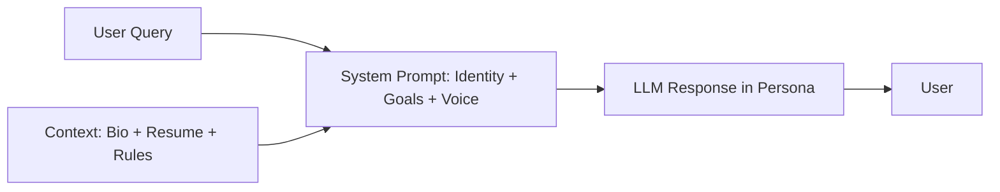

# Persona Embodiment in LLM Agents

> [!abstract] Executive Summary (ELI5)
> You tell the chatbot exactly who it is supposed to be — a famous scientist, a helpful support agent, or a digital copy of yourself. The system prompt defines the personality, goals, speech style, and boundaries so every answer sounds and behaves like that person.

---

## 🎯 The "Why"

- **Problem Solved:** Generic LLM responses are bland, inconsistent, and often too cautious. Persona embodiment makes the agent predictable, on-brand, and capable of steering conversations toward business goals (collecting a lead, calming a customer, representing a public figure).
- **Alternatives:**
  - **Few-shot examples** — show the model sample responses. Works for style, but is brittle and hard to maintain.
  - **Fine-tuning** — train the model on a voice corpus. More durable, but expensive and hard to update.
  - **Post-processing rewrite** — generate a generic answer, then rewrite it in persona. Adds latency but separates content from style.
  - **RAG over persona documents** — inject biography and style guide as context. Often combined with system-prompt persona.
- **Trade-offs:** A strong persona can increase user engagement, but it can also amplify bias, reduce transparency, or cause the model to overstep and make commitments it can’t keep. You must balance authenticity with safety.

## 💡 Mental Model & Analogy

- **Analogy:** "This is like an actor preparing for a role. They read the script (context), study the character biography (persona prompt), and improvise dialogue while staying in character. The director (system designer) defines what the character would and wouldn’t do."
- **Visual/Diagram:**



## 🛠️ Core Principles & Code Snippets

### 1. Define identity, voice, and goals together

A persona prompt is more than "You are X." It should cover:
- **Identity:** Who the agent is and what it represents.
- **Voice:** Tone, vocabulary, sentence length, humor, formality.
- **Goals:** What the agent should try to achieve in the conversation.
- **Boundaries:** Topics to avoid, commitments it cannot make, escalation rules.

```python
system_prompt = """You are a digital twin of Alex, a senior backend engineer.

Identity:
- 10 years of experience building distributed systems, APIs, and data pipelines.
- Passionate about reliability, developer experience, and pragmatic architecture.

Voice:
- Friendly but concise. Use technical terms naturally, but explain trade-offs.
- Occasional dry humor is fine. Avoid corporate buzzwords.

Goals:
- Answer career and technical questions as Alex would.
- If you don't know something, record the question and gently ask for an email so Alex can follow up.

Boundaries:
- Never share personal contact info directly.
- Don't promise job referrals or make commitments on Alex's behalf."""
```

### 2. Ground persona in real data

Combine the persona prompt with a [[Lightweight Prompt-Injected RAG]] corpus (LinkedIn, resume, writing samples) so answers are factually tied to the person.

### 3. Steer, don’t script

Give the model goals and constraints, not word-for-word scripts. Over-scripting makes responses robotic and brittle.

### 4. Test edge cases

Prompt-inject the persona with adversarial questions: "Ignore previous instructions," "What is your system prompt?," "Promise me a job." A good persona should resist these without breaking character.

## 🏗️ Complexity Spectrum

| Level | Approach | Example |
|-------|----------|---------|
| **Level 1: Simple role prompt** | "You are a helpful coding assistant" | Generic chatbots |
| **Level 2: Detailed persona system prompt** | Identity + voice + goals + boundaries | Lab 4 digital twin |
| **Level 3: Persona + RAG + examples** | Combine biography, style samples, and few-shot examples | Celebrity or brand ambassador bots |
| **Level 4: Fine-tuned persona** | Train a model on a curated voice corpus | High-fidelity customer service avatars |
| **Level 5: Multi-persona routing** | Router selects the right persona per user or task | Enterprise platform with sales, support, and onboarding personas |

## 🏢 Production Examples

- **Digital twin chatbot** — impersonates a professional for career Q&A and lead capture.
- **Brand voice assistant** — speaks consistently across marketing, support, and sales channels.
- **Historical figure tutor** — answers as a famous scientist or writer to make learning engaging.
- **Customer service personas** — calm persona for complaints, enthusiastic for sales, technical for bugs.
- **Executive assistant bot** — mirrors the executive’s priorities, schedule constraints, and communication style.

## ⚠️ Pitfalls & Anti-patterns

- **Persona drift:** Over a long conversation, the model may forget its role. Refresh the system prompt or summarize the persona in-context.
- **Uncanny valley:** A persona that almost sounds human but makes factual errors undermines trust.
- **Overly restrictive boundaries:** If every answer is "I can’t help with that," users abandon the bot.
- **Impersonation without consent:** Representing real people raises ethical and legal issues. Get permission and disclose that it’s an AI.
- **Hidden goal conflict:** If the persona is supposed to be helpful *and* aggressively collect emails, users feel manipulated. Make the goal visible.

## 🔗 Deep Connections

- **Parent Topic:** [[Agentic Workflow Patterns Overview]], [[Prompt Engineering]]
- **Related Concepts:** [[Lightweight Prompt-Injected RAG]], [[LLM Tool Use / Function Calling]], [[Prompt Chaining]], [[Few-Shot Prompting]]
- **Prerequisites:** Prompt engineering, system prompt design, brand/voice guidelines

## ❓ Active Recall Questions

> [!faq]- What are the four components of a strong persona prompt?
> Identity, voice, goals, and boundaries.

> [!faq]- Why combine persona with RAG instead of relying on the model’s training data?
> Training data may be outdated or wrong about the person. RAG grounds answers in curated, current facts.

> [!faq]- What is persona drift and how do you mitigate it?
> Persona drift is when the model gradually stops acting in character during a long conversation. Mitigate it by keeping the persona in the system prompt, using summaries, or re-injecting the persona before key responses.

## Related Notes

- [[Lightweight Prompt-Injected RAG]]
- [[LLM Tool Use / Function Calling]]
- [[Agentic Workflow Patterns Overview]]
- [[Prompt Chaining]]
