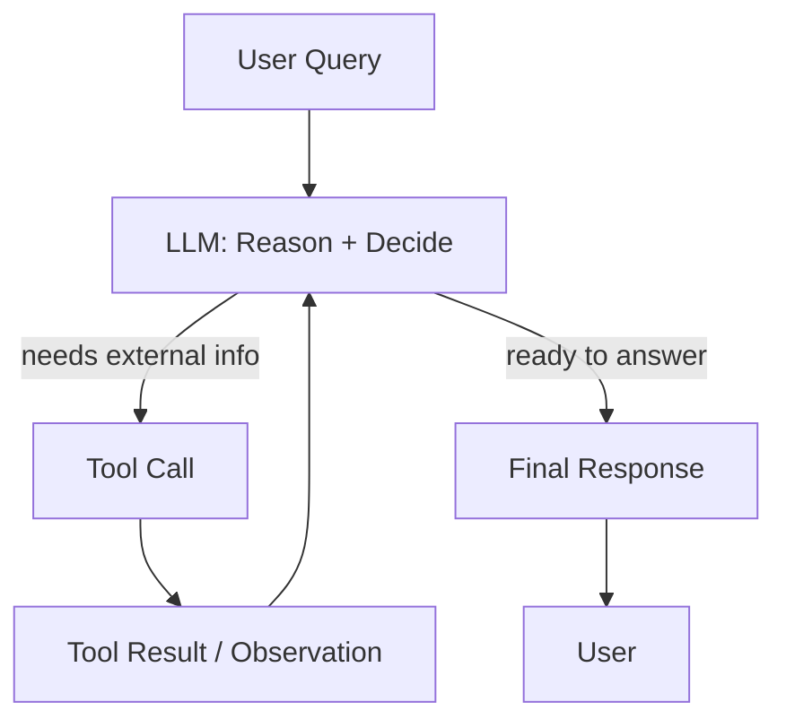

# ReAct Loop

> [!abstract] Executive Summary (ELI5)
> ReAct means the LLM **Re**asons about what to do, **Act**s by calling a tool, observes the result, and then repeats the cycle until it has enough information to answer. It’s like a detective asking questions, checking clues, and updating their theory step by step.

---

## 🎯 The "Why"

- **Problem Solved:** Many questions can’t be answered in one shot. They require gathering facts, checking assumptions, and adapting. ReAct gives the LLM a structured loop to think, act, observe, and revise instead of guessing everything at once.
- **Alternatives:**
  - **Single-shot prompting** — fast, but the model must either know everything or hallucinate.
  - **Chain-of-thought (CoT)** — the model reasons out loud, but can’t verify facts against external systems.
  - **Hardcoded multi-step pipelines** — predictable, but brittle when inputs vary.
  - **Prompt chaining** — fixed sequence of LLM calls; less flexible than ReAct because the path is predetermined.
- **Trade-offs:** ReAct adds latency and cost because it may call the LLM multiple times. It can also loop forever if termination criteria are weak. Use it when the problem is dynamic and the value of correctness is high.

## 💡 Mental Model & Analogy

- **Analogy:** "This is like a chef tasting a sauce, adding salt, tasting again, adding herbs, tasting again — each action informs the next decision until the dish is right."
- **Visual/Diagram:**



## 🛠️ Core Principles & Code Snippets

### 1. The basic loop

The runtime keeps calling the LLM as long as it returns tool calls.

```python
def react_loop(messages, tools, max_iterations=5):
    for _ in range(max_iterations):
        response = client.chat.completions.create(
            model="gpt-4o",
            messages=messages,
            tools=tools
        )
        choice = response.choices[0]

        if choice.finish_reason == "tool_calls":
            messages.append(choice.message)
            for call in choice.message.tool_calls:
                result = execute_tool(call)
                messages.append({
                    "role": "tool",
                    "tool_call_id": call.id,
                    "content": json.dumps(result)
                })
        else:
            return choice.message.content
    raise RuntimeError("Max iterations exceeded")
```

### 2. Reasoning is explicit

Classic ReAct uses a scratchpad where the model writes `Thought:`, `Action:`, and `Observation:` lines. With modern function calling, the "thought" is often implicit in the LLM’s internal reasoning, but you can still expose it by asking the model to emit reasoning text before tool calls.

### 3. Observations drive the next reasoning step

The tool result is the only new information the model gets between iterations. Format it clearly so the model can interpret it.

### 4. Termination is not optional

Always cap iterations and define clear stop conditions: final answer, no more tool calls, or a special `done` tool.

## 🏗️ Complexity Spectrum

| Level | Behavior | Use Case |
|-------|----------|----------|
| **Level 1: Single tool call** | One action, then answer | Weather, calculations |
| **Level 2: Sequential tool calls** | Multiple dependent actions | Look up user → check order → issue refund |
| **Level 3: Conditional branching** | Model chooses tools based on previous results | Debugging agent |
| **Level 4: Multi-tool planning** | Model plans a DAG of tool calls, then executes | Research agent, multi-step data analysis |

## 🏢 Production Examples

- **Support ticket triage:** Classify → look up account → check recent orders → route or resolve.
- **Coding agent:** Plan → read files → edit → run tests → fix errors → repeat.
- **Travel planner:** Search flights → check hotels → verify availability → build itinerary.
- **Lab 4 digital twin:** Answer question → if unknown, record question → notify owner → provide fallback.

## ⚠️ Pitfalls & Anti-patterns

- **No iteration cap:** A confused model can bounce between tools forever.
- **Poor observation formatting:** Returning raw API dumps makes it hard for the model to extract what matters.
- **Tool results that don’t ground the answer:** If the result is ignored or not fed back, the loop is wasted.
- **Over-reliance on implicit reasoning:** For high-stakes tasks, ask the model to state its thought before acting.
- **Tight coupling between reasoning and tools:** Keep tool execution dumb; the LLM should own the strategy.

## 🔗 Deep Connections

- **Parent Topic:** [[Agentic Workflow Patterns Overview]], [[LLM System Design]]
- **Related Concepts:** [[LLM Tool Use / Function Calling]], [[Prompt Chaining]], [[Orchestrator-Worker]], [[Evaluator-Optimizer]]
- **Prerequisites:** Tool use / function calling, prompt engineering, API design

## ❓ Active Recall Questions

> [!faq]- What does ReAct stand for and what is the loop?
> ReAct = Reason + Act. The LLM reasons, picks a tool, observes the result, and repeats until it can answer.

> [!faq]- How is ReAct different from Chain-of-Thought?
> CoT only produces reasoning text. ReAct couples reasoning with external actions and observations, so the model can verify and update its reasoning.

> [!faq]- Why is a max-iteration limit critical?
> Without it, a stuck or confused model can loop indefinitely, burning tokens and latency.

## Related Notes

- [[LLM Tool Use / Function Calling]]
- [[Decorator-Based Tool Registry]]
- [[Human-in-the-Loop for Agent Observability]]
- [[Agentic Workflow Patterns Overview]]
- [[Prompt Chaining]]
- [[Orchestrator-Worker]]
