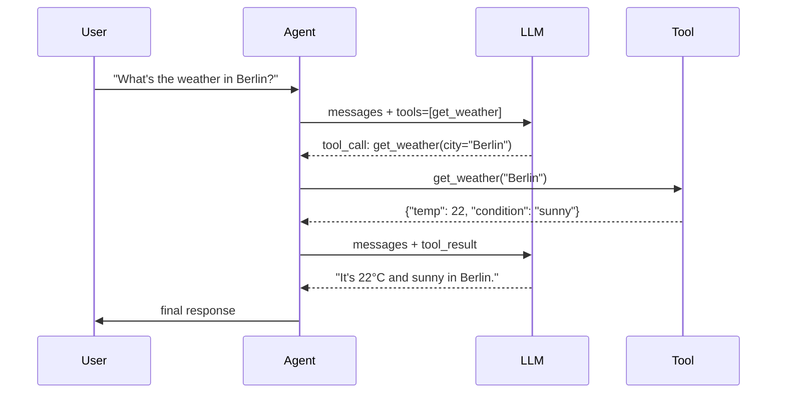

# LLM Tool Use / Function Calling

> [!abstract] Executive Summary (ELI5)
> Instead of just answering with text, the LLM can "press buttons" — call predefined functions like checking the weather, sending a notification, or saving a lead. It decides which button to press and what arguments to pass, then your code runs the real action and feeds the result back.

---

## 🎯 The "Why"

- **Problem Solved:** LLMs are frozen in time and have no access to private data, external systems, or the ability to act. Tool use bridges the gap between reasoning and action — it lets an LLM interact with APIs, databases, calendars, notification services, and custom business logic.
- **Alternatives:**
  - **Structured output only** — the LLM emits JSON, but your code hardcodes what to do with it. Works for simple cases, but the LLM doesn't get to reason over the result.
  - **Prompt-only extraction** — ask the LLM to parse intent, then regex/parse its response. Fragile and model-dependent.
  - **Fine-tuning** — teach the model to internalize a task. Doesn’t help with real-time data or side effects.
  - **Agent frameworks** (LangChain, CrewAI, etc.) — wrap tool use with orchestration. Useful, but often overkill for a single agent with a handful of tools.
- **Trade-offs:** Native function calling is cleaner than prompt parsing, but adds latency and token cost. You also become responsible for executing tools safely, handling errors, and preventing malicious or mistaken invocations.

## 💡 Mental Model & Analogy

- **Analogy:** "This is like a bank teller who can’t open the vault themselves, but they can fill out a withdrawal slip and hand it to you. You verify the slip, open the vault, return the cash, and the teller completes the transaction."
- **Visual/Diagram:**



## 🛠️ Core Principles & Code Snippets

### 1. Schema-first design

The LLM doesn't call your code directly. It sees a JSON schema (name, description, parameters) and emits a matching call. Invest in good descriptions — they are part of the prompt.

```python
tools = [
    {
        "type": "function",
        "function": {
            "name": "record_user_details",
            "description": "Record contact details when a visitor wants to get in touch. Only call when email or phone is explicitly provided.",
            "parameters": {
                "type": "object",
                "properties": {
                    "email": {"type": "string", "format": "email"},
                    "phone": {"type": "string"},
                    "name": {"type": "string"}
                },
                "required": ["email"]
            }
        }
    }
]
```

### 2. Let the model decide, but validate yourself

The model proposes; your runtime approves. Always validate arguments, enforce rate limits, and handle tool errors gracefully.

```python
def execute_tool(call):
    name = call.function.name
    args = json.loads(call.function.arguments)
    if name == "record_user_details":
        if not is_valid_email(args.get("email")):
            return {"error": "Invalid email"}
        return save_to_crm(args)
```

### 3. Return results back to the LLM

A tool call is only useful if the LLM sees the result. Append a `tool` message and call the LLM again so it can reason over the outcome.

### 4. Keep tool count low and focused

Too many tools confuse the model and increase latency. Group related operations, and hide rarely-used tools behind routing logic.

## 🏗️ Complexity Spectrum

| Level | Setup | Example |
|-------|-------|---------|
| **Level 1: Static tools** | 1–3 hardcoded functions | Weather bot, calculator bot |
| **Level 2: Tool registry + decorators** | Dynamically registered tools | Lab 4 chatbot, internal admin assistant |
| **Level 3: Tool discovery** | LLM picks from a large catalog by name/description | Enterprise copilot with 50+ tools |
| **Level 4: Self-written tools** | Agent generates code for new tools on the fly | Research agent that writes and runs Python |

> See [[Decorator-Based Tool Registry]] for the registry pattern used in Lab 4.

## 🏢 Production Examples

- **Customer support bot:** `lookup_order`, `refund_order`, `escalate_to_human`
- **DevOps assistant:** `run_diagnostics`, `restart_service`, `create_incident`
- **Scheduling agent:** `check_availability`, `book_meeting`, `send_invite`
- **E-commerce copilot:** `search_products`, `apply_discount`, `add_to_cart`

## ⚠️ Pitfalls & Anti-patterns

- **Vague descriptions:** A tool named `do_something` with empty description will be ignored or misused. Treat descriptions as prompts.
- **Trusting model-generated arguments:** The LLM can hallucinate emails, IDs, or dates. Validate everything before side effects.
- **Missing error handling:** If a tool fails, the LLM should know. Return structured errors, not stack traces.
- **Infinite loops:** A tool result can trigger another tool call. Cap iterations and detect loops.
- **Over-tooling:** Don’t expose internal CRUD operations as tools unless the LLM genuinely needs them.

## 🔗 Deep Connections

- **Parent Topic:** [[Agentic Workflow Patterns Overview]], [[LLM System Design]]
- **Related Concepts:** [[ReAct Loop]], [[Decorator-Based Tool Registry]], [[Human-in-the-Loop for Agent Observability]], [[Prompt Chaining]]
- **Prerequisites:** LLM APIs, JSON schema basics, prompt engineering

## ❓ Active Recall Questions

> [!faq]- When should you choose native function calling over structured output + hardcoded dispatch?
> Native function calling is better when the LLM needs to reason about which action to take and adapt based on tool results. Structured output is enough when the action path is fixed and the LLM only needs to extract parameters.

> [!faq]- What makes a good tool description?
> A good description explains *when* to call the tool, *what* it does, and *what* each parameter means. It should read like an instruction to the model.

> [!faq]- Why must tool results be fed back to the LLM?
> The LLM needs the result to produce a final answer grounded in reality. Without the result, it would have to hallucinate the outcome.

## Related Notes

- [[ReAct Loop]]
- [[Decorator-Based Tool Registry]]
- [[Human-in-the-Loop for Agent Observability]]
- [[Agentic Workflow Patterns Overview]]
- [[Prompt Chaining]]
