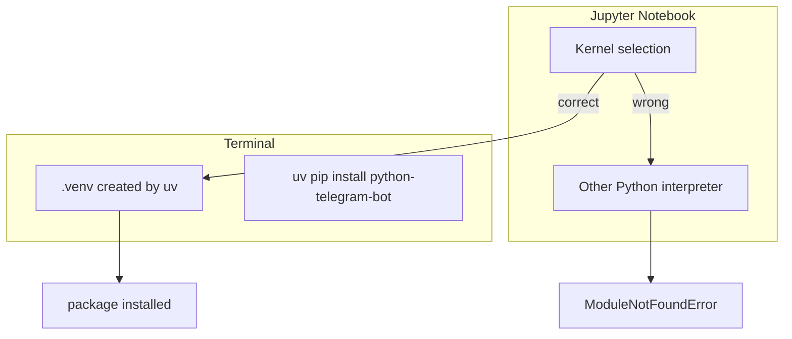

# 🧠 Topic: Jupyter Kernel and uv Virtual Environment

> [!abstract] Executive Summary (ELI5)
> Jupyter notebooks and terminal virtual environments are independent. A package installed in the project's `.venv` is invisible to a notebook running the wrong kernel. And `uv` creates lightweight virtual environments that do not ship with `pip`, so you must install packages with `uv pip install` instead of `python -m pip install`.

---

## 🎯 The "Why"
- **Problem Solved:** Agentic-AI experiments often start in Jupyter notebooks, but notebooks easily drift away from the project's Python interpreter. Meanwhile `uv` speeds up dependency management by removing `pip` from the venv, which breaks muscle memory for developers used to `python -m pip`.
- **Alternatives:**
    - **Install `ipykernel` globally** and point the notebook to the system Python. Works for quick scripts, but pollutes the global environment and makes reproducibility harder.
    - **Use `pip` instead of `uv`** to create the venv. Slower, but the venv will contain `pip` and the notebook workflow stays familiar.
    - **Run scripts as `.py` files from the terminal** inside the activated venv. Avoids Jupyter kernel confusion entirely.
- **Trade-offs:** `uv` + Jupyter gives fast, reproducible environments, but requires explicit kernel registration and using `uv pip` commands. The cost is a small upfront workflow change.

## 💡 Mental Model & Analogy
- **Analogy:** A virtual environment is a **workbench with its own toolbox**. Jupyter is a **remote-control crane** that picks up tools from whichever bench the operator selected. If the crane is pointed at the wrong bench, it cannot find the wrench you just put down. `uv` is a lean bench that does not include a particular screwdriver (`pip`) — you must use the `uv` tool cart instead.
- **Visual/Diagram:**


## 🛠️ Core Principles & Code Snippets

### 1. Verify which interpreter the notebook is using
```python
import sys
print(sys.executable)
```

If the path does not point to your project's `.venv/bin/python`, the notebook cannot see packages installed in that venv.

### 2. Install the kernel from inside the correct environment
```bash
# Activate the uv-managed venv
source .venv/bin/activate

# Install ipykernel into it
uv pip install ipykernel

# Register the kernel for Jupyter
python -m ipykernel install --user --name=agents_learning --display-name "agents_learning (.venv)"
```

Then in Jupyter, select the `agents_learning (.venv)` kernel.

### 3. Install packages with `uv pip`, not `python -m pip`
`uv` virtual environments do not include `pip`. Running:
```bash
/path/to/.venv/bin/python -m pip install python-telegram-bot
```

fails with:
```
No module named pip
```

Correct command:
```bash
uv pip install python-telegram-bot
```

Or, from inside the activated venv:
```bash
source .venv/bin/activate
uv pip install python-telegram-bot
```

> [!tip] Implementation Note
> Treat the venv as read-only except through `uv`. If you really need `pip` inside the venv, you can `uv pip install pip`, but that defeats the point of a lean `uv` environment.

### 4. Quick checklist when a notebook import fails
1. `print(sys.executable)` — is it the `.venv` interpreter?
2. `python -c "import <package>"` from the activated terminal — does it work there?
3. Was the package installed with `uv pip install`, not `python -m pip install`?
4. Has the Jupyter kernel been restarted after installation?

## ⚠️ Pitfalls & Anti-patterns
- **Assuming the terminal venv and notebook share state:** They do not. The notebook follows its selected kernel, which is a separate process and possibly a separate Python installation.
- **Using `python -m pip` in a `uv` venv:** This fails immediately because `pip` is not installed. Use `uv pip install` instead.
- **Installing packages into the wrong kernel:** Running `pip install` from a notebook whose kernel is not the project venv will install the package into the wrong environment.
- **Not naming the kernel clearly:** A kernel named `python3` tells you nothing. Use `--display-name` to make the mapping obvious.
- **Restarting the kernel without reinstalling `ipykernel`:** If `ipykernel` is missing from the venv, Jupyter cannot even start a kernel from it.

## 🔗 Deep Connections
- **Parent Topic:** [[OpenAI-Agent-SDK-Overview]], [[OpenAI Client vs AsyncOpenAI Client]]
- **Related Concepts:**
    - [[Troubleshooting Custom LLM Provider with OpenAI Agents SDK]] — Often debugged inside the same Jupyter/notebook workflow
    - [[The Agent]] — SDK code you run once the environment is correct
- **Prerequisites:** Basic virtual-environment concepts, command-line navigation

## ❓ Active Recall Questions
> [!faq]- Why does `import telegram` fail in a notebook even after `pip install python-telegram-bot`?
> The notebook kernel points to a different Python interpreter than the one where the package was installed. Check `sys.executable` and switch the kernel.

> [!faq]- Why does `python -m pip install` fail in a `uv` virtual environment?
> `uv` creates lightweight virtual environments that do not include `pip`. Use `uv pip install <package>` instead.

> [!faq]- How do you register a project's `.venv` as a Jupyter kernel?
> Activate the venv, install `ipykernel` with `uv pip install ipykernel`, then run `python -m ipykernel install --user --name=<name> --display-name "<display name>"`.

> [!faq]- What is the first thing to check when a notebook import fails?
> Run `import sys; print(sys.executable)` inside the notebook and confirm it matches the project virtual environment.
