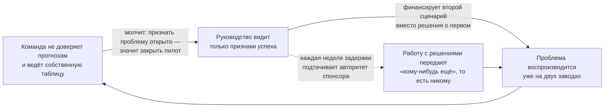
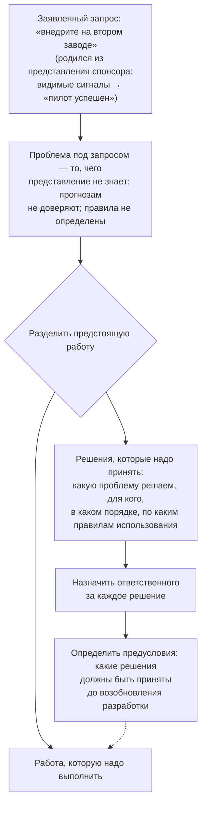

# 1.1 Unscoped Decision Work — работа с решениями, не включённая в план

Related: [[1.1-Unscoped-Decision-Work-Flashcards]] · [[Decisions-Vs-Management-Flashcards]]

> [!summary] TL;DR
> Исход инициативы определяет не качество технологии, а решения, которые никто не включил в объём работ: можно ли доверять результатам инструмента, для каких задач их допустимо использовать, кто имеет право это решать. Такой проект не терпит очевидного краха (**collapse**) — он буксует (**stall**): формальные показатели выполняются, но содержательного движения нет. Выход даёт навык, а не инструмент (**skill, not instrument**): отделить заявленный запрос (**stated ask**) от стоящей за ним бизнес-проблемы; разделить предстоящую работу на «решения, которые надо принять» и «работу, которую надо выполнить»; назначить ответственного за каждое решение и определить, какие решения должны быть приняты до возобновления разработки.

## Простыми словами

Представьте завод, на котором запустили программу, прогнозирующую выпуск продукции. Первые месяцы всё выглядит отлично: прогнозы приходят точно по расписанию, руководство довольно и уже планирует установить программу на втором заводе. Но за кулисами происходит то, чего руководство не видит: специалисты по планированию почти сразу перестали этим прогнозам верить — на производстве что-то изменилось, а программа об этом не знала. Чтобы завод всё-таки получал пригодные планы, они в тишине ведут собственную таблицу с настоящими цифрами. Признаться в расхождении никто не хочет: это значит признать, что программа не работает и проект пора закрывать. Поэтому снаружи проект выглядит движущимся, хотя на самом деле он стоит.

Отсюда главная мысль главы: судьбу проекта решает не техника, а решения, которые никто не взял в работу — можно ли верить цифрам, где их разрешено применять, кто вправе это решить. Это как испечь торт по новому рецепту, но не сообщить об этом духовке: снаружи всё по плану, а результат — нет. Чтобы проект двигался по-настоящему, нужно сначала отделить «что у нас просят» от «какая проблема на самом деле»; затем разделить будущую работу на «решения, которые надо принять» и «работу, которую надо выполнить»; назначить ответственных за решения и договориться, какие из них должны быть закрыты до продолжения строительства.

## 1. Центральный тезис: в план не включили работу с решениями

Лекция формулирует проблему одной фразой: **«The work that decides the outcome is the work nobody scoped»** — исход определяет та работа, которую никто не включил в объём проекта.

Расшифровка на кейсе. В плане forecasting-инициативы завода были технические задачи: разработать инструмент, выдавать прогнозы по графику, внедрить его на втором заводе. В плане не было управленческих задач, от которых зависит результат: проверить, доверяют ли специалисты прогнозам; определить, для каких решений прогнозы допустимо использовать; распределить, кто и какое решение принимает. Пока эти вопросы открыты, техническое расширение не приближает проект к цели — оно переносит нерешённые проблемы на новое место.

## 2. Крах и буксование: почему проблему не видно

Лекция различает два режима, в которых инициатива может деградировать.

**Крах (collapse)** — явный, публичный провал: проект останавливают, финансирование отзывают, о неудаче знают все участники. Такой провал невозможно игнорировать, и он быстро получает внимание руководства.

**Буксование (stall)** — тихий режим: проект формально жив и исправно отчитывается, но не приближается к цели. Ничего не ломается и не останавливается: прогнозы выдаются в срок, бюджет осваивается, планы расширения объявляются. Однако содержательно инициатива стоит на месте: доверие к её результатам утрачено, ключевые решения не приняты.

Опасность буксования — в незаметности. У краха есть свидетели; буксование заметно только тому, кто проверяет, используются ли результаты по назначению, а не соблюдаются ли сроки. Именно поэтому в кейсе инициатива пять месяцев выглядит успешной. Представьте понедельничное совещание: спонсор показывает зелёный график исполнения сроков. Вопрос «а пользуются ли этими прогнозами люди» на таком совещании просто не звучит — и буксование может длиться месяцами.

В кейсе расхождение между внешней картиной и фактическим положением дел выглядит так:

| Что видно со стороны | Что происходит фактически |
|---|---|
| Инструмент пять месяцев выдаёт прогнозы точно по графику | Команда планирования потеряла доверие к прогнозам и параллельно ведёт собственную таблицу |
| Второй сценарий использования получает финансирование | Решение о судьбе первого сценария (масштабировать или нет) не принято |
| Руководство регулярно получает отчёты спонсора | О потере доверия к инструменту руководству никто не сообщил |
| План расширения публично объявлен | Не определено, для каких решений допустимо использовать цифры и кто это решает |

## 3. Почему буксование воспроизводится само: два механизма

**Механизм 1: обоснованное молчание команды.** Команда планирования располагает двумя версиями одного показателя: официальными прогнозами инструмента и собственной таблицей, которой доверяет. О расхождении она не сообщает, и это рационально по двум причинам. Во-первых, ведение таблицы — добросовестное исполнение работы: специалисты компенсируют ненадёжный инструмент, чтобы завод получал пригодные планы. Во-вторых, открытое признание проблемы означало бы, что пилот не оправдал себя и подлежит закрытию, — а сотрудник, приносящий такую новость, рискует собственной репутацией. Пока организацией не поставлен вопрос «для каких решений допустимы эти прогнозы», система вознаграждает обходной путь и наказывает за честность.

**Механизм 2: передача работы с решениями как самоустранение.** Спонсор воспринимает каждую неделю задержки как подтачивание собственного авторитета (**credibility draining weekly**). Работа по управлению и внедрению (**governance and adoption**) в этих условиях непривлекательна: она продвигается медленно (**slow**), требует политических согласований (**political**) и не даёт наглядных промежуточных результатов, которые можно показать руководству (**demonstrates badly**). Отсюда два типовых поведения. Первое — передать эту работу «кому-нибудь ещё»: явный владелец не назначается, и задача фактически не принадлежит никому. Второе — профинансировать следующий видимый шаг, второй сценарий использования. Финансирование нового пилота проще, чем решение о судьбе старого: решение требует обсуждения неудобных вопросов, финансирование — только бюджета.

## 4. Навык вместо инструмента: три шага

Что разрешает ситуацию — не новая платформа и не улучшенная модель, а навык, который можно тренировать до контакта с какой-либо технологией (**skill, not instrument**). Навык состоит из трёх последовательных шагов.

1. **Отделить заявленный запрос (stated ask) от бизнес-проблемы под ним.** Запрос рождается не из проблемы, а из представления спонсора о положении дел: он видит только видимые сигналы (цифры в срок пять месяцев) и собирает из них картинку «пилот успешен» — о потере доверия он не знает, потому что планировщики молчат (механизмы §3). Из этой картинки логически следует запрос «внедрите инструмент на втором заводе»: раз инструмент работает — расширьте. Проблема под запросом — то, чего представление не знает: цифрам не доверяют, правила использования не определены, пилот буксует. Пока разрыв между представлением и фактическим положением не предъявлен спонсору, выполнение запроса переносит проблему на второй завод, не решая, — а бизнес-цель, ради которой инструмент строили (более точное и быстрое планирование), не приближается. Сам запрос в нынешней форме — симптом непоправленной картинки: знай спонсор реальное положение, он запросил бы другое.
2. **Разделить предстоящую работу на два класса.** Первый — решения, которые должны быть приняты: какую проблему решаем, для кого, в какой последовательности, по каким правилам использования. Второй — работа, которую надо выполнить: разработка, внедрение, обучение. Это и есть «сортировка» (**sort**), знакомая по разбору квиза.
3. **Назначить ответственного за каждое решение и отделить предусловия.** У каждого решения должна быть конкретная роль или лицо, обладающее правом его принять. Кроме того, часть решений является предусловием (**gate**): оно должно быть закрыто до того, как разработка и расширение продолжатся. Например, правило «прогнозы допустимо использовать для планирования закупок, но не для финансовых обязательств» должно быть сформулировано и утверждено до запуска инструмента на втором заводе.

## 5. Связь с квизом

Лекция разворачивает тот же кейс, на котором был сделан неверный вывод в квизе 1. Ответ «нужен более жёсткий менеджмент» был попыткой управлять буксованием средствами исполнения: контрольные точки и учащённые проверки упростили бы отчётность о проблеме, но не привели бы к принятию ни одного из отложенных решений. Подробный разбор — в [[Decisions-Vs-Management-Flashcards]].

## Ловушки / квиз-моменты

- **«Всё идёт хорошо».** Исполнение графика принято за фактический успех; при этом результаты инструмента могут никем не использоваться.
- **«Нужен более жёсткий менеджмент».** Контрольные точки и проверки упрощают отчётность о проблеме, но не принимают решения.
- **«Инструмент недостаточно хорош».** Разрыв не в качестве модели, а в отсутствии решений о доверии и правилах использования; улучшение модели эти вопросы не закрывает.
- **«Передадим работу с решениями отдельной команде».** Без ответственного, обладающего правом решать, задача не принадлежит никому.

## История напоследок

Через полгода программу всё-таки установили и на втором заводе — деньги на неё нашлись быстрее, чем разговоры о доверии к цифрам. Через два месяца команда второго завода, ни с кем не советуясь, завела точно такую же частную таблицу: у их сырья оказались особенности, которых программа не знала. Никакие решения за это время приняты не были — их лишь предстоит принять заново, уже на двух площадках. В этом и смысл петли из раздела 3: расширение переносит вопросы на новое место, не отвечая на них.

## Связано

- [[1.1-Unscoped-Decision-Work-Flashcards]] — карточки этой лекции
- [[Decisions-Vs-Management-Flashcards]] — разбор ошибки квиза по этому же кейсу
